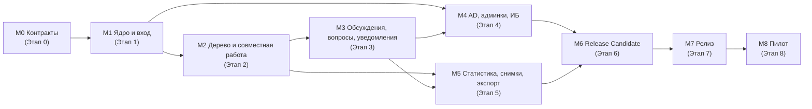

# PLAN.md — План реализации приложения совместной оценки проектов

| Параметр | Значение |
|---|---|
| Назначение | Рабочий план реализации MVP от пустого репозитория до приёмки релиза и пилота. По нему параллельно работают агенты разных треков |
| Источник правды | `docs/spec/SPEC.md` **v0.5** (04.11.2026), макеты `docs/spec/img/*.png` и `docs/spec/mockups-src/*.html`, журналы решений `docs/spec/review/DECISIONS.md`, `DECISIONS-v0.3.md`, `docs/plan/GAP-DECISIONS.md` |
| Правило приоритета | **При любом расхождении плана и SPEC прав SPEC.** Если макет расходится с текстом SPEC, прав текст (SPEC 11, «Как читать макеты»). Найденное расхождение исправляется в плане, а не «по месту» в коде |
| Стек (SPEC 13.1) | Python 3.12, FastAPI + Uvicorn, SQLAlchemy 2.0 async + Alembic, PostgreSQL 16, Redis 7, Celery 5 + Beat, ldap3, openpyxl / python-docx, argon2-cffi / pyotp / cryptography, ClamAV, structlog, Prometheus; TypeScript + React 18 + Vite, TanStack Table/Virtual/Query, Zustand, Mantine 7 + `mockups-src/app.css`, decimal.js; Nginx; Docker Compose; pytest / pytest-asyncio / Hypothesis / Playwright / Vitest / Locust |
| Статус плана | Всё не начато. Версия плана 1.3 от 04.11.2026 |
| Регламент работы агентов | `AGENTS.md` (роли и полномочия, разрешение коллизий, работа с репозиторием, ИБ, эскалация, журнал `agents/journal/`) |

## Содержание

1. [Как пользоваться планом](#1-как-пользоваться-планом)
2. [Сводка прогресса](#2-сводка-прогресса)
3. [Общий Definition of Done](#3-общий-definition-of-done)
4. [Треки и зоны ответственности](#4-треки-и-зоны-ответственности)
5. [Структура репозитория и владение файлами](#5-структура-репозитория-и-владение-файлами)
6. [Контракты между треками](#6-контракты-между-треками)
7. [Этапы и вехи](#7-этапы-и-вехи)
8. [Задачи по этапам](#8-задачи-по-этапам)
9. [Граф зависимостей, критический путь и волны параллельной работы](#9-граф-зависимостей-критический-путь-и-волны-параллельной-работы)
10. [Риски реализации и меры](#10-риски-реализации-и-меры)
11. [Открытые вопросы, пробелы спецификации и блокеры](#11-открытые-вопросы-пробелы-спецификации-и-блокеры)
12. [Вне объёма MVP](#12-вне-объёма-mvp)
13. [Матрица трассировки SPEC → задачи](#13-матрица-трассировки-spec--задачи)
14. [Журнал изменений контрактов и плана](#14-журнал-изменений-контрактов-и-плана)

---

## 1. Как пользоваться планом

### 1.1. Легенда статусов

| Отметка | Значение |
|---|---|
| `- [ ]` | Не начато |
| `- [ ] … · 🔧 в работе @<ТРЕК>/<агент> с ДД.ММ` | Взято в работу (пометка дописывается в конец строки задачи, чекбокс остаётся пустым) |
| `- [ ] … · ⛔ блок: <ID или GAP-NN>` | Заблокировано (указать, чем) |
| `- [x] … · ✔ <коммит/PR>` | Готово: критерий готовности выполнен, тесты зелёные, есть ссылка на коммит или merge request |

Подзадачи (вложенные чекбоксы) отмечаются по мере выполнения; родительская задача отмечается `[x]` только когда отмечены все её подзадачи и выполнен её критерий «Готово, когда».

### 1.2. Формат задачи

```text
- [ ] **TRK-NNN** · Название · трек TRK
  - SPEC: разделы, требования (FR-/BR-/SEC-/NFR-), решения (Q-/R-/C-)
  - Зависит: ID задач, которые должны быть готовы (— если нет)
  - Сделать: что конкретно
  - Артефакты: файлы и каталоги
  - Готово, когда: проверяемый критерий, какие тесты (TC-…, G-…) зелёные
  - [ ] подзадача
```

`G-NN` — номера Gherkin-сценариев SPEC 17.2 в порядке их следования (перечень — задача QA-002 и раздел 13.3). `CL-NN` — пункты чек-листа ИБ SPEC 17.3.

### 1.3. Правила работы агентов

1. **Одна задача — один владелец-трек.** Задачу берёт только агент её трека. Внутри трека несколько агентов могут работать одновременно, если их задачи не трогают одни и те же файлы (раздел 5).
2. **Брать можно только задачу, у которой все зависимости `[x]`.** Исключение — работа «на контракте»: фронтенд и потребители API могут начинать, когда готов соответствующий контракт (раздел 6), а не реализация; это уже учтено в полях «Зависит».
3. **Взять задачу** — дописать в конец её строки `· 🔧 в работе @ТРЕК/агент с ДД.ММ` отдельным коммитом в план (чтобы два агента не взяли одно и то же).
4. **Отметить выполнение** — только после выполнения критерия «Готово, когда», прохождения CI (линтеры, SAST, тесты, пороги покрытия) и ревью. В строку дописывается `· ✔ <хэш коммита или ссылка на MR>`, чекбокс меняется на `[x]`. Обновить таблицу раздела 2.
5. **Чужие файлы не правятся.** Если для задачи нужно изменение в зоне другого трека, создаётся запрос в раздел 14 (CR-NNN) и задача-исполнитель в треке-владельце, либо изменение согласуется ревью владельца (CODEOWNERS).
6. **Контракты меняются только через CR** (раздел 14) с ревью всех треков-потребителей. Ломающее изменение контракта после вехи M0 требует обновления моков (FE-001) в том же MR.
7. **Расхождение с SPEC** (ошибка, пробел, противоречие) не решается агентом самостоятельно: заводится запись в разделе 11.2 (GAP-NN), задача помечается `⛔`, решение принимает владелец продукта (задача PM-002).
8. **Нумерация требований SPEC в коде и тестах.** Тесты помечаются ID из SPEC (`@pytest.mark.tc("TC-CALC-01")`, `@spec("BR-BR-02")`), чтобы QA-027 строил трассировку автоматически.
9. Тесты пишет трек-владелец функциональности в рамках своей задачи (unit + интеграционные). Трек QA владеет сквозными наборами: матрица прав, Gherkin, E2E, нагрузка, ИБ-проверки.
10. Номера задач уникальны и не переиспользуются; удалённая задача помечается «исключено», а не стирается (как в SPEC).
11. **Общий регламент — `AGENTS.md`.** Правила этого раздела действуют вместе с ним; по вопросам процесса (ветки, коммиты, ревью, слияние, ИБ разработки, коллизии, эскалация, журналирование) при противоречии прав `AGENTS.md`. Термин MR в плане означает pull request на GitHub.

---

## 2. Сводка прогресса

Заполняется вручную при отметке задач (столбец «Готово»).

**По этапам**

| Этап | Веха | Задач | Подзадач | Готово задач | % |
|---|---|---|---|---|---|
| 0. Фундамент и контракты | M0 | 25 | 25 | 9 | 36% |
| 1. Ядро: данные, расчёт, безопасность, вход | M1 | 50 | 37 | 0 | 0% |
| 2. Проекты и дерево | M2 | 49 | 46 | 0 | 0% |
| 3. Обсуждения, вопросы, уведомления, документы | M3 | 24 | 20 | 0 | 0% |
| 4. AD, админки, контур ИБ | M4 | 40 | 35 | 0 | 0% |
| 5. Статистика, снимки, экспорт, портфель | M5 | 28 | 24 | 0 | 0% |
| 6. Укрепление, НФТ, эксплуатация | M6 | 30 | 10 | 0 | 0% |
| 7. Stage, ИБ-приёмка, UAT, релиз | M7 | 5 | 19 | 0 | 0% |
| 8. Пилот | M8 | 3 | 0 | 0 | 0% |
| **Итого** | | **254** | **216** | **9** | **3,5%** |

**По трекам**

| Трек | Задач | Готово | В работе | Заблокировано |
|---|---|---|---|---|
| INF | 17 | 8 | 0 | 0 |
| DB | 13 | 0 | 0 | 0 |
| CORE | 45 | 0 | 0 | 0 |
| AUTH | 19 | 0 | 0 | 0 |
| SEC | 17 | 0 | 0 | 0 |
| ADM | 13 | 0 | 0 | 0 |
| API | 7 | 0 | 0 | 0 |
| RT | 9 | 0 | 0 | 0 |
| NTF | 7 | 0 | 0 | 0 |
| EXP | 13 | 0 | 0 | 0 |
| FE | 52 | 0 | 0 | 0 |
| QA | 27 | 0 | 0 | 0 |
| DOC | 7 | 0 | 0 | 0 |
| PM | 8 | 1 | 0 | 0 |
| **Итого** | **254** | **9** | **0** | **0** |

---

## 3. Общий Definition of Done

Задача считается выполненной, когда выполнено всё применимое из списка (плюс её собственный критерий «Готово, когда»):

- [ ] Код соответствует SPEC v0.5; номера требований указаны в docstring/комментариях к ключевым функциям и в тестах.
- [ ] Unit- и интеграционные тесты написаны и зелёные; пороги покрытия NFR-MNT-01 не понижены (бэкенд ≥ 80% строк; расчётный модуль `domain/calc` и модуль прав `security/authz` — 100% ветвлений).
- [ ] CI зелёный: `ruff`, `bandit`, `semgrep` (вкл. запрет сырого SQL), `eslint` + security (вкл. запрет `dangerouslySetInnerHTML`), `pip-audit`, `npm audit --omit=dev`, `gitleaks`, `trivy` — без критичных и высоких находок (SEC-SDLC-01).
- [ ] Каждый новый эндпоинт объявляет право (SEC-AUTHZ-02) и проходит TC-SEC-01; денежные поля и заметки не утекают (TC-SEC-03, TC-SEC-07) — для эндпоинтов, где это применимо.
- [ ] Каждое изменяющее действие, перечисленное в SEC-AUD-01, пишет событие аудита из каталога `contracts/audit-events.yaml`.
- [ ] Миграции БД — через Alembic, с `downgrade`, по схеме expand → migrate → contract (NFR-MNT-02).
- [ ] Реализация совпадает с контрактом (`contracts/openapi.yaml`, `contracts/ws-events.schema.json`, `contracts/errors.yaml`); контрактный тест API-004 зелёный.
- [ ] Пользовательские тексты — в файлах i18n (FR-UI-01); числа и даты — в русском формате (FR-UI-02).
- [ ] В логах нет секретов (SEC-AUTH-04); ошибки 5xx имеют `error_id` (SEC-WEB-09).
- [ ] Новые переменные окружения добавлены в `.env.example` и README (NFR-MNT-03).
- [ ] Ревью выполнено владельцем зоны (CODEOWNERS); для задач SEC/AUTH — обязательное ревью трека SEC.
- [ ] В плане: чекбокс `[x]`, ссылка на коммит/MR, обновлена сводка раздела 2.

---

## 4. Треки и зоны ответственности

| Код | Трек | Зона ответственности | Публикует для других |
|---|---|---|---|
| **INF** | Инфраструктура / DevOps | Монорепозиторий, сборка, образы, Docker Compose, Nginx, CI, стенды dev/test/stage/prod, бэкапы, мониторинг, каркас CLI и Celery | `deploy/*`, `.github`/`.gitlab-ci.yml`, CLI-реестр `estimator`, Celery-приложение и реестр расписаний, `/metrics`, `/health/*` |
| **DB** | БД и модель данных | Схема PostgreSQL, миграции Alembic, ORM-модели, роли БД, партиционирование аудита, сиды справочников и демо-данных | `contracts/db/` (схема), `backend/src/estimator/db/models/*`, `seed-demo` |
| **CORE** | Бэкенд-ядро и расчётная модель | Чистый расчётный модуль (раздел 6), доменные сервисы: проекты, жизненный цикл, команда, дерево, ветки, ревью, корзина, деньги проекта, заметки, обсуждения, вопросы заказчику, статистика, снимки, портфель | `domain/calc` (API функций), эталонные фикстуры расчёта, доменные события |
| **AUTH** | Аутентификация | Провайдеры `local`/`ldap`, сессии, TOTP, step-up, блокировки, пароли, AD (JIT, группы, отзыв доступа, переключение режима), профиль пользователя | Зависимость FastAPI «текущий пользователь/сессия», интерфейс провайдера (ARCH-06) |
| **SEC** | ИБ и авторизация | Матрица прав как данные, движок авторизации, сериализация без денег, аудит (цепочка хэшей, SIEM, просмотр, purge), криптография и ключи, веб-защита (CSP, CSRF, заголовки, rate limit), оповещения ИБ, сетевые ограничения, ПДн/анонимизация | `contracts/permissions.yaml`, `contracts/audit-events.yaml`, `security/*` (декораторы прав, `audit.write()`, `crypto.*`) |
| **ADM** | Админки (бэкенд) | Мастер первичной настройки, системные настройки, «Состояние системы», администраторы/суперадминистраторы/аудиторы, пользователи, справочники, календарь, предложенные типы, реестр проектов, режим поддержки, замена участника | Эндпоинты `/system/*`, `/admin/*`; утилита рабочих дней |
| **API** | API-контракт и шлюз | Соглашения REST, словарь ошибок, OpenAPI-контракт, общие механизмы (Problem Details, пагинация, числа-строки), генерация TS-клиента, контрактные тесты | `contracts/openapi.yaml`, `contracts/errors.yaml`, `frontend/src/shared/api/generated` |
| **RT** | Realtime / WebSocket | Шина доменных событий, WS-эндпоинт, Redis pub/sub, фильтрация по правам, каналы `project:{id}`, `:money`, `:notes`, `user:{id}`, захват ячеек, присутствие, `change_log` и догрузка изменений, отзыв доступа и сессий | `contracts/ws-events.schema.json`, `realtime.publish()` и `realtime.locks.*` |
| **NTF** | Уведомления и почта | Уведомления в приложении, SMTP-клиент, шаблоны писем, пачки за 15 минут, ежедневная сводка, служебные письма, хранение уведомлений | `contracts/notifications.yaml`, `notify()` |
| **EXP** | Экспорт, отчёты и файлы | Excel/Word/CSV-выгрузки, фоновые экспорты, отметки «Коммерческая тайна», формульные инъекции, документы заказчика (карантин, ClamAV, шифрование, хранение) | `contracts/exports.yaml`, `exports.marks` |
| **FE** | Фронтенд | SPA: каркас, клиентский расчёт на decimal.js, все экраны раздела 11 и экраны «по аналогии», WS-клиент, доступность | `frontend/*` |
| **QA** | Тестирование | Тестовая инфраструктура, матрица прав TC-SEC-02/06, Gherkin 17.2, E2E Playwright, нагрузка Locust, DAST ZAP, чек-лист 17.3, трассировка 17.2а | `tests/security`, `tests/acceptance`, `e2e/`, `load/`, отчёты |
| **DOC** | Документация | README и переменные окружения, руководства (суперадминистратор, администратор, пользователь), инструкция службы эксплуатации, регламенты | `manuals/*`, `README.md`, `.env.example` (совместно с INF) |
| **PM** | Продукт и приёмка | Утверждение контрактов, решения по пробелам спецификации, UAT, приёмка релиза, пилот и его метрики, бэклог «после MVP» | Решения GAP-NN, протоколы приёмки, отчёт пилота |

> Внутри треков FE и CORE ожидается несколько агентов одновременно: задачи разнесены по разным каталогам (`features/<экран>` во фронтенде, `services/<домен>` в ядре).

---

## 5. Структура репозитория и владение файлами

Каталог `docs/` (спецификация) — только чтение для всех треков. Руководства пишутся в `manuals/`.

```text
/
├─ README.md                         DOC (+INF)
├─ AGENTS.md                         PM (только по поручению владельца)
├─ agents/journal/                   все треки: новые записи DEC/INC/ERR (AGENTS.md, раздел 8)
├─ .env.example                      INF (+DOC)
├─ CODEOWNERS                        INF
├─ .gitlab-ci.yml | .github/         INF
├─ contracts/                        «Контракты» (раздел 6), каждый файл — владелец в скобках
│  ├─ openapi.yaml                   (API)
│  ├─ errors.yaml                    (API)
│  ├─ ws-events.schema.json          (RT)
│  ├─ permissions.yaml               (SEC)
│  ├─ audit-events.yaml              (SEC)
│  ├─ notifications.yaml             (NTF)
│  ├─ exports.yaml                   (EXP)
│  ├─ settings.schema.json           (ADM, ключи system_settings)
│  ├─ db/schema.md, db/erd.mmd       (DB)
│  └─ fixtures/calc/*.json           (CORE, эталоны расчёта)
├─ backend/
│  ├─ pyproject.toml, uv.lock        INF
│  ├─ alembic/                       DB
│  └─ src/estimator/
│     ├─ main.py, config.py, logging.py          INF
│     ├─ cli/                        INF (каркас); команды — треки-владельцы (cli/<команда>.py)
│     ├─ jobs/celery_app.py, schedule.py         INF; задачи — в модулях треков (`*/tasks.py`)
│     ├─ db/ (base, session, uuid7), db/models/  DB
│     ├─ domain/calc/                CORE (чистые функции, без I/O)
│     ├─ services/{projects,team,tree,branches,review,trash,money,notes,
│     │            discussions,customer_questions,stats,snapshots,portfolio}/   CORE
│     ├─ auth/{providers/local.py,providers/ldap.py,sessions,totp,lockout,
│     │        passwords,ad_sync,switch_mode,profile}/                         AUTH
│     ├─ security/{authz,serialize,audit,siem,crypto,web,ratelimit,alerts,
│     │            networks,pd}/                                               SEC
│     ├─ admin/{setup,settings,health,admins,users,dictionaries,calendar,
│     │         proposed_types,registry,support,replace}/                      ADM
│     ├─ api/common/ (errors, pagination, types)  API
│     ├─ api/v1/<домен>.py           трек домена (по контракту API, ревью API)
│     ├─ realtime/{bus,ws,pubsub,locks,presence,changes,revoke}/              RT
│     ├─ notifications/{inapp,mail,templates,batches,digest}/                 NTF
│     └─ exports/{marks,engine,xlsx_hours,xlsx_money,cq,diff,stats,portfolio}/,
│        documents/                  EXP
│  └─ tests/{unit,integration}/<трек>/          трек-владелец
│     tests/{security,acceptance,contract}/     QA (contract — API)
├─ frontend/
│  ├─ package.json, package-lock.json, vite.config.ts                         INF
│  └─ src/
│     ├─ app/ (роутинг, провайдеры, layout)     FE
│     ├─ shared/{api,calc,ui,i18n,format,ws,store}/  FE (shared/api/generated — API)
│     └─ features/{auth,profile,home,project-create,settings,documents,trash,
│                  work,discussions,notes,stats,compare,snapshots,exports,
│                  portfolio,system,setup-wizard,audit,admin}/                 FE
├─ e2e/                              QA (Playwright)
├─ load/                             QA (Locust)
├─ deploy/{compose,nginx,backup,samba-ad,monitoring}/                         INF
└─ manuals/{superadmin,admin,user,operations,regulations}.md                  DOC
```

**Правила против конфликтов:** миграции Alembic создаёт только трек DB (линейная история); если доменному треку нужна новая колонка — CR в раздел 14 и задача DB. Роутеры `api/v1/<домен>.py` пишет трек домена строго по `contracts/openapi.yaml`. Общий файл регистрации роутеров (`api/v1/__init__.py`) — API; добавление строки регистрации допускается любым треком с ревью API.

---

## 6. Контракты между треками

Контракты фиксируются на Этапе 0 (веха **M0**). После M0 изменения — только через CR (раздел 14).

| Контракт | Файл | Владелец | Задача | Потребители | Что фиксирует |
|---|---|---|---|---|---|
| Схема БД | `contracts/db/schema.md`, `erd.mmd` | DB | DB-001 | все бэкенд-треки | Все таблицы 14.2, типы, enum-значения, индексы 14.3, правила UUID v7/TIMESTAMPTZ/аудиторских полей, решения «где живёт» (`app_params` → `system_settings` `method.*`; `totp_used_codes` → Redis) |
| Матрица прав | `contracts/permissions.yaml` | SEC | SEC-001 | CORE, ADM, AUTH, RT, EXP, QA, FE | Коды прав (`tree.read`, `tree.write.branch`, `money.read/write`, `notes.read/write`, `cq.manage`, …), правила по системным/проектным ролям, дисциплине ветки, статусу проекта (3.4), режиму поддержки, руководителю пресейла; каждая строка 3.3 и 3.4 — запись с ID для TC-SEC-02/06 |
| OpenAPI | `contracts/openapi.yaml` | API | API-002 | FE, QA, все бэкенд-треки | Все эндпоинты 15.2 (включая добавленные в SPEC v0.5 по GAP-02), схемы, `x-permission`, денежные поля — отдельными схемами, примеры 15.3 |
| Словарь ошибок | `contracts/errors.yaml` | API | API-001 | все | RFC 9457; коды `FIELD_CONFLICT`, `CELL_LOCKED`, `NODES_LIMIT`, `DEPTH_LIMIT`, `NODE_HAS_CHILDREN`, `VALUE_OUT_OF_RANGE`, `LAST_MODERATOR`, `LAST_SUPERADMIN`, `TOTP_REQUIRED`, а также коды для 401/403/404/409/422/423/429 остальных правил SPEC |
| WS-события | `contracts/ws-events.schema.json` | RT | RT-001 | FE, CORE, NTF, EXP, QA | Все события и команды 15.4, каналы, правила фильтрации полей, формат `project_version` |
| Каталог аудита | `contracts/audit-events.yaml` | SEC | SEC-002 | все бэкенд-треки | Типы событий SEC-AUD-01 и причины отказа входа (`ad_account_disabled`, `ad_not_in_group`, …), обязательные поля `details` без секретов и без денежных значений |
| Каталог уведомлений | `contracts/notifications.yaml` | NTF | NTF-001 | CORE, ADM, AUTH, FE | Виды уведомлений FR-NOTIF-01, получатели, правила по статусам проекта (3.4), виды писем FR-NOTIF-02, ограничения FR-NOTIF-03 |
| Каталог выгрузок | `contracts/exports.yaml` | EXP | EXP-001 | CORE, FE, QA | Виды выгрузок, состав листов, права, имена файлов FR-EXP-03, отметки FR-EXP-06 |
| Настройки системы | `contracts/settings.schema.json` | ADM | ADM-000 | AUTH, SEC, NTF, ADM, FE | Ключи `system_settings` (14.2): `auth.*`, `security.*`, `smtp.*`, `siem.*`, `app.*`, `retention.*`, `digest.time`, `method.*` и значения по умолчанию |
| Эталоны расчёта | `contracts/fixtures/calc/*.json` | CORE | CORE-001 | FE, EXP, QA | Дерево 5.1 и ставки 6.5, ожидаемые значения 6.5 (E/σ/P80/P90, УП, деньги по E/P80/P90, НДС, USD), граничные случаи округления |
| Моки для фронта | `frontend/src/shared/api/mocks` | FE | FE-001 | FE, QA | MSW-обработчики по OpenAPI, данные «Портала дилеров» для ролей эксперт/модератор/пресейл/руководитель пресейла/администратор/суперадминистратор/аудитор |


---

## 7. Этапы и вехи

Этапы — логические группы; реальную параллельность задают зависимости и волны (раздел 9). Этап 4 (AD и админки) может начинаться сразу после M1 и идёт параллельно Этапам 2–3.

| Этап | Название | Цель | Критерий выхода (веха) | Границы MVP (SPEC 1.4) |
|---|---|---|---|---|
| 0 | Фундамент и контракты | Репозиторий, CI, окружение dev, все контракты раздела 6 | **M0:** `docker compose up` поднимает пустые сервисы; CI зелёный на скелете; все контракты раздела 6 утверждены PM-001; моки FE-001 отдают «Портал дилеров» | — |
| 1 | Ядро: данные, расчёт, безопасность, вход | Полная схема БД, расчётный модуль сервера и клиента, движок прав, аудит, крипто, локальный вход с TOTP | **M1:** все таблицы 14.2 мигрируются вверх/вниз; TC-CALC-01..04 и TC-MONEY-01 зелёные на сервере и клиенте; локальный вход + TOTP + step-up работают end-to-end; `audit verify` проходит; TC-SEC-01, TC-SEC-08, TC-AUD-01 зелёные | аутентификация через приложение; журнал аудита |
| 2 | Проекты и дерево (вертикальный срез) | Создание проекта, команда, дисциплины, дерево с расчётом на лету, совместная работа в реальном времени | **M2:** модератор создаёт проект, назначает экспертов, двое экспертов параллельно правят дерево; правки доходят ≤ 1 с; TC-CONC-01..04, TC-TREE-01, TC-BR-01 зелёные; G-01, G-02, G-07, G-13, G-14, G-15, G-16, G-23, G-24 проходят | проекты, команда, ставки и валюта; рабочий экран с деревом, расчётами на лету, совместной работой |
| 3 | Обсуждения, вопросы заказчику, уведомления, документы | Коммуникация у строки, вопросы заказчику, заметки, уведомления и письма, документы заказчика | **M3:** TC-CQ-01, TC-NOTIF-01, TC-SEC-07, TC-SEC-10 зелёные; G-17, G-22 проходят | комментарии, обсуждения, вопросы заказчику; уведомления, письма пачкой за 15 минут, ежедневная сводка; документы заказчика |
| 4 | AD, админки, контур ИБ | Режим AD, мастер установки, админки суперадминистратора и администратора, справочники, оповещения ИБ, SIEM | **M4:** TC-AUTH-01..08, TC-ADM-01, TC-ADM-02 зелёные на Samba AD; G-04..G-06, G-08..G-12, G-20, G-26 проходят | аутентификация через AD; админка суперадминистратора и администратора; передача аудита в SIEM |
| 5 | Статистика, снимки, экспорт, портфель | Все вкладки статистики, снимки и сравнение, все выгрузки, портфель руководителя пресейла | **M5:** TC-SNAP-01, TC-PORT-01, TC-SEC-04, TC-SEC-05, TC-SEC-09, TC-MONEY-01 (экспорт) зелёные; G-03, G-18, G-19, G-21, G-25 проходят | статистика, снимки и сравнение; экспорт Excel (оценка) и Excel/Word (вопросы) |
| 6 | Укрепление: полнота прав, НФТ, эксплуатация | Полный перебор прав, НФТ 16, эксплуатационная готовность, документация | **M6 (Release Candidate):** все автотесты 17.1 зелёные; NFR-PERF-01..06 подтверждены; бэкап и восстановление проверены; ZAP без критичных/высоких; руководства готовы | все пункты 1.4 |
| 7 | Stage, ИБ-приёмка, UAT, релиз | Приёмка релиза по Q-52 | **M7 (Релиз):** чек-лист 17.3 пройден службой ИБ; UAT 2 недели на stage; 0 открытых критичных дефектов; приёмка подписана владельцем продукта и ИБ; prod развёрнут | — |
| 8 | Пилот | Проверка измеримых целей 1.3 на 10 пилотных проектах | **M8:** собраны метрики 1.3: средняя оценка опроса ≥ 4; 0 жалоб «занято»; ≥ 90% правок модератора увидены экспертом; первый лист эксперта ≤ 10 минут без обучения; справочно — медиана «создание проекта → первый снимок» | — |

---

## 8. Задачи по этапам

### Этап 0. Фундамент и контракты

**Цель:** все треки могут работать параллельно: есть каркас, CI, окружение и зафиксированные контракты. **Выход:** веха M0 (раздел 7).

#### INF — каркас

- [x] **INF-001** · Каркас монорепозитория · трек INF · ✔ #8
  - SPEC: 13.1, 13.2, 16.4
  - Зависит: —
  - Сделать: создать структуру каталогов раздела 5, `CODEOWNERS` по трекам, `.editorconfig`, `.gitignore`, шаблон MR с чек-листом DoD (раздел 3), каталог `contracts/` с README о порядке изменений (CR).
  - Артефакты: корень репозитория, `CODEOWNERS`, `contracts/README.md`, `.gitlab/merge_request_templates/default.md`
  - Готово, когда: структура совпадает с разделом 5; CODEOWNERS назначает ревьюера по каждому каталогу; шаблон MR содержит DoD.

- [x] **INF-002** · Каркас бэкенда (Python 3.12, FastAPI) · трек INF · ✔ #8
  - SPEC: 13.1, NFR-MNT-03, NFR-MNT-04, NFR-MNT-05, SEC-SDLC-03
  - Зависит: INF-001
  - Сделать: `pyproject.toml` + `uv.lock` с хэшами; зависимости стека 13.1 с закреплёнными версиями; фабрика приложения FastAPI; конфигурация через переменные окружения (pydantic-settings); `structlog` JSON-логи с полями `time, level, request_id, user_id, project_id, event`; middleware `request_id`; `/health/live`, `/health/ready` (проверка БД и Redis); запуск Uvicorn.
  - Артефакты: `backend/pyproject.toml`, `backend/uv.lock`, `backend/src/estimator/{main,config,logging}.py`
  - Готово, когда: `uv sync --frozen` воспроизводим; `pytest` запускается; `/health/live` = 200, `/health/ready` отражает доступность БД и Redis; логи — одна JSON-строка на событие.
  - [x] Зависимости с хэшами (SEC-SDLC-03)
  - [x] Конфиг 12-factor, список переменных выгружается командой для README
  - [x] structlog + request_id

- [x] **INF-003** · Каркас фронтенда (React 18, Vite, TypeScript) · трек INF · ✔ #8
  - SPEC: 13.1, FR-UI-01, SEC-WEB-02, SEC-WEB-03, SEC-SDLC-03
  - Зависит: INF-001
  - Сделать: Vite + React 18 + TS strict; зависимости Mantine 7, TanStack Table/Virtual/Query, Zustand, decimal.js, i18n-библиотека; `package-lock.json`; ESLint с `eslint-plugin-security` и правилом, запрещающим `dangerouslySetInnerHTML`; Vitest; сборка без inline-скриптов и без внешних CDN; подключение `docs/spec/mockups-src/app.css` копией в `frontend/src/shared/ui/app.css` (исходник в docs не изменять).
  - Артефакты: `frontend/package.json`, `frontend/package-lock.json`, `frontend/vite.config.ts`, `frontend/.eslintrc.*`
  - Готово, когда: `npm ci && npm run build && npm test` проходят; в собранном `index.html` нет inline-скриптов; линтер падает на `dangerouslySetInnerHTML`.

- [x] **INF-004** · Docker Compose для dev и test · трек INF · ✔ #8
  - SPEC: 13.2, 18.1, 18.2, 17.1 (Samba AD), Q-47, Q-50
  - Зависит: INF-002, INF-003
  - Сделать: `docker-compose.yml` с сервисами `nginx`, `api` (2 реплики), `worker`, `beat`, `redis`, `clamav`, `postgres:16`; профиль `test` с Samba AD DC (тестовые OU, вложенные группы, отключённые учётки), SMTP-ловушкой и syslog-приёмником по TCP+TLS — эмулятором SIEM для SEC-012 (PLAN-1.4); самоподписанный TLS для dev (нужен для `__Host-`-cookie); тома для файлов экспорта и документов.
  - Артефакты: `deploy/compose/docker-compose.yml`, `deploy/compose/docker-compose.test.yml`, `deploy/samba-ad/`, `deploy/syslog/`
  - Готово, когда: `docker compose up` поднимает все сервисы, health зелёный; профиль test поднимает Samba AD с тестовыми данными, SMTP-ловушку и syslog-приёмник TLS.

- [x] **INF-005** · CI-пайплайн с проверками безопасности · трек INF · ✔ #8
  - SPEC: SEC-SDLC-01, SEC-SDLC-03, NFR-MNT-01, SEC-WEB-05
  - Зависит: INF-002, INF-003
  - Сделать: стадии lint (`ruff`, `eslint`), SAST (`bandit`, `semgrep` с правилом запрета SQL-строк с подстановкой значений), зависимости (`pip-audit`, `npm audit --omit=dev`; критичные и высокие блокируют), `gitleaks`, `trivy` по образам, тесты (`pytest` с покрытием, `vitest`), пороги покрытия (бэкенд ≥ 80%, `domain/calc` и `security/authz` — 100% ветвлений), контрактный тест (подключается в API-004).
  - Артефакты: `.gitlab-ci.yml` (или `.github/workflows/*`), `backend/.semgrep.yml`
  - Готово, когда: MR с искусственной уязвимостью/секретом/сырым SQL блокируется; пороги покрытия применяются.

- [x] **INF-006** · Защищённые образы контейнеров · трек INF · ✔ #8
  - SPEC: SEC-SDLC-04, SEC-CRYPT-01
  - Зависит: INF-002, INF-003
  - Сделать: `python:3.12-slim` для api/worker/beat, `nginx:alpine` для фронта; процесс не от root; read-only FS кроме `/tmp`; `no-new-privileges`; секреты только через env / Docker secrets.
  - Артефакты: `deploy/docker/api.Dockerfile`, `deploy/docker/nginx.Dockerfile`
  - Готово, когда: `trivy` без критичных/высоких; контейнеры стартуют с read-only FS; в образах нет секретов (gitleaks/trivy secret scan).

- [x] **INF-007** · Каркас CLI `estimator` · трек INF · ✔ #8
  - SPEC: 18.2, FR-SA-01, SEC-AUD-01 («запуск любой консольной команды … с именем пользователя ОС»), 17.4
  - Зависит: INF-002
  - Сделать: точка входа `estimator` (Typer/Click) с реестром подкоманд, которые регистрируют треки; общий хук «до/после команды» для записи аудита (реализацию записи подключает SEC-004); флаг окружения `APP_ENV` и общий запрет запуска команд «только для стендов» на prod; команда `estimator migrate` (обёртка `alembic upgrade head`).
  - Артефакты: `backend/src/estimator/cli/__init__.py`, `cli/migrate.py`
  - Готово, когда: `estimator --help` показывает зарегистрированные команды; хук вызывается для каждой команды; команда с меткой «только стенд» отказывается работать при `APP_ENV=prod`.

- [x] **INF-008** · Каркас Celery и Celery Beat · трек INF · ✔ #8
  - SPEC: 13.1, 13.2, FR-UI-02 (ночные задачи по поясу приложения)
  - Зависит: INF-002, INF-004
  - Сделать: Celery-приложение с брокером Redis, реестр периодических задач (треки добавляют свои), расписания в часовом поясе приложения (`app.timezone`), защита от двойного запуска beat, метрика длины очереди.
  - Артефакты: `backend/src/estimator/jobs/{celery_app,schedule}.py`
  - Готово, когда: тестовая задача выполняется worker'ом; периодическая задача запускается по расписанию в заданном поясе; длина очереди видна в метриках.

#### Контракты

- [ ] **DB-001** · Контракт схемы БД и соглашения · трек DB · 🔧 в работе @DB/claude-11oprt с 05.11
  - SPEC: 14.1, 14.2, 14.3, ARCH-03, ARCH-04, SEC-AUTHZ-03 (UUID v7)
  - Зависит: INF-001
  - Сделать: описать все таблицы 14.2 с типами, enum, CHECK, индексами 14.3; общие правила (UUID v7 генерируется приложением, `TIMESTAMPTZ` в UTC, `created_at/by`, `updated_at/by`, логическое удаление); зафиксировать решения, которые SPEC оставляет на выбор: `app_params` → ключи `method.*` в `system_settings`; `totp_used_codes` → Redis с TTL; `NULLS NOT DISTINCT` для `project_rates`, `project_members`.
  - Артефакты: `contracts/db/schema.md`, `contracts/db/erd.mmd`
  - Готово, когда: документ покрывает все 42 таблицы 14.2 (users … audit_log); утверждён треками CORE, AUTH, SEC, ADM, RT, NTF, EXP.

- [ ] **SEC-001** · Матрица прав как данные · трек SEC
  - SPEC: 3.1–3.4, BR-ROLE-01..08, SEC-AUTHZ-01..06, FR-2FA-05, FR-ADM-06, FR-PORT-01, R-02, R-05, R-06, C-05, Q-25
  - Зависит: INF-001
  - Сделать: `permissions.yaml`: (1) каталог прав (`project.read`, `tree.read`, `tree.write.any`, `tree.write.own_discipline`, `branch.status.draft_done`, `branch.status.not_needed`, `review.mark`, `money.read`, `money.write`, `notes.read`, `notes.write`, `cq.manage`, `cq.answer`, `docs.write`, `docs.read`, `snapshot.create`, `export.hours`, `export.money`, `stats.read`, `team.write`, `project.status`, `outcome.write`, `support.open`, `audit.read.all`, `audit.read.admin_categories`, …); (2) по одной записи на каждую строку матрицы 3.3 (ID `M3.3-NN`) с ожиданием для 8 ролей; (3) по одной записи на каждую строку 3.4 (ID `M3.4-NN`) × 5 статусов; (4) правила суммирования ролей BR-ROLE-01 (кроме денег), совместимости BR-ROLE-02, TOTP-гейт для `money.*`/`notes.*`.
  - Артефакты: `contracts/permissions.yaml`, `contracts/permissions.md` (пояснения)
  - Готово, когда: все 44 строки 3.3 и 16 строк 3.4 представлены; таблица SEC-AUTHZ-05 выражается через записи файла; ревью CORE, ADM, QA пройдено.
  - [ ] Каталог прав
  - [ ] Записи `M3.3-01…44`
  - [ ] Записи `M3.4-01…16` × 5 статусов
  - [ ] Правила суммирования ролей, совместимости и TOTP-гейта

- [ ] **SEC-002** · Каталог событий аудита · трек SEC
  - SPEC: SEC-AUD-01, SEC-AUD-02, уточнение к SEC-AUD-01 (факт без значений), 17.2 (`login.failed` с причинами `ad_account_disabled`, `ad_not_in_group`)
  - Зависит: INF-001
  - Сделать: перечень типов событий по категориям (аутентификация, пользователи и роли, система, справочники, проекты, безопасность, аудит), причины отказа входа (нет пользователя, неверный пароль, заблокирован, не в группе AD, неверный TOTP, пустой пароль, отключён в AD), схема `details` для каждого типа (без секретов и денежных значений), признак «отправлять оповещение ИБ» (SEC-AUTH-07).
  - Артефакты: `contracts/audit-events.yaml`
  - Готово, когда: каждое событие из таблицы SEC-AUD-01 имеет тип; ревью AUTH, ADM, CORE, EXP пройдено.

- [ ] **API-001** · Соглашения API и словарь ошибок · трек API · 🔧 в работе @API/claude-11oprt с 05.11
  - SPEC: 15.1, 15.3, SEC-WEB-09, SEC-AUTHZ-03 (404 вместо 403)
  - Зависит: INF-001
  - Сделать: соглашения: `/api/v1`, JSON UTF-8, числа O/R/P и деньги — строками, курсорная пагинация (`cursor`, `limit ≤ 200`), RFC 9457 c `code` и `error_id`; словарь стабильных кодов (раздел 6) с HTTP-статусом, условиями и текстом для пользователя (тексты отказов входа FR-AUTH-AD-13, FR-LOCK-05 — дословно из SPEC).
  - Артефакты: `contracts/errors.yaml`, `contracts/api-conventions.md`
  - Готово, когда: все коды, упомянутые в SPEC (15.3, BR-ROLE-03/07, BR-TREE-06, FR-2FA-05, FR-TREE-31/32, FR-PORT-03, POST `/remind` 429), присутствуют; ревью FE и QA пройдено.

- [ ] **ADM-000** · Контракт ключей системных настроек · трек ADM
  - SPEC: 14.2 `system_settings`, 7.1, FR-SESS-02, FR-AUTH-LOC-02, FR-LOCK-01..04, FR-2FA-02, FR-SA-06, NFR-REL-06, FR-NOTIF-02, 7.5 «Пороги и проценты»
  - Зависит: INF-001
  - Сделать: JSON Schema всех ключей `auth.mode`, `auth.ad.*`, `security.password_policy`, `security.session`, `security.lockout`, `security.mfa_policy`, `security.admin_networks`, `security.alert_email`, `smtp.*`, `siem.*`, `app.base_url`, `app.timezone`, `retention.*`, `digest.time`, `method.*` (пороги 80/40 ч, ожидаемое число единиц «Средне», % УП 18, автоархивация 180) со значениями по умолчанию из SPEC и признаком «секрет — хранится зашифрованным».
  - Артефакты: `contracts/settings.schema.json`
  - Готово, когда: каждое значение по умолчанию из SPEC указано и сослано на требование; ревью AUTH, SEC, NTF пройдено.

- [ ] **API-002** · OpenAPI-контракт v1 · трек API · 🔧 в работе @API/claude-11oprt с 05.11
  - SPEC: 15.2, 15.3, SEC-AUTHZ-02, SEC-AUTHZ-04, FR-2FA-05, 11.x
  - Зависит: API-001, SEC-001, ADM-000
  - Сделать: описать все эндпоинты 15.2 (вход и профиль, система, администратор, руководитель пресейла, проекты, дерево, обсуждения, вопросы заказчику, статистика, снимки, экспорт, уведомления); для каждого — `x-permission` из SEC-001, схемы запросов/ответов, коды ошибок; денежные поля — в отдельных схемах (`*Money`), которые присутствуют только при праве; пример PATCH узла 15.3; эндпоинты, добавленные в 15.2 в SPEC v0.5 по GAP-02 (журнал проекта, восстановление документа из корзины, выгрузки вкладок статистики и «Допущений», автодополнение адресатов), — с пометкой `x-spec-gap: GAP-02`.
  - Артефакты: `contracts/openapi.yaml`
  - Готово, когда: каждая строка таблицы 15.2 имеет операцию; `spectral lint` без ошибок; ревью FE, CORE, ADM, AUTH, QA пройдено.
  - [ ] Вход, профиль, система
  - [ ] Администратор, руководитель пресейла
  - [ ] Проекты, команда, деньги, документы, заметки
  - [ ] Дерево, корзина, история, ветки
  - [ ] Обсуждения, вопросы заказчику
  - [ ] Статистика, снимки, экспорт, уведомления, WS

- [ ] **RT-001** · Контракт WebSocket-событий · трек RT
  - SPEC: 15.4, 13.3, ARCH-01, ARCH-02, SEC-AUTHZ-04, FR-TREE-31, FR-SESS-02
  - Зависит: API-001
  - Сделать: JSON Schema для команд `subscribe`, `unsubscribe`, `lock {node_id, field, force?}`, `unlock`, `heartbeat` и всех событий: `node.created/updated/moved/deleted/restored`, `branch.status`, `cell.locked/unlocked`, `message.created/updated`, `thread.created/resolved/reopened`, `customer_question.updated`, `document.scanned`, `notification.created`, `member.updated`, `presence`, `project.updated`, `money.updated`, `note.created/updated`, `access.revoked`, `session.ended`, `resync.required`; каналы `project:{id}`, `project:{id}:money`, `project:{id}:notes`, `user:{id}`; правило «денежных ключей нет в событиях общего канала».
  - Артефакты: `contracts/ws-events.schema.json`, `contracts/ws-events.md`
  - Готово, когда: все события и команды 15.4 описаны; ревью FE, CORE, NTF пройдено.

- [ ] **CORE-001** · Эталонные фикстуры расчёта · трек CORE · 🔧 в работе @CORE/claude-11oprt с 05.11
  - SPEC: 5.1, 6.1–6.6, BR-CALC-03, BR-MONEY-04, TC-CALC-01, TC-CALC-04, TC-MONEY-01
  - Зависит: INF-001
  - Сделать: JSON-фикстура «Портал дилеров»: дерево 5.1, k = 18%, база УП, ставки 6.5, USD 92,5, НДС 20%; ожидаемые значения листьев, дисциплин, работ, УП, итога (E, σ, P80, P90), стоимости по E, строк «Для КП» по E/P80/P90 (K_P80 = 1,046823, K_P90 = 1,071303), НДС, итогов в ₽ и USD (в т. ч. 12 397 USD по E, а не 12 398); отдельные фикстуры: ROUND_HALF_UP (0,05 → 0,1; 3,45 → 3,5), E = 0, пустые/неверные листья, ×N, база УП без часов, «не заданы ставки», переполнение `NUMERIC(20,0)`, свёртка 8–12–20 ×1 + 4–6–8 ×2 → 16–24–36.
  - Артефакты: `contracts/fixtures/calc/portal-dilerov.json`, `contracts/fixtures/calc/edge-cases.json`
  - Готово, когда: все числа 6.5 (обе таблицы и абзацы про P90 и σ) внесены; формат читается и сервером, и клиентом.

- [ ] **NTF-001** · Каталог уведомлений и писем · трек NTF
  - SPEC: FR-NOTIF-01..03, 3.4 (строки «Уведомления…»), BR-PRJ-01, BR-BR-02, FR-ADM-05, FR-ADM-06, FR-PORT-03, BR-PRJ-07, SEC-AUTH-06, SEC-AUTH-07, Q-12, Q-37, Q-45
  - Зависит: INF-001
  - Сделать: перечень видов in-app уведомлений (вопрос мне, ответ на мой вопрос, изменение модератора, ветка вернулась в черновик, назначение, замена участника/переадресация, участник заблокирован, руководитель пресейла вошёл модератором, режим поддержки, проект без модератора, перехват ячейки) — получатели, класс (оценочное/служебное/ИБ), разрешённые статусы проекта по 3.4; виды писем (сводка, пачка вопросов, служебные, оповещения ИБ, «Напомнить не начавшим»); поля `payload` (без денег, без текста сообщений и названий узлов для писем).
  - Артефакты: `contracts/notifications.yaml`
  - Готово, когда: каждый пункт FR-NOTIF-01/02 и каждая строка 3.4 про уведомления отражены; ревью CORE, ADM, FE пройдено.

- [ ] **EXP-001** · Каталог выгрузок · трек EXP
  - SPEC: 10.3, FR-CQ-02, FR-CQ-04, FR-SNAP-05, FR-PORT-02, 11.9, 11.10 №4, SEC-AUD-06, FR-EXP-06
  - Зависит: INF-001
  - Сделать: виды выгрузок: `hours_xlsx`, `money_xlsx`, `cq_xlsx`, `cq_docx`, `snapshot_diff_xlsx`, `stats_tab_xlsx`, `assumptions_docx`, `portfolio_xlsx`, `audit_csv`; для каждого — право, источник (текущее/снимок), листы и колонки, имя файла `<Название>_<снимок|дата>_<часы|деньги>.xlsx`, отметки «Коммерческая тайна», ФИО, дата.
  - Артефакты: `contracts/exports.yaml`
  - Готово, когда: состав листов FR-EXP-01/02 описан колонка в колонку; ревью CORE, FE, QA пройдено.

- [ ] **API-006** · Генерация TS-клиента и типов из OpenAPI · трек API · 🔧 в работе @API/claude-11oprt с 05.11
  - SPEC: 15.1, 13.1
  - Зависит: API-002, INF-003
  - Сделать: генерация типов и клиента (openapi-typescript или аналог) в `frontend/src/shared/api/generated`; числа-строки как branded-тип `DecimalString`; скрипт `npm run api:gen`; проверка в CI, что сгенерированный код актуален.
  - Артефакты: `frontend/src/shared/api/generated/*`, `frontend/scripts/api-gen.*`
  - Готово, когда: клиент собирается; CI падает при расхождении контракта и сгенерированного кода.

- [ ] **FE-001** · Моки API для фронтенда · трек FE
  - SPEC: 5.1, 6.5, 11 (все макеты на данных «Портала дилеров»), 17.4
  - Зависит: API-006, CORE-001, RT-001
  - Сделать: MSW-обработчики всех операций OpenAPI; данные «Портала дилеров» и «Интеграции с ФНС» (11.3); переключатель роли (эксперт Бэкенда И. Иванов, модератор А. Смирнова, пресейл П. Сидоров, руководитель пресейла, администратор, суперадминистратор, аудитор); имитатор WS-событий по контракту RT-001; для эксперта денежные ключи отсутствуют.
  - Артефакты: `frontend/src/shared/api/mocks/*`
  - Готово, когда: `npm run dev:mock` поднимает приложение без бэкенда; ответы проходят валидацию по OpenAPI.

#### QA, DOC, PM

- [ ] **QA-001** · Тестовая инфраструктура и трассировка · трек QA
  - SPEC: 13.1 (pytest, pytest-asyncio, Hypothesis, Playwright, Vitest), 17.1, 17.2а, NFR-MNT-01
  - Зависит: INF-002, INF-005
  - Сделать: конфигурация pytest (маркеры `tc("TC-…")`, `spec("…")`, `gherkin("G-NN")`), фабрики тестовых данных, изоляция БД (транзакция на тест / отдельная БД), фикстуры двух API-процессов и WS-клиентов; генератор отчёта «требование → тест» по маркерам.
  - Артефакты: `backend/tests/conftest.py`, `backend/tests/factories/`, `tools/traceability.py`
  - Готово, когда: пример теста с маркером попадает в отчёт трассировки; тесты запускаются в CI параллельно.

- [ ] **QA-002** · Реестр приёмочных сценариев G-01…G-26 · трек QA
  - SPEC: 17.2, 17.2а
  - Зависит: QA-001
  - Сделать: перенести 26 Gherkin-сценариев 17.2 в `.feature`-файлы (pytest-bdd для API-уровня, Playwright для UI) с ID G-01…G-26 в порядке SPEC (перечень — раздел 13.3 плана); шаги-заглушки помечены `pending`.
  - Артефакты: `backend/tests/acceptance/features/*.feature`, `e2e/features/*.feature`
  - Готово, когда: все 26 сценариев присутствуют дословно; прогон показывает 26 pending.

- [ ] **DOC-001** · README и описание переменных окружения · трек DOC
  - SPEC: NFR-MNT-03, 18.2
  - Зависит: INF-002, INF-004
  - Сделать: README: назначение, как поднять dev, как запускать тесты, ссылка на SPEC и PLAN, таблица переменных окружения (генерируется из конфига INF-002) с описанием и значениями по умолчанию; `.env.example`.
  - Артефакты: `README.md`, `.env.example`
  - Готово, когда: новый разработчик поднимает dev по README; таблица переменных совпадает с конфигом (проверка в CI).

- [ ] **PM-001** · Утверждение контрактов (веха M0) · трек PM
  - SPEC: 19, 20
  - Зависит: DB-001, SEC-001, SEC-002, API-001, API-002, ADM-000, RT-001, CORE-001, NTF-001, EXP-001
  - Сделать: ревью контрактов с владельцами треков; протокол утверждения; заморозка версий контрактов `v1.0`.
  - Артефакты: раздел 14 плана (запись «M0»), теги версий контрактов
  - Готово, когда: все контракты раздела 6 утверждены и помечены версией.

- [x] **PM-002** · Решения по пробелам спецификации (GAP-реестр) · трек PM
  - SPEC: 19 (открытых вопросов нет), раздел 11.2 плана
  - Зависит: —
  - Сделать: вынести владельцу продукта пробелы GAP-01…GAP-12 (раздел 11.2); получить решение по каждому; внести решения в план и при необходимости — CR к контрактам. Задача остаётся открытой, пока появляются новые GAP.
  - Артефакты: раздел 11.2 плана (колонка «Решение»)
  - Готово, когда: по всем GAP есть решение владельца продукта; блоки `⛔ GAP-NN` в задачах сняты.
  - [x] GAP-01 Динамика итога — источник данных
  - [x] GAP-02 Эндпоинты, которых нет в 15.2
  - [x] GAP-03 Формат CSV производственного календаря
  - [x] GAP-04 Определения метрик пилота 1.3
  - [x] GAP-05 Где показывается медиана «создание проекта → первый снимок»
  - [x] GAP-06 Кто восстанавливает документы из корзины
  - [x] GAP-07 Набор иконок для локальных типов
  - [x] GAP-08 Отметка «просрочено» в статистике
  - [x] GAP-09 Параметры TLS для SIEM
  - [x] GAP-10 Момент предупреждения при правке «готовой» ветки в «Сведении»
  - [x] GAP-11 Ссылка на несуществующий раздел 8.6
  - [x] GAP-12 Регламент согласования `project purge`

### Этап 1. Ядро: данные, расчёт, безопасность, вход

**Цель:** полная схема БД, расчётный модуль (сервер и клиент), движок прав, аудит, криптография, локальный вход с TOTP. **Выход:** веха M1.

#### DB — схема и миграции

- [ ] **DB-002** · Alembic, роли БД и базовые расширения · трек DB
  - SPEC: NFR-MNT-02, SEC-AUD-03, SEC-AUD-04, SEC-CRYPT-05
  - Зависит: DB-001, INF-004
  - Сделать: Alembic (async), шаблон миграции с обязательным `downgrade`; расширения `citext`; роли БД: `estimator_app` (рабочая), `estimator_migrator`, `estimator_audit_purge`; схема `audit`; генератор UUID v7 в приложении; правила expand → migrate → contract в README миграций.
  - Артефакты: `backend/alembic/`, `backend/src/estimator/db/{base,uuid7}.py`
  - Готово, когда: `estimator migrate` и `alembic downgrade base` проходят на чистой БД; роль приложения не владеет схемой `audit`.

- [ ] **DB-011** · Асинхронная сессия SQLAlchemy и unit of work · трек DB
  - SPEC: 13.1, NFR-REL-04, SEC-WEB-05
  - Зависит: DB-002
  - Сделать: фабрика `AsyncSession`, транзакция на запрос (commit до ответа клиенту), хук after-commit (для шины событий RT-002), TLS-подключение `sslmode=verify-full` по конфигурации.
  - Артефакты: `backend/src/estimator/db/session.py`
  - Готово, когда: тест «ответ клиенту отправляется только после commit» зелёный; after-commit хук вызывается только при успешном commit.

- [ ] **DB-003** · Таблицы пользователей, сессий и настроек · трек DB
  - SPEC: 14.2 `users`, `user_roles`, `password_history`, `backup_codes`, `totp_used_codes`, `known_devices`, `sessions`, `system_settings`; FR-AUTH-AD-06, FR-AUTH-AD-12
  - Зависит: DB-002, DB-011
  - Сделать: миграция и ORM-модели: `users` (CITEXT `login` UNIQUE, частичный уникальный индекс `email`, `status`, `block_reason`, `source`, `ad_object_guid` UNIQUE, `timezone`, `notify_digest`, `notify_questions`); `user_roles` (enum 6 ролей, `source`; CHECK `ad_group` только для moderator/presale); `password_history`; `backup_codes`; `known_devices`; `sessions` (`id_hash`, `mfa_passed`, `step_up_until`, `revoked_at`); `system_settings` (JSONB, шифрованные значения).
  - Артефакты: `alembic/versions/*_users.py`, `db/models/users.py`, `db/models/settings.py`
  - Готово, когда: миграция вверх/вниз; ограничения проверены тестами (дубль логина в другом регистре отклоняется; `ad_group` для `admin` отклоняется).

- [ ] **DB-004** · Таблицы справочников · трек DB
  - SPEC: 14.2 `phases`, `disciplines`, `node_types`, `discipline_profiles`, `comment_tags`, `control_ratios`, `app_params`, `work_calendar`, `loss_reasons`, `vat_rates`, `currencies`; 7.5
  - Зависит: DB-002, DB-011
  - Сделать: миграции и модели; частичные уникальные индексы: ровно одна `phases.is_cross_cutting = true`, ровно одна `vat_rates.is_default = true`; `node_types.norms` JSONB, `project_id NULL` (локальный тип), `proposal_status`; `discipline_profiles.type_chain UUID[]`; `currencies.code CHAR(3) PK`.
  - Артефакты: `alembic/versions/*_dictionaries.py`, `db/models/dictionaries.py`
  - Готово, когда: вторая сквозная фаза и вторая ставка НДС «по умолчанию» отклоняются БД.

- [ ] **DB-005** · Таблицы проектов, денег и команды · трек DB
  - SPEC: 14.2 `projects`, `project_money`, `project_totals`, `project_rates`, `project_members`, `project_phases`, `project_disciplines`, `branch_status`, `support_sessions`; SEC-AUTHZ-04, BR-CALC-03
  - Зависит: DB-003, DB-004
  - Сделать: `projects` (все поля 14.2: `status`, `outcome`, `quote_figure`, `duration_weeks`, `no_moderator_since`, `detail_level`, `pm_percent NUMERIC(5,2)`, `version BIGINT`, `completed_at`, `archived_at`, `cancel_reason`, `next_question_no`); `project_money` и `project_rates` — отдельные таблицы (`rate_rub NUMERIC(12,0)`, `exchange_rate NUMERIC(12,4)`, `contract_amount NUMERIC(20,0)`; уникальность `NULLS NOT DISTINCT`); `project_totals` (`NUMERIC(14,2)` часы, `NUMERIC(20,0)` деньги); `project_members` (`NULLS NOT DISTINCT`, `added_by_admin_self`); `project_phases.in_pm_base`; `project_disciplines.profile_id`; `branch_status` PK из трёх полей; `support_sessions`.
  - Артефакты: `alembic/versions/*_projects.py`, `db/models/projects.py`, `db/models/money.py`
  - Готово, когда: две ставки УП (`discipline_id = NULL`) одного проекта отклоняются; денежные модели вынесены в отдельный модуль, импорт которого разрешён только сервису денег (правило линтера import-linter).
  - [ ] `projects` и `project_phases`, `project_disciplines`
  - [ ] `project_money`, `project_rates` (отдельный модуль, import-linter)
  - [ ] `project_members` и `branch_status`
  - [ ] `project_totals`, `support_sessions`

- [ ] **DB-006** · Таблицы дерева, истории и версий · трек DB
  - SPEC: 14.2 `nodes`, `node_history`, `change_log`, `user_view_state`; 14.3; ARCH-02, ARCH-04, BR-CALC-03, NFR-LIM-01
  - Зависит: DB-005
  - Сделать: `nodes` (`kind`, денормализованные `phase_id`/`discipline_id`, `position TEXT COLLATE "C"`, `o/r/p NUMERIC(10,2)` CHECK 0–99 999,5, `multiplier` CHECK 1–10 000, `comment_lines JSONB`, `reviewed_by/at`, `self_review`, `version`, `field_versions JSONB`, `deleted_at`, `deleted_batch_id`, CHECK `kind <> 'item' OR (phase_id … AND discipline_id …)`); `node_history` (только INSERT для роли приложения); `change_log` PK (`project_id`, `version`); `user_view_state`; индексы 14.3.
  - Артефакты: `alembic/versions/*_tree.py`, `db/models/tree.py`
  - Готово, когда: `UPDATE node_history` ролью приложения → ошибка прав; EXPLAIN запроса 14.3 использует частичный индекс.
  - [ ] `nodes` с CHECK и индексами 14.3
  - [ ] `node_history` (только INSERT)
  - [ ] `change_log`, `user_view_state`

- [ ] **DB-007** · Таблицы обсуждений, заметок и уведомлений · трек DB
  - SPEC: 14.2 `threads`, `messages`, `message_addressees`, `message_history`, `project_notes`, `notifications`; FR-DISC-09, BR-CQ-02, FR-CQ-02
  - Зависит: DB-006
  - Сделать: `threads` (`is_customer`, `customer_question_no` уникален в проекте (индекс `WHERE is_customer`), `customer_status`, `sent_at`, `answered_at`, `closed_by/at`, `withdraw_reason`, `edited_after_sent`); `messages` (`kind`, `body` до 4 000 / 10 000 для `customer_answer` — CHECK по `kind`); `message_history` (только INSERT); `message_addressees`; `project_notes`; `notifications`; индексы 14.3.
  - Артефакты: `alembic/versions/*_discussions.py`, `db/models/discussions.py`
  - Готово, когда: дубль номера вопроса заказчику в проекте отклоняется; `UPDATE message_history` ролью приложения → ошибка прав.

- [ ] **DB-008** · Таблицы снимков, экспортов и документов · трек DB
  - SPEC: 14.2 `snapshots`, `export_files`, `customer_documents`; FR-SNAP-02, SEC-CRYPT-06
  - Зависит: DB-005
  - Сделать: `snapshots` (`payload`, `money_payload` JSONB, `payload_sha256`, `is_invalid`; права роли приложения: только INSERT и UPDATE столбца `is_invalid`); `export_files`; `customer_documents` (`storage_key UUID`, `key_enc BYTEA`, `scan_status`, `deleted_at`).
  - Артефакты: `alembic/versions/*_snapshots_files.py`, `db/models/files.py`
  - Готово, когда: попытка изменить `payload` снимка ролью приложения → ошибка прав.

- [ ] **DB-009** · Журнал аудита: схема `audit`, партиции, функция записи · трек DB
  - SPEC: SEC-AUD-02, SEC-AUD-03, SEC-AUD-04, 14.2 `audit_log`
  - Зависит: DB-002
  - Сделать: `audit.audit_log` с полями SEC-AUD-02 (`ts` мкс, `event_type`, `result`, `user_id`, `login`, `ip`, `user_agent`, `session_hash`, `object_type`, `object_id`, `details`, `prev_hash`, `hash`), партиционирование по месяцам (+ создание партиций на 3 месяца вперёд периодической задачей); `REVOKE UPDATE, DELETE, TRUNCATE` у роли приложения; SQL-функция вставки под `pg_advisory_xact_lock(<константа>)`, которая читает последний `hash` и вставляет запись с переданным хэшем либо вычисляет его; отдельная таблица якоря для purge.
  - Артефакты: `alembic/versions/*_audit.py`, `db/models/audit.py`
  - Готово, когда: `UPDATE audit.audit_log` ролью приложения → ошибка (CL-12); две параллельные транзакции вставки не дают одинаковый `prev_hash`.

- [ ] **DB-010** · Справочники по умолчанию (миграция данных) · трек DB
  - SPEC: 5.2 (10 типов с нормами и иконками, профили дисциплин), 2 (6 фаз), 7.5, 6.6 (QA к Бэкенд+Фронтенд 25–35%), BR-PRJ-05 (причины проигрыша), BR-MONEY-03 (7 валют), BR-MONEY-05 и C-31 (ставки НДС, по умолчанию 22%), BR-PRJ-03 (180 дней), 5.2 (пороги 80/40 ч), 2 и 6.3 (УП 18%), «Работа» системный тип
  - Зависит: DB-004
  - Сделать: фазы «Анализ и проектирование», «Разработка», «Тестирование», «Внедрение», «Гарантийная поддержка», «Управление проектом» (сквозная); дисциплины Бэкенд, Фронтенд, Аналитика, QA, Архитектура, DevOps с профилями по умолчанию и альтернативами; типы Модуль, Функция, Экран, Интеграция, Отчёт, Сущность, Сервис, Тест-набор, Документ, Работа (иконки ▣ ƒ ▭ ⇄ ▤ ◇ ⚙ ✓ ✎ •, нормы 5.2); метки «Огр.», «Тех.», «Риск», «Допущение» с категориями; валюты RUB, USD, EUR, CNY, KZT, BYN, AED; НДС «без НДС», 0, 5, 7, 10, 20, 22 (по умолчанию 22); причины проигрыша «Цена», «Сроки», «Выбран конкурент», «Отказ от проекта», «Другое»; `method.*` в `system_settings`.
  - Артефакты: `alembic/versions/*_seed_dictionaries.py`
  - Готово, когда: после `estimator migrate` справочники совпадают с SPEC (тест сравнения с таблицами 5.2).

#### CORE — расчётный модуль сервера

- [ ] **CORE-002** · Расчёт листа · трек CORE
  - SPEC: 6.1, BR-CALC-02, BR-CALC-03, BR-CALC-04, BR-TREE-01, FR-TREE-21, FR-TREE-22, NFR-LIM-01
  - Зависит: CORE-001, INF-002
  - Сделать: чистые функции на `Decimal`: `E_ед = (O + 4R + P)/6`, `σ_ед = (P − O)/6`, `E_лист = N·E_ед`, `σ_лист = N·σ_ед`; классификация листа: пустой / неверный (O > R или R > P) / нулевой (0–0–0, серый) / валидный; нормализация ввода: шаг 0,5 по ROUND_HALF_UP с флагом «округлено», диапазоны O/R/P 0–99 999,5 и ×N 1–10 000.
  - Артефакты: `backend/src/estimator/domain/calc/leaf.py`
  - Готово, когда: unit-тесты на фикстурах CORE-001 зелёные; 100% ветвлений.

- [ ] **CORE-003** · Свёртка дерева · трек CORE
  - SPEC: 6.2, BR-CALC-01, BR-CALC-02, FR-TREE-10 (подсказки ΣO/ΣR/ΣP, σ, P80 узла), R-08
  - Зависит: CORE-002
  - Сделать: `E_узла = ΣE`, `σ_узла = √Σσ²` (Decimal sqrt с достаточной точностью), `O/R/P_узла = ΣN·O…`, `P80 = E + 0,8416σ`, `P90 = E + 1,2816σ`; исключение пустых и неверных листьев с подсчётом «не учтено N»; ветки «не нужно» не участвуют; результат для каждого узла (E, σ, ΣO, ΣR, ΣP, P80, P90, число неучтённых).
  - Артефакты: `domain/calc/rollup.py`
  - Готово, когда: свёртка «Портала дилеров» совпадает с таблицей «Свёртка по дисциплинам» 6.5; σ работ = 19,17.

- [ ] **CORE-004** · Управление проектом и итог проекта · трек CORE
  - SPEC: 6.3, BR-CALC-05, BR-CALC-03 (E = 0), Q-42
  - Зависит: CORE-003
  - Сделать: `E_работ`, `σ_работ`, `E_базы`, `σ_базы` по фазам с флагом `in_pm_base`, `E_УП = k·E_базы`, `σ_УП = k·σ_базы`, `E_итог`, `σ_итог = σ_работ + σ_УП`, `P80_итог`, `P90_итог`; k = 0 → УП выключено; база без часов → E_УП = 0; E = 0 → отношения P80/E и P90/E не вычисляются.
  - Артефакты: `domain/calc/project.py`
  - Готово, когда: итог 406,5 / 22,6 / 425,5 / 435,5 ч и УП 62,0 / 3,5 из 6.5 совпадают после округления.

- [ ] **CORE-005** · Деньги: строки, НДС, валюта · трек CORE
  - SPEC: 6.4, BR-MONEY-01..06, BR-CALC-03, R-01, Q-40, Q-41, C-31
  - Зависит: CORE-004
  - Сделать: `K_F = F_итог / E_итог` для E/P80/P90; `Строка_F (₽) = округл(E_строки · ставка · K_F)` для дисциплин и УП; итог = сумма округлённых строк; НДС (или «НДС не облагается»); пересчёт каждой строки в валюту отдельно (`округл(Строка ₽ / курс)`), итог в валюте = сумма строк; RUB → курс 1; «не заданы ставки: <список>» если ставка пуста при E > 0 (или у УП при E_УП > 0); переполнение `NUMERIC(20,0)` → признак «—»; E = 0 → денежные P80/P90 = 0.
  - Артефакты: `domain/calc/money.py`
  - Готово, когда: таблицы 6.5 «Стоимость» и «Строки для КП» совпадают до 1 ₽ и до 1 USD; 12 397 USD (не 12 398); P90 1 228 569 ₽ / 1 474 283 ₽ / 13 282 USD.
  - [ ] Строки по E и K_F для P80/P90
  - [ ] НДС и «НДС не облагается»
  - [ ] Валюта построчно, RUB = 1
  - [ ] «не заданы ставки», переполнение, E = 0

- [ ] **CORE-006** · Доли, соотношения, «крупные» листья, объёмы · трек CORE
  - SPEC: 6.6, BR-TREE-09, C-27, 5.2 (уровни детализации), 10.1 («Объёмы по типам», «Кандидаты на декомпозицию», «↔ широкая вилка σ/E > 30%»), 11.10
  - Зависит: CORE-003
  - Сделать: доли дисциплин в проекте и в фазе (при E = 0 — «—»); контрольные соотношения «A к ΣB» с отметкой в норме/ниже/выше; признак «крупный» по `E_ед` > порога уровня (Средне 80, Детально 40, Крупно — нет); «повторяющийся» (×N > 1, E_ед ниже порога, E листа выше); широкая вилка σ/E > 30%; объёмы по типам с учётом ×N (узлы-группы не считаются); топ-10 по E и по σ/E.
  - Артефакты: `domain/calc/analytics.py`
  - Готово, когда: пример 6.6 даёт 24,1% «ниже нормы»; объёмы «Экран — 13, Интеграция — 1, Тест-набор — 31»; «Аналитика целиком» 83,3 ч помечена «крупный» при пороге 80.

- [ ] **CORE-007** · Автотесты расчётного модуля (сервер) · трек CORE
  - SPEC: TC-CALC-01, TC-CALC-02, TC-CALC-03, TC-CALC-04, TC-MONEY-01 (часть расчёта), NFR-MNT-01
  - Зависит: CORE-005, CORE-006, QA-001
  - Сделать: TC-CALC-01 по фикстуре; TC-CALC-02 на Hypothesis (ΣE детей = E узла; σ узла ≤ Σσ детей; P80 ≥ E; ×N масштабирует E и σ линейно); TC-CALC-03 (неверные/пустые исключаются, предупреждение с числом); TC-CALC-04 (ROUND_HALF_UP, итог = сумма округлённых строк, E = 0 без деления на ноль, база УП из отмеченных фаз); TC-MONEY-01 для «Цифры для КП» = E, P80, P90.
  - Артефакты: `backend/tests/unit/core/calc/*`
  - Готово, когда: все перечисленные TC зелёные; покрытие `domain/calc` — 100% ветвлений.

#### FE — клиентский расчёт

- [ ] **FE-002** · Клиентский расчётный модуль на decimal.js · трек FE
  - SPEC: раздел 6 целиком, BR-CALC-03, 13.1 (decimal.js), TC-CALC-01, TC-MONEY-01, NFR-PERF-03
  - Зависит: CORE-001, INF-003
  - Сделать: зеркальная реализация CORE-002…CORE-006 на decimal.js (без float); инкрементальный пересчёт предков изменённого листа; форматирование: часы — 1 знак, деньги — целые, проценты — целые, ROUND_HALF_UP; русские разделители.
  - Артефакты: `frontend/src/shared/calc/*`
  - Готово, когда: Vitest-версии TC-CALC-01..04 и TC-MONEY-01 на тех же фикстурах зелёные; пересчёт при изменении листа в дереве на 5 000 узлов ≤ 100 мс (бенчмарк).

#### SEC — основа безопасности

- [ ] **SEC-003** · Криптосервис и ротация ключа · трек SEC
  - SPEC: SEC-CRYPT-01, SEC-CRYPT-02, SEC-CRYPT-03, SEC-CRYPT-06, SEC-CRYPT-07, 18.4 «Ротация мастер-ключа»
  - Зависит: INF-002, INF-007
  - Сделать: AES-256-GCM (`cryptography`) с идентификатором ключа в зашифрованном значении; загрузка мастер-ключа 256 бит из env / Docker secret; envelope-шифрование (ключ данных на файл, зашифрованный мастер-ключом) для документов; команда `estimator rotate-key` (перешифровка `users.totp_secret_enc`, секретов `system_settings`, `customer_documents.key_enc`), запуск — в аудит.
  - Артефакты: `security/crypto/*`, `cli/rotate_key.py`
  - Готово, когда: после `rotate-key` все значения читаются новым ключом, старый ключ можно убрать; подмена шифротекста детектируется (GCM tag).

- [ ] **SEC-004** · Сервис записи аудита и проверка цепочки · трек SEC
  - SPEC: SEC-AUD-01, SEC-AUD-02, SEC-AUD-03, SEC-AUTH-04, FR-SA-01 (запуск команд), TC-AUD-01
  - Зависит: DB-009, SEC-002, INF-007, INF-008
  - Сделать: `audit.write(event_type, …)` с валидацией по каталогу SEC-002; канонический JSON (RFC 8785: ключи по алфавиту, UTF-8, без пробелов, время ISO 8601 UTC с мкс); `hash = SHA-256(prev_hash ‖ canonical)` через функцию DB-009; вычистка секретов из `details`; запись в той же транзакции, что и действие (и в отдельной — для отказов); подключение к хуку CLI INF-007 (имя пользователя ОС); `estimator audit verify`; ежедневная задача 04:00 с индикатором и оповещением ИБ (через SEC-011, когда готово).
  - Артефакты: `security/audit/*`, `cli/audit.py`
  - Готово, когда: TC-AUD-01 (QA-010) зелёный; `audit verify` находит искусственно изменённую запись (тестом под ролью-владельцем).

- [ ] **SEC-005** · Движок авторизации и защита маршрутов · трек SEC
  - SPEC: SEC-AUTHZ-01, SEC-AUTHZ-02, SEC-AUTHZ-03, 3.3, 3.4, BR-ROLE-01, BR-ROLE-04, FR-2FA-05, FR-ADM-06, FR-PORT-01, TC-SEC-01
  - Зависит: SEC-001, DB-005, AUTH-003
  - Сделать: зависимость FastAPI `require(permission, scope)`; deny by default; разрешение прав по цепочке «объект → проект → членство → роль → дисциплина → статус проекта»; режим поддержки (чтение без денег и заметок), чтение руководителем пресейла; 404 для объектов чужих проектов; TOTP-гейт `money.*`/`notes.*` → 403 `TOTP_REQUIRED`; актуальные роли на каждом запросе; реестр маршрутов и тест TC-SEC-01 «каждый маршрут объявляет право, иначе тест падает».
  - Артефакты: `security/authz/*`, `backend/tests/unit/sec/test_routes_protected.py`
  - Готово, когда: TC-SEC-01 зелёный; unit-тесты движка по записям `permissions.yaml` зелёные; покрытие `security/authz` — 100% ветвлений.
  - [ ] Зависимость `require()` и deny by default
  - [ ] Разрешение по цепочке объект → проект → роль → дисциплина → статус
  - [ ] Режим поддержки и чтение руководителем пресейла
  - [ ] TOTP-гейт `money.*`/`notes.*`
  - [ ] TC-SEC-01

- [ ] **SEC-006** · Сериализация по правам (деньги и заметки отсутствуют) · трек SEC
  - SPEC: SEC-AUTHZ-04, BR-MONEY-01, FR-HOME-04, FR-NOTE-01, TC-SEC-03
  - Зависит: SEC-005
  - Сделать: механизм схем ответа, где денежные поля добавляются только при `money.read` (ключа нет, а не `null`); правило для `money_payload` снимков; тестовый помощник «рекурсивный поиск ключей `rate`, `cost`, `currency`, `exchange_rate`, `money`» для REST и WS.
  - Артефакты: `security/serialize/*`, `backend/tests/helpers/money_keys.py`
  - Готово, когда: помощник находит денежный ключ на любой глубине; пример эндпоинта без права не содержит ключей.

- [ ] **SEC-007** · Веб-защита: заголовки, CSP с nonce, CSRF, размеры, ошибки · трек SEC
  - SPEC: SEC-WEB-03, SEC-WEB-04, SEC-WEB-05, SEC-WEB-08, SEC-WEB-09, TC-SEC-08, CL-05, CL-14
  - Зависит: INF-002, AUTH-003, API-003
  - Сделать: middleware заголовков 12.5 (`Cache-Control: no-store` для `/api/*`); генерация nonce на каждый HTML-ответ, подстановка в CSP и `<meta name="csp-nonce">`; CSRF: не-HttpOnly cookie + заголовок `X-CSRF-Token`, привязка к сессии, проверка на всех изменяющих запросах; проверка `Origin` (общая функция для WS); лимиты тела (1 МБ; сертификат УЦ 64 КБ; календарь 256 КБ; документы 50 МБ); CORS выключен; обработчик ошибок без трассировок с `error_id`.
  - Артефакты: `security/web/*`
  - Готово, когда: TC-SEC-08 (QA-008) зелёный; заголовки присутствуют и на ответах-ошибках.
  - [ ] Заголовки и `Cache-Control`
  - [ ] CSP nonce + meta
  - [ ] CSRF
  - [ ] Лимиты тела и CORS
  - [ ] Обработчик ошибок с `error_id`

- [ ] **SEC-008** · Ограничение частоты (rate limit) · трек SEC
  - SPEC: SEC-WEB-07, FR-LOCK-02, 15.2 `/remind` (429)
  - Зависит: INF-004, INF-002
  - Сделать: Redis-лимитер (скользящее окно): 300 изменяющих запросов/мин на пользователя, 30 экспортов/час, 60 сообщений/мин; универсальный API для доменных лимитов («раз в сутки на проект»); ответ 429 с `Retry-After`; событие для аудита (агрегируется SEC-010).
  - Артефакты: `security/ratelimit/*`
  - Готово, когда: тесты превышения каждого лимита дают 429 с `Retry-After`.

- [ ] **SEC-009** · Фильтры секретов в логах · трек SEC
  - SPEC: SEC-AUTH-04, CL-11
  - Зависит: INF-002
  - Сделать: процессор structlog, маскирующий поля и значения `password`, `token`, `secret`, `code`, `cookie`, `authorization` (включая вложенные структуры и заголовки); формат access-лога Uvicorn/Nginx без cookie и Authorization.
  - Артефакты: `security/logfilter.py`, вклад в `deploy/nginx/log_format.conf`
  - Готово, когда: тест: после сценария входа/сброса пароля в захваченных логах нет тестового пароля, токена и cookie.

#### AUTH — локальный вход, сессии, TOTP

- [ ] **AUTH-001** · Интерфейс провайдеров и провайдер `local` · трек AUTH
  - SPEC: ARCH-06, FR-AUTH-AD-11, SEC-AUTH-01, Q-05
  - Зависит: INF-002, DB-003
  - Сделать: интерфейс провайдера «проверить учётные данные → внешний идентификатор и атрибуты»; провайдер `local`: Argon2id (`argon2-cffi`, память ≥ 64 МиБ, итераций ≥ 3, параллелизм 1–4), пересчёт хэша при устаревших параметрах; реестр провайдеров по `auth.mode` (суперадминистратор — всегда `local`).
  - Артефакты: `auth/providers/{base,local}.py`
  - Готово, когда: тест «добавление фиктивного провайдера не требует изменений в сессиях/ролях/аудите»; хэш с устаревшими параметрами пересчитывается при входе.

- [ ] **AUTH-002** · Серверные сессии · трек AUTH
  - SPEC: FR-SESS-01, FR-SESS-02, FR-SESS-03, FR-AUTH-LOC-02 (лимит сессий), BR-ROLE-01 (кратчайший тайм-аут), ARCH-05, CL-02, CL-03
  - Зависит: AUTH-001, INF-004, DB-003
  - Сделать: идентификатор 256 бит, запись в Redis + копия метаданных в `sessions` (`id_hash`); cookie `__Host-session` (`HttpOnly; Secure; SameSite=Strict; Path=/`); тайм-ауты: бездействие 60 мин (15 мин для admin/superadmin), абсолютный 12 ч — из `security.session`; запросы с `X-Background: 1` не продлевают; смена идентификатора при входе и TOTP; лимит одновременных сессий (завершается самая старая); API отзыва (по сессии, по пользователю, «все кроме»); хук «сессия завершена» для RT.
  - Артефакты: `auth/sessions/*`
  - Готово, когда: выход → повтор старого cookie даёт 401 (CL-03); фоновые запросы не продлевают сессию; потеря Redis → повторный вход.
  - [ ] Redis + `sessions`, cookie `__Host-session`
  - [ ] Тайм-ауты и `X-Background`
  - [ ] Ротация идентификатора, лимит сессий
  - [ ] API отзыва и хук для RT

- [ ] **AUTH-003** · Контекст запроса: текущий пользователь и сессия · трек AUTH
  - SPEC: FR-SESS-05, SEC-AUTHZ-01, FR-2FA-04, FR-2FA-05
  - Зависит: AUTH-002
  - Сделать: зависимость FastAPI `current_principal`: пользователь, актуальные системные роли и статус из БД на каждом запросе, флаги `mfa_passed`, `step_up_until`, `enrollment_required`, `support_session`; блокировка или смена ролей действуют на следующем запросе.
  - Артефакты: `auth/context.py`
  - Готово, когда: тест «заблокированный пользователь получает 401 на следующем запросе» зелёный.

- [ ] **AUTH-005** · Блокировки и защита от подбора · трек AUTH
  - SPEC: FR-LOCK-01, FR-LOCK-02, FR-LOCK-03, FR-LOCK-04, FR-LOCK-05, R-07, Q-21, 14.2 (ключ `lock:{login}:{ip}`), TC-AUTH-03, TC-AUTH-07
  - Зависит: SEC-008, INF-004
  - Сделать: счётчик неудач по паре «логин (без регистра) + IP» в Redis: 5 подряд → блок 15 мин (значения из `security.lockout`), в т. ч. для несуществующих логинов; сброс после успешного входа (пароль + TOTP) и по истечении; > 20 неудач за час по логину с разных IP → событие тревоги ИБ; лимит 20 попыток/мин с IP → 429 на 5 мин; неудачный TOTP = неудачная попытка; для логинов суперадминистраторов — без блокировки, растущая задержка по IP (1, 2, 4, 8 … 60 с) и тревога после 5 неудач подряд.
  - Артефакты: `auth/lockout/*`
  - Готово, когда: unit-тесты сценариев TC-AUTH-03 и TC-AUTH-07 на уровне сервиса зелёные.
  - [ ] Пара «логин + IP» и сброс
  - [ ] Тревога > 20 за час
  - [ ] Лимит IP 20/мин → 429
  - [ ] Растущая задержка для СА и тревога

- [ ] **AUTH-004** · Вход в режиме «Приложение» · трек AUTH
  - SPEC: 7.2 (диаграмма входа), FR-SA-03, FR-AUTH-AD-12, FR-AUTH-AD-13 (единый ответ, сопоставимое время), FR-LOCK-05, SEC-AUD-01, 11.1
  - Зависит: AUTH-003, AUTH-005, SEC-004
  - Сделать: `POST /auth/login`: пустые поля → отказ без проверки; проверка зарезервированных логинов суперадминистраторов (без учёта регистра) → только локально; rate limit и блокировка; проверка пароля; единый текст ошибки; выравнивание времени ответа (фиктивный хэш для несуществующих логинов); ответ `{step: "totp"}` + временный токен 5 мин либо `{step: "enroll"}`; `POST /auth/logout`; аудит успеха/неуспеха с причиной.
  - Артефакты: `auth/login.py`, `api/v1/auth.py`
  - Готово, когда: интеграционные тесты: одинаковый ответ и сопоставимое время для «нет логина» и «неверный пароль»; события аудита с причинами.

- [ ] **AUTH-006** · TOTP: подключение, проверка, резервные коды · трек AUTH
  - SPEC: FR-2FA-01, FR-2FA-04, SEC-CRYPT-03, SEC-AUTH-02, 11.1 №6–7, TC-AUTH-04
  - Зависит: AUTH-003, SEC-003
  - Сделать: `pyotp` (RFC 6238, 30 с, 6 цифр, SHA-1), допуск ±1 шаг; защита от повтора (использованный шаг хранится в Redis до конца окна); секрет зашифрован; подключение: QR (otpauth URI) + секрет текстом + подтверждение первым кодом; 10 резервных 8-значных кодов (хэши, одноразовые); `POST /auth/totp` по временному токену; «Назад» аннулирует временный токен; сравнения через `hmac.compare_digest`.
  - Артефакты: `auth/totp/*`, `api/v1/auth.py` (часть)
  - Готово, когда: соседний шаг принимается, повтор кода отклоняется, резервный код работает один раз.

- [ ] **AUTH-007** · Политика 2FA, принудительное подключение, step-up · трек AUTH
  - SPEC: FR-SA-04, FR-2FA-02, FR-2FA-04, FR-2FA-05, SEC-AUTH-05, R-05, Q-23, 15.2 `/auth/totp/enroll*`, `/auth/step-up`, TC-AUTH-04, TC-AUTH-08
  - Зависит: AUTH-006, AUTH-004
  - Сделать: политика из `security.mfa_policy` по системным ролям (по умолчанию «обязательно» для admin, moderator, presale, presale_head, security_auditor; «по желанию» для «Пользователь»; superadmin — всегда); обязателен, если обязателен хотя бы для одной роли; принудительное подключение: сессия ограничена 15 мин, доступны только enroll и logout; изменение политики применяется со следующего входа; `POST /auth/step-up` (пароль + TOTP; для AD — пароль AD + TOTP; вариант `{"totp_only": true}` для доступа к деньгам) с окном 5 мин; флаг `mfa_passed` для TOTP-гейта SEC-005; аудит step-up.
  - Артефакты: `auth/mfa_policy.py`, `auth/stepup.py`
  - Готово, когда: сессия без TOTP получает 403 `TOTP_REQUIRED` на тестовом денежном эндпоинте, после step-up TOTP — 200.
  - [ ] Политика по системным ролям
  - [ ] Принудительное подключение (15 мин)
  - [ ] Step-up (пароль + TOTP, `totp_only`)
  - [ ] Флаг `mfa_passed` для денег и заметок

- [ ] **AUTH-008** · Пароли и ссылки активации (режим «Приложение») · трек AUTH
  - SPEC: FR-AUTH-LOC-01..04, SEC-AUTH-02, SEC-AUTH-03, Q-24, 15.2 `/auth/activate`, `/auth/password/forgot`, `/auth/password/reset`, `/me/password`
  - Зависит: AUTH-004, NTF-002
  - Сделать: политика паролей (12–128, список 100 000 распространённых паролей, запрет совпадения с логином/ФИО/email, история 5, срок действия опционально, состав — опционально); токены 256 бит из `secrets`, в БД — SHA-256, одноразовые; ссылка активации 72 ч (письмо или показ администратору, если SMTP не настроен), «Забыли пароль» — одинаковый ответ, ссылка 60 мин, после использования — завершение всех сессий; смена пароля в профиле с текущим паролем, завершение остальных сессий; `pending_password` → `active`.
  - Артефакты: `auth/passwords/*`, `auth/tokens.py`, `backend/src/estimator/auth/data/common-passwords.txt`
  - Готово, когда: интеграционные тесты всех четырёх FR-AUTH-LOC; ответ «Забыли пароль» одинаков для существующего и несуществующего логина.
  - [ ] Политика паролей и список 100 000
  - [ ] Ссылка активации 72 ч
  - [ ] «Забыли пароль» 60 мин
  - [ ] Смена пароля и завершение сессий

- [ ] **AUTH-010** · Профиль пользователя и его сессии · трек AUTH
  - SPEC: FR-SESS-04, 8.1 (профиль), FR-UI-02 (`users.timezone`), FR-NOTIF-02 (отключение писем), 15.2 `/me*`
  - Зависит: AUTH-007, AUTH-008
  - Сделать: `GET/PATCH /me` (ФИО — только local; часовой пояс), `GET/DELETE /me/sessions` (браузер, IP, вход, активность; завершить любую/все кроме текущей), `POST /me/totp`, `DELETE /me/totp` (step-up; запрещено, если TOTP обязателен), `POST /me/backup-codes`, `GET/PUT /me/notification-settings`.
  - Артефакты: `auth/profile/*`, `api/v1/me.py`
  - Готово, когда: интеграционные тесты эндпоинтов; удаление TOTP без step-up → 403.

- [ ] **AUTH-011** · Консольные команды суперадминистратора · трек AUTH
  - SPEC: FR-SA-01, FR-2FA-03, Q-22, 18.2
  - Зависит: AUTH-008, INF-007, SEC-004
  - Сделать: `estimator create-superadmin --login --email` (без пароля в аргументах; одноразовая ссылка 60 мин на `APP_BASE_URL`); `estimator issue-activation --login` (аннулирует прежнюю ссылку); `estimator reset-superadmin --login` (ссылка сброса пароля и TOTP); проверки BR-ROLE-03 (не больше 3); каждый запуск — в аудит с пользователем ОС.
  - Артефакты: `cli/superadmin.py`
  - Готово, когда: интеграционные тесты команд; повторная ссылка аннулирует старую.

- [ ] **AUTH-012** · Режим «Приложение настраивается» · трек AUTH
  - SPEC: FR-SA-02
  - Зависит: AUTH-004
  - Сделать: пока мастер первичной настройки не завершён (флаг в `system_settings`), вход разрешён только суперадминистраторам; остальные API (кроме входа СА и мастера) отвечают кодом «приложение настраивается»; признак отдаётся фронтенду для страницы-заглушки.
  - Артефакты: `auth/setup_gate.py`
  - Готово, когда: тест: до завершения мастера обычный пользователь не входит; после — входит.

#### API, RT, NTF, EXP — общие механизмы

- [ ] **API-003** · Общие механизмы REST · трек API
  - SPEC: 15.1, SEC-WEB-09
  - Зависит: API-001, INF-002
  - Сделать: обработчик исключений → RFC 9457 с `code`, `error_id` (и связь с логом); тип `DecimalString` (сериализация `Decimal` строкой, парсинг с запятой/точкой); курсорная пагинация; базовый класс роутера, требующий объявления права (интеграция с SEC-005); идемпотентность повторов для POST, где это нужно (ключ запроса).
  - Артефакты: `backend/src/estimator/api/common/*`
  - Готово, когда: unit-тесты формата ошибок и пагинации; 500 возвращает только `error_id` без трассировки.

- [ ] **API-004** · Контрактные тесты OpenAPI · трек API
  - SPEC: 15.1, 15.2
  - Зависит: API-002, API-003, INF-005
  - Сделать: в CI сравнивать OpenAPI, сгенерированный FastAPI, с `contracts/openapi.yaml` (оператор за оператором: пути, схемы, коды); schemathesis-прогон по реализованным операциям на тестовом стенде; отчёт «реализовано / не реализовано».
  - Артефакты: `backend/tests/contract/*`
  - Готово, когда: расхождение реализации и контракта роняет CI; отчёт публикуется артефактом CI.

- [ ] **API-005** · Документация OpenAPI только на тестовом стенде · трек API
  - SPEC: 15.1
  - Зависит: API-003
  - Сделать: `/api/docs` и `/api/openapi.json` включаются только при `APP_ENV in (dev, test, stage)`.
  - Артефакты: `api/common/docs.py`
  - Готово, когда: при `APP_ENV=prod` ответы 404.

- [ ] **RT-002** · Шина доменных событий · трек RT
  - SPEC: ARCH-01, ARCH-02, 13.3, NFR-REL-04
  - Зависит: RT-001, DB-011
  - Сделать: `realtime.publish(channel, event)` — отложенная публикация после commit (хук DB-011); валидация события по контракту RT-001; in-memory реализация для тестов; интерфейсы-заглушки `locks.assert_not_locked()` (заменяется в RT-005) для использования ядром до готовности захватов.
  - Артефакты: `realtime/bus.py`, `realtime/locks_iface.py`
  - Готово, когда: событие не публикуется при откате транзакции; невалидное по схеме событие роняет тест.

- [ ] **NTF-002** · Почтовый клиент и шаблоны писем · трек NTF
  - SPEC: FR-NOTIF-02, FR-NOTIF-03, Q-37, SEC-CRYPT-03 (пароль SMTP), 7.1 шаг 2 (тестовое письмо), FR-AUTH-LOC-01 (нет email)
  - Зависит: INF-008, SEC-003, NTF-001, ADM-000
  - Сделать: отправка через SMTP из `smtp.*` (пароль зашифрован) задачей Celery с повторами; шаблоны Jinja с автоэкранированием, только название проекта, счётчики и ссылка; пропуск пользователей без email и заблокированных; функция «тестовое письмо»; возможность отправить через явно указанный (старый) SMTP — для SEC-011.
  - Артефакты: `notifications/mail/*`, `notifications/templates/*`
  - Готово, когда: тест: письмо приходит в SMTP-ловушку; линтер-тест шаблонов: нет переменных с названиями узлов, текстами сообщений и деньгами.

- [ ] **EXP-002** · Модуль отметок и безопасной записи значений · трек EXP
  - SPEC: FR-EXP-04, FR-EXP-06, SEC-WEB-06, FR-EXP-03 (имя файла), Q-36
  - Зависит: EXP-001, INF-002
  - Сделать: экранирование текстовых значений, начинающихся с `=`, `+`, `-`, `@`, `\t`, `\r`, префиксом `'`; запись только значений (не формул); гриф «Коммерческая тайна», ФИО и дата/время в колонтитуле и на первом листе (xlsx, docx); строка-комментарий `# Коммерческая тайна; <ФИО>; <дата и время>` для CSV; нормализация имени файла (недопустимые символы → `_`).
  - Артефакты: `exports/marks.py`, `exports/safe_values.py`
  - Готово, когда: unit-тест на `=HYPERLINK(…)` и на все префиксы; отметки присутствуют в сгенерированных тестовых файлах.

#### QA, INF, FE — к вехе M1

- [ ] **QA-008** · TC-SEC-08: CSRF · трек QA
  - SPEC: SEC-WEB-04, TC-SEC-08, CL-05
  - Зависит: SEC-007, QA-001
  - Сделать: для каждого изменяющего маршрута из реестра SEC-005 — запрос без `X-CSRF-Token` и с токеном другой сессии → 403.
  - Артефакты: `backend/tests/security/test_csrf.py`
  - Готово, когда: TC-SEC-08 зелёный и автоматически включает новые маршруты.

- [ ] **QA-010** · TC-AUD-01: параллельная запись аудита · трек QA
  - SPEC: SEC-AUD-03, TC-AUD-01
  - Зависит: SEC-004, QA-001
  - Сделать: два процесса API и worker Celery одновременно пишут ≥ 10 000 событий; затем `estimator audit verify`.
  - Артефакты: `backend/tests/security/test_audit_chain.py`
  - Готово, когда: цепочка не ломается; тест в nightly CI.

- [ ] **INF-009** · Nginx: TLS, заголовки, WebSocket, лимиты · трек INF
  - SPEC: SEC-WEB-01, SEC-WEB-03, SEC-WEB-08, NFR-MNT-05, 13.1, CL-05
  - Зависит: INF-006, SEC-007
  - Сделать: TLS 1.2/1.3 (Mozilla intermediate), HTTP → 301, HSTS `max-age=31536000; includeSubDomains`; заголовки безопасности на статике и ошибках Nginx; проксирование `/api/v1/ws` (Upgrade); `client_max_body_size` по location (1 МБ, 64 КБ, 256 КБ, 50 МБ); `/metrics`, `/health/*` не проксируются наружу; формат логов без cookie.
  - Артефакты: `deploy/nginx/*.conf`
  - Готово, когда: testssl/sslyze — только TLS 1.2/1.3; заголовки есть на 404 и статике.

- [ ] **INF-010** · Метрики Prometheus · трек INF
  - SPEC: 13.1, 18.4, NFR-MNT-05
  - Зависит: INF-002, INF-008
  - Сделать: `/metrics` (только внутренняя сеть): p95 времени ответа по эндпоинтам, 5xx, неуспешные входы в минуту, длина очереди Celery; реестр для метрик других треков (WS, синхронизация AD, бэкап, SIEM).
  - Артефакты: `backend/src/estimator/metrics.py`
  - Готово, когда: метрики видны Prometheus на стенде dev; `/metrics` недоступен через публичный Nginx.

- [ ] **FE-003** · Каркас SPA · трек FE
  - SPEC: 8.1, 11 «Как читать макеты», 11.14 (FR-UI-01, FR-UI-02, FR-UI-05), SEC-WEB-02, SEC-WEB-03 (nonce для Emotion), FR-SESS-02 (`X-Background`)
  - Зависит: INF-003, API-006
  - Сделать: роутинг по карте экранов 8.1; Mantine-тема поверх `app.css`; кэш Emotion с nonce из `<meta name="csp-nonce">`; i18n (ru); форматирование чисел (пробел — тысячи, запятая — десятичные), дат ДД.ММ.ГГГГ и времени по `users.timezone`; API-клиент: `X-CSRF-Token`, `X-Background: 1` для фоновых запросов, обработка Problem Details, показ `error_id`; гарды по ролям; компонент пустого состояния; layout с меню по ролям (Портфель 🔒, Система, Журнал аудита, Админка).
  - Артефакты: `frontend/src/app/*`, `frontend/src/shared/{api,i18n,format,ui}/*`
  - Готово, когда: приложение на моках открывает все маршруты 8.1 (заглушки); в консоли нет нарушений CSP со стилями Mantine.

- [ ] **FE-004** · Общие UI-компоненты · трек FE
  - SPEC: 11 (цветовые обозначения), FR-2FA-05 («🔒 Подтвердите вход кодом»), FR-DISC-02 (автоссылки только http/https), FR-UI-04, FR-TREE-21
  - Зависит: FE-003
  - Сделать: `MoneyGuard` (фиолетовая рамка с замком; при 403 `TOTP_REQUIRED` — «🔒 Подтвердите вход кодом» и модальное окно step-up TOTP без выхода из сессии); `StatusBadge` со статусом-символом (цвет не единственный носитель смысла); `AutoLinkText` (только `http`, `https`); `HoursInput` (запятая/точка, шаг 0,5 с подсказкой «округлено до …»); `StepUpModal` (пароль + TOTP); `ConfirmDialog`.
  - Артефакты: `frontend/src/shared/ui/*`
  - Готово, когда: Vitest-тесты компонентов; `AutoLinkText` не делает ссылку из `javascript:`.

- [ ] **FE-005** · Экран входа и второй фактор (11.1) · трек FE
  - SPEC: 11.1 №1–7, FR-LOCK-05, FR-AUTH-AD-13, FR-AUTH-LOC-03, FR-SA-02, R-04
  - Зависит: FE-004, FE-001
  - Сделать: три состояния макета `login.png`: фокус в «Логин»; «Войти» неактивна при пустом поле, Enter, индикатор, повторное нажатие игнорируется; подсказка режима AD; тексты ошибок дословно (единый, с припиской для AD, блокировка «Слишком много попыток, повторите через 15 минут», «Сервис аутентификации временно недоступен»), очистка пароля; «Забыли пароль?» только в режиме «Приложение»; TOTP 6 клеток (автопереход, вставка, автоотправка); резервный 8-значный код; «Назад»; страницы активации/сброса пароля; страница «Приложение настраивается».
  - Артефакты: `frontend/src/features/auth/*`
  - Готово, когда: Vitest/Playwright на моках по всем 7 выноскам; сравнение с `docs/spec/img/login.png` пройдено визуальным ревью.

- [ ] **FE-006** · Принудительное подключение TOTP и профиль · трек FE
  - SPEC: FR-2FA-04, 11.1 («Подключение TOTP»), FR-SESS-04, FR-AUTH-LOC-04, FR-NOTIF-02, FR-UI-02, 8.1 «Профиль»
  - Зависит: FE-005
  - Сделать: экран подключения (QR, секрет, первый код, 10 резервных кодов с «Скачать»); профиль: смена пароля (local), 2FA (подключить/отключить со step-up, новые резервные коды), активные сессии (завершить одну/все кроме текущей), письма (сводка, пачки), часовой пояс.
  - Артефакты: `frontend/src/features/profile/*`
  - Готово, когда: на моках доступны все действия; до подключения TOTP навигация заблокирована.

- [ ] **FE-090** · Интеграция с бэкендом: вход, TOTP, профиль · трек FE
  - SPEC: 7.2–7.4, 11.1, TC-AUTH-04
  - Зависит: FE-006, AUTH-010, AUTH-012, SEC-007
  - Сделать: переключить экраны входа и профиля с моков на реальный API на стенде dev; Playwright-сценарии: вход local + TOTP, принудительное подключение, резервный код, выход.
  - Артефакты: `e2e/auth/*.spec.ts`
  - Готово, когда: Playwright-сценарии зелёные на dev-стенде; веха M1 подтверждена.

### Этап 2. Проекты и дерево (вертикальный срез)

**Цель:** модератор создаёт проект и команду, эксперты одновременно и независимо строят и оценивают дерево, суммы считаются на лету, правки доходят до всех ≤ 1 с. **Выход:** веха M2.

#### CORE — проекты и команда

- [ ] **CORE-010** · Создание проекта и основные настройки · трек CORE
  - SPEC: FR-PRJ-01, FR-PRJ-05 («Создание»), FR-HOME-03, 5.1 (уровни «Проект», «Фаза»), BR-CALC-05, BR-MONEY-05, BR-MONEY-06, BR-PRJ-06, C-31, 15.2 `GET/POST /projects`, `GET/PATCH /projects/{id}`
  - Зависит: DB-005, DB-006, DB-010, SEC-005, RT-002
  - Сделать: `POST /projects` (только системная роль «Модератор»): название 3–200, заказчик 1–200, описание ≤ 10 000, фазы ≥ 1 из активных (по умолчанию все), уровень (по умолчанию «Средне»), дедлайн не раньше сегодня (пояс приложения); значения по умолчанию: % УП из `method.*`, база УП — все фазы, кроме «Гарантийная поддержка», «Цифра для КП» = P80, валюта RUB, НДС «по умолчанию»; создатель — модератор; статус «Подготовка»; узлы-фазы и фаза «Управление проектом» (не выключается); `PATCH`: процент УП 0–50 шаг 0,5, обоснование ≤ 1 000, база УП, «Цифра для КП», срок 1–260; выключение фазы с непустыми ветками — только с подтверждением, ветки в корзину; событие `project.updated` (без денег); запись в журнал проекта.
  - Артефакты: `services/projects/*`, `api/v1/projects.py`
  - Готово, когда: интеграционные тесты валидаций FR-PRJ-01; фаза УП не выключается (422); эксперт получает 403 на `PATCH`.
  - [ ] `POST /projects` и значения по умолчанию
  - [ ] Узлы-фазы и фаза УП
  - [ ] `PATCH` настроек и выключение фаз
  - [ ] Событие `project.updated` и журнал

- [ ] **CORE-011** · Жизненный цикл проекта · трек CORE
  - SPEC: 4.2, FR-PRJ-05 (таблица переходов), BR-PRJ-01, BR-PRJ-02, BR-PRJ-04 (отмена с причиной), 3.4, 15.2 `POST /projects/{id}/status`
  - Зависит: CORE-010, SEC-004
  - Сделать: машина состояний «Подготовка → Оценка → Сведение ⇄ Оценка → Завершена → Оценка/Архив; Оценка → Архив (отмена, причина 10–500); Архив → Завершена»; только модератор проекта; данные для подтверждений (число экспертов, дисциплины без эксперта, ветки «черновик»/«не начато», открытые вопросы заказчику, отсутствие снимка); `completed_at`, `archived_at`, `cancel_reason`; признак «Все ветки готовы» для баннера; доменное событие «оценка запущена» (для писем «Вас назначили», NTF-006); каждое изменение — в ленту проекта и аудит.
  - Артефакты: `services/projects/lifecycle.py`
  - Готово, когда: тест всех разрешённых и запрещённых переходов; отмена без причины → 422.

- [ ] **CORE-012** · Команда проекта · трек CORE
  - SPEC: 3.2 (роли), BR-ROLE-04..08, FR-PRJ-01 (модераторы, пресейл 0–3, эксперты, ревьюер), FR-ADM-05 (замена в проекте модератором), BR-ADM-03 / Q-25 (`added_by_admin_self`), BR-PRJ-07 (`no_moderator_since`), 15.2 `GET/PUT /projects/{id}/members`, `POST /projects/{id}/members/{user_id}/replace`
  - Зависит: CORE-010, SEC-005
  - Сделать: роли `moderator`/`expert`/`presale`; модератор — только пользователи с системной ролью «Модератор» (или «Руководитель пресейла» — только сам себя через CORE-071); пресейл — с ролью «Пресейл», 0–3; эксперт — любой активный, по дисциплине, несколько дисциплин; признак ревьюера; модератор+эксперт → права модератора, показ в обоих списках; 409 `LAST_MODERATOR`; исключение → потеря доступа сразу (событие `access.revoked` через RT-008), авторство сохраняется; пометка «участник заблокирован» и замена в своём проекте (те же роли, дисциплины, ревьюерство; переадресация открытых вопросов — после CORE-040 подключается через ADM-012); аудит изменений команды с пометкой «администратор назначил себя / свою учётку»; пересчёт `no_moderator_since`.
  - Артефакты: `services/team/*`, `api/v1/members.py`
  - Готово, когда: интеграционные тесты: G-09 на уровне API (последний модератор → 409); пресейл без системной роли → 422.
  - [ ] Роли и проверки системных ролей
  - [ ] `LAST_MODERATOR`, исключение и отзыв доступа
  - [ ] «Участник заблокирован» и замена в проекте
  - [ ] Аудит самоназначения администратора, `no_moderator_since`

- [ ] **CORE-014** · Сборка дерева и расчёт при выдаче · трек CORE
  - SPEC: 5.1, BR-TREE-01, BR-TREE-04, BR-TREE-05, BR-TREE-06, ARCH-03, ARCH-04, 14.3, 15.2 `GET /projects/{id}/tree`, NFR-LIM-01
  - Зависит: DB-006, CORE-004, SEC-006
  - Сделать: загрузка всех живых узлов одним запросом (14.3), сборка в памяти, признак «лист» (нет активных детей), суммы по CORE-003/004 на каждом узле, итоги проекта, число неучтённых листьев, `project_version`; fractional indexing для `position` (вставка между соседями без перенумерации); проверки глубины ≤ 8 ниже ветки и лимита 5 000 узлов (предупреждение с 4 500); сериализация без денег.
  - Артефакты: `services/tree/load.py`, `services/tree/positions.py`, `api/v1/tree.py`
  - Готово, когда: `GET /tree` для 5 000 узлов отвечает ≤ 1 с на dev-стенде; суммы совпадают с CORE-007 на «Портале дилеров».

- [ ] **CORE-013** · Дисциплины проекта и профиль ветки · трек CORE
  - SPEC: FR-PRJ-04, 5.1 (уровень «Дисциплина»), FR-TREE-04, 4.3 (НеНачато), 15.2 `POST /projects/{id}/disciplines`, `PATCH /projects/{id}/disciplines/{discipline_id}`
  - Зависит: CORE-012, CORE-014
  - Сделать: «Добавить дисциплину» (только модератор) — узлы-ветки во всех включённых фазах, `branch_status = not_started`, профиль по умолчанию; назначение эксперта на отсутствующую дисциплину добавляет её; удаление дисциплины — только если все ветки пустые; пометка «нет эксперта»; смена профиля ветки (эксперт дисциплины или модератор): одна на все фазы, пишется в ленту проекта, не сбрасывает «готово».
  - Артефакты: `services/projects/disciplines.py`
  - Готово, когда: интеграционные тесты; удаление непустой дисциплины → 409.

- [ ] **CORE-015** · Создание и изменение узлов · трек CORE
  - SPEC: FR-TREE-01, FR-TREE-02, FR-TREE-20..22, FR-TREE-32, BR-TREE-07, BR-TREE-08, BR-CALC-03, ARCH-02, 15.3, 13.3, R-03, 15.2 `POST /projects/{id}/nodes`, `PATCH /nodes/{id}`
  - Зависит: CORE-014, CORE-013, SEC-005, RT-002
  - Сделать: создание узла: предложение типа по профилю (первый тип цепочки для ветки; следующий за типом родителя; иначе тип родителя), «Работа» по умолчанию, название 1–200 без переводов строк с обрезкой пробелов, позиция; нормы — только подсказка (O/R/P не заполняются); `PATCH` с `base_version` и сравнением `field_versions` по каждому полю → 409 `FIELD_CONFLICT` с `conflicts[]` и `current_version` (разные поля не конфликтуют); округление до 0,5; ошибки 422 `VALUE_OUT_OF_RANGE`, `NODE_HAS_CHILDREN`, `DEPTH_LIMIT`; 409 `NODES_LIMIT`; `comment_lines` (≤ 10 строк, ≤ 2 000 символов, метка на строку); вызов `locks.assert_not_locked` (423 `CELL_LOCKED`); в одной транзакции: обновление узла, `node_history`, `projects.version++`, `change_log`; ответ по образцу 15.3 (узел, `project_version`, предки, итоги, `branch_status`); события `node.created/updated`, при изменении денег — `money.updated` в канал `:money`.
  - Артефакты: `services/tree/edit.py`, `api/v1/nodes.py`
  - Готово, когда: интеграционные тесты: пример 15.3 (200 и 409); TC-CONC-01 и TC-CONC-02 на уровне сервиса; права эксперта «свои ветки» (SEC-AUTHZ-05, первые 3 строки).
  - [ ] Создание узла и предложение типа
  - [ ] `PATCH` с `field_versions` и 409
  - [ ] Округление и ошибки 422/409/423
  - [ ] Транзакция: узел + история + версия + `change_log`
  - [ ] Ответ 15.3 и события

- [ ] **CORE-018** · Статусы веток и сброс «готово» · трек CORE
  - SPEC: 4.3, BR-BR-01, BR-BR-02 (таблица), BR-BR-03, 3.4 («Сведение»: «готово» → «черновик» с предупреждением), FR-TREE-34 (часть), 15.2 `PUT /projects/{id}/branches/{phase}/{discipline}/status`, TC-BR-01
  - Зависит: CORE-015
  - Сделать: машина состояний ветки: `not_started → draft` при первой правке; `draft → done` только без пустых и неверных листьев («Готово · N открытых вопросов» — счётчик); `done → draft` автоматически по таблице BR-BR-02 (O/R/P/×N; добавление, удаление, восстановление, разбиение, сворачивание; перенос — обе ветки); переименование, смена типа, комментарий — не сбрасывают; `not_needed` — только модератор и только из «не начато» или пустого «черновика», обратно в `not_started`; снятие «Проверено» с листа/родителя/предков по таблице; событие `branch.status`; уведомление модератору «Ветка вернулась в черновик» (через `notify()` NTF-003, если готов; иначе — доменное событие).
  - Артефакты: `services/branches/*`
  - Готово, когда: TC-BR-01 (таблица BR-BR-02 целиком) зелёный.
  - [ ] Машина состояний ветки
  - [ ] Сброс по таблице BR-BR-02
  - [ ] Снятие «Проверено» с предков
  - [ ] Уведомление модератору
  - [ ] TC-BR-01

- [ ] **CORE-019** · Отметка «Проверено» и самопроверка · трек CORE
  - SPEC: FR-REV-01, FR-REV-02, FR-REV-04, Q-33, 3.3 (строка «Проверено»), 15.2 `POST /nodes/{id}/review`
  - Зависит: CORE-018
  - Сделать: ревьюер дисциплины и модератор ставят/снимают «Проверено» листу или узлу (все листья поддерева); `self_review`, если ревьюер — автор последнего изменения O/R/P/×N листа; отметка модератора самопроверкой не считается; автор и время; запись `review` в `node_history`.
  - Артефакты: `services/review/*`
  - Готово, когда: тесты: ревьюер на своём листе → `self_review = true`; эксперт без признака ревьюера → 403.

- [ ] **CORE-016** · Структурные операции: перенос, порядок, дублирование, разбиение, сворачивание · трек CORE
  - SPEC: FR-TREE-23, BR-TREE-02, BR-TREE-03, 5.1 (перенос: эксперту — в пределах ветки, модератору — по проекту), BR-BR-02, 15.2 `POST /nodes/{id}/move|split|collapse|duplicate`, TC-TREE-01
  - Зависит: CORE-015, CORE-018
  - Сделать: `move` (диалог «Переместить в…»; эксперт — в пределах своей ветки, иначе 403; модератор — по проекту, обе ветки → «черновик», снятие «Проверено» в обеих ветках); «Вверх/вниз» и перестановка (fractional index); `duplicate`; `split` (лист → узел + ребёнок «<название> — часть 1» с прежними O/R/P/×N, обрезка до 200 символов, прежняя оценка в истории, комментарий остаётся на узле); `collapse` (предложение O/R/P = суммы детей с учётом ×N, ×N = 1; дети — в корзину одним пакетом); события `node.moved` и др.
  - Артефакты: `services/tree/structure.py`
  - Готово, когда: TC-TREE-01 зелёный; сворачивание 8–12–20 ×1 + 4–6–8 ×2 предлагает 16–24–36 ×1.
  - [ ] Перенос (эксперт / модератор)
  - [ ] Порядок и дублирование
  - [ ] Разбиение
  - [ ] Сворачивание и пакет в корзину
  - [ ] TC-TREE-01

- [ ] **CORE-017** · Корзина · трек CORE
  - SPEC: FR-TREE-24, Q-04, BR-TREE-03 (пакет), BR-TREE-06, 15.2 `DELETE /nodes/{id}`, `GET /projects/{id}/trash`, `POST /trash/{batch_id}/restore`
  - Зависит: CORE-015, CORE-018
  - Сделать: удаление поддерева пакетом (`deleted_batch_id`), признак «нужно подтверждение» (дети или открытые обсуждения); список корзины (модератор — всё, эксперт — свои ветки), «будет удалён через N дн.» за 3 дня; восстановление на прежнее место вместе с удалённым родителем; проверка лимитов глубины и числа узлов; недоступное место (фаза выключена, ветка «не нужно», дисциплина удалена) → ответ с кандидатами в той же дисциплине и повтор с `target_parent_id`; восстановление в «готово» → «черновик»; ночная задача окончательного удаления через 30 дней; в «Завершена» и «Архив» восстановление запрещено (3.4).
  - Артефакты: `services/trash/*`, `services/trash/tasks.py`
  - Готово, когда: интеграционные тесты сценариев G-15 и G-16 на уровне сервиса.
  - [ ] Удаление пакетом
  - [ ] Список корзины по ролям
  - [ ] Восстановление и выбор другого места
  - [ ] Ночная очистка 30 дней

- [ ] **CORE-020** · Локальные типы узлов · трек CORE
  - SPEC: FR-TREE-03, 3.3 («Создать локальный тип узла»), NFR-LIM-01 (название ≤ 50), 15.2 `POST /projects/{id}/node-types`
  - Зависит: CORE-015
  - Сделать: создание локального типа (название + иконка из курируемого набора ~30 иконок, ✅ GAP-07; сервер принимает только ключ иконки из набора) экспертом или модератором проекта; тип сразу доступен только в этом проекте; `proposal_status = proposed` для списка администратора.
  - Артефакты: `services/tree/local_types.py`
  - Готово, когда: тип виден в проекте и не виден в другом проекте.

- [ ] **CORE-021** · История узла и «Вернуть это значение» · трек CORE
  - SPEC: FR-TREE-25, 11.5 №3, 15.2 `GET /nodes/{id}/history`
  - Зависит: CORE-015
  - Сделать: история «кто, когда, поле, было → стало» из `node_history`; «Вернуть» — новая правка через тот же путь, что и `PATCH` (история, лента обсуждения, снятие «Проверено», сброс «готово»).
  - Артефакты: `services/tree/history.py`
  - Готово, когда: «Вернуть 30–40–60» создаёт новую запись истории и сбрасывает «Проверено».

- [ ] **CORE-022** · Правка модератором чужой ветки · трек CORE
  - SPEC: FR-TREE-34, 1.1 (правки модератора видны экспертам), 1.3 (доля увиденных правок)
  - Зависит: CORE-015, CORE-018, NTF-003
  - Сделать: при правке модератором листа ветки, где он не эксперт: автор-модератор в истории; уведомление экспертам дисциплины вида «Изменение модератора» (счётчик отдельно от вопросов); «Проверено» снимается; «готово» → «черновик»; событие в ленте обсуждения листа (подключается к CORE-043).
  - Артефакты: `services/tree/moderator_edits.py`
  - Готово, когда: интеграционный тест: эксперт получает уведомление вида `moderator_change`.

- [ ] **CORE-023** · Копирование проекта · трек CORE
  - SPEC: FR-PRJ-02, 3.3 («Копировать проект»), 15.2 `POST /projects/{id}/copy`
  - Зависит: CORE-013, CORE-016, CORE-030
  - Сделать: новый проект в «Подготовке» с настройками, командой и деревом; без обсуждений, истории, снимков, «Проверено»; статусы веток «черновик»; ставки копируются, только если копирует модератор исходного проекта; требуется системная роль «Модератор».
  - Артефакты: `services/projects/copy.py`
  - Готово, когда: тест: копия не содержит обсуждений и «Проверено»; пресейл не может копировать (403).

- [ ] **CORE-024** · Копирование ветки из другого проекта · трек CORE
  - SPEC: FR-PRJ-03, BR-ROLE-06, Q-44, 3.4 («Копировать ветку»), 15.2 `POST /nodes/{id}/copy-from`
  - Зависит: CORE-016, CORE-012
  - Сделать: источник — проект, где пользователь **сейчас** участник (в т. ч. архивный), ветка той же дисциплины; копируются названия, типы, O/R/P, ×N, комментарии как дети выбранного узла; проверка лимитов до копирования, отказ целиком; из проекта, откуда исключён, — 404.
  - Артефакты: `services/tree/copy_branch.py`
  - Готово, когда: интеграционные тесты: превышение лимита → 409 `NODES_LIMIT`, ничего не скопировано.

- [ ] **CORE-026** · Кэш итогов `project_totals` · трек CORE
  - SPEC: ARCH-03, FR-HOME-04, BR-MONEY-04, 14.2 «Проверка переполнения»
  - Зависит: CORE-005, CORE-015, INF-008
  - Сделать: фоновая задача с дебаунсом (задержка ≤ 10 с) пересчитывает `e`, `p80`, `p90`, `cost_rub`, `quote_rub`, `quote_cur`; при переполнении `NUMERIC(14,2)`/`NUMERIC(20,0)` поле не пишется (в списке «—»); пересчёт при изменении дерева, настроек, денег.
  - Артефакты: `services/projects/totals.py`, `tasks.py`
  - Готово, когда: тест: после правки кэш обновлён ≤ 10 с; переполнение не роняет задачу.

- [ ] **CORE-027** · Состояние вида пользователя · трек CORE
  - SPEC: FR-TREE-14, 14.2 `user_view_state`, 15.2 `GET/PUT /me/view-state/{project_id}`
  - Зависит: DB-006, SEC-005
  - Сделать: хранение раскрытия, фильтров и ширины столбцов на сервере для пары «пользователь × проект» (ограничение размера JSON).
  - Артефакты: `services/view_state.py`
  - Готово, когда: состояние, сохранённое в одном браузере, читается в другом.

- [ ] **CORE-030** · Деньги проекта · трек CORE
  - SPEC: BR-MONEY-01..03, BR-MONEY-05, FR-PRJ-01 (ставки 0–1 000 000, курс > 0, 4 знака), 11.6 №7–9, №13–14, SEC-AUTHZ-04, SEC-AUD-01 (факт без значений), 15.2 `GET/PUT /projects/{id}/money`
  - Зависит: CORE-005, CORE-013, SEC-006, AUTH-007
  - Сделать: сервис денег — единственный, кому доступны модели `project_money`/`project_rates`; `GET` (`money.read`: модератор, пресейл проекта, руководитель пресейла; TOTP в сессии) и `PUT` (`money.write`: модератор); валюта из справочника, RUB → курс 1 и поле скрыто; НДС из справочника (копия процента); ставки по дисциплинам проекта и УП; итоги блока «Деньги» (без НДС, НДС, с НДС, «в КП» в ₽ и валюте) по CORE-005; «не заданы ставки: …»; аудит — факт изменения без значений; история значений ставок для модераторов; событие `money.updated` в `project:{id}:money`.
  - Артефакты: `services/money/*`, `api/v1/money.py`
  - Готово, когда: эксперт → 403, модератор без TOTP → 403 `TOTP_REQUIRED`, руководитель пресейла (не участник) → 200; аудит не содержит сумм.

- [ ] **CORE-033** · «Мои оценки»: список проектов · трек CORE
  - SPEC: FR-HOME-01, FR-HOME-02, FR-HOME-04, 11.3 №1–7, BR-PRJ-08, Q-43, Q-44, 3.4 (видимость по статусам)
  - Зависит: CORE-012, CORE-018, CORE-026, ADM-008, NTF-003
  - Сделать: проекты, где пользователь в любой проектной роли (в «Подготовке» — только модераторам; «Архив» — по фильтру); колонки: название, заказчик, статус, моя роль и дисциплины, мой прогресс (ветки «готово»/«не нужно» из моих; для модератора — все; «команда не назначена»), дедлайн с признаком «красный» (≤ 2 рабочих дня по календарю и мои ветки не готовы), счётчик «Мне», дата изменения, «Итог» («Цифра для КП» в часах, с меткой; сумма в КП без НДС в валюте — только при `money.read` в этом проекте); сортировка: сначала с «Мне» > 0, затем по дедлайну; фильтры статус/роль/поиск ≥ 2 символов.
  - Артефакты: `services/projects/home.py`, `api/v1/projects.py` (часть)
  - Готово, когда: интеграционные тесты; эксперт не получает денежных ключей (помощник SEC-006).

#### ADM, NTF, DB — опоры для среза

- [ ] **ADM-008** · Производственный календарь и рабочие дни · трек ADM
  - SPEC: 7.5 «Производственный календарь», BR-PRJ-08, Q-43, SEC-WEB-08 (≤ 256 КБ), 15.2 `CRUD /admin/calendar`
  - Зависит: DB-004, SEC-005
  - Сделать: загрузка календаря на год (CSV ≤ 256 КБ или вручную), просмотр/правка; утилита «рабочих дней между датами» (если на год календаря нет — Пн–Пт) для дедлайнов и статистики; аудит «было → стало».
  - Артефакты: `admin/calendar/*`, `api/v1/admin_calendar.py`
  - Готово, когда: unit-тесты утилиты на годе с переносами и без календаря. Формат CSV — data.gov.ru (✅ GAP-03): парсер файла Минтруда и предпросмотр по месяцам перед сохранением; тесты на реальном файле года с переносами.

- [ ] **NTF-003** · Уведомления в приложении · трек NTF
  - SPEC: FR-NOTIF-01, 3.4 (уведомления по статусам), 14.2 `notifications`, 15.2 `GET /notifications`, `POST /notifications/read`, 15.4 `notification.created`, 11.3 №5–6
  - Зависит: DB-007, RT-002, NTF-001
  - Сделать: `notify(kind, recipients, project, node, payload)` по каталогу NTF-001 с фильтром по статусу проекта (оценочные — только «Оценка»/«Сведение», по вопросам заказчику — и в «Завершена», служебные и ИБ — всегда); заблокированным не создаются; событие `notification.created` в канал `user:{id}`; список «Мне», общий счётчик и счётчик по проекту, отметка прочитанного (`read_at` — источник метрики пилота 1.3); deep-link (проект, узел, вопрос).
  - Артефакты: `notifications/inapp/*`, `api/v1/notifications.py`
  - Готово, когда: тест: в «Подготовке» оценочное уведомление не создаётся, служебное — создаётся.

- [ ] **DB-012** · Команда `estimator seed-demo` · трек DB
  - SPEC: 17.4, 18.1, 5.1, 6.5
  - Зависит: DB-010, CORE-015, CORE-030
  - Сделать: справочники по умолчанию; 12 пользователей всех ролей (вкл. руководителя пресейла и аудитора ИБ); проект «Портал дилеров» (дерево 5.1, ставки 6.5, USD 92,5, НДС 20%); проект на 2 000 узлов для нагрузочных тестов; отказ при `APP_ENV=prod`.
  - Артефакты: `cli/seed_demo.py`
  - Готово, когда: после `seed-demo` итог «Портала дилеров» в API = 406,5 / 425,5 / 435,5 ч; на prod команда завершается с ошибкой.

#### RT — совместная работа

- [ ] **RT-003** · WebSocket-эндпоинт и подписки · трек RT
  - SPEC: 15.4 (подключение, `subscribe`), SEC-AUTHZ-01, SEC-WEB-04 (Origin), SEC-WEB-08 (≤ 64 КБ), FR-SA-06 (WS суперадминистратора)
  - Зависит: RT-002, AUTH-003, SEC-005, SEC-007
  - Сделать: `wss://<host>/api/v1/ws` с cookie сессии; проверка `Origin`; лимит сообщения 64 КБ; `subscribe {project_id, since}` с проверкой права чтения проекта; подписка на `project:{id}` и при праве — на `:money` и `:notes`; личный канал `user:{id}`; проверка прав на каждое входящее сообщение; heartbeat не продлевает сессию.
  - Артефакты: `realtime/ws.py`
  - Готово, когда: интеграционный тест: эксперт не может подписаться на `:money` (отказ), чужой проект — отказ без раскрытия существования.

- [ ] **RT-004** · Redis pub/sub и фильтрация по правам · трек RT
  - SPEC: 13.3, NFR-REL-05, SEC-AUTHZ-04, TC-SEC-03 (часть WS)
  - Зависит: RT-003
  - Сделать: публикация событий шины в Redis; каждый экземпляр API раздаёт своим подписчикам с фильтром по актуальным правам; денежные события — только в `:money`; заметки — только в `:notes`; события общего канала проходят проверку «нет денежных ключей» в тестовом режиме.
  - Артефакты: `realtime/pubsub.py`
  - Готово, когда: тест с двумя процессами API: событие с процесса 1 доходит до клиента процесса 2; эксперт не получает `money.updated`.

- [ ] **RT-005** · Захват ячеек · трек RT
  - SPEC: FR-TREE-31, 15.4 (`lock`, `unlock`, `heartbeat`, `cell.locked/unlocked`), 15.3 (423 `CELL_LOCKED`, `locked_by`), D-05, TC-CONC-04
  - Зависит: RT-004, CORE-015
  - Сделать: захват «узел + поле» на 30 с с TTL в Redis, продление каждые 10 с; события `cell.locked/unlocked` (имя, инициалы, цвет пользователя); реальная реализация `locks.assert_not_locked` → 423 с `locked_by`; `force` только модератору, уведомление прежнему владельцу (NTF-003); снятие при сохранении, Esc (unlock), закрытии WS владельца, истечении; потеря права правки (`member.updated`) — снятие захватов.
  - Артефакты: `realtime/locks.py`
  - Готово, когда: TC-CONC-04 (в составе QA-011) зелёный.

- [ ] **RT-006** · Присутствие в проекте · трек RT
  - SPEC: 15.4 `presence`, 11.4 №4
  - Зависит: RT-004
  - Сделать: список пользователей, у которых проект открыт (с цветом аватара, совпадающим с цветом рамки захвата), обновление при подписке/отписке/разрыве.
  - Артефакты: `realtime/presence.py`
  - Готово, когда: тест: два клиента видят друг друга; после закрытия WS — исчезают ≤ 30 с.

- [ ] **RT-007** · Догрузка изменений после разрыва · трек RT
  - SPEC: FR-TREE-33, ARCH-02, NFR-REL-06 (`change_log` 7 дней), 15.2 `GET /projects/{id}/changes?since=`, 15.4 `resync.required`, TC-CONC-03
  - Зависит: RT-002, CORE-015
  - Сделать: `GET /changes?since=` возвращает события `change_log` после версии с фильтром по правам; если версии нет (старше 7 дней) — признак полной перезагрузки; `subscribe {since}` сразу досылает пропущенное или `resync.required`; ночная очистка `change_log` старше 7 дней.
  - Артефакты: `realtime/changes.py`, `api/v1/changes.py`
  - Готово, когда: TC-CONC-03 (в составе QA-011) зелёный.

- [ ] **RT-008** · Отзыв доступа и завершение сессий в WS · трек RT
  - SPEC: FR-SESS-02 (закрытие WS ≤ 5 с), FR-SESS-05, BR-ROLE-06, 15.4 `access.revoked`, `session.ended`, `member.updated`, TC-AUTH-05, G-13
  - Зависит: RT-004, AUTH-002, CORE-012
  - Сделать: при исключении из проекта — `access.revoked` и отписка; при изменении команды/прав — `member.updated`; при истечении/отзыве сессии, блокировке, смене ролей, смене пароля — `session.ended` и закрытие соединения ≤ 5 с (подписка на хук сессий AUTH-002 + периодическая проверка); heartbeat не продлевает сессию.
  - Артефакты: `realtime/revoke.py`
  - Готово, когда: интеграционный тест G-13 и TC-AUTH-05 на уровне API зелёные.

#### FE — проекты и рабочий экран

- [ ] **FE-020** · WS-клиент и синхронизация · трек FE
  - SPEC: 15.4, FR-TREE-33, ARCH-02, BR-ROLE-06, FR-SESS-02
  - Зависит: FE-003, RT-001
  - Сделать: подключение, `subscribe {since}`, переподключение с экспоненциальной задержкой, догрузка `changes?since`, `resync.required` → перезагрузка дерева; жёлтая полоса «Нет связи, правки не сохраняются» и режим только чтения; `access.revoked` → «Доступ к проекту отозван»; `session.ended` → экран входа; heartbeat с `X-Background`-семантикой.
  - Артефакты: `frontend/src/shared/ws/*`
  - Готово, когда: Vitest с имитатором WS (FE-001): разрыв → полоса и read-only; восстановление → догрузка.

- [ ] **FE-007** · Продление сессии · трек FE
  - SPEC: FR-SESS-02
  - Зависит: FE-020
  - Сделать: диалог «Продлить сессию?» за 2 минуты до истечения по бездействию (по таймеру и данным сервера); фоновые запросы и heartbeat не продлевают.
  - Артефакты: `frontend/src/features/auth/SessionExtend.tsx`
  - Готово, когда: Vitest: диалог появляется за 2 минуты; «Продлить» выполняет пользовательский запрос.

- [ ] **FE-010** · «Мои оценки» и колокольчик (11.3) · трек FE
  - SPEC: 11.3 №1–7, FR-HOME-01..04, FR-NOTIF-01
  - Зависит: FE-004, FE-001
  - Сделать: таблица с колонками FR-HOME-01, поиск с 2 символов, фильтры (запоминаются), сортировка, полоса прогресса, дедлайн ⚠ красный, «Мне», «Итог, ч» с меткой цифры и суммой для ролей с деньгами; «+ Создать проект» только с системной ролью «Модератор»; колокольчик со списком «Мне» (цветные метки типов, клик — к строке с раскрытым обсуждением).
  - Артефакты: `frontend/src/features/home/*`
  - Готово, когда: на моках вид совпадает с `home.png` (визуальное ревью); у эксперта нет кнопки создания.

- [ ] **FE-011** · Создание проекта · трек FE
  - SPEC: FR-PRJ-05 («Создание»), FR-PRJ-01, 11 «по аналогии» (форма как блок «Проект» 11.6)
  - Зависит: FE-010
  - Сделать: форма на одном экране: название (подсказка «Клиент. Проект. Что надо сделать»), заказчик, описание и ссылки, фазы, уровень, дедлайн; после «Создать» — переход в настройки проекта.
  - Артефакты: `frontend/src/features/project-create/*`
  - Готово, когда: валидации FR-PRJ-01 на клиенте; переход в настройки.

- [ ] **FE-012** · Настройки проекта: основное и УП (11.6) · трек FE
  - SPEC: 11.6 №1–3, №10–11, №15, FR-PRJ-01, BR-CALC-05, BR-MONEY-06, BR-PRJ-06
  - Зависит: FE-011
  - Сделать: вкладки 11.6 №1; блок «Основное» (фазы с подтверждением выключения, «Управление проектом — всегда», уровень детализации); блок УП (процент, обоснование, флажки базы УП); «Цифра для КП» с текущим значением; «Срок, недель»; экспертам — только чтение.
  - Артефакты: `frontend/src/features/settings/general/*`
  - Готово, когда: на моках совпадает с `settings.png`; у эксперта поля только для чтения.

- [ ] **FE-013** · Настройки проекта: команда · трек FE
  - SPEC: 11.6 №4–6, №12, №16, FR-PRJ-04, FR-ADM-05, FR-AUTH-AD-10, BR-ROLE-07
  - Зависит: FE-012
  - Сделать: таблица команды по дисциплинам; «+ Добавить дисциплину»; назначение экспертов, «Сделать ревьюером» (плашка со звёздочкой), «Нет эксперта»; модераторы, пресейл; плашка «заблокирован» + «Заменить»; «Найти в AD» (в режиме AD); удаление последнего модератора — кнопка неактивна.
  - Артефакты: `frontend/src/features/settings/team/*`
  - Готово, когда: на моках все выноски №4–6, 12, 16 работают.

- [ ] **FE-014** · Настройки проекта: блок «Деньги» · трек FE
  - SPEC: 11.6 №7–9, №13–14, BR-MONEY-01..05, FR-2FA-05, G-19
  - Зависит: FE-012
  - Сделать: блок только для ролей с деньгами (у эксперта нет в разметке); валюта и курс (скрыт для RUB, 4 знака), ставки по дисциплинам и УП (пустая подсвечена), НДС из справочника, итоги (без НДС, НДС, с НДС, «в КП»); правка — модератор, просмотр — пресейл и руководитель пресейла; при 403 `TOTP_REQUIRED` — «🔒 Подтвердите вход кодом».
  - Артефакты: `frontend/src/features/settings/money/*`
  - Готово, когда: на моках для эксперта блока нет в DOM; для модератора без TOTP — заглушка с кнопкой кода.

- [ ] **FE-015** · Статус проекта, копирование, журнал проекта · трек FE
  - SPEC: FR-PRJ-05 (кнопки и подтверждения), FR-PRJ-02, 11.4 №21, 11.6 №1 («Журнал проекта»), №15
  - Зависит: FE-012
  - Сделать: кнопка статуса с меню переходов и диалогами подтверждения по таблице FR-PRJ-05 (списки предупреждений, причина отмены 10–500); меню «⋯» → «Копировать проект»; вкладка «Журнал проекта».
  - Артефакты: `frontend/src/features/settings/status/*`, `features/settings/journal/*`
  - Готово, когда: на моках все 8 переходов с корректными подтверждениями.

- [ ] **FE-021** · Хранилище дерева и локальный пересчёт · трек FE
  - SPEC: ARCH-03, 13.3 («пересчёт сумм вверх по дереву локально»), NFR-PERF-03, FR-TREE-30
  - Зависит: FE-002, FE-020
  - Сделать: нормализованное дерево в Zustand; применение ответов PATCH и WS-событий по `project_version`; оптимистичный пересчёт предков (FE-002) ≤ 100 мс; признак «ячейка сохраняется»; итоги проекта всегда по всему дереву.
  - Артефакты: `frontend/src/features/work/store/*`
  - Готово, когда: Vitest: применение 1 000 событий подряд даёт то же дерево, что серверная выдача.

- [ ] **FE-022** · Рабочий экран: таблица-дерево (11.4) · трек FE
  - SPEC: FR-TREE-10, FR-TREE-13, FR-TREE-15, 11.4 №7, №9–11, №15, 11.4 «Чужие ветки», FR-UI-03
  - Зависит: FE-021
  - Сделать: TanStack Table + Virtual (≤ ~150 строк в DOM); столбцы и ширины FR-TREE-10; прилипание строк фазы и дисциплины, закреплённая шапка; отступ 16 px, после 5-го уровня — цифра глубины; пустой лист (красноватые ячейки, «не учтён»), неверный («O > R»), множитель (×1 бледный, иначе плашка), ◆ крупный, 0–0–0 серым; чужие ветки — без курсора, подсказка «Ветка дисциплины …, редактируют её эксперты»; строка УП (последняя, процент и подсказка формулы, у модератора — переход в настройки); подсказка Σ E (ΣO–R–P, σ, P80, без долей); ветка «не нужно» — штриховка; пустые ветки — свёрнутые серые строки; горизонтальная прокрутка < 1366 px.
  - Артефакты: `frontend/src/features/work/tree/*`
  - Готово, когда: на моках совпадает с `work.png` (визуальное ревью); в DOM ≤ 150 строк при 5 000 узлах.
  - [ ] Виртуализированная таблица
  - [ ] Столбцы и состояния листа
  - [ ] Прилипание строк и отступы
  - [ ] Чужие ветки, «не нужно», строка УП
  - [ ] Подсказка Σ E

- [ ] **FE-023** · Верхняя полоса рабочего экрана · трек FE
  - SPEC: FR-TREE-11, 11.4 №1–4, №6, №16–17, №21, BR-MONEY-02, BR-MONEY-06
  - Зависит: FE-022, FE-004
  - Сделать: название, заказчик, уровень, дедлайн, «←»; E/P80/P90 с плашкой «в КП»; деньги «в КП» без НДС и с НДС (только роли с деньгами; «не заданы ставки: …»); «Открыто» (мне/всего) с выпадающим списком; счётчик рисков; аватары присутствия; предупреждение «N листов без оценки не учтены» → фильтр «Без оценки»; кнопки «Статистика», «Снимок» (модератор), «Экспорт», «Настройки»; кнопка статуса модератора.
  - Артефакты: `frontend/src/features/work/topbar/*`
  - Готово, когда: на моках у эксперта нет денежных элементов в DOM; у модератора — есть.

- [ ] **FE-024** · Поиск, фильтры и сохранение вида · трек FE
  - SPEC: FR-TREE-12, FR-TREE-14, 11.4 №5
  - Зависит: FE-022
  - Сделать: поиск по названию и комментарию с 2 символов с подсветкой; чипы «Мои ветки» (включён при первом входе эксперта, у модератора — выключен), «Без оценки», «Крупные», «Без „Проверено“», «С открытыми вопросами» с числом строк; «До фаз», «До дисциплин», «Всё раскрыть»; найденные строки с родителями; сохранение раскрытия/фильтров/ширин в `user_view_state`; фильтр самопроверки для модератора (FR-REV-04).
  - Артефакты: `frontend/src/features/work/filters/*`
  - Готово, когда: Vitest на моках; итоги в полосе не меняются от фильтров.

- [ ] **FE-025** · Редактирование ячеек · трек FE
  - SPEC: FR-TREE-20, FR-TREE-21, FR-TREE-22, FR-TREE-02, FR-TREE-10 (комментарий из строк с метками, «+N», «…»), R-03, R-09, 11.4 №10–11, №19, «Ввод с клавиатуры»
  - Зависит: FE-022
  - Сделать: клик → поле, Enter/уход фокуса — сохранение, Esc — отмена; Tab O → R → P → Комментарий → O следующего листа; быстрый ввод `8-12-20` / `8/12/20` в O; округление до 0,5 с подсказкой; индикатор «сохраняется», красная рамка и текст ошибки без потери значения; подсветка O ≤ R ≤ P; подсказка нормы «Норма: средний экран 5–7–10 · подставить»; редактор комментария из строк с меткой на строку (до 10 строк, 2 000 символов), в ячейке — 2 строки, плашка «+N» с метками, «…» с раскрытием; ×N.
  - Артефакты: `frontend/src/features/work/cells/*`
  - Готово, когда: Vitest/Playwright на моках: полный цикл ввода с клавиатуры; ошибка 422 оставляет значение в поле.
  - [ ] Ввод и сохранение на лету
  - [ ] Tab-навигация и быстрый ввод вилки
  - [ ] Ошибки и индикатор сохранения
  - [ ] Комментарий из строк с метками
  - [ ] Подсказка нормы

- [ ] **FE-026** · Совместная работа в интерфейсе · трек FE
  - SPEC: FR-TREE-30, FR-TREE-31, FR-TREE-32, 11.4 №8, G-14
  - Зависит: FE-025, FE-020
  - Сделать: `lock` при начале ввода, `heartbeat` каждые 10 с, `unlock` при сохранении/Esc/уходе фокуса; чужая занятая ячейка — рамка цвета пользователя с инициалами и подсказка «Сейчас редактирует …»; модератору — «Всё равно править» (`force`); обработка 423; подсветка изменённой ячейки 2 с, метка с инициалами автора 10 с; диалог конфликта 409 «Значение изменил П. Петров: 16. Ваше: 18. [Оставить моё] [Принять]».
  - Артефакты: `frontend/src/features/work/collab/*`
  - Готово, когда: на моках с имитатором WS: все состояния выноски №8 и диалог конфликта.
  - [ ] Захват и heartbeat
  - [ ] Чужая занятая ячейка и перехват
  - [ ] Подсветка и метка автора
  - [ ] Диалог конфликта

- [ ] **FE-027** · Меню строки, «+» и локальные типы (11.5) · трек FE
  - SPEC: 11.5 №1, №2, №4, FR-TREE-23, FR-TREE-01, FR-TREE-03, FR-TREE-04, FR-TREE-24 (подтверждение удаления), FR-PRJ-03, BR-TREE-02
  - Зависит: FE-025
  - Сделать: «+» при наведении и на строке с фокусом: «Лист рядом», «Дочерний узел» (у листа — «разбить» с подтверждением); выбор типа с меткой «профиль», все активные и локальные типы; «+ Свой тип в проекте…» (выбор иконки сеткой из курируемого набора ~30 иконок, ✅ GAP-07); после создания курсор в названии; меню «⋯»/правая кнопка: у ветки — «Профиль ветки ▸», у остальных — «Сменить тип», «Разбить на части», «Свернуть в лист» (с предложенными суммами), «Переместить в…» (диалог), «Вверх/вниз», «Дублировать», «История», «Удалить в корзину» (подтверждение при детях/обсуждениях), «Скопировать ветку из проекта…»; недоступные пункты бледные с причиной; перетаскивание для порядка внутри родителя (СЛЕДУЕТ).
  - Артефакты: `frontend/src/features/work/menu/*`
  - Готово, когда: на моках совпадает с `tree-menu.png` (визуальное ревью).
  - [ ] Кнопка «+» и выбор типа
  - [ ] Локальный тип
  - [ ] Контекстное меню операций
  - [ ] Диалоги перемещения и копирования ветки
  - [ ] Перетаскивание (СЛЕДУЕТ)

- [ ] **FE-028** · История листа · трек FE
  - SPEC: FR-TREE-25, 11.5 №3
  - Зависит: FE-027
  - Сделать: панель истории (кто, когда, поле, было → стало), кнопка «Вернуть это значение».
  - Артефакты: `frontend/src/features/work/history/*`
  - Готово, когда: на моках «Вернуть» отправляет новую правку.

- [ ] **FE-029** · Статус ветки и отметка «Проверено» · трек FE
  - SPEC: 4.3, BR-BR-01, 11.4 №7, №12, FR-REV-01, FR-REV-04, 3.4 («Сведение»)
  - Зависит: FE-022
  - Сделать: кнопка «Отметить „Готово“» (неактивна с подсказкой при пустых/неверных листьях), «Готово · N открытых вопросов», «не нужно» (модератор); предупреждение при правке «готовой» ветки в «Сведении» (✅ GAP-10: диалог подтверждения перед первой правкой ветки, дальше без вопросов); столбец ✓: ✓ / ◐ «самопроверка».
  - Артефакты: `frontend/src/features/work/branch/*`
  - Готово, когда: на моках все состояния ветки и отметки.

- [ ] **FE-018** · Корзина · трек FE
  - SPEC: FR-TREE-24, 11.6 №1 («Корзина»), G-15, G-16
  - Зависит: FE-012
  - Сделать: вкладка корзины: удалённые узлы и документы, автор и дата, «будет удалён через N дн.», «Восстановить»; диалог выбора другого места в той же дисциплине, если место недоступно.
  - Артефакты: `frontend/src/features/trash/*`
  - Готово, когда: на моках сценарий G-15 проходит в UI.

- [ ] **FE-091** · Интеграция с бэкендом: проекты, настройки, дерево, совместная работа · трек FE
  - SPEC: 8.2–8.5, 11.3–11.6, NFR-PERF-04
  - Зависит: FE-013, FE-014, FE-015, FE-018, FE-023, FE-024, FE-026, FE-028, FE-029, FE-007, CORE-016, CORE-017, CORE-019, CORE-021, CORE-030, CORE-033, RT-005, RT-006, RT-007, RT-008
  - Сделать: перевести экраны этапа на реальный API/WS; Playwright: модератор создаёт проект, добавляет дисциплины и экспертов, запускает оценку; два эксперта параллельно правят ветки; захват ячейки; конфликт; разрыв связи и догрузка; исключение из проекта при открытой вкладке.
  - Артефакты: `e2e/work/*.spec.ts`
  - Готово, когда: Playwright-сценарии зелёные на dev; веха M2 подтверждена вместе с QA-011 и QA-014.

#### QA — к вехе M2

- [ ] **QA-011** · TC-CONC-01..04: конкурентные правки · трек QA
  - SPEC: TC-CONC-01, TC-CONC-02, TC-CONC-03, TC-CONC-04, FR-TREE-31..33
  - Зависит: RT-005, RT-007, CORE-015, QA-001
  - Сделать: два реальных WS/HTTP-клиента на двух процессах API: разные поля одного листа (обе правки применены); одно поле с одной базовой версией (второй — 409 с текущим значением); переподключение после 100 пропущенных изменений (дерево совпадает с серверным); захват: PATCH другого → 423, перехват модератором, снятие при закрытии WS.
  - Артефакты: `backend/tests/integration/concurrency/*`
  - Готово, когда: TC-CONC-01..04 зелёные в CI.

- [ ] **QA-014** · Gherkin: дерево, ветки, корзина, конфликт · трек QA
  - SPEC: 17.2 — G-01, G-02, G-07, G-13, G-14, G-15, G-16, G-23, G-24
  - Зависит: QA-002, CORE-016, CORE-017, CORE-018, CORE-022, RT-008
  - Сделать: реализовать шаги сценариев на уровне API (pytest-bdd): сброс «готово» при правке (уведомление модератору «Ветка Бэкенд в фазе Разработка возвращена в черновик»); правка комментария; множитель ×12 (72,0 и 8,0); исключение из проекта (≤ 5 с `access.revoked`); «Оставить моё» (R = 18, две правки в истории); восстановление в «не нужно»; окончательное удаление через 30 дней; разбить; свернуть.
  - Артефакты: `backend/tests/acceptance/steps/tree_*.py`
  - Готово, когда: 9 сценариев зелёные (UI-часть «плашка ×12» проверяется в QA-018).

### Этап 3. Обсуждения, вопросы заказчику, заметки, уведомления, документы

**Цель:** вопросы и переписка у строки оценки, вопросы заказчику с полным жизненным циклом, закрытые заметки, уведомления и письма, документы заказчика. **Выход:** веха M3.

#### CORE — обсуждения и вопросы

- [ ] **CORE-040** · Обсуждения: ленты, вопросы, адресаты · трек CORE
  - SPEC: 9.1, FR-DISC-01, FR-DISC-02, FR-DISC-03, FR-DISC-04 (счётчики), FR-DISC-08, FR-DISC-09, Q-03, 3.4 («Писать в обсуждениях»), SEC-WEB-07 (60 сообщений/мин), 15.2 `GET/POST /projects/{id}/threads`, `GET/POST /nodes/{id}/messages`, `POST /threads/{id}/messages`
  - Зависит: DB-007, SEC-005, CORE-014, RT-002, SEC-008
  - Сделать: сообщения у любого узла и у проекта (`node_id = NULL`); текст 1–4 000, как есть (без HTML/Markdown); флаг «нужен ответ» открывает вопрос (`threads`), ответы ссылаются на вопрос; несколько открытых вопросов в одном узле; адресаты `@Дисциплина`, `@участник`, `@модератор`, `@заказчик` (несколько), по умолчанию — эксперты дисциплины (внутри ветки) или модераторы (фаза, проект); автодополнение адресатов (эндпоинт участников и дисциплин); счётчики сообщений, открытых вопросов, вопросов мне; лента: последние 3 записи и «Показать всё (N)» (включая события); права записи по статусу проекта (в «Подготовке» — только модераторы; в «Завершена»/«Архив» — чтение); уведомления «вопрос мне» и «ответ на мой вопрос» (NTF-003); события `message.created`, `thread.created`.
  - Артефакты: `services/discussions/*`, `api/v1/discussions.py`
  - Готово, когда: интеграционные тесты; адресат по умолчанию вычисляется по правилу FR-DISC-03.
  - [ ] Модель вопросов и сообщений
  - [ ] Адресаты и правило по умолчанию
  - [ ] Счётчики и лента «последние 3»
  - [ ] Права по статусам и rate limit
  - [ ] Уведомления и события

- [ ] **CORE-041** · Закрытие и переоткрытие вопросов · трек CORE
  - SPEC: FR-DISC-05, 4.4 («Обычное обсуждение»), 3.3 («Закрыть обсуждение»), 15.2 `POST /threads/{id}/resolve`, `/reopen`
  - Зависит: CORE-040
  - Сделать: «Решено» — автор, любой адресат, модератор; «Переоткрыть» — тот же круг; «Добавить вывод в комментарий листа» (подставляется последнее сообщение, правка, выбор метки, добавляется строкой в `comment_lines`); свёрнутое представление «Решено: <начало вывода> · кто, когда»; события `thread.resolved/reopened`.
  - Артефакты: `services/discussions/resolve.py`
  - Готово, когда: тесты прав: не автор и не адресат эксперт → 403.

- [ ] **CORE-042** · Правка и отзыв сообщений · трек CORE
  - SPEC: FR-DISC-06, 14.2 `message_history`, 15.2 `PATCH /messages/{id}`, `POST /messages/{id}/revoke`
  - Зависит: CORE-040
  - Сделать: автор правит, пока нет ответов (метка «изменено»); удалить нельзя; «Отозвать» скрывает текст («Сообщение отозвано автором»); прежний текст — в `message_history`; модератор видит исходный текст в истории; событие `message.updated`.
  - Артефакты: `services/discussions/edit.py`
  - Готово, когда: тесты: правка после ответа → 409; модератор получает историю, эксперт — нет.

- [ ] **CORE-043** · Автоматические события в ленте · трек CORE
  - SPEC: FR-DISC-07, FR-TREE-34, BR-BR-02 (столбец «Событие в ленте»), FR-ADM-05 («вопрос переадресован»)
  - Зависит: CORE-040, CORE-015, CORE-022
  - Сделать: при изменении O/R/P, ×N, комментария, типа, переноса узла с хотя бы одним сообщением — серая запись `kind = event` («И. Иванов изменил O/R/P 8–12–20 → 12–16–30 · 03.11 14:20»); без сообщений — только история; API для других сервисов («вопрос переадресован …»).
  - Артефакты: `services/discussions/events.py`
  - Готово, когда: тест: узел без сообщений не получает событие в ленте, с сообщением — получает.

- [ ] **CORE-044** · Вопросы заказчику · трек CORE
  - SPEC: 4.4 («Вопрос заказчику»), BR-CQ-01, BR-CQ-02, FR-CQ-01, FR-CQ-02, FR-CQ-03, Q-46, C-05, 3.3 (строки вопросов заказчику), 3.4 («Статусы вопросов заказчику»), 15.2 `GET /projects/{id}/customer-questions`, `POST /threads/{id}/answer`, `/withdraw`, `PATCH /threads/{id}/question`, 15.4 `customer_question.updated`, TC-CQ-01
  - Зависит: CORE-040, CORE-041, CORE-042
  - Сделать: адресат `@заказчик` → флаг «нужен ответ», `is_customer`, статус `new`; номер В-NNN атомарно `UPDATE projects SET next_question_no = next_question_no + 1 … RETURNING` в транзакции создания, номера не переиспользуются; переходы: `new → sent` (выгрузка/вручную), `sent → answered`, `new → answered`, `answered → closed` (автор, модератор, пресейл), `closed → answered`/переоткрытие (модератор, пресейл), `new → withdrawn` (автор, модератор, пресейл), `sent → withdrawn` (модератор, пресейл), причина снятия; после `sent` текст заморожен для автора (403), правка модератором/пресейлом → `edited_after_sent` + `message_history(reason = edit_after_sent)`; «Внести ответ заказчика» (`customer_answer` ≤ 10 000, «Ответ заказчика · внёс …»), уведомление автору; список с фильтрами по статусу и дисциплине, путь узла, даты; в «Архиве» статусы не меняются; метод «отметить выгруженные как отправленные» для EXP-007.
  - Артефакты: `services/customer_questions/*`, `api/v1/customer_questions.py`
  - Готово, когда: TC-CQ-01 (все переходы × роли, В-NNN не переиспользуется) зелёный.
  - [ ] Номер В-NNN
  - [ ] Переходы статусов × роли
  - [ ] Ответ заказчика
  - [ ] Правка после отправки и история
  - [ ] Снятие с причиной
  - [ ] TC-CQ-01

- [ ] **CORE-045** · Счётчики «Открыто» и рисков · трек CORE
  - SPEC: FR-TREE-11, 11.4 №3, 15.4 (счётчики «Открыто» на лету)
  - Зависит: CORE-040
  - Сделать: «вопросы мне / всего открытых» по проекту, список открытых вопросов с путём узла; число листьев с меткой категории «Риск»; включение счётчиков в события обсуждений для обновления на лету.
  - Артефакты: `services/discussions/counters.py`
  - Готово, когда: тест: счётчики меняются после создания и закрытия вопроса.

- [ ] **CORE-031** · Закрытые заметки · трек CORE
  - SPEC: FR-NOTE-01, Q-03, FR-2FA-05, SEC-AUTHZ-04 (`notes.read`/`notes.write`), 3.3 («Закрытые заметки»), 15.2 `GET/POST /projects/{id}/notes`, `PATCH /notes/{id}`, 15.4 `note.created/updated`, TC-SEC-07
  - Зависит: SEC-005, AUTH-007, RT-004, DB-007
  - Сделать: заметки проекта и узла (≤ 4 000); писать — модераторы и пресейл проекта; руководитель пресейла — только читать (пока не стал модератором); без TOTP в сессии — 403 `TOTP_REQUIRED`; эксперты и ревьюеры — 403, без счётчика; события только в `project:{id}:notes`; заметки не попадают в экспорт и снимки.
  - Артефакты: `services/notes/*`, `api/v1/notes.py`
  - Готово, когда: TC-SEC-07 (QA-007) зелёный.

- [ ] **CORE-029** · Результат пресейла · трек CORE
  - SPEC: BR-PRJ-05, Q-14, 3.3 («Результат пресейла»), 3.4 (в любом статусе), 15.2 `GET/PUT /projects/{id}/outcome`
  - Зависит: CORE-010, SEC-006, DB-010
  - Сделать: результат `unknown/won/lost/cancelled`; сумма договора (≥ 0, 0 знаков, только при «выигран», только роли с деньгами); причина проигрыша из справочника (обязательна при «проигран»; «Другое» — текст ≤ 500); правят модератор, пресейл проекта, руководитель пресейла в любом статусе; сумма — в `project_money.contract_amount` через сервис денег.
  - Артефакты: `services/projects/outcome.py`, `api/v1/outcome.py`
  - Готово, когда: эксперт видит результат без суммы договора (помощник SEC-006); «проигран» без причины → 422.

- [ ] **CORE-032** · Журнал проекта (лента) · трек CORE
  - SPEC: 11.6 №1 («Журнал проекта»), 8.1 («Журнал проекта (лента)»), BR-PRJ-03 (запись от имени «Система»), FR-TREE-04, FR-PRJ-05
  - Зависит: CORE-011, CORE-013
  - Сделать: лента изменений настроек, команды, статуса, профилей веток, автоархивации (автор «Система»); эндпоинт чтения с пагинацией (15.2 SPEC v0.5, `x-spec-gap: GAP-02`); денежные изменения — только роли с деньгами.
  - Артефакты: `services/projects/journal.py`
  - Готово, когда: эксперт не видит записей об изменении ставок. Эндпоинт `GET /projects/{id}/journal` (✅ GAP-02).

#### NTF — письма

- [ ] **NTF-004** · Пачки писем о вопросах за 15 минут · трек NTF
  - SPEC: FR-NOTIF-02 («Быстрые письма»), Q-45, FR-NOTIF-03, TC-NOTIF-01
  - Зависит: NTF-002, NTF-003
  - Сделать: «вопрос мне» и «ответ на мой вопрос» копятся и уходят одним письмом через 15 минут после первого события в окне («Портал дилеров: 1 ответ на ваш вопрос»); отключается в профиле (`notify_questions`); `emailed_at`.
  - Артефакты: `notifications/batches/*`
  - Готово, когда: тест: 3 события за 10 минут → одно письмо; отключено → писем нет; в теле нет названий узлов и текста.

- [ ] **NTF-005** · Ежедневная сводка · трек NTF
  - SPEC: FR-NOTIF-02 («Ежедневная сводка»), `digest.time`, FR-UI-02 (пояс приложения)
  - Зависит: NTF-004
  - Сделать: в `digest.time` (по умолчанию 09:00, пояс приложения) — письмо «Вам 3 вопроса по 2 проектам», только если есть новые события с прошлого письма; отключается в профиле (`notify_digest`).
  - Артефакты: `notifications/digest/*`
  - Готово, когда: тест: без новых событий письмо не отправляется.

- [ ] **NTF-006** · Служебные письма · трек NTF
  - SPEC: FR-NOTIF-02 («Служебные письма»), BR-PRJ-01, 4.5 п. 1, FR-NOTIF-03, TC-NOTIF-01
  - Зависит: NTF-002, NTF-003, CORE-011, CORE-012
  - Сделать: «Вас назначили в проект „…“» (in-app + письмо) — экспертам, ревьюерам и пресейлу при переходе «Подготовка → Оценка», а назначенным позже — в момент назначения; в «Подготовке» не отправляется; не отключается; письма о ссылках установки/сброса пароля (используются AUTH-008) — в этом же модуле шаблонов.
  - Артефакты: `notifications/service_mail.py`
  - Готово, когда: тест TC-NOTIF-01 (часть «Вас назначили»): письмо уходит при запуске оценки, а не при назначении в «Подготовке».

- [ ] **NTF-007** · Хранение уведомлений · трек NTF
  - SPEC: NFR-REL-06 (уведомления — 1 год), `retention.*`
  - Зависит: NTF-003, INF-008
  - Сделать: ночная задача удаления уведомлений старше срока из `retention.notifications`.
  - Артефакты: `notifications/tasks.py`
  - Готово, когда: тест задачи.

- [ ] **AUTH-009** · Вход с нового устройства · трек AUTH
  - SPEC: SEC-AUTH-06, FR-NOTIF-02, Q-12, 14.2 `known_devices`
  - Зависит: AUTH-004, NTF-006
  - Сделать: устройство = семейство браузера + подсеть /24; новое, если не было входа 90 дней; письмо — только тем, кто видит деньги (суперадминистраторы, администраторы, руководитель пресейла, модераторы и пресейл проектов); экспертам — нет; служебное, не отключается.
  - Артефакты: `auth/devices.py`
  - Готово, когда: тест: эксперт не получает письмо, модератор — получает.

#### EXP — документы заказчика

- [ ] **EXP-011** · Документы заказчика: загрузка, карантин, антивирус, шифрование · трек EXP
  - SPEC: FR-DOC-01, SEC-WEB-10, SEC-CRYPT-06, SEC-WEB-08, NFR-LIM-01, 11.7 №1–4, 15.4 `document.scanned`, Q-09, TC-SEC-10
  - Зависит: SEC-003, INF-008, DB-008, RT-004, SEC-005
  - Сделать: `POST /projects/{id}/documents` (модератор, пресейл): ≤ 50 МБ, ≤ 1 ГБ на проект; тип по сигнатуре (PDF, DOCX, XLSX; `.docm`/`.xlsm` и файлы с макросами — отказ); имя хранения — UUID; карантин → проверка ClamAV (`clamd` по TCP) задачей Celery; чистый — шифрование AES-256-GCM с ключом данных на файл (`key_enc`), `scan_status = clean`; заражённый — файл удаляется, строка «заражён» видна 24 часа, аудит и SIEM; ошибка проверки — `error`, файл не выдаётся; событие `document.scanned`.
  - Артефакты: `backend/src/estimator/documents/upload.py`, `documents/scan.py`, `documents/tasks.py`
  - Готово, когда: TC-SEC-10 (QA-009) зелёный: EICAR и `.exe`, переименованный в `.pdf`, отклоняются; на диске файл зашифрован.
  - [ ] Проверка сигнатуры и лимитов
  - [ ] Карантин и ClamAV
  - [ ] Шифрование и хранение
  - [ ] «Заражён» и аудит/SIEM

- [ ] **EXP-012** · Документы заказчика: список, скачивание, удаление, корзина · трек EXP
  - SPEC: FR-DOC-01, 11.7 №4–6, SEC-WEB-10 (`Content-Disposition: attachment`, `nosniff`), 15.2 `GET /projects/{id}/documents`, `GET /documents/{id}/download`, `DELETE /documents/{id}`, FR-TREE-24 (корзина 30 дней)
  - Зависит: EXP-011, CORE-017
  - Сделать: список (название, кто и когда загрузил, размер, статус проверки, занятое место из 1 ГБ; счётчик — доступные и ожидающие, без «заражён»); скачивание всеми участниками только для `clean`, с аудитом; удаление модератором/пресейлом → корзина на 30 дней, восстановление модератором и пресейлом проекта через `POST /documents/{id}/restore` с аудитом (✅ GAP-06, GAP-02), окончательное удаление ночной задачей; ссылка на документ для вставки в сообщение («📎»).
  - Артефакты: `documents/service.py`, `api/v1/documents.py`
  - Готово, когда: интеграционные тесты; скачивание `pending` → 409.

#### FE — обсуждения, заметки, документы

- [ ] **FE-030** · Обсуждения под строкой · трек FE
  - SPEC: FR-DISC-01..07, FR-DISC-09, FR-CQ-03, 11.4 №13–14, 11.7 №6, SEC-WEB-02
  - Зависит: FE-022, FE-004
  - Сделать: значок 💬 со счётчиком (оранжевый — открытый вопрос, красная точка — вопрос мне); раскрытие под строкой без перекрытия; шапка со статусом вопроса и адресатом; последние 3 записи и «Показать всё (N)»; серые события «⟲ изменено…»; зелёная плашка ответа заказчика; поле ввода с автодополнением `@`, флагом «нужен ответ», «📎» (ссылка на документ), Ctrl+Enter; «Решено ▾» с «Добавить вывод в комментарий»; правка и отзыв своего сообщения; обсуждение проекта в шапке; несколько вопросов в узле; все тексты — как текст, автоссылки `http(s)`.
  - Артефакты: `frontend/src/features/discussions/*`
  - Готово, когда: на моках совпадает с нижней частью `work.png` (визуальное ревью).
  - [ ] Значок и счётчики
  - [ ] Лента и «Показать всё»
  - [ ] Поле ввода с @ и «нужен ответ»
  - [ ] «Решено ▾» и вывод в комментарий
  - [ ] Правка и отзыв

- [ ] **FE-031** · Закрытые заметки · трек FE
  - SPEC: FR-NOTE-01, 11.4 №18, FR-2FA-05
  - Зависит: FE-030
  - Сделать: у модератора, пресейла и руководителя пресейла под строкой и у проекта вкладки «Обсуждение» и «🔒 Заметки» (фиолетовые); «Добавить заметку» — у модератора и пресейла, у руководителя пресейла — только чтение; без TOTP — «🔒 Подтвердите вход кодом»; у эксперта вкладки нет в DOM.
  - Артефакты: `frontend/src/features/notes/*`
  - Готово, когда: на моках для эксперта вкладки нет.

- [ ] **FE-016** · Вкладка «Результат пресейла» · трек FE
  - SPEC: BR-PRJ-05, 11.6 №1
  - Зависит: FE-012
  - Сделать: результат, сумма договора (только роли с деньгами, при «выигран»), причина проигрыша (обязательна при «проигран», текст при «Другое»).
  - Артефакты: `frontend/src/features/settings/outcome/*`
  - Готово, когда: на моках валидации работают; у эксперта нет поля суммы.

- [ ] **FE-017** · Документы заказчика (11.7) · трек FE
  - SPEC: 11.7 №1–6, FR-DOC-01
  - Зависит: FE-012
  - Сделать: зона загрузки (перетаскивание/выбор, PDF/DOCX/XLSX ≤ 50 МБ), строки «Проверяется» (скачать нельзя), «Заражён» (24 часа), место проекта из 1 ГБ, подсказка «Кто что может», счётчик вкладки; обновление статуса по `document.scanned`.
  - Артефакты: `frontend/src/features/documents/*`
  - Готово, когда: на моках совпадает с `docs.png` (визуальное ревью).

- [ ] **FE-092** · Интеграция с бэкендом: обсуждения, вопросы, заметки, документы, уведомления · трек FE
  - SPEC: 9.x, 11.4 №13–14, №18, 11.7
  - Зависит: FE-030, FE-031, FE-016, FE-017, FE-010, CORE-041, CORE-043, CORE-044, CORE-045, CORE-031, CORE-029, EXP-012, NTF-003
  - Сделать: перевести экраны на реальный API/WS; Playwright: типовой день эксперта SPEC 4.5 (вопрос @заказчик, комментарий «Допущение: …», ответ пресейла, уведомление и переход к строке, «Готово»); заметки модератора; загрузка документа и ожидание проверки.
  - Артефакты: `e2e/discussions/*.spec.ts`
  - Готово, когда: сценарий 4.5 проходит end-to-end на dev.

#### QA — к вехе M3

- [ ] **QA-007** · TC-SEC-07: заметки не видны эксперту · трек QA
  - SPEC: TC-SEC-07, FR-NOTE-01
  - Зависит: CORE-031, RT-004, QA-001
  - Сделать: эксперт и ревьюер: 403 на эндпоинты заметок; отсутствие заметок и их счётчиков во всех ответах проекта (рекурсивный поиск) и в WS-кадрах; руководитель пресейла (не модератор): чтение 200, запись 403.
  - Артефакты: `backend/tests/security/test_notes_visibility.py`
  - Готово, когда: TC-SEC-07 зелёный.

- [ ] **QA-009** · TC-SEC-10: документы заказчика · трек QA
  - SPEC: TC-SEC-10, SEC-WEB-10, CL-15
  - Зависит: EXP-012, QA-001
  - Сделать: EICAR, `.exe` → `.pdf`, `.docm`, `.xlsm` отклоняются; файл на диске не совпадает с исходным и не читается без ключа; скачивание с `Content-Disposition: attachment` и `nosniff`; файл до проверки не скачивается.
  - Артефакты: `backend/tests/security/test_documents.py`
  - Готово, когда: TC-SEC-10 зелёный.

- [ ] **QA-016** · Gherkin и TC: вопросы заказчику и уведомления · трек QA
  - SPEC: G-17, G-22, TC-CQ-01, TC-NOTIF-01
  - Зависит: QA-002, CORE-044, NTF-004, NTF-005, NTF-006
  - Сделать: шаги G-17 «Правка после отправки» (автор → 403, пресейл → «изменён после отправки», номер В-007 сохраняется) и G-22 «Автор закрывает отвеченный вопрос»; сквозной TC-NOTIF-01 (пачка за 15 минут, отключение в профиле, «Вас назначили» при запуске оценки, в теле письма нет названий узлов и денег).
  - Артефакты: `backend/tests/acceptance/steps/cq_*.py`, `backend/tests/integration/notifications/*`
  - Готово, когда: G-17, G-22, TC-CQ-01, TC-NOTIF-01 зелёные.

### Этап 4. Active Directory, админки, контур ИБ

**Цель:** режим AD, мастер первичной настройки, админки суперадминистратора и администратора, справочники, оповещения ИБ, SIEM, просмотр аудита. Этап может начинаться после M1 параллельно Этапам 2–3 (зависимости указаны явно). **Выход:** веха M4.

#### AUTH — Active Directory

- [ ] **AUTH-013** · Провайдер `ldap`: вход через AD · трек AUTH
  - SPEC: 7.2 (диаграмма), FR-AUTH-AD-01, FR-AUTH-AD-02, FR-AUTH-AD-05, FR-AUTH-AD-09, FR-AUTH-AD-12, FR-AUTH-AD-13, Q-19, R-04, TC-AUTH-01, CL-10, CL-13
  - Зависит: AUTH-001, AUTH-004, SEC-003, ADM-000
  - Сделать: `ldap3`: список контроллеров с перебором, только LDAPS (636) или StartTLS (389), CA компании (PEM), проверка сертификата не отключается; Base DN, фильтр `(&(objectClass=user)(sAMAccountName={login}))`, атрибут логина (`sAMAccountName`/`userPrincipalName`), атрибуты ФИО/email, сервисная учётка (пароль зашифрован), таймаут 5 с; алгоритм FR-AUTH-AD-13: пустые логин/пароль → отказ без обращения к AD; `escape_filter_chars`; ровно одна запись; bind пользователем; затем атрибуты, `userAccountControl` (ACCOUNTDISABLE), группы доступа с `LDAP_MATCHING_RULE_IN_CHAIN 1.2.840.113556.1.4.1941`; любой отказ — единый текст за сопоставимое время, причина — в аудите (`ad_account_disabled`, `ad_not_in_group`, …); AD недоступен — «Сервис аутентификации временно недоступен»; зарезервированные логины суперадминистраторов не идут в AD.
  - Артефакты: `auth/providers/ldap.py`
  - Готово, когда: TC-AUTH-01 на Samba AD (в составе QA-012) зелёный; самоподписанный сертификат контроллера отклоняется.
  - [ ] Подключение LDAPS/StartTLS, CA, перебор контроллеров
  - [ ] Поиск с экранированием и bind пользователем
  - [ ] UAC и вложенные группы доступа
  - [ ] Единый ответ и причины в аудите
  - [ ] AD недоступен

- [ ] **AUTH-014** · JIT-создание пользователей AD и роли по группам · трек AUTH
  - SPEC: FR-AUTH-AD-06, FR-AUTH-AD-07, Q-17, Q-34, 14.2 `user_roles.source`
  - Зависит: AUTH-013, DB-003, SEC-004
  - Сделать: опознание по `objectGUID` (`ad_object_guid`), создание с ролью «Пользователь» при первом входе, обновление логина, ФИО, email, статуса при каждом входе; анонимизированная учётка с тем же GUID → новая учётка; таблица «группа AD → роль» только для «Модератор» и «Пресейл» (вложенные группы, роли суммируются); при включённом сопоставлении — пересчёт при входе и ежедневно, ручная выдача этих ролей AD-пользователям запрещена; отчёт перед включением (какие ручные роли снимутся) → подтверждение → немедленный пересчёт → отчёт в аудит; выключение → `ad_group` становятся `manual`.
  - Артефакты: `auth/ad_provisioning.py`, `auth/ad_roles.py`
  - Готово, когда: интеграционные тесты на Samba: переименование логина не создаёт дубль; вложенная группа даёт роль.
  - [ ] Опознание по `objectGUID` и JIT
  - [ ] Обновление атрибутов при входе
  - [ ] Роли по группам и отчёт при включении
  - [ ] Выключение сопоставления

- [ ] **AUTH-015** · Настройки AD: проверки и сохранение · трек AUTH
  - SPEC: FR-AUTH-AD-03, FR-AUTH-AD-04, 11.2 №3–6, SEC-AUTH-05, SEC-AUTH-07, 15.2 `POST /system/auth/ad/test-connection`, `/test-login`, `PUT /system/settings/{section}`
  - Зависит: AUTH-013, AUTH-007, SEC-011
  - Сделать: «Проверить подключение» (bind сервисной учёткой + поиск, время ответа); «Проверить вход» (тестовые логин/пароль → найденные ФИО, email, состояние, группы, итоговая роль; пароль не сохраняется и не логируется); сохранение — только если обе проверки прошли после последнего изменения параметров (отпечаток параметров); пароль сервисной учётки не возвращается («••••••, изменить»); step-up; оповещение ИБ при изменении параметров AD.
  - Артефакты: `auth/ad_settings.py`, `api/v1/system_auth.py`
  - Готово, когда: попытка сохранить без проверок → 409; пароль сервисной учётки не появляется в ответах и логах.

- [ ] **AUTH-016** · Отзыв доступа и ежедневная синхронизация AD · трек AUTH
  - SPEC: FR-AUTH-AD-08, Q-18, D-21, 14.2 `users.block_reason`, TC-AUTH-02, G-26
  - Зависит: AUTH-014, INF-008, RT-008
  - Сделать: каждые 15 минут — проверка в AD учёток с активными сессиями (существование по GUID, ACCOUNTDISABLE, группа доступа) → блокировка (`ad_disabled`, `ad_group`, `ad_missing`), завершение сессий, закрытие WS; ежедневно в 03:00 — то же для всех AD-пользователей + пересчёт ролей; блокировки по причинам AD снимаются автоматически, `manual` — никогда; AD недоступен → пропуск, сессии не трогаются, предупреждение в «Состоянии системы»; метрики времени последних проверок; результаты в аудит.
  - Артефакты: `auth/ad_sync/*`
  - Готово, когда: TC-AUTH-02 и G-26 (QA-012) зелёные.

- [ ] **AUTH-017** · Поиск в каталоге AD и заведение заранее · трек AUTH
  - SPEC: FR-AUTH-AD-10, FR-SA-02, Q-16, 3.3 («Найти человека в AD»), SEC-AUTHZ-05 (`/ad-search` модератор 200, эксперт 403), 15.2 `GET /admin/ad/search`, `GET /projects/{id}/ad-search`
  - Зависит: AUTH-014, CORE-012, ADM-006
  - Сделать: поиск сервисной учёткой (ввод экранирован, от 3 символов, до 50 записей: ФИО, логин, email, подразделение) с пометкой «нет в группе доступа» (такой не заводится); администратор заводит с ролями и назначениями до первого входа; модератор проекта — только с ролью «Пользователь» и сразу назначает на дисциплину; существующая учётка просто назначается; создание учётки модератором — в аудит.
  - Артефакты: `auth/ad_search.py`, `api/v1/ad_search.py`
  - Готово, когда: SEC-AUTHZ-05 строки `/ad-search` зелёные; пользователь вне группы доступа не создаётся.

- [ ] **AUTH-018** · Переход «Приложение → AD» · трек AUTH
  - SPEC: FR-AUTH-SW-01, Q-20, C-13, D-22, 11.2 №2, SEC-AUTH-07, 15.2 `POST /system/auth/switch-mode`, `/switch-mode/resolve`, G-10, G-11
  - Зависит: AUTH-014, AUTH-015, SEC-011, AUTH-002
  - Сделать: dry run — сопоставление только по логину (без регистра): «сопоставлено однозначно», «неоднозначно» (несколько кандидатов или логин совпал, ФИО нет), «не найдено»; решения суперадминистратора по каждому неоднозначному; применение (только когда решены все; step-up): сопоставленные получают `ad_object_guid`, `source = ad`, локальные пароли, история и ссылки удаляются, TOTP сохраняется; несопоставленные блокируются с `not_matched`; все сессии, кроме сессии суперадминистратора, завершаются; оповещение по старому каналу; отчёт в аудит; `mode = local` через API → 409.
  - Артефакты: `auth/switch_mode/*`
  - Готово, когда: G-10 и G-11 (QA-012) зелёные.
  - [ ] Dry run (три списка)
  - [ ] Решения по неоднозначным
  - [ ] Применение и блокировка несопоставленных
  - [ ] Завершение сессий, оповещение, аудит
  - [ ] `mode=local` → 409

- [ ] **AUTH-019** · Консольная команда `estimator auth-mode local` · трек AUTH
  - SPEC: FR-AUTH-SW-01 (таблица, «AD → Приложение»), 18.2
  - Зависит: AUTH-018, AUTH-008, INF-007
  - Сделать: все пользователи становятся локальными без пароля, ссылки установки пароля 72 ч; проверка SMTP — при отсутствии почты или email выводится CSV «логин; ФИО; одноразовая ссылка»; сопоставление групп отключается, роли из групп становятся ручными; сессии завершаются; запуск и отчёт — в аудит; оповещение ИБ.
  - Артефакты: `cli/auth_mode.py`
  - Готово, когда: интеграционный тест на Samba-стенде: после команды пользователь входит по ссылке локально.

#### SEC — контур ИБ

- [ ] **SEC-010** · Аудит отказов и событий безопасности · трек SEC
  - SPEC: SEC-AUD-01 («Безопасность»), FR-SA-06
  - Зависит: SEC-004, SEC-005, SEC-008
  - Сделать: агрегированная запись отказов 403/404 на объекты проекта (не чаще 1 записи в минуту на пару «пользователь + объект»), отказов по сетевому ограничению, превышений rate limit.
  - Артефакты: `security/audit/security_events.py`
  - Готово, когда: тест: 100 отказов за минуту дают 1 запись.

- [ ] **SEC-011** · Оповещения ИБ · трек SEC
  - SPEC: SEC-AUTH-07, Q-26, D-19, FR-LOCK-01, FR-LOCK-04, SEC-AUD-03, TC-AUTH-06, CL-18
  - Зависит: NTF-002, SEC-004, ADM-000
  - Сделать: `security_alert(kind, …)`: немедленное письмо всем администраторам и на `security.alert_email`, запись в аудит и событие в SIEM при: смене SMTP, режима входа или параметров AD, создании/разжаловании/сбросе пароля или TOTP суперадминистратора и администратора, выдаче/снятии роли «Аудитор ИБ», отключении обязательного TOTP для роли, изменении сетевых ограничений, 5 неудачах подряд по логину суперадминистратора, > 20 неудачах за час по логину, сбое проверки цепочки аудита; при смене SMTP — сначала через **старый** сервер (до применения), затем через новый; если старый не сработал — изменение применяется, в «Состоянии системы» и SIEM — «оповещение не доставлено».
  - Артефакты: `security/alerts/*`
  - Готово, когда: TC-AUTH-06 (QA-013) зелёный.
  - [ ] Перечень триггеров
  - [ ] Отправка через старый, затем новый SMTP
  - [ ] «Оповещение не доставлено»
  - [ ] TC-AUTH-06

- [ ] **SEC-012** · Передача аудита в SIEM · трек SEC
  - SPEC: SEC-AUD-05, Q-39, 18.4 (очередь SIEM > 10 000)
  - Зависит: SEC-004, ADM-000
  - Сделать: каждое событие аудита — syslog RFC 5424 по TCP+TLS (тело — JSON одной строкой) на адрес из `siem.*` и дублирование в stdout; при недоступности — очередь в Redis до 100 000 с досылкой по порядку; переполнение → красный индикатор; метрика длины очереди. TLS (✅ GAP-09): проверка сертификата SIEM по загружаемому CA и имени хоста обязательна; клиентский сертификат (mTLS) — опционально.
  - Артефакты: `security/siem/*`
  - Готово, когда: интеграционный тест с тестовым syslog-приёмником: события доходят, после простоя приёмника досылаются без потерь.

- [ ] **SEC-013** · Ограничение админки суперадминистратора по сетям · трек SEC
  - SPEC: FR-SA-06, SEC-AUTH-07, CL-16
  - Зависит: AUTH-004, SEC-010, RT-003
  - Сделать: при заданном списке CIDR (`security.admin_networks`) — 404 для `/admin/system/*`, `/api/v1/system/*`, `/api/v1/auth/*` для зарезервированных логинов, WS-подключений сессий суперадминистратора из других сетей; учёт реального IP за Nginx; аудит отказов; изменение списка — с оповещением ИБ.
  - Артефакты: `security/networks/*`
  - Готово, когда: тест: запрос из «чужой» сети → 404 (не 403).

- [ ] **SEC-014** · Анонимизация пользователя · трек SEC
  - SPEC: SEC-PD-01, SEC-PD-03, Q-34, 15.2 `POST /system/users/{id}/anonymize`
  - Зависит: AUTH-002, AUTH-007, SEC-004
  - Сделать: только суперадминистратор, step-up, только заблокированные: ФИО → «Удалённый пользователь #<номер>», логин и email → случайные значения, удаление сессий, TOTP и резервных кодов, удаление `ad_object_guid`; авторство в проектах остаётся (обезличенно); IP в аудите не стираются; `status = anonymized`.
  - Артефакты: `security/pd/anonymize.py`
  - Готово, когда: тест: после анонимизации вход того же человека через AD создаёт новую учётку.

- [ ] **SEC-015** · Просмотр и выгрузка журнала аудита · трек SEC
  - SPEC: SEC-AUD-06, Q-27, 3.3 («Журнал аудита»), FR-EXP-06, SEC-AUTH-05, 15.2 `GET /system/audit`, `POST /system/audit/export`, CL-17
  - Зависит: SEC-004, AUTH-007, EXP-002, SEC-005
  - Сделать: суперадминистратор и аудитор ИБ — все события; администратор — только категории «Справочники» и «Пользователи и роли»; фильтры: период, пользователь, тип, результат; выгрузка CSV со step-up и первой строкой `# Коммерческая тайна; <ФИО>; <дата и время>`; просмотр и выгрузка пишутся в аудит.
  - Артефакты: `security/audit/view.py`, `api/v1/system_audit.py`
  - Готово, когда: администратор не видит событий категории «Система» (тест).

- [ ] **SEC-016** · Команда `estimator audit purge` · трек SEC
  - SPEC: SEC-AUD-04, NFR-REL-06, Q-38
  - Зависит: SEC-004, INF-007, DB-009
  - Сделать: удаление записей старше срока (`retention.audit`, минимум 6 месяцев) отдельной ролью БД `estimator_audit_purge`, сохранение хэша последней удалённой записи (якорь), `audit verify` учитывает якорь; результат в аудит и SIEM; предупреждение в «Состоянии системы», если purge не запускался больше двух месяцев.
  - Артефакты: `cli/audit.py` (часть), `security/audit/purge.py`
  - Готово, когда: после purge `audit verify` проходит.

- [ ] **SEC-017** · Ограничения на системные роли · трек SEC
  - SPEC: BR-ROLE-02, BR-ROLE-03, SEC-AUTHZ-06, FR-SA-05, Q-07, 15.3 (`LAST_SUPERADMIN`), G-08
  - Зависит: SEC-005, DB-003, SEC-004
  - Сделать: суперадминистратор не совмещает другие роли и не назначается в проекты; аудитор ИБ совместим только с «Пользователь»; 2–3 активных суперадминистратора: последнего нельзя заблокировать/разжаловать (409 `LAST_SUPERADMIN`), четвёртого создать нельзя (409), флаг баннера «Заведите второго суперадминистратора…»; администратор не выдаёт/не снимает роли «Администратор» и «Аудитор ИБ»; никто не меняет собственные системные роли.
  - Артефакты: `security/authz/role_rules.py`
  - Готово, когда: unit- и интеграционные тесты всех правил; G-08 (QA-013) зелёный.

#### ADM — админка суперадминистратора

- [ ] **ADM-002** · Системные настройки · трек ADM
  - SPEC: 3.2 (суперадминистратор), FR-AUTH-LOC-02, FR-SESS-02, FR-LOCK-01..04, FR-2FA-02, FR-SA-04 (красное предупреждение при отключении TOTP), FR-SA-06, NFR-REL-06, SEC-AUD-04, FR-NOTIF-02 (`digest.time`), SEC-AUTH-05, 15.2 `GET/PUT /system/settings/{section}`
  - Зависит: ADM-000, AUTH-007, SEC-011, SEC-004
  - Сделать: чтение и запись разделов: безопасность (пароли, сессии, блокировки, 2FA по ролям, сети), почта (SMTP с тестовым письмом; секрет шифруется), сроки хранения (аудит ≥ 6 мес.), SIEM, адрес и пояс приложения, время сводки; валидация по схеме; step-up на запись; аудит «было → стало» без секретов; оповещения ИБ (SMTP — через старый канал, сети, отключение TOTP).
  - Артефакты: `admin/settings/*`, `api/v1/system_settings.py`
  - Готово, когда: изменение SMTP вызывает оповещение через старый сервер до применения (тест вместе с SEC-011).

- [ ] **ADM-003** · «Состояние системы» · трек ADM
  - SPEC: FR-SA-07, FR-AUTH-AD-08 (предупреждение), SEC-AUD-03, SEC-AUD-04, SEC-AUD-05, SEC-AUTH-07 («оповещение не доставлено»), 15.2 `GET /system/health`
  - Зависит: INF-008, SEC-012, SEC-016, AUTH-016
  - Сделать: версия приложения, версия схемы БД, доступность БД, Redis, SMTP, LDAP (зелёный/красный), очередь фоновых задач, дата последней резервной копии (из файла-метки скрипта бэкапа), предупреждения: AD-проверка пропущена, цепочка аудита не прошла, очередь SIEM переполнена, оповещение не доставлено, purge просрочен, ClamAV недоступен.
  - Артефакты: `admin/health/*`, `api/v1/system_health.py`
  - Готово, когда: каждый индикатор покрыт тестом с имитацией сбоя.

- [ ] **ADM-004** · Суперадминистраторы, администраторы, аудиторы ИБ · трек ADM
  - SPEC: FR-SA-05, FR-2FA-03, FR-AUTH-AD-12 (предупреждение о логине в AD), BR-ROLE-02, BR-ROLE-03, Q-07, Q-22, Q-27, SEC-AUTH-05, SEC-AUTH-07, 15.2 `GET/POST /system/admins`, `PATCH/DELETE /system/admins/{id}`, `POST /system/users/{id}/reset-password`, `/reset-totp`
  - Зависит: SEC-017, AUTH-008, SEC-011, AUTH-007
  - Сделать: создание суперадминистратора (step-up, 2–3, предупреждение, если логин есть в AD), администратора (локально или из AD), выдача/снятие роли «Аудитор ИБ»; блокировка и разжалование; сброс пароля и TOTP администраторам и другому суперадминистратору (ссылка); все действия — step-up, аудит, оповещение ИБ.
  - Артефакты: `admin/admins/*`, `api/v1/system_admins.py`
  - Готово, когда: интеграционные тесты; создание четвёртого суперадминистратора → 409.

- [ ] **ADM-005** · Служебный реестр проектов суперадминистратора · трек ADM
  - SPEC: 3.2 («служебный реестр проектов»), 11.2 №1, 15.2 `GET /system/projects`, CL-09
  - Зависит: CORE-010, SEC-005
  - Сделать: список проектов (название, модератор, статус, даты) без денег, дерева и обсуждений; суперадминистратор не может открыть проект.
  - Артефакты: `admin/registry/system.py`
  - Готово, когда: `GET /projects/{id}/tree` суперадминистратором → 404 (SEC-AUTHZ-05).

- [ ] **ADM-001** · Мастер первичной настройки · трек ADM
  - SPEC: 7.1 (диаграмма, шаги 1–5), FR-SA-02, Q-16, SEC-AUD-01 («шаги мастера»), 15.2 `GET/POST /system/setup/{step}`
  - Зависит: AUTH-012, ADM-002, ADM-004, AUTH-015, AUTH-017
  - Сделать: шаги: (1) адрес приложения, часовой пояс; (2) SMTP и тестовое письмо; (3) способ аутентификации (AD — параметры, группы, тест входа; «Приложение» — политика паролей); (4) политики безопасности; (5) первый администратор — создать (local) или найти в AD; доступно только суперадминистратору и только до завершения; завершение снимает режим «Приложение настраивается»; каждый шаг — в аудит.
  - Артефакты: `admin/setup/*`, `api/v1/system_setup.py`
  - Готово, когда: интеграционный тест полного прохождения мастера в обоих режимах; после завершения `/system/setup/*` → 409.

#### ADM — админка администратора

- [ ] **ADM-006** · Пользователи (администратор) · трек ADM
  - SPEC: 7.5 «Пользователи», FR-AUTH-LOC-01, FR-AUTH-AD-07 (ручные роли недоступны при сопоставлении), FR-2FA-03, FR-SESS-05, BR-ROLE-08, SEC-AUTHZ-06, 15.2 `CRUD /admin/users`, `POST /admin/users/{id}/reset-password`, `/reset-totp`, `/block`, `/unblock`
  - Зависит: AUTH-008, SEC-017, RT-008, NTF-003
  - Сделать: список (ФИО, логин, email, источник, роли, статус, «не активирован», «нет email», последний вход, 2FA); создание локального пользователя (логин: латиница, цифры, `.`, `-`, `_`, 3–64, уникален без регистра; email уникален; ссылка активации письмом или на экран); роли «Модератор», «Пресейл», «Руководитель пресейла»; блокировка (`manual`)/разблокировка — без удаления из проектов, уведомления не получает, сессии завершаются ≤ 5 с; сброс пароля и TOTP (step-up); удаление запрещено; снятие роли «Модератор» не снимает его из проектов; триггер BR-PRJ-07 при блокировке модератора.
  - Артефакты: `admin/users/*`, `api/v1/admin_users.py`
  - Готово, когда: интеграционные тесты; блокировка закрывает WS ≤ 5 с (CL-04).

- [ ] **ADM-007** · Справочники · трек ADM
  - SPEC: 7.5 (Фазы, Дисциплины, Типы узлов, Профили, Пороги и проценты, Контрольные соотношения, Метки, Валюты, Причины проигрыша, Ставки НДС), BR-ADM-01, BR-ADM-02, C-31, 3.3 («Справочники» — просмотр остальным ролям), 15.2 `CRUD /admin/phases …/admin/loss-reasons`
  - Зависит: DB-010, SEC-004, SEC-005
  - Сделать: CRUD с правилами: ровно одна сквозная фаза; используемую фазу нельзя удалить — только деактивировать; короткое имя дисциплины ≤ 12, цвет, профиль по умолчанию; «Работа» нельзя удалить/отключить; один профиль по умолчанию на дисциплину; нормы типа «вариант — O/R/P»; пороги/проценты влияют на новые проекты, кроме порогов подсказок и срока автоархивации (сразу); RUB и «без НДС» неудаляемы; ровно одна ставка НДС «по умолчанию»; аудит «было → стало»; чтение справочников всем ролям, которым это разрешено матрицей.
  - Артефакты: `admin/dictionaries/*`, `api/v1/admin_dictionaries.py`
  - Готово, когда: интеграционные тесты каждого правила; изменение названия фазы не меняет снимки (тест с CORE-060 — в CORE-060).
  - [ ] Фазы и дисциплины
  - [ ] Типы узлов и профили
  - [ ] Пороги, проценты, соотношения
  - [ ] Метки, валюты, НДС, причины проигрыша
  - [ ] Аудит «было → стало»

- [ ] **ADM-009** · Предложенные типы · трек ADM
  - SPEC: FR-TREE-03, 7.5 «Предложенные типы», 15.2 `GET /admin/proposed-types`, `POST …/accept`, `/merge`, `/reject`
  - Зависит: CORE-020, ADM-007
  - Сделать: список локальных типов (проект, автор); «Добавить в словарь», «Объединить с существующим» (перепривязка узлов проекта к выбранному типу), «Отклонить»; аудит.
  - Артефакты: `admin/proposed_types/*`
  - Готово, когда: после «Объединить» узлы проекта ссылаются на выбранный тип.

- [ ] **ADM-010** · Реестр проектов администратора и «Проекты без модератора» · трек ADM
  - SPEC: 7.5 «Реестр проектов», BR-PRJ-07, Q-30, BR-ADM-03, Q-25, 15.2 `GET /admin/projects` (`without_moderator`), `POST /admin/projects/{id}/moderators`
  - Зависит: CORE-012, ADM-006, NTF-003, SEC-004
  - Сделать: реестр без денег (название, заказчик, модераторы, статус, даты, «без модератора» с числом дней); фильтр «Проекты без модератора»; когда все модераторы заблокированы — `no_moderator_since`, уведомление администраторам; «Передать / добавить модератора» (пользователь с системной ролью «Модератор»; назначение себя или своей учётки — с пометкой в аудите).
  - Артефакты: `admin/registry/admin.py`, `api/v1/admin_projects.py`
  - Готово, когда: тест: блокировка последнего модератора → проект в списке и уведомление администратору.

- [ ] **ADM-011** · Режим поддержки · трек ADM
  - SPEC: FR-ADM-06, Q-15, BR-ADM-03, 3.3–3.4 («Открыть в режиме поддержки»), SEC-AUTHZ-05 (строки администратора), 15.2 `POST /admin/projects/{id}/support-session`, TC-ADM-02
  - Зависит: SEC-005, NTF-003, ADM-010
  - Сделать: причина 10–500; сессия поддержки по проекту ≤ 60 минут (`support_sessions`); только чтение, без денег и закрытых заметок, в любом статусе; признак для жёлтой полосы; аудит с причиной; уведомление модераторам «Администратор открыл проект в режиме поддержки: <причина>» в любом статусе (включая «Подготовку» и «Архив»).
  - Артефакты: `admin/support/*`
  - Готово, когда: TC-ADM-02 зелёный (чтение 200, `money` 403, `PATCH` 403, заметки 403, истечение 60 минут, аудит, уведомление в «Архиве»).

- [ ] **ADM-012** · «Заменить участника» во всех проектах · трек ADM
  - SPEC: FR-ADM-05, Q-29, 15.2 `POST /admin/users/{id}/replace` (dry_run), TC-ADM-01, G-20
  - Зависит: CORE-012, CORE-043, CORE-044, NTF-003, ADM-006
  - Сделать: dry run: все активные проекты исходного пользователя с ролями и дисциплинами, проверка системных ролей замены (модератор проекта — «Модератор» или «Руководитель пресейла»; пресейл — «Пресейл»; строка «у замены нет роли …» не применяется); подтверждение выбранных строк: перенос ролей, дисциплин, ревьюерства; исключение исходного; переадресация открытых вопросов и обсуждений (закрытые не трогаются) с событием «вопрос переадресован: Н. Новиков → И. Иванов»; уведомления модераторам и замене; авторство не меняется; аудит.
  - Артефакты: `admin/replace/*`
  - Готово, когда: TC-ADM-01 зелёный; G-20 (QA-015) зелёный.
  - [ ] Dry run и проверка ролей замены
  - [ ] Перенос ролей и исключение исходного
  - [ ] Переадресация вопросов и событие в ленте
  - [ ] Уведомления и аудит

#### FE — админки

- [ ] **FE-060** · Админка суперадминистратора: каркас, «Состояние системы», step-up · трек FE
  - SPEC: 11.2 №1, FR-SA-07, BR-ROLE-03 (красный баннер), FR-SA-04 (красное предупреждение), SEC-AUTH-05
  - Зависит: FE-004, FE-001
  - Сделать: меню раздела «Система» (пункты 11.2 №1); экран «Состояние системы» с индикаторами; красный баннер «Заведите второго суперадминистратора…»; общий шаблон «таблица со списком и формой справа»; окно step-up на критичных действиях.
  - Артефакты: `frontend/src/features/system/{layout,health}/*`
  - Готово, когда: на моках меню и состояние совпадают с `sa-auth.png` (меню).

- [ ] **FE-061** · Аутентификация и переход на AD (11.2) · трек FE
  - SPEC: 11.2 №2–6, FR-AUTH-AD-01..07, FR-AUTH-SW-01, G-10, G-11
  - Зависит: FE-060
  - Сделать: текущий режим и итог перехода; «Перейти на Active Directory…» — мастер: dry run (три списка), решение по каждому неоднозначному, подтверждение паролем и TOTP; подключение к AD (без нешифрованного варианта; пароль — «изменить»); «Проверить подключение» с временем ответа; группы доступа и роли (подсказка о ролях, которые не выдаются группами; отчёт при включении сопоставления); тестовый вход; «Сохранить…» неактивна до двух проверок; переключателя «Приложение» в режиме AD нет; подсказка «суперадминистраторы входят локально».
  - Артефакты: `frontend/src/features/system/auth/*`
  - Готово, когда: на моках совпадает с `sa-auth.png` (визуальное ревью).
  - [ ] Текущий режим и мастер перехода на AD
  - [ ] Подключение к AD и проверки
  - [ ] Группы и роли
  - [ ] Тестовый вход и сохранение со step-up

- [ ] **FE-062** · Безопасность, почта, сроки хранения, SIEM · трек FE
  - SPEC: 11.2 №1 (пункты «безопасность», «почта», «сроки хранения»), FR-AUTH-LOC-02, FR-SESS-02, FR-LOCK-*, FR-2FA-02, FR-SA-06, NFR-REL-06, SEC-AUD-05
  - Зависит: FE-060
  - Сделать: формы политик (пароли, сессии, блокировки, 2FA по системным ролям с красным предупреждением при отключении, разрешённые сети), почта (SMTP, тестовое письмо, адрес ИБ), сроки хранения, SIEM, время сводки; все сохранения — со step-up.
  - Артефакты: `frontend/src/features/system/settings/*`
  - Готово, когда: на моках все поля ADM-000 редактируются и валидируются.

- [ ] **FE-063** · Суперадминистраторы, администраторы, аудиторы, анонимизация, реестр · трек FE
  - SPEC: 11.2 №1, FR-SA-05, FR-2FA-03, SEC-PD-03, 3.2
  - Зависит: FE-060
  - Сделать: списки и формы суперадминистраторов/администраторов/аудиторов ИБ (создать, заблокировать, разжаловать, сбросить пароль/TOTP; кнопка блокировки последнего суперадминистратора неактивна); анонимизация заблокированных (step-up); служебный реестр проектов без денег.
  - Артефакты: `frontend/src/features/system/{admins,anonymize,registry}/*`
  - Готово, когда: на моках все действия со step-up.

- [ ] **FE-064** · Мастер первичной настройки · трек FE
  - SPEC: 7.1 (шаги 1–5), FR-SA-02
  - Зависит: FE-060
  - Сделать: пятишаговый мастер (адрес и пояс; SMTP с тестовым письмом; режим аутентификации с ветвлением AD/«Приложение»; политики; первый администратор — создать или найти в AD); индикатор шагов; продолжение с прерванного шага.
  - Артефакты: `frontend/src/features/setup-wizard/*`
  - Готово, когда: на моках проходятся обе ветки мастера.

- [ ] **FE-065** · Журнал аудита · трек FE
  - SPEC: SEC-AUD-06, 8.1 («Журнал аудита (аудитор ИБ)»), FR-EXP-06
  - Зависит: FE-060
  - Сделать: таблица событий с фильтрами (период, пользователь, тип, результат), детали записи; выгрузка CSV со step-up; для администратора — только разрешённые категории; для аудитора ИБ — отдельный пункт меню.
  - Артефакты: `frontend/src/features/audit/*`
  - Готово, когда: на моках фильтры и выгрузка работают.

- [ ] **FE-070** · Админка администратора: пользователи, «Найти в AD», «Заменить участника» · трек FE
  - SPEC: 7.5 «Пользователи», FR-AUTH-AD-10, FR-ADM-05, 11 «по аналогии»
  - Зависит: FE-060
  - Сделать: список пользователей с поиском и формой справа (роли; ручные «Модератор»/«Пресейл» недоступны AD-пользователям при сопоставлении групп); «Найти в AD» (≥ 3 символов, до 50, «нет в группе доступа»); блокировка/разблокировка, сброс пароля и TOTP (step-up), ссылка активации на экране; мастер «Заменить участника» (выбор замены, список проектов с ролями, снятие отметок, предупреждения о ролях замены, подтверждение).
  - Артефакты: `frontend/src/features/admin/users/*`
  - Готово, когда: на моках полный сценарий замены участника.
  - [ ] Список и форма пользователя
  - [ ] «Найти в AD»
  - [ ] Блокировка и сбросы
  - [ ] Мастер «Заменить участника»

- [ ] **FE-071** · Справочники · трек FE
  - SPEC: 7.5 (все разделы справочников), 5.2
  - Зависит: FE-070
  - Сделать: экраны фаз, дисциплин, типов узлов (нормы списком), профилей (цепочка типов), порогов и процентов, контрольных соотношений, меток, валют, причин проигрыша, ставок НДС — шаблон «список + форма справа»; запреты (неудаляемые записи) видны в интерфейсе.
  - Артефакты: `frontend/src/features/admin/dictionaries/*`
  - Готово, когда: на моках все справочники редактируются; неудаляемые записи без кнопки удаления.

- [ ] **FE-072** · Производственный календарь и предложенные типы · трек FE
  - SPEC: 7.5 «Производственный календарь», «Предложенные типы», FR-TREE-03
  - Зависит: FE-070
  - Сделать: загрузка CSV и ручная правка календаря по году; список предложенных типов с действиями «Добавить», «Объединить с …», «Отклонить».
  - Артефакты: `frontend/src/features/admin/{calendar,proposed-types}/*`
  - Готово, когда: на моках оба экрана работают; загрузка CSV data.gov.ru с предпросмотром по месяцам (✅ GAP-03).

- [ ] **FE-073** · Реестр проектов, «Проекты без модератора», режим поддержки · трек FE
  - SPEC: 7.5 «Реестр проектов», BR-PRJ-07, FR-ADM-06, 11 «по аналогии» (жёлтая полоса режима поддержки)
  - Зависит: FE-070, FE-022
  - Сделать: реестр без денег с фильтром «без модератора» и числом дней; «Передать / добавить модератора»; «Открыть в режиме поддержки» с вводом причины 10–500; рабочий экран в режиме поддержки: жёлтая полоса «Режим поддержки», только чтение, без денег и заметок, таймер 60 минут.
  - Артефакты: `frontend/src/features/admin/registry/*`, `features/work/support-banner/*`
  - Готово, когда: на моках режим поддержки не показывает денежных элементов.

- [ ] **FE-094** · Интеграция с бэкендом: админки и AD · трек FE
  - SPEC: 7.1–7.5, 11.2, 12.7
  - Зависит: FE-061, FE-062, FE-063, FE-064, FE-065, FE-071, FE-072, FE-073, ADM-001, ADM-003, ADM-009, ADM-011, ADM-012, AUTH-018, SEC-013, SEC-014, SEC-015
  - Сделать: перевести экраны админок на реальный API; Playwright на test-стенде с Samba AD: установка с нуля (`create-superadmin` → мастер), переход на AD, вход AD-пользователя, режим поддержки, замена участника.
  - Артефакты: `e2e/admin/*.spec.ts`
  - Готово, когда: сценарии зелёные на test-стенде.

#### QA — к вехе M4

- [ ] **QA-012** · Набор AD на Samba: TC-AUTH-01, TC-AUTH-02 и Gherkin · трек QA
  - SPEC: TC-AUTH-01, TC-AUTH-02, 17.1 (Samba AD DC), Q-50, G-04, G-05, G-06, G-10, G-11, G-26, CL-10, CL-13
  - Зависит: AUTH-016, AUTH-018, INF-004, QA-002
  - Сделать: TC-AUTH-01 (пустой пароль без bind; логин `*)(uid=*` экранируется; одинаковый ответ для всех причин); TC-AUTH-02 (отключение в AD → сессия завершена ≤ 15 мин; ручная блокировка не снимается синхронизацией); вложенные группы, отключённые учётки, переименование логина; шаги G-04 (`login.failed` с `ad_account_disabled`), G-05 (`ad_not_in_group`), G-06 (вход СА при недоступном AD), G-10 (неоднозначное совпадение), G-11 (`switch-mode mode=local` → 409), G-26 (удалён из группы → блок `ad_group` ≤ 15 мин).
  - Артефакты: `backend/tests/integration/ad/*`, `backend/tests/acceptance/steps/ad_*.py`
  - Готово, когда: все перечисленные тесты зелёные в CI профиля test.

- [ ] **QA-013** · Набор аутентификации TC-AUTH-03..08 и Gherkin · трек QA
  - SPEC: TC-AUTH-03, TC-AUTH-04, TC-AUTH-05, TC-AUTH-06, TC-AUTH-07, TC-AUTH-08, G-08, G-09, G-12, CL-01..04
  - Зависит: AUTH-005, AUTH-007, SEC-011, SEC-017, RT-008, ADM-004, ADM-002, CORE-012, QA-002
  - Сделать: TC-AUTH-03 (СА не блокируется, задержка растёт, ИБ оповещена); TC-AUTH-04 (соседний шаг, повтор, принудительное подключение блокирует остальные страницы); TC-AUTH-05 (heartbeat не продлевает, WS закрыт ≤ 5 с); TC-AUTH-06 (SMTP: старый, затем новый; сбой старого → «оповещение не доставлено»); TC-AUTH-07 (пара «логин + IP», адрес B входит, несуществующий логин — тот же ответ, > 20 за час — тревога); TC-AUTH-08 (деньги после TOTP); шаги G-08 (409 `LAST_SUPERADMIN` + баннер), G-09 (409 `LAST_MODERATOR`), G-12 (10.0.5.17 блокируется, 10.0.8.40 входит).
  - Артефакты: `backend/tests/integration/auth/*`, `backend/tests/acceptance/steps/auth_*.py`
  - Готово, когда: все перечисленные тесты зелёные.

- [ ] **QA-015** · TC-ADM-01, TC-ADM-02 и G-20 · трек QA
  - SPEC: TC-ADM-01, TC-ADM-02, G-20
  - Зависит: ADM-011, ADM-012, QA-002
  - Сделать: сквозные проверки замены участника (роли, дисциплины, ревьюерство, открытые адресованные вопросы, проверка ролей замены, уведомления) и режима поддержки (чтение, без денег и заметок, 60 минут, причина в аудите, уведомление в любом статусе); шаги G-20.
  - Артефакты: `backend/tests/acceptance/steps/admin_*.py`
  - Готово, когда: TC-ADM-01, TC-ADM-02, G-20 зелёные.

### Этап 5. Статистика, снимки, экспорт, портфель

**Цель:** все вкладки статистики, снимки и сравнение, все выгрузки, портфель руководителя пресейла, автоархивация. **Выход:** веха M5.

#### CORE — статистика

- [ ] **CORE-050** · Статистика: сетка готовности и итоги · трек CORE
  - SPEC: 10.1 («Сетка готовности», «Итоги»), 11.8 №2–8, 11.9 №1–3, BR-MONEY-01..06, BR-CALC-03, FR-REV-03, 15.2 `GET /projects/{id}/stats`
  - Зависит: CORE-006, CORE-019, CORE-044, CORE-030, CORE-013, SEC-006
  - Сделать: сетка «фаза × дисциплина»: E, статус, кто и когда правил последним, флажки (◆ крупный, ↔ широкая вилка, ? открытые вопросы, «N не учтены», «нет эксперта», ⏰ «просрочено на N раб. дн.» у неготовых веток после дедлайна — ✅ GAP-08, BR-PRJ-08); строка «Стоимость» (E дисциплины × ставка по всем фазам; «—» при пустой ставке) — только с `money.read`; итоги по фазам и дисциплинам: E, σ, P80, P90, доля, ставка, стоимость (для УП P80/P90 не выводятся); «Работы» — сумма округлённых строк; «Сумма для КП»: E/P80/P90 × часы, без НДС, НДС, с НДС в ₽ и валюте, выбранная цифра, валюта, курс, НДС, срок; «Проверено»: доля часов и доля самопроверки по дисциплинам; права по 3.4 (в «Подготовке» — только модераторы).
  - Артефакты: `services/stats/grid.py`, `services/stats/totals.py`, `api/v1/stats.py`
  - Готово, когда: цифры совпадают с 6.5 и макетами 11.8/11.9; эксперт не получает денежных ключей (G-03 на уровне API).
  - [ ] Сетка готовности
  - [ ] Итоги по фазам и дисциплинам
  - [ ] «Сумма для КП»
  - [ ] «Проверено» и самопроверка

- [ ] **CORE-051** · Статистика: остальные вкладки · трек CORE
  - SPEC: 10.1 («Доли и соотношения», «Объёмы по типам», «Кандидаты на декомпозицию», «Списки по меткам», «Обсуждения», «Вопросы заказчику», «Снимки»), 11.10 №1–5, 11.11, BR-TREE-09, C-27, R-03
  - Зависит: CORE-050, CORE-060
  - Сделать: доли дисциплин в проекте и по фазе, контрольные соотношения с отметкой; объёмы по типам (с ×N; E и E на единицу; для «Работы» E на единицу не выводится; строка-сводка для КП); кандидаты: топ-10 по E с пометками «выше порога»/«повторяющийся» и топ-10 по σ/E (порог 30%); списки строк комментариев по категориям меток («Допущение», «Огр.», «Риск», «Тех.») с путём узла + обоснование процента УП; обсуждения (все вопросы, фильтры: адресат, статус, дисциплина); вопросы заказчику (CORE-044); снимки (список с E/P80, «в КП» в валюте только роли с деньгами, «ошибочный»).
  - Артефакты: `services/stats/details.py`
  - Готово, когда: «Объёмы по типам» для «Портала дилеров» = «Экран — 13, Интеграция — 1, Тест-набор — 31 …»; у одного листа две строки с разными метками попадают в оба списка.
  - [ ] Доли и соотношения
  - [ ] Объёмы по типам
  - [ ] Кандидаты на декомпозицию
  - [ ] Списки по меткам
  - [ ] Обсуждения и снимки

- [ ] **CORE-052** · Динамика итога · трек CORE
  - SPEC: 10.1 («Динамика»), 11.9 №4, 14.2 `project_totals_daily`
  - Зависит: CORE-026, PM-002
  - Сделать: ряд «итог E и P80 на конец каждого дня с начала оценки» с отметками снимков; переключатель «часы / валюта» (валюта — только с `money.read`). Источник данных (✅ GAP-01): новая таблица `project_totals_daily` (`project_id`, `date`, `e`, `p80`, `p90`, денежные поля как в `project_totals`; PK `project_id, date`) — миграция через CR в DB; фоновая задача обновления `project_totals` делает upsert строки текущего дня (по часовому поясу приложения).
  - Артефакты: `services/stats/dynamics.py`
  - Готово, когда: после правок в разные дни в `project_totals_daily` по одной строке на день, ряд совпадает с итогами на конец дня; денежного ряда нет у эксперта.
  - [ ] Миграция `project_totals_daily` (CR в DB)
  - [ ] Upsert строки дня в задаче `project_totals`
  - [ ] Ряд для графика и фильтр денег по `money.read`

- [ ] **CORE-053** · «Напомнить не начавшим» · трек CORE
  - SPEC: 10.1 («Сетка готовности»), 11.8 №7, 15.2 `POST /projects/{id}/remind` (429)
  - Зависит: CORE-018, NTF-002, SEC-008
  - Сделать: письмо экспертам веток «не начато» (только модератор; без названий узлов — FR-NOTIF-03); не чаще 1 раза в сутки на проект (иначе 429); если адресатов нет — кнопка неактивна (признак в ответе статистики).
  - Артефакты: `services/stats/remind.py`
  - Готово, когда: повтор в течение суток → 429.

#### CORE — снимки, автоархивация, портфель

- [ ] **CORE-060** · Снимки · трек CORE
  - SPEC: FR-SNAP-01, FR-SNAP-02, BR-PRJ-02, BR-ADM-02, FR-NOTE-01 (заметки не входят), SEC-AUTHZ-04 (`money_payload`), 15.2 `GET/POST /projects/{id}/snapshots`, `POST /snapshots/{id}/invalidate`
  - Зависит: CORE-014, CORE-030, CORE-044, CORE-019, DB-008
  - Сделать: создание (модератор; статусы «Оценка», «Сведение», «Завершена»): название ≤ 100 (обязательно), описание ≤ 1 000; `payload` — полное дерево, расчётные значения, настройки (процент и база УП, уровень, фазы, «Цифра для КП», срок), денормализованные названия справочников, комментарии (без обсуждений и заметок), открытые вопросы заказчику на момент снимка; `money_payload` — ставки, валюта, курс, НДС, стоимости; `payload_sha256`; неизменяемость (правка и удаление невозможны); пометка «ошибочный» (модератор); список; аудит создания и пометки.
  - Артефакты: `services/snapshots/*`, `api/v1/snapshots.py`
  - Готово, когда: переименование фазы в справочнике не меняет содержимое снимка; эксперт не получает `money_payload`.

- [ ] **CORE-061** · Сравнение со снимком · трек CORE
  - SPEC: FR-SNAP-03, FR-SNAP-04, 11.12 №1–4, 15.2 `GET /snapshots/{id}/diff?with=`, TC-SNAP-01
  - Зависит: CORE-060
  - Сделать: «текущее ↔ снимок» и «снимок ↔ снимок» (в т. ч. «ошибочный»); сопоставление по ID узла; виды: добавлен / удалён / изменён / перемещён / параметры проекта; ΔE по узлу (по листьям) и по итогам, изменение УП — строкой-пояснением; автор последнего изменения; сводка E и P80 «было → стало»; деньги — только с `money.read`: разница в ₽ и валюте с отдельным вкладом изменения курса и ставок; параметры с деньгами — только ролям с деньгами.
  - Артефакты: `services/snapshots/diff.py`
  - Готово, когда: TC-SNAP-01 зелёный (неизменяемость, «ошибочный», 4 вида изменений, деньги только у ролей с деньгами); переименование показывается как «изменён».
  - [ ] Сопоставление по ID и виды изменений
  - [ ] ΔE и сводка
  - [ ] Параметры проекта
  - [ ] Деньги и вклад курса
  - [ ] TC-SNAP-01

- [ ] **CORE-028** · Автоархивация · трек CORE
  - SPEC: BR-PRJ-03, Q-13, 7.5 («срок автоархивации … сразу на все»), G-25
  - Зависит: CORE-011, CORE-032, INF-008
  - Сделать: ночная задача (пояс приложения): проекты в «Завершена» дольше `method.autoarchive_days` от `completed_at` → «Архив»; 0 — выключено; запись в ленту проекта от имени «Система» и в аудит.
  - Артефакты: `services/projects/tasks.py`
  - Готово, когда: G-25 (QA-017) зелёный.

- [ ] **CORE-070** · Портфель руководителя пресейла · трек CORE
  - SPEC: FR-PORT-01, FR-PORT-02, 10.4, 11.13 №1–7, R-02, Q-31, 3.3 («Реестр всех проектов», «Открыть чужой проект без членства»), 15.2 `GET /portfolio/projects`, `GET /portfolio/summary`
  - Зависит: CORE-026, CORE-029, CORE-012, SEC-005, SEC-004
  - Сделать: реестр всех проектов: модераторы, пресейл, статус, «в КП» в часах с меткой цифры, в валюте КП и в ₽ без НДС, результат, сумма договора, дата изменения, «без модератора», «не заданы ставки»; фильтры: период (по дате создания), статус, результат, модератор, поиск; сводка: число проектов по статусам и результатам, сумма оценок по выигранным и проигранным, доля выигранных по числу (из известных итогов) и по деньгам, распределение причин проигрыша (с текстами «Другое»), медиана «договор / в КП» по выигранным, сумма «в КП» проектов в работе, результаты по месяцам, справочная медиана «создание проекта → первый снимок» за период (✅ GAP-05); открытие чужого проекта на чтение со всеми деньгами — первое открытие каждого проекта за сессию пишется в аудит (модераторы не уведомляются).
  - Артефакты: `services/portfolio/*`, `api/v1/portfolio.py`
  - Готово, когда: повторное открытие в той же сессии не пишет второй записи аудита (часть TC-PORT-01).
  - [ ] Реестр с фильтрами
  - [ ] Сводка по портфелю
  - [ ] Аудит первого открытия за сессию

- [ ] **CORE-071** · «Стать модератором проекта» · трек CORE
  - SPEC: FR-PORT-03, R-06, 3.3, 3.4 (кроме «Архив»), SEC-AUTHZ-05 (409 в «Архиве», 403 на добавление другого модератора, 403 на запись заметок до вступления), 15.2 `POST /projects/{id}/join-as-moderator`, G-21
  - Зависит: CORE-012, CORE-011, NTF-003
  - Сделать: руководитель пресейла добавляет модератором только себя, в любом статусе кроме «Архив» (409); действующие модераторы получают уведомление; аудит; после вступления — права модератора проекта по матрице; может выйти из команды, если не последний модератор; добавить других модераторов или передать проект не может (403).
  - Артефакты: `services/team/join_as_moderator.py`
  - Готово, когда: строки SEC-AUTHZ-05 для руководителя пресейла зелёные.

#### EXP — выгрузки

- [ ] **EXP-003** · Фоновые экспорты: движок и хранение файлов · трек EXP
  - SPEC: FR-EXP-05, FR-EXP-06 (аудит выгрузок), SEC-WEB-07 (30 экспортов/час), NFR-REL-06 (24 часа), 14.2 `export_files`, 15.2 `POST /projects/{id}/exports`, `GET /exports/{id}`
  - Зависит: INF-008, DB-008, SEC-004, SEC-008, SEC-005, EXP-002
  - Сделать: постановка задачи Celery, статус «Готовим файл…» если > 3 с; файл хранится 24 часа и отдаётся только запросившему; права по виду выгрузки из EXP-001; аудит создания и скачивания (кто, проект, вид, снимок); ночная очистка просроченных файлов; источник — текущее состояние или снимок.
  - Артефакты: `exports/engine.py`, `exports/tasks.py`, `api/v1/exports.py`
  - Готово, когда: чужой пользователь получает 404 на `GET /exports/{id}`; файл удаляется через 24 часа.

- [ ] **EXP-004** · Excel «Часы» · трек EXP
  - SPEC: FR-EXP-01, FR-EXP-03, FR-EXP-04, BR-MONEY-06 (отметка «Цифра для КП»), Q-36
  - Зависит: EXP-003, CORE-014, CORE-018, CORE-019
  - Сделать: лист «Оценка»: дерево с отступами в колонке названия + колонка уровня (группировка Excel), тип, ×N, O, R, P, E, σ, комментарий, метка, статус ветки, «Проверено»; итоговые строки по фазам, УП, итог E, P80, P90 с отметкой «Цифра для КП»; лист «Допущения и риски»; лист «Параметры» (уровень, процент УП, дата выгрузки, кто выгрузил, снимок); значения, не формулы; экранирование; отметки.
  - Артефакты: `exports/xlsx_hours.py`
  - Готово, когда: файл «Портала дилеров» открывается в Excel/LibreOffice, итоги = 406,5 / 425,5 / 435,5; денежных колонок нет (часть TC-SEC-04).

- [ ] **EXP-005** · Excel «С деньгами» и лист «Для КП» · трек EXP
  - SPEC: FR-EXP-02, BR-MONEY-04, BR-MONEY-05, BR-MONEY-06, R-01, BR-PRJ-06, TC-MONEY-01 (экспорт), G-18
  - Зависит: EXP-004, CORE-030
  - Сделать: на листе «Оценка» колонки «Ставка», «Стоимость, ₽», «Стоимость, валюта КП» (по E); лист «Для КП»: строки дисциплин и УП по «Цифре для КП» (округл(стоимость по E без округления · K_F)) в ₽ и валюте, итог без НДС, «НДС N%», «Итого с НДС», «Цифра для КП» в часах, «Срок, недель», для сравнения — итоги по E, P80, P90; курс, валюта, НДС — в «Параметрах»; суммы столбцов сходятся с итогами до рубля и единицы валюты на обоих листах; только роли с деньгами и TOTP в сессии.
  - Артефакты: `exports/xlsx_money.py`
  - Готово, когда: G-18 (Бэкенд 291 017 ₽ и 3 146 USD; итог 1 200 495 ₽ и 12 978 USD; с НДС 1 440 594 ₽ и 15 574 USD) и TC-MONEY-01 по файлу зелёные.
  - [ ] Колонки денег на листе «Оценка»
  - [ ] Лист «Для КП» по K_F
  - [ ] НДС и итоги в ₽ и валюте
  - [ ] Сверка сумм столбцов с итогами

- [ ] **EXP-006** · Экспорт из снимка · трек EXP
  - SPEC: FR-EXP-03, FR-SNAP-01
  - Зависит: EXP-005, CORE-060
  - Сделать: выгрузки «Часы» и «С деньгами» из `payload`/`money_payload` снимка (с денормализованными названиями); имя файла с названием снимка; в «Параметрах» — название снимка.
  - Артефакты: `exports/from_snapshot.py`
  - Готово, когда: выгрузка из снимка не меняется после правок текущего дерева.

- [ ] **EXP-007** · Вопросы заказчику: Excel и Word · трек EXP
  - SPEC: FR-CQ-02, FR-CQ-04, 11.11 №2, №7, FR-EXP-06
  - Зависит: EXP-003, CORE-044
  - Сделать: выгрузка выбранных вопросов (по умолчанию все «новые») в Excel и Word: шапка (проект, заказчик, дата), таблица «№, раздел, вопрос, ответ (пустая колонка)»; ничего о деньгах и внутренних обсуждениях; выгруженные «новые» → «отправлен» с датой (через CORE-044); только модератор и пресейл.
  - Артефакты: `exports/cq.py`
  - Готово, когда: после выгрузки статус вопросов `sent`, `sent_at` заполнен; в файле нет закрытых заметок и сообщений обсуждений.

- [ ] **EXP-008** · Экспорт сравнения со снимком · трек EXP
  - SPEC: FR-SNAP-05, 11.12 №5
  - Зависит: EXP-003, CORE-061
  - Сделать: таблица сравнения FR-SNAP-03 в Excel с теми же правилами видимости денег и отметками.
  - Артефакты: `exports/diff.py`
  - Готово, когда: у эксперта в файле нет денежных колонок.

- [ ] **EXP-009** · Выгрузки вкладок статистики и «Допущения» в Word · трек EXP
  - SPEC: 11.9 («⇩ Excel» — таблицы вкладки), 11.10 №4 («⇩ Word» — черновик раздела КП), FR-EXP-06
  - Зависит: EXP-003, CORE-051
  - Сделать: Excel таблиц вкладки «Итоги» (денежные колонки — только роли с деньгами); Word «Допущения и риски» (строки по меткам + обоснование УП, с путём узла). Эндпоинт — через `POST /projects/{id}/exports` с видом из EXP-001 (✅ GAP-02: также `GET /projects/{id}/stats/{tab}/export?format=xlsx` и `GET /projects/{id}/assumptions/export`).
  - Артефакты: `exports/stats.py`
  - Готово, когда: файлы содержат отметки; эксперт получает Excel без денег.

- [ ] **EXP-010** · Портфель в Excel · трек EXP
  - SPEC: FR-PORT-02, 11.13 №1, 15.2 `POST /portfolio/export`
  - Зависит: EXP-003, CORE-070
  - Сделать: реестр и сводка с текущими фильтрами, отметки, аудит.
  - Артефакты: `exports/portfolio.py`
  - Готово, когда: доступно только руководителю пресейла (остальным 403).

#### FE — статистика, снимки, экспорт, портфель

- [ ] **FE-040** · Статистика: сетка готовности (11.8) · трек FE
  - SPEC: 11.8 №1–10, 10.1, FR-REV-03
  - Зависит: FE-003, FE-004, FE-001
  - Сделать: вкладки статистики со счётчиком новых вопросов; сетка «фаза × дисциплина» с состояниями «готово», «черновик», «не начато» (пунктир, «нет эксперта»), «не нужно» (штриховка), флажками (включая ⏰ «просрочено на N раб. дн.», ✅ GAP-08); строка «Стоимость» — только роли с деньгами; «Напомнить не начавшим» (неактивна с объяснением); итог проекта; контрольные соотношения (шкала с зелёной пунктирной зоной нормы); «Проверено ревьюерами» с самопроверкой; клик по ячейке → рабочий экран на ветке.
  - Артефакты: `frontend/src/features/stats/grid/*`
  - Готово, когда: на моках совпадает с `stats.png` (визуальное ревью); у эксперта нет «Стоимости» в DOM.

- [ ] **FE-041** · Статистика: итоги и динамика (11.9) · трек FE
  - SPEC: 11.9 №1–4
  - Зависит: FE-040
  - Сделать: по фазам; по дисциплинам с переключателем «часы / % работ», серые дисциплины без часов, «—» при пустой ставке; карточка «Сумма для КП» (только роли с деньгами); график динамики E и P80 с отметками снимков и переключателем «часы / валюта»; «⇩ Excel».
  - Артефакты: `frontend/src/features/stats/totals/*`
  - Готово, когда: на моках совпадает с `stats-totals.png`; график строится по `project_totals_daily` (✅ GAP-01).

- [ ] **FE-042** · Статистика: доли, объёмы, кандидаты, допущения, снимки, обсуждения (11.10) · трек FE
  - SPEC: 11.10 №1–5, 10.1
  - Зависит: FE-040
  - Сделать: вкладки «Доли и соотношения» (фильтр по фазе), «Объёмы по типам» (копирование строки-сводки), «Кандидаты на декомпозицию» (клик → лист), «Допущения и риски» («⇩ Word»), «Снимки» (флажки для «Сравнить два», зачёркнутые ошибочные, «в КП» только роли с деньгами), «Обсуждения» (как 11.11, все вопросы, фильтры).
  - Артефакты: `frontend/src/features/stats/details/*`
  - Готово, когда: на моках совпадает с `stats-details.png`.

- [ ] **FE-043** · Статистика: вопросы заказчику (11.11) · трек FE
  - SPEC: 11.11 №1–7, FR-CQ-02, FR-CQ-03, BR-CQ-01
  - Зависит: FE-040
  - Сделать: чипы статусов с числами, фильтр по дисциплине; флажки (по умолчанию все «новые») и «Выгрузить в Excel / Word» — только модератор и пресейл; номер В-NNN; плашки «изменён после отправки», «Ответ заказчика» (кто и когда); снятый — зачёркнут с причиной; «Внести ответ заказчика», «Снять» с причиной; подсказка о составе выгрузки; клик → вопрос в дереве.
  - Артефакты: `frontend/src/features/stats/questions/*`
  - Готово, когда: на моках совпадает с `stats-questions.png`; у эксперта нет флажков и кнопок выгрузки.

- [ ] **FE-044** · Сравнение со снимком (11.12) · трек FE
  - SPEC: 11.12 №1–5, FR-SNAP-03, FR-SNAP-04
  - Зависит: FE-042
  - Сделать: выбор «что с чем» (текущее/снимок слева, снимок справа; ошибочные зачёркнуты, но выбираются); сводка E и P80 «было → стало»; денежные карточки (₽, валюта, вклад курса) — только роли с деньгами; фильтры видов изменения с числами; строки параметров; пояснение про УП; «Экспорт сравнения в Excel».
  - Артефакты: `frontend/src/features/compare/*`
  - Готово, когда: на моках совпадает с `compare.png`.

- [ ] **FE-045** · Экспорт и снимок из рабочего экрана · трек FE
  - SPEC: FR-EXP-01..05, FR-SNAP-01, 11.4 №17
  - Зависит: FE-023
  - Сделать: меню «Экспорт» (часы — всем; с деньгами — ролям с деньгами; источник: текущее или снимок); «Готовим файл…» с ожиданием и автоскачиванием; окно «Снимок» (модератор): название ≤ 100, описание ≤ 1 000; пометка снимка «ошибочный».
  - Артефакты: `frontend/src/features/exports/*`, `features/snapshots/*`
  - Готово, когда: на моках экспорт > 3 с показывает «Готовим файл…».

- [ ] **FE-050** · Портфель руководителя пресейла (11.13) · трек FE
  - SPEC: 11.13 №1–7, FR-PORT-01..03
  - Зависит: FE-003, FE-004, FE-001
  - Сделать: пункт меню «Портфель 🔒» только руководителю пресейла; фильтры; показатели (фиолетовые денежные карточки); результаты по месяцам; причины проигрыша (клик по «Другое» — тексты); «договор / в КП»; реестр с «без модератора» (красным), «не заданы ставки»; «Открыть» (чтение со всеми деньгами) и «Стать модератором проекта» (неактивна в «Архиве» с подсказкой «Сначала восстановите проект»); «⇩ Excel».
  - Артефакты: `frontend/src/features/portfolio/*`
  - Готово, когда: на моках совпадает с `portfolio.png`.

- [ ] **FE-093** · Интеграция с бэкендом: статистика, снимки, экспорт, портфель · трек FE
  - SPEC: 10.x, 11.8–11.13
  - Зависит: FE-041, FE-042, FE-043, FE-044, FE-045, FE-050, CORE-051, CORE-053, CORE-061, CORE-071, EXP-006, EXP-007, EXP-008, EXP-009, EXP-010
  - Сделать: перевести экраны на реальный API; Playwright: модератор делает снимок «v1 — КП отправлено», меняет оценку, сравнивает; выгружает Excel «С деньгами»; пресейл выгружает вопросы в Word; руководитель пресейла открывает проект и становится модератором.
  - Артефакты: `e2e/stats/*.spec.ts`
  - Готово, когда: сценарии зелёные на dev; цифры на экранах совпадают с 6.5.

#### QA — к вехе M5

- [ ] **QA-005** · TC-SEC-03: нет денег у эксперта и администратора · трек QA
  - SPEC: TC-SEC-03, BR-MONEY-01, SEC-AUTHZ-04, CL-08
  - Зависит: SEC-006, RT-004, CORE-050, CORE-051, CORE-060, CORE-061, CORE-033, CORE-070, ADM-011, QA-001
  - Сделать: для эксперта, ревьюера, администратора (в режиме поддержки и вне его) и аудитора — вызов всех доступных GET-эндпоинтов и подписка на WS «Портала дилеров» с прогоном типового сценария; рекурсивный поиск ключей `rate`, `cost`, `currency`, `exchange_rate`, `money` в JSON и WS-кадрах.
  - Артефакты: `backend/tests/security/test_no_money_leak.py`
  - Готово, когда: TC-SEC-03 зелёный и автоматически включает новые эндпоинты из реестра маршрутов.

- [ ] **QA-006** · TC-SEC-04, TC-SEC-05, TC-SEC-09: выгрузки · трек QA
  - SPEC: TC-SEC-04, TC-SEC-05, TC-SEC-09, FR-EXP-04, FR-EXP-06, SEC-WEB-06, CL-06 (Excel, Word), CL-17
  - Зависит: EXP-005, EXP-007, EXP-008, EXP-009, EXP-010, SEC-015, QA-001
  - Сделать: «Часы» не содержат денег (поиск по ячейкам); «С деньгами» эксперту → 403; формульные инъекции (`=HYPERLINK(…)`, все префиксы) экранированы во всех xlsx и CSV; гриф «Коммерческая тайна», ФИО и дата в каждом файле (xlsx, docx, csv аудита); запись каждой выгрузки в аудит; XSS-строка `` в названии узла выводится текстом в Excel и Word.
  - Артефакты: `backend/tests/security/test_exports.py`
  - Готово, когда: TC-SEC-04, TC-SEC-05, TC-SEC-09 зелёные.

- [ ] **QA-017** · Gherkin и TC: деньги, экспорт, портфель, автоархивация · трек QA
  - SPEC: G-03, G-18, G-19, G-21, G-25, TC-PORT-01, TC-SNAP-01
  - Зависит: CORE-050, EXP-005, CORE-030, CORE-071, CORE-070, CORE-028, CORE-061, AUTH-007, QA-002
  - Сделать: шаги G-03 («Эксперт открывает статистику»: нет «Стоимости», нет денежных полей в `/stats`), G-18 («Экспорт для КП по P80»), G-19 («Модератор без TOTP в сессии»), G-21 («Руководитель пресейла и архив» → 409), G-25 («Автоархивация» 181 день при сроке 180); сквозные TC-PORT-01 и TC-SNAP-01.
  - Артефакты: `backend/tests/acceptance/steps/money_*.py`, `steps/portfolio_*.py`
  - Готово, когда: перечисленные сценарии и TC зелёные.

### Этап 6. Укрепление: полнота прав, НФТ, эксплуатационная готовность

**Цель:** полный перебор прав, подтверждение НФТ раздела 16, эксплуатационная готовность (стенды, бэкапы, мониторинг, обновление и откат), документация. **Выход:** веха M6 (Release Candidate).

#### QA — полный перебор прав и сквозные проверки

- [ ] **QA-003** · TC-SEC-02: полная матрица «роль × действие × ветка» · трек QA
  - SPEC: TC-SEC-02, 3.3 (каждая строка), SEC-AUTHZ-05 (таблица), BR-ROLE-03, BR-ROLE-07, 17.2а, CL-07, CL-09
  - Зависит: SEC-001, CORE-016, CORE-017, CORE-019, CORE-024, CORE-029, CORE-031, CORE-041, CORE-044, CORE-053, CORE-060, CORE-071, EXP-005, EXP-012, ADM-010, ADM-011, ADM-012, AUTH-017, QA-001
  - Сделать: генератор тестов из `permissions.yaml`: для каждой записи `M3.3-NN` × 8 ролей × принадлежность ветки (своя/чужая дисциплина) — запрос к соответствующему эндпоинту и ожидание (2xx / 403 / 404 / 409); явные кейсы таблицы SEC-AUTHZ-05 (все 23 строки); IDOR: UUID объектов чужого проекта во всех эндпоинтах → 404; суперадминистратор и аудитор ИБ не открывают дерево.
  - Артефакты: `backend/tests/security/test_matrix_roles.py`
  - Готово, когда: TC-SEC-02 зелёный; каждая строка 3.3 имеет хотя бы одну проверку (отчёт покрытия матрицы = 100%).
  - [ ] Генератор по записям `M3.3-NN`
  - [ ] 23 строки SEC-AUTHZ-05
  - [ ] IDOR по всем эндпоинтам
  - [ ] Отчёт покрытия матрицы

- [ ] **QA-004** · TC-SEC-06: права по статусам проекта · трек QA
  - SPEC: TC-SEC-06, 3.4 (каждая строка × 5 статусов), 4.2, BR-PRJ-01
  - Зависит: QA-003, CORE-011, NTF-003, NTF-006
  - Сделать: генератор из записей `M3.4-NN`: для каждого статуса «Подготовка / Оценка / Сведение / Завершена / Архив» и каждой роли — проверка действий таблицы 3.4 (видимость в «Моих оценках», правка дерева, настройки, обсуждения, статусы вопросов, снимок, экспорт/статистика/сравнение, копирование ветки, корзина, «Результат пресейла», режим поддержки, чтение руководителем пресейла, «Стать модератором», уведомления оценочные и служебные).
  - Артефакты: `backend/tests/security/test_matrix_statuses.py`
  - Готово, когда: TC-SEC-06 зелёный; покрытие строк 3.4 = 100%.
  - [ ] Генератор по записям `M3.4-NN`
  - [ ] Уведомления по статусам
  - [ ] Отчёт покрытия

- [ ] **QA-018** · E2E Playwright: сквозные сценарии ролей · трек QA
  - SPEC: 4.1, 4.5, 17.2 (UI-части G-07, G-13, G-14, G-19, G-21), 11.14, CL-06 (дерево, обсуждение, статистика)
  - Зависит: FE-091, FE-092, FE-093, FE-094
  - Сделать: сквозной процесс 4.1 (модератор → эксперты → пресейл → снимок → экспорт); типовой день эксперта 4.5 с замером «первый вход → первый заполненный лист»; UI-проверки плашки «×12», «Доступ к проекту отозван», диалога «Оставить моё», «🔒 Подтвердите вход кодом», неактивной кнопки «Стать модератором» в «Архиве»; XSS-строка в названии узла показывается текстом в дереве, обсуждении, статистике.
  - Артефакты: `e2e/scenarios/*.spec.ts`
  - Готово, когда: сценарии зелёные на test-стенде в nightly CI.

- [ ] **QA-019** · Нагрузочный тест (Locust) · трек QA
  - SPEC: NFR-PERF-01, NFR-PERF-03 (сервер ≤ 300 мс p95), NFR-PERF-04, NFR-REL-05, BR-TREE-06
  - Зависит: DB-012, RT-005, CORE-015, INF-011
  - Сделать: профиль 300 пользователей, до 50 одновременно, до 30 активных проектов, до 15 человек в одном проекте (проект 2 000 узлов из `seed-demo`); замеры: подтверждение PATCH ≤ 300 мс p95, доставка события другому клиенту ≤ 1 с p95 (два клиента с отметками времени), 2 экземпляра API.
  - Артефакты: `load/locustfile.py`, отчёт в артефактах CI
  - Готово, когда: NFR-PERF-01, NFR-PERF-04 и серверная часть NFR-PERF-03 подтверждены отчётом.

- [ ] **QA-020** · Производительность фронтенда · трек QA
  - SPEC: NFR-PERF-02, NFR-PERF-03 (пересчёт ≤ 100 мс), NFR-PERF-06, FR-TREE-15
  - Зависит: FE-081, DB-012, INF-011
  - Сделать: Playwright + трассировка на эталонном ноутбуке (Core i5 / 8 ГБ, сеть 100 Мбит): открытие рабочего экрана 2 000 узлов ≤ 2 с и 5 000 ≤ 4 с до интерактивности (p95); пересчёт сумм ≤ 100 мс; прокрутка 5 000 строк ≥ 30 fps.
  - Артефакты: `e2e/perf/*.spec.ts`, отчёт
  - Готово, когда: NFR-PERF-02, NFR-PERF-06 и клиентская часть NFR-PERF-03 подтверждены.

- [ ] **QA-021** · DAST: OWASP ZAP · трек QA
  - SPEC: SEC-SDLC-02, SEC-SDLC-05, Q-11, 17.3 «Приёмка релиза»
  - Зависит: INF-011, FE-094, FE-093
  - Сделать: ZAP baseline и авторизованное сканирование (роли эксперт, модератор, администратор) на test-стенде; устранение находок через задачи треков-владельцев.
  - Артефакты: `deploy/zap/*`, отчёт
  - Готово, когда: нет критичных и высоких находок.

- [ ] **QA-023** · Совместимость браузеров и экранов · трек QA
  - SPEC: NFR-COMP-01, NFR-COMP-02, FR-UI-03
  - Зависит: QA-018
  - Сделать: прогон E2E в Chrome, Edge, Яндекс Браузере, Firefox (две последние стабильные версии) на 1366×768 и шире.
  - Артефакты: конфигурация Playwright projects, отчёт
  - Готово, когда: сценарии QA-018 зелёные во всех браузерах.

- [ ] **QA-024** · Пороги покрытия · трек QA
  - SPEC: NFR-MNT-01
  - Зависит: CORE-007, SEC-005, QA-003
  - Сделать: проверить и зафиксировать в CI: бэкенд ≥ 80% строк, `domain/calc` и `security/authz` — 100% ветвлений; отчёт по непокрытым участкам передать трекам.
  - Артефакты: отчёт покрытия
  - Готово, когда: пороги выполнены на ветке релиза.

- [ ] **QA-025** · Проверка восстановления из резервной копии · трек QA
  - SPEC: NFR-REL-02, NFR-REL-03, 18.4 «Ротация мастер-ключа и эскроу», R-10
  - Зависит: INF-012
  - Сделать: восстановить test-стенд из бэкапа на рабочем ключе службы эксплуатации: проверить RPO ≤ 15 минут (по WAL) и RTO ≤ 4 часа; оформить протокол (шаблон для ежеквартальной проверки).
  - Артефакты: `manuals/operations.md` (протокол), отчёт
  - Готово, когда: восстановление уложилось в RTO, потеря ≤ 15 минут.

- [ ] **QA-026** · Надёжность: падение процесса и несколько экземпляров · трек QA
  - SPEC: NFR-REL-04, NFR-REL-05, ARCH-05, 18.3 (поочерёдный перезапуск)
  - Зависит: QA-011, INF-015
  - Сделать: убийство процесса API во время серии правок — ни одна подтверждённая правка не потеряна; работа с 2+ экземплярами API; перезапуск Redis — пользователи входят заново, данные целы; поочерёдный перезапуск `api` — клиенты переподключаются без потери данных.
  - Артефакты: `backend/tests/integration/reliability/*`
  - Готово, когда: все проверки зелёные.

- [ ] **QA-027** · Отчёт трассировки требований к тестам · трек QA
  - SPEC: 17.2а, 17.1 (все TC), 17.2 (G-01…G-26)
  - Зависит: QA-003, QA-004, QA-005, QA-006, QA-012, QA-013, QA-014, QA-015, QA-016, QA-017, QA-018
  - Сделать: автоматический отчёт по маркерам: каждая строка таблицы 17.2а → тесты; каждый TC-* из 17.1 и каждый G-NN найден и зелёный; несоответствия — задачи трекам.
  - Артефакты: `tools/traceability.py`, отчёт CI
  - Готово, когда: все 36 TC из 17.1 и 26 сценариев G имеют зелёные тесты.

#### INF — эксплуатационная готовность

- [ ] **INF-011** · Стенды test и stage · трек INF
  - SPEC: 18.1, NFR-COMP-03, NFR-ENV-01, Q-35, Q-50, 15.1 (OpenAPI на тестовом стенде)
  - Зависит: INF-004, INF-009, INF-006
  - Сделать: развёртывание test (CI, Samba AD, `seed-demo`) и stage (копия справочников, тестовые проекты, тестовый OU корпоративного AD); секреты — Docker secrets; доступ только из офисной сети и VPN; проверка установки на Ubuntu 22.04+, Astra Linux, РЕД ОС (Docker 24+).
  - Артефакты: `deploy/envs/{test,stage}/*`
  - Готово, когда: оба стенда разворачиваются одной процедурой; извне сети стенды недоступны.

- [ ] **INF-012** · Резервное копирование и восстановление · трек INF
  - SPEC: NFR-REL-02, NFR-REL-06 (бэкапы 30 дней), SEC-CRYPT-04, SEC-CRYPT-07, FR-SA-07 (файл-метка), 18.2
  - Зависит: INF-004
  - Сделать: `pgbackrest` или `wal-g`: непрерывная архивация WAL (RPO 15 мин) и ежедневная полная копия; шифрование `age`/`gpg`, ключ отдельно от копий; хранение 30 дней; файл-метка времени последнего бэкапа для «Состояния системы»; бэкап тома документов заказчика; инструкция восстановления.
  - Артефакты: `deploy/backup/*`
  - Готово, когда: QA-025 подтверждает восстановление.

- [ ] **INF-013** · Мониторинг и оповещения · трек INF
  - SPEC: 18.4, NFR-REL-01, NFR-REL-02 (отставание WAL), FR-AUTH-AD-08, SEC-AUD-03, SEC-AUD-05
  - Зависит: INF-010, INF-012, RT-009, AUTH-016, SEC-012
  - Сделать: метрики 18.4 (WS-соединения, задержка доставки, p95 API, 5xx, неуспешные входы, очередь Celery, последняя синхронизация AD, последний бэкап); правила оповещений: 5xx > 1% за 5 мин; > 50 неуспешных входов за 5 мин; проверка AD (15 мин) не выполнялась > 1 часа; ежедневная синхронизация > 26 часов; бэкап старше 26 часов; отставание WAL > 15 мин; сертификат УЦ AD или TLS приложения истекает < 30 дней; очередь SIEM > 10 000; цепочка аудита не прошла; ClamAV недоступен или базы старше 3 дней.
  - Артефакты: `deploy/monitoring/*`
  - Готово, когда: каждое правило проверено имитацией на stage.
  - [ ] Метрики 18.4
  - [ ] Правила оповещений 18.4
  - [ ] Проверка имитацией на stage

- [ ] **INF-014** · Защищённые соединения внутри контура · трек INF
  - SPEC: SEC-CRYPT-05
  - Зависит: INF-004, DB-011
  - Сделать: приложение ↔ PostgreSQL — TLS `sslmode=verify-full`; приложение ↔ Redis — ACL-пароль и TLS, если Redis на другом хосте; вариант «PostgreSQL на отдельном сервере службы эксплуатации».
  - Артефакты: `deploy/compose/*`, конфигурация
  - Готово, когда: подключение с неверным сертификатом БД отклоняется.

- [ ] **INF-015** · Процедура обновления и отката · трек INF
  - SPEC: 18.3, NFR-MNT-02
  - Зависит: INF-011, INF-012, DB-002
  - Сделать: скрипт обновления: бэкап → `docker compose pull` → `estimator migrate` → поочерёдный перезапуск `api` → проверка `/health/ready`; откат: прежний тег образа (expand-совместимые миграции), при необходимости `alembic downgrade`, восстановление из бэкапа шага 1; проверка «миграции совместимы с предыдущей версией» в CI (запуск старого кода на новой схеме).
  - Артефакты: `deploy/scripts/{upgrade,rollback}.sh`, CI-джоб совместимости
  - Готово, когда: обновление и откат отработаны на stage без потери данных.

- [ ] **INF-016** · Хранение логов приложения и Nginx · трек INF
  - SPEC: NFR-REL-06 (90 дней), SEC-PD-01 (IP в логах)
  - Зависит: INF-011
  - Сделать: ротация и удаление логов старше 90 дней (настраивается); stdout-логи контейнеров — через драйвер с ограничением.
  - Артефакты: `deploy/logging/*`
  - Готово, когда: на stage логи старше срока удаляются.

- [ ] **RT-009** · Метрики WebSocket · трек RT
  - SPEC: 18.4 (WS-соединения, задержка доставки событий)
  - Зависит: RT-004, INF-010
  - Сделать: число активных WS-соединений, задержка «commit → отправка клиенту» (гистограмма).
  - Артефакты: `realtime/metrics.py`
  - Готово, когда: метрики видны в Prometheus на stage.

- [ ] **CORE-090** · Команда `estimator project purge` · трек CORE
  - SPEC: BR-PRJ-04, SEC-AUD-01 («физическое удаление»), 18.2
  - Зависит: CORE-017, CORE-060, EXP-012, SEC-004, INF-007
  - Сделать: физическое удаление проекта: дерево, обсуждения, заметки, снимки, история, `change_log`, документы заказчика (файлы и ключи), экспорты; записи аудита остаются; обязательные аргументы — номер заявки и логин согласовавшего сотрудника ИБ; сначала dry-run с составом удаляемого, затем подтверждение вводом id проекта; всё — в аудит и SIEM (✅ GAP-12); запуск — в аудит с пользователем ОС.
  - Артефакты: `cli/project_purge.py`
  - Готово, когда: после команды в БД и на томе нет данных проекта, аудит — есть.

- [ ] **DB-013** · Производительность запросов и индексы · трек DB
  - SPEC: 14.3, NFR-PERF-01, NFR-PERF-02, BR-TREE-06
  - Зависит: DB-012, CORE-050, CORE-033, CORE-070
  - Сделать: EXPLAIN ANALYZE ключевых запросов (дерево 5 000 узлов, «Мои оценки», статистика, портфель, счётчики уведомлений, лента обсуждений) на объёмах NFR-PERF-01; недостающие индексы — миграциями expand.
  - Артефакты: миграции индексов, отчёт
  - Готово, когда: нет последовательных сканов больших таблиц в ключевых запросах.

- [ ] **EXP-013** · Производительность экспорта · трек EXP
  - SPEC: NFR-PERF-05
  - Зависит: EXP-005, DB-012
  - Сделать: экспорт Excel «С деньгами» для проекта 2 000 узлов ≤ 10 с (потоковая запись openpyxl, без формул).
  - Артефакты: бенчмарк в `backend/tests/perf/`
  - Готово, когда: бенчмарк ≤ 10 с на стенде stage.

- [ ] **FE-080** · Доступность и общие требования к интерфейсу · трек FE
  - SPEC: FR-UI-01..05, 11 «Цветовые обозначения»
  - Зависит: FE-091, FE-092, FE-093, FE-094
  - Сделать: аудит axe на всех экранах: контраст ≥ 4,5:1, все действия с клавиатуры, `aria-label` у иконок, статусы дублируются символом; пустые состояния всех списков и веток («В ветке пока ничего нет. Нажмите + …»); все тексты в i18n; поведение < 1366 px (горизонтальная прокрутка, сжатие полосы).
  - Артефакты: `e2e/a11y/*.spec.ts`
  - Готово, когда: axe без нарушений уровня serious/critical; проверка клавиатурой пройдена.

- [ ] **FE-081** · Производительность рабочего экрана · трек FE
  - SPEC: NFR-PERF-02, NFR-PERF-03, NFR-PERF-06, FR-TREE-15
  - Зависит: FE-091
  - Сделать: профилирование на 5 000 узлах: мемоизация строк, инкрементальный пересчёт, разбиение бандла, ленивые экраны (админки, статистика, портфель).
  - Артефакты: изменения в `features/work/*`, отчёт профилирования
  - Готово, когда: локальные замеры укладываются в NFR-PERF-02/03/06 (подтверждение — QA-020).

- [ ] **API-007** · Сверка контракта и реализации перед релизом · трек API
  - SPEC: 15.2, 15.4, раздел 11.2 плана (GAP-02)
  - Зависит: API-004, FE-094, FE-093, QA-003
  - Сделать: отчёт API-004 «реализовано / не реализовано» = 100% операций 15.2; все добавления к 15.2 (GAP-02) согласованы PM-002; OpenAPI на prod выключен.
  - Артефакты: отчёт, `contracts/openapi.yaml` v1.x
  - Готово, когда: расхождений нет.

#### DOC — документация

- [ ] **DOC-002** · Руководство суперадминистратора · трек DOC
  - SPEC: 18.2, 7.1–7.4, 12.3, 12.7, 11.2
  - Зависит: FE-094, ADM-001
  - Сделать: установка и мастер первичной настройки, режимы аутентификации и переход на AD, политики безопасности, сети админки, почта и оповещения ИБ, SIEM, сроки хранения, администраторы и аудиторы, анонимизация, «Состояние системы», журнал аудита; скриншоты.
  - Артефакты: `manuals/superadmin.md`
  - Готово, когда: ревью владельцем продукта и ИБ.

- [ ] **DOC-003** · Руководство администратора · трек DOC
  - SPEC: 7.5, FR-ADM-05, FR-ADM-06, FR-TREE-03
  - Зависит: FE-094
  - Сделать: пользователи и роли, «Найти в AD», справочники, календарь, предложенные типы, реестр и «Проекты без модератора», режим поддержки, замена участника.
  - Артефакты: `manuals/admin.md`
  - Готово, когда: ревью владельцем продукта.

- [ ] **DOC-004** · Руководство пользователя (кратко, со скриншотами) · трек DOC
  - SPEC: 18.2, 4.5, 8.x, 9.x, 10.x, 1.3 (цель «≤ 10 минут без обучения»)
  - Зависит: FE-091, FE-092, FE-093
  - Сделать: разделы для эксперта (первые 10 минут: вход, «Мои ветки», «+», O/R/P через Tab, комментарий, вопрос, «Готово»), модератора, пресейла, руководителя пресейла, аудитора ИБ.
  - Артефакты: `manuals/user.md`
  - Готово, когда: ревью владельцем продукта; раздел эксперта — не больше 2 страниц.

- [ ] **DOC-005** · Инструкция службы эксплуатации ИТ · трек DOC
  - SPEC: 18.2, 18.3, 18.4, SEC-CRYPT-07, R-10, Q-28, Q-48, BR-PRJ-04
  - Зависит: INF-012, INF-013, INF-015, AUTH-019, CORE-090, SEC-016
  - Сделать: установка, переменные окружения, все консольные команды (`migrate`, `create-superadmin`, `issue-activation`, `reset-superadmin`, `auth-mode local`, `rotate-key`, `audit verify`, `audit purge`, `project purge`, `seed-demo`), бэкапы и восстановление, ключи и эскроу (запечатанная копия в сейфе ИБ, акт вскрытия, ежегодная проверка копии при ротации), обновление и откат, мониторинг, зоны ответственности.
  - Артефакты: `manuals/operations.md`
  - Готово, когда: служба эксплуатации проводит установку на stage только по инструкции.

- [ ] **DOC-006** · Регламенты сопровождения · трек DOC
  - SPEC: NFR-MNT-06, SEC-SDLC-03, Q-49, SEC-AUD-04, NFR-REL-03, 18.4 (ротация ключа раз в год)
  - Зависит: DOC-005
  - Сделать: ежемесячное обновление зависимостей и образов; сроки устранения уязвимостей (критичные — 7 дней, высокие — 30); ежемесячный `audit purge`; ежеквартальная проверка восстановления; ежегодная ротация мастер-ключа и проверка копии из сейфа.
  - Артефакты: `manuals/regulations.md`
  - Готово, когда: утверждено владельцем продукта, ИТ и ИБ.

- [ ] **DOC-007** · Финальный `.env.example` и README · трек DOC
  - SPEC: NFR-MNT-03, 18.2
  - Зависит: DOC-001, INF-011
  - Сделать: полный список переменных всех компонентов (api, worker, beat, nginx, backup) с описанием и значениями по умолчанию; ссылки на руководства.
  - Артефакты: `README.md`, `.env.example`
  - Готово, когда: проверка CI «все переменные конфига описаны» зелёная.

### Этап 7. Stage, ИБ-приёмка, UAT, релиз

**Цель:** приёмка релиза по решению Q-52. **Выход:** веха M7.

- [ ] **QA-022** · Чек-лист ручной проверки безопасности 17.3 · трек QA
  - SPEC: 17.3 (п. 1–19), SEC-SDLC-02, SEC-SDLC-05
  - Зависит: QA-003, QA-005, QA-006, QA-013, QA-021, INF-011, INF-013
  - Сделать: предварительный прогон командой и сопровождение проверки службой ИБ на stage; по каждому пункту — протокол и ссылка на автотест, если есть.
  - Артефакты: `manuals/security-checklist-report.md`
  - Готово, когда: служба ИБ подписала протокол без открытых пунктов.
  - [ ] CL-01 Перебор пароля: блок пары «логин + IP» после 5, с другого адреса вход; СА не блокируется, задержка растёт; одинаковое сообщение (AUTH-005, QA-013)
  - [ ] CL-02 Cookie `HttpOnly`, `Secure`, `SameSite=Strict`, `__Host-` (AUTH-002)
  - [ ] CL-03 Выход завершает сессию на сервере, старый cookie → 401 (AUTH-002)
  - [ ] CL-04 Блокировка администратором выкидывает из вкладки ≤ 5 с (ADM-006, RT-008)
  - [ ] CL-05 Заголовки 12.5 на всех ответах, включая ошибки и статику (SEC-007, INF-009)
  - [ ] CL-06 XSS `` выводится текстом: дерево, обсуждение, статистика, письмо, Excel, Word (QA-018, QA-006, NTF-002)
  - [ ] CL-07 IDOR: UUID чужого проекта во всех эндпоинтах → 404 (QA-003)
  - [ ] CL-08 Эксперт: нет денег в Network, WS-кадрах, Excel (QA-005, QA-006)
  - [ ] CL-09 Суперадминистратор не открывает дерево ни в интерфейсе, ни через API (ADM-005, QA-003)
  - [ ] CL-10 Режим AD: самоподписанный сертификат контроллера → отказ (AUTH-013, QA-012)
  - [ ] CL-11 В логах приложения и Nginx нет паролей, токенов, cookie (SEC-009)
  - [ ] CL-12 `UPDATE audit.audit_log` ролью приложения → ошибка; `audit verify` проходит; события в SIEM (DB-009, SEC-004, SEC-012)
  - [ ] CL-13 Режим AD: пустой пароль и спецсимволы LDAP не дают входа и не меняют фильтр (AUTH-013, QA-012)
  - [ ] CL-14 CSP: нет нарушений на всех экранах, `style-src` без `'unsafe-inline'`, Mantine через nonce (SEC-007, FE-003)
  - [ ] CL-15 Документы: EICAR, `.exe` → `.pdf`, `.docm` отклоняются; `Content-Disposition: attachment` (EXP-011, QA-009)
  - [ ] CL-16 Приложение недоступно из интернета; админка СА из сетей вне списка → 404 (INF-011, SEC-013)
  - [ ] CL-17 Выгрузки (Excel, Word, CSV аудита) с грифом, ФИО и датой (EXP-002, QA-006)
  - [ ] CL-18 Смена SMTP: оповещение ИБ через старый сервер (SEC-011, QA-013)
  - [ ] CL-19 Модератор, которому TOTP стал обязателен во время сессии, не видит денег до ввода кода (AUTH-007, QA-017)

- [ ] **PM-003** · Подготовка UAT и пилота · трек PM
  - SPEC: 1.3, 17.3 «Приёмка релиза», 18.1 (stage)
  - Зависит: INF-011
  - Сделать: выбрать 10 пилотных проектов и участников (модераторы, эксперты, пресейл); заведение пользователей на stage; анкета опроса (шкала 1–5, вопрос «новый инструмент удобнее Cash-Meter»); порядок сбора дефектов и их критичности; канал жалоб «не могу редактировать, занято».
  - Артефакты: `manuals/pilot-plan.md`
  - Готово, когда: план UAT и пилота утверждён владельцем продукта.

- [ ] **PM-004** · UAT на stage — 2 недели · трек PM
  - SPEC: 17.3 «Приёмка релиза», Q-52, 18.1
  - Зависит: PM-003, QA-027, API-007, FE-080, DOC-004
  - Сделать: двухнедельная пилотная эксплуатация на stage с реальными пользователями; ежедневный разбор дефектов; исправления — через задачи треков.
  - Артефакты: протокол UAT
  - Готово, когда: 2 недели пройдены; 0 открытых критичных дефектов.

- [ ] **INF-017** · Развёртывание prod · трек INF
  - SPEC: 18.1, 18.2, NFR-ENV-01, SEC-WEB-01, Q-28
  - Зависит: INF-015, INF-013, INF-014, INF-016, DOC-005, QA-022
  - Сделать: развёртывание prod службой эксплуатации по инструкции DOC-005; приложение доступно только из офисной сети и VPN; передача запечатанных копий ключей в сейф ИБ; `create-superadmin` для двух суперадминистраторов.
  - Артефакты: протокол развёртывания
  - Готово, когда: `/health/ready` зелёный на prod; приложение недоступно из интернета; два суперадминистратора активированы.

- [ ] **PM-005** · Подписание приёмки релиза · трек PM
  - SPEC: 17.3 «Приёмка релиза», Q-52
  - Зависит: PM-004, QA-022, QA-027, QA-021, INF-017
  - Сделать: проверка условий: автотесты 17.1 зелёные; чек-лист 17.3 пройден ИБ; ZAP без критичных и высоких; 0 открытых критичных дефектов; UAT 2 недели; подписи владельца продукта и службы ИБ.
  - Артефакты: акт приёмки
  - Готово, когда: акт подписан.

### Этап 8. Пилот

**Цель:** подтвердить измеримые цели SPEC 1.3. **Выход:** веха M8.

- [ ] **PM-006** · Сбор метрик пилота · трек PM
  - SPEC: 1.3, Q-51, FR-NOTIF-01 (`read_at`), FR-TREE-34
  - Зависит: PM-005, PM-002
  - Сделать: отчёты только на чтение (SQL-запросы к prod-реплике или выгрузке, без новых функций приложения): доля правок модератора, которые эксперт увидел (уведомления вида «изменение модератора» с `read_at`); время «первый вход эксперта → первый заполненный лист» (аудит входа + `node_history`); число жалоб «занято» (канал жалоб); справочно — медиана «создание проекта → первый снимок». Определения (✅ GAP-04): «увидел» = уведомление о правке модератора с `read_at` не позже 7 дней; «время до первого листа» = первый успешный вход эксперта (аудит) → первый лист с O/R/P в `node_history`. Медиана — также в сводке портфеля (✅ GAP-05, CORE-070).
  - Артефакты: `manuals/pilot-metrics.sql`, отчёт
  - Готово, когда: метрики посчитаны по 10 пилотным проектам.

- [ ] **PM-007** · Опрос и итоги пилота · трек PM
  - SPEC: 1.3, Q-51
  - Зависит: PM-006
  - Сделать: опрос модераторов и экспертов (шкала 1–5); итоговый отчёт по четырём целям 1.3 (≥ 4; 0 жалоб; ≥ 90%; ≤ 10 минут) и решение о промышленном тиражировании.
  - Артефакты: отчёт пилота
  - Готово, когда: отчёт утверждён владельцем продукта.

- [ ] **PM-008** · Бэклог «после MVP» · трек PM
  - SPEC: 1.4 («Не входит в MVP»), 20, раздел 12 плана
  - Зависит: PM-007
  - Сделать: оформить кандидатов следующих этапов (раздел 12) с приоритетами по итогам пилота.
  - Артефакты: бэклог
  - Готово, когда: бэклог согласован владельцем продукта.


---

## 9. Граф зависимостей, критический путь и волны параллельной работы

### 9.1. Вехи



> Этап 4 не ждёт M2/M3 целиком: AUTH-013…AUTH-016, AUTH-018, AUTH-019, SEC-010…SEC-017, ADM-002…ADM-004, ADM-007 и все FE-06x/FE-07x на моках стартуют сразу после M1. От задач Этапа 2 зависят ADM-005, ADM-006, ADM-010, ADM-011, AUTH-017 (проекты, команда, уведомления в приложении, отзыв в WS); от Этапа 3 — только ADM-012 (переадресация вопросов).

### 9.2. Критический путь

Самая длинная цепочка зависимостей (27 задач, считается скриптом проверки по полям «Зависит»):


**Что из этого следует для управления:**

- Первые 10 задач пути (INF-001 → SEC-005) — общая платформа; на них нужно ставить самых сильных исполнителей INF, DB, AUTH, SEC и не допускать простоя: SEC-005 открывает почти все доменные задачи.
- CORE-015 (изменение узлов) и CORE-018 (статусы веток) — центр доменного ядра; от них зависят корзина, ревью, снимки, экспорт, статистика и все Gherkin-сценарии дерева.
- Выгрузки EXP-004…EXP-006 стоят на пути, потому что за ними идут интеграционные E2E (FE-093, QA-018) и сводная трассировка QA-027 — условие UAT.
- UAT (PM-004) длится 2 недели календарно — это самая длинная по времени задача пути; её нельзя сократить параллелизмом.
- Альтернативные почти критические цепочки: (а) AD: AUTH-013 → AUTH-014 → AUTH-018/AUTH-016 → QA-012; (б) права: SEC-001 → SEC-005 → … → QA-003 → QA-004 → QA-022; (в) фронтенд дерева: FE-002 → FE-021 → FE-022 → FE-025 → FE-026 → FE-091 → FE-081 → QA-020.

### 9.3. Волны параллельной работы

Волна = самый ранний момент, когда задача может стартовать (все её зависимости готовы). Задачи одной волны разных треков выполняются одновременно. Номер этапа задачи указан в разделе 8; задачи более поздних этапов могут попадать в ранние волны (например, бэкапы INF-012) — это допустимо и желательно.

| Волна | Этапы | Задач | Задачи по трекам |
|---|---|---|---|
| 1 | 0 | 2 | **INF**: INF-001; **PM**: PM-002 |
| 2 | 0 | 10 | **INF**: INF-002, INF-003; **DB**: DB-001; **CORE**: CORE-001; **SEC**: SEC-001, SEC-002; **ADM**: ADM-000; **API**: API-001; **NTF**: NTF-001; **EXP**: EXP-001 |
| 3 | 0, 1 | 11 | **INF**: INF-004, INF-005, INF-006, INF-007; **CORE**: CORE-002; **SEC**: SEC-009; **API**: API-002, API-003; **RT**: RT-001; **EXP**: EXP-002; **FE**: FE-002 |
| 4 | 0, 1, 6 | 12 | **INF**: INF-008, INF-012; **DB**: DB-002; **CORE**: CORE-003; **SEC**: SEC-003, SEC-008; **API**: API-004, API-005, API-006; **QA**: QA-001; **DOC**: DOC-001; **PM**: PM-001 |
| 5 | 0, 1, 6 | 11 | **INF**: INF-010; **DB**: DB-009, DB-011; **CORE**: CORE-004, CORE-006; **AUTH**: AUTH-005; **NTF**: NTF-002; **FE**: FE-001, FE-003; **QA**: QA-002, QA-025 |
| 6 | 1, 2, 6 | 8 | **INF**: INF-014; **DB**: DB-003, DB-004; **CORE**: CORE-005; **SEC**: SEC-004; **RT**: RT-002; **FE**: FE-004, FE-020 |
| 7 | 1, 2, 4, 5 | 15 | **DB**: DB-005, DB-010; **CORE**: CORE-007; **AUTH**: AUTH-001; **SEC**: SEC-011, SEC-012, SEC-016; **FE**: FE-005, FE-007, FE-010, FE-021, FE-040, FE-050, FE-060; **QA**: QA-010 |
| 8 | 1, 2, 4, 5 | 15 | **DB**: DB-006, DB-008; **AUTH**: AUTH-002; **FE**: FE-006, FE-011, FE-022, FE-041, FE-042, FE-043, FE-061, FE-062, FE-063, FE-064, FE-065, FE-070 |
| 9 | 1, 2, 3, 4, 5 | 12 | **DB**: DB-007; **AUTH**: AUTH-003; **FE**: FE-012, FE-023, FE-024, FE-025, FE-029, FE-030, FE-044, FE-071, FE-072, FE-073 |
| 10 | 1, 2, 3, 5 | 15 | **AUTH**: AUTH-004, AUTH-006; **SEC**: SEC-005, SEC-007; **NTF**: NTF-003; **FE**: FE-013, FE-014, FE-015, FE-016, FE-017, FE-018, FE-026, FE-027, FE-031, FE-045 |
| 11 | 1, 2, 3, 4, 5 | 18 | **INF**: INF-009; **CORE**: CORE-010, CORE-027; **AUTH**: AUTH-007, AUTH-008, AUTH-012, AUTH-013; **SEC**: SEC-006, SEC-010, SEC-017; **ADM**: ADM-007, ADM-008; **RT**: RT-003; **NTF**: NTF-004, NTF-007; **EXP**: EXP-003; **FE**: FE-028; **QA**: QA-008 |
| 12 | 1, 2, 3, 4, 6 | 17 | **INF**: INF-011; **CORE**: CORE-011, CORE-012, CORE-014, CORE-029; **AUTH**: AUTH-010, AUTH-011, AUTH-014, AUTH-015; **SEC**: SEC-013, SEC-014, SEC-015; **ADM**: ADM-002, ADM-004, ADM-005; **RT**: RT-004; **NTF**: NTF-005 |
| 13 | 1, 2, 3, 4, 5, 6, 7 | 15 | **INF**: INF-015, INF-016; **CORE**: CORE-013, CORE-031, CORE-040, CORE-071; **AUTH**: AUTH-018; **RT**: RT-006, RT-008, RT-009; **NTF**: NTF-006; **EXP**: EXP-011; **FE**: FE-090; **DOC**: DOC-007; **PM**: PM-003 |
| 14 | 2, 3, 4 | 12 | **CORE**: CORE-015, CORE-030, CORE-032, CORE-041, CORE-042, CORE-045; **AUTH**: AUTH-009, AUTH-016, AUTH-019; **ADM**: ADM-006; **QA**: QA-007, QA-013 |
| 15 | 2, 3, 4, 5, 6 | 14 | **INF**: INF-013; **DB**: DB-012; **CORE**: CORE-018, CORE-020, CORE-021, CORE-026, CORE-028, CORE-044; **AUTH**: AUTH-017; **ADM**: ADM-003, ADM-010; **RT**: RT-005, RT-007; **QA**: QA-012 |
| 16 | 2, 3, 4, 5, 6 | 15 | **CORE**: CORE-016, CORE-017, CORE-019, CORE-022, CORE-033, CORE-052, CORE-053, CORE-070; **ADM**: ADM-001, ADM-009, ADM-011; **EXP**: EXP-007; **QA**: QA-011, QA-016, QA-019 |
| 17 | 2, 3, 5, 6 | 11 | **CORE**: CORE-023, CORE-024, CORE-043, CORE-050, CORE-060; **EXP**: EXP-004, EXP-010, EXP-012; **FE**: FE-091; **QA**: QA-014, QA-026 |
| 18 | 3, 4, 5, 6 | 9 | **DB**: DB-013; **CORE**: CORE-051, CORE-061, CORE-090; **ADM**: ADM-012; **EXP**: EXP-005; **FE**: FE-081, FE-092; **QA**: QA-009 |
| 19 | 4, 5, 6 | 11 | **EXP**: EXP-006, EXP-008, EXP-009, EXP-013; **FE**: FE-094; **QA**: QA-003, QA-005, QA-015, QA-017, QA-020; **DOC**: DOC-005 |
| 20 | 5, 6 | 7 | **FE**: FE-093; **QA**: QA-004, QA-006, QA-024; **DOC**: DOC-002, DOC-003, DOC-006 |
| 21 | 6 | 5 | **API**: API-007; **FE**: FE-080; **QA**: QA-018, QA-021; **DOC**: DOC-004 |
| 22 | 6, 7 | 3 | **QA**: QA-022, QA-023, QA-027 |
| 23 | 7 | 2 | **INF**: INF-017; **PM**: PM-004 |
| 24 | 7 | 1 | **PM**: PM-005 |
| 25 | 8 | 1 | **PM**: PM-006 |
| 26 | 8 | 1 | **PM**: PM-007 |
| 27 | 8 | 1 | **PM**: PM-008 |

### 9.4. Параллельность по этапам (кратко)

| Этап | Одновременно работают треки | Точки синхронизации |
|---|---|---|
| 0 | INF (каркас) ‖ DB, SEC, API, RT, CORE, NTF, EXP, ADM (контракты) ‖ QA, DOC, PM | PM-001 (утверждение контрактов) |
| 1 | DB (схема) ‖ CORE (расчёт) ‖ FE (FE-002 расчёт, FE-003…FE-006 на моках) ‖ SEC (крипто, аудит, веб-защита) ‖ AUTH (сессии, вход, TOTP) ‖ API, RT, NTF, EXP (общие механизмы) | SEC-005 и AUTH-003 открывают доменные задачи; FE-090 — проверка M1 |
| 2 | CORE (проекты, дерево) ‖ RT (WS, захваты, догрузка) ‖ FE (экраны на моках) ‖ NTF-003, ADM-008 ‖ QA-011/QA-014 по готовности | CORE-015 → RT-005/RT-007; FE-091 — проверка M2 |
| 3 | CORE (обсуждения, вопросы, заметки) ‖ NTF (письма) ‖ EXP (документы) ‖ FE (обсуждения, документы) ‖ QA | FE-092 — проверка M3 |
| 4 | AUTH (AD) ‖ SEC (контур ИБ) ‖ ADM (админки) ‖ FE (админки на моках) ‖ QA (AD-набор на Samba) | FE-094, QA-012, QA-013 — проверка M4 |
| 5 | CORE (статистика, снимки, портфель) ‖ EXP (выгрузки) ‖ FE (статистика, портфель) ‖ QA | FE-093, QA-017 — проверка M5 |
| 6 | QA (матрицы, НФТ, ZAP) ‖ INF (стенды, бэкапы, мониторинг) ‖ DOC ‖ FE/DB/EXP (производительность) ‖ API-007 | QA-027 — проверка M6 |
| 7 | QA-022 (ИБ) ‖ PM-003/PM-004 (UAT) ‖ INF-017 (prod) | PM-005 — подписание |
| 8 | PM (метрики, опрос), все треки — исправления по итогам | PM-007 |

---

## 10. Риски реализации и меры

| № | Риск | Вероятность / влияние | Меры | Задачи |
|---|---|---|---|---|
| RISK-01 | Расхождение расчётов клиента (decimal.js) и сервера (Decimal): в SPEC это дефект | Средняя / высокое | Единые фикстуры CORE-001 для обеих сторон; TC-CALC-01..04 и TC-MONEY-01 на сервере и клиенте в CI; запрет float в `shared/calc` линтером; сверка ответа PATCH с локальным пересчётом в dev-режиме | CORE-001, CORE-007, FE-002, FE-021 |
| RISK-02 | Утечка денежных полей через новый эндпоинт или WS-событие | Средняя / критическое | Денежные модели доступны только сервису денег (import-linter); схемы ответов с денежными полями только при праве; TC-SEC-03 автоматически обходит все маршруты реестра и WS; отдельный канал `:money` | SEC-006, CORE-030, RT-004, QA-005 |
| RISK-03 | Комбинаторный взрыв проверок прав (8 ролей × 44 действия × 5 статусов × ветки) | Высокая / высокое | Матрица как данные (SEC-001) и генерация тестов из неё (QA-003, QA-004); единый движок SEC-005 вместо проверок «по месту» | SEC-001, SEC-005, QA-003, QA-004 |
| RISK-04 | Конфликты и потеря правок при одновременной работе 15 человек | Средняя / высокое | Версии полей (`field_versions`), 409 по полю, захваты ячеек с TTL, `change_log` и догрузка; TC-CONC-01..04 на двух процессах API; нагрузочный тест | CORE-015, RT-005, RT-007, QA-011, QA-019 |
| RISK-05 | Узкое место записи аудита под `pg_advisory_xact_lock` (последовательная цепочка хэшей) | Средняя / среднее | Короткая транзакция вставки; агрегирование шумных событий (SEC-010); нагрузочный TC-AUD-01; при необходимости — запись аудита отдельной транзакцией сразу после основной | DB-009, SEC-004, SEC-010, QA-010 |
| RISK-06 | CSP без `'unsafe-inline'` ломает стили Mantine/Emotion | Средняя / среднее | Nonce на каждый HTML-ответ и передача в кэш Emotion с первого дня (FE-003, SEC-007); проверка консоли CSP в E2E | SEC-007, FE-003, QA-022 (CL-14) |
| RISK-07 | Отличия Samba AD от корпоративного AD (вложенные группы, UPN, `IN_CHAIN`-производительность, сертификаты) | Средняя / высокое | Автотесты на Samba + ручной прогон на тестовом OU корпоративного AD перед stage (Q-50); таймауты и перебор контроллеров; кэш результатов проверки групп только в пределах запроса | AUTH-013, AUTH-016, QA-012, INF-011 |
| RISK-08 | Производительность дерева 5 000 узлов (загрузка ≤ 4 с, прокрутка ≥ 30 fps) | Средняя / высокое | Один запрос дерева, суммы в памяти, виртуализация ≤ 150 строк, инкрементальный пересчёт, бенчмарки с этапа 1 (FE-002) | CORE-014, FE-022, FE-081, QA-020 |
| RISK-09 | Линейная история Alembic при параллельной работе треков | Высокая / среднее | Миграции пишет только трек DB; CR от других треков; проверка «одна голова» в CI; expand → migrate → contract | DB-002, раздел 14 |
| RISK-10 | Дрейф OpenAPI-контракта и фронтенда на моках | Высокая / среднее | Генерация TS-клиента из контракта (API-006), контрактные тесты (API-004), моки валидируются по схеме (FE-001), интеграционные задачи FE-09x | API-004, API-006, FE-001, FE-090…FE-094 |
| RISK-11 | Двойной запуск периодических задач (несколько beat, перезапуски) | Средняя / среднее | Один экземпляр beat, блокировки задач в Redis, идемпотентность ночных задач (корзина, автоархивация, purge, проверка AD) | INF-008, CORE-017, CORE-028, AUTH-016 |
| RISK-12 | Письма с конфиденциальными данными (названия узлов, тексты) | Низкая / высокое | Шаблоны получают только разрешённые переменные; тест-линтер шаблонов; TC-NOTIF-01 | NTF-002, NTF-004, QA-016 |
| RISK-13 | Потеря мастер-ключа — невосстановимы TOTP, пароли AD/SMTP, документы | Низкая / критическое | Идентификатор ключа в шифротексте, `rotate-key`, эскроу в сейфе ИБ, ежегодная проверка копии, квартальное восстановление | SEC-003, INF-012, QA-025, DOC-005 |
| RISK-14 | `__Host-`-cookie и `Secure` не работают в dev без HTTPS | Высокая / низкое | Самоподписанный TLS в compose для dev (INF-004) | INF-004 |
| RISK-15 | Время сопоставимого ответа при отказах входа (тайминговые атаки на существование логина и AD) | Средняя / среднее | Фиктивная проверка хэша, выравнивание времени ответа, тест на распределение времени | AUTH-004, AUTH-013 |
| RISK-16 | Всплеск переподключений WS при поочерёдном перезапуске `api` | Средняя / низкое | Экспоненциальная задержка с джиттером на клиенте, догрузка по `since`, проверка в QA-026 | FE-020, RT-007, QA-026 |
| RISK-17 | Недостаточно данных для «Динамики итога» без отдельного хранения (GAP-01) | Высокая / низкое | Блокер вынесен в PM-002; остальная статистика от него не зависит | CORE-052, FE-041 |

---

## 11. Открытые вопросы, пробелы спецификации и блокеры

### 11.1. Открытые вопросы раздела 19 SPEC

**В SPEC v0.5 открытых вопросов нет** (раздел 19: «Открытых вопросов нет»; все Q-01…Q-52, R-01…R-10, C-05, C-13, C-27, C-31, GAP-01…GAP-12 решены, пометки «[Допущение]» не используются). Поэтому **формальных блокеров из раздела 19 нет**: ни одна задача плана не ждёт ответа на вопрос из раздела 19. Связь принятых решений с задачами — раздел 13.4.

### 11.2. Пробелы, найденные при планировании (GAP-реестр)

Все 12 пробелов **решены владельцем продукта 04.11.2026** (задача PM-002, колонка «Решение»; журнал — `docs/plan/GAP-DECISIONS.md`). Решения внесены в текст SPEC v0.5 (04.11.2026) с пометками «[Решение GAP-NN]», сводка — раздел 19 SPEC; план и SPEC по этим пунктам совпадают. Колонка «Что сказано в SPEC» описывает состояние v0.4. Колонка «Временный порядок работы» сохранена для истории и больше не действует. Новые пробелы добавляются сюда же по правилу 7 раздела 1.

| № | Пробел | Что сказано в SPEC (допущение SPEC) | Затронутые задачи | Временный порядок работы до решения | Решение (PM-002) |
|---|---|---|---|---|---|
| GAP-01 | Источник данных для вкладки «Динамика» (итог E и P80 на конец каждого дня, 10.1, 11.9 №4) | Таблицы ежедневных итогов в 14.2 нет; `project_totals` хранит только текущее значение. Допущения в SPEC нет | CORE-052, FE-041, (DB — возможный CR) | Остальная статистика делается без графика; график на моках | ✅ Новая таблица `project_totals_daily` (`project_id`, `date`, E, P80, P90, денежные поля как в `project_totals`); задача обновления `project_totals` перезаписывает строку текущего дня; деньги — только с `money.read`. (04.11.2026) |
| GAP-02 | Эндпоинты, которых нет в таблице 15.2 «Основные эндпоинты»: журнал проекта (11.6 №1), восстановление документа из корзины (11.6 №1, FR-DOC-01), выгрузки вкладок статистики и Word «Допущения» (11.9, 11.10 №4), автодополнение адресатов `@` (FR-DISC-03) | 15.2 названа «Основные эндпоинты», т. е. перечень не исчерпывающий. Допущения о конкретных путях нет | API-002, CORE-032, EXP-012, EXP-009, CORE-040, API-007 | Добавляются в контракт API-002 с пометкой `x-spec-gap: GAP-02` и ревью треков | ✅ Пути дописываются в OpenAPI (API-002) по 15.1 с `x-spec-gap: GAP-02`, права по 3.3: `GET /projects/{id}/journal`, `POST /documents/{id}/restore`, `GET /projects/{id}/stats/{tab}/export?format=xlsx`, `GET /projects/{id}/assumptions/export`, `GET /projects/{id}/members/suggest?q=`. (04.11.2026) |
| GAP-03 | Формат CSV производственного календаря (7.5) | «Администратор загружает календарь РФ на год (CSV или вручную)»; формат не задан | ADM-008, FE-072 | Временный формат «дата;рабочий(0/1)» только в тестах | ✅ CSV в формате открытых данных data.gov.ru (Минтруд), загружается без правок; предпросмотр по месяцам перед сохранением; точечные правки — вручную. (04.11.2026) |
| GAP-04 | Точные определения метрик пилота 1.3: что значит «эксперт увидел (открыл событие)»; от какого события считать «первый вход» и что такое «первый заполненный лист» | Метрики и целевые значения заданы, способ измерения — нет | PM-006, NTF-003 (`read_at`), QA-018 | `read_at` уведомления сохраняется всегда; расчёт метрик — после решения | ✅ «Увидел правку» = уведомление о правке модератора открыто (`read_at`) не позже 7 дней; «время до первого листа» = от первого успешного входа эксперта (аудит) до первого листа с O/R/P в `node_history`. (04.11.2026) |
| GAP-05 | Где показывается справочная медиана «создание проекта → первый снимок» (1.3: «собирается в статистике как справочная») | Экран и роль не указаны | PM-006, (CORE-070 при решении «в портфеле») | Считается в отчёте пилота PM-006 | ✅ Плашка в сводке портфеля руководителя пресейла (10.4) за выбранный период + строка в отчёте пилота PM-006. (04.11.2026) |
| GAP-06 | Кто восстанавливает документы заказчика из корзины | FR-DOC-01: удаляют модератор и пресейл; 11.6 №1: корзина «удалённые узлы и документы с восстановлением»; права восстановления документов не названы | EXP-012, FE-018, QA-003 | Восстановление документов скрыто за флагом до решения | ✅ Восстанавливают модератор и пресейл проекта (те же, кто удаляет); остальные удалённые документы в корзине не видят; восстановление — в аудит. (04.11.2026) |
| GAP-07 | Набор иконок для локальных типов узлов («иконка из набора», FR-TREE-03) | Набор не перечислен; есть иконки 10 типов 5.2 | CORE-020, FE-027 | Используются иконки таблицы 5.2 | ✅ Курируемый набор ~30 иконок (10 из 5.2 + ~20 из той же библиотеки фронтенда), зашит в код; выбор сеткой; загрузка своих файлов не поддерживается. (04.11.2026) |
| GAP-08 | Где выводится «просрочено» в статистике (BR-PRJ-08) | BR-PRJ-08 упоминает «просрочено в статистике», но в 10.1 и 11.8–11.11 элемента нет | CORE-050, FE-040 | Не реализуется до решения | ✅ Флажок ⏰ «просрочено на N раб. дн.» в неготовых ячейках сетки готовности (11.8) после дедлайна; рабочие дни — BR-PRJ-08. (04.11.2026) |
| GAP-09 | Параметры TLS для SIEM (CA сервера SIEM, клиентский сертификат, проверка имени) | SEC-AUD-05: «syslog RFC 5424, TCP+TLS» без деталей | SEC-012, ADM-002, FE-062 | Проверка сертификата сервера по загружаемому CA; клиентский сертификат — опционально в настройках | ✅ Сертификат SIEM проверяется по загружаемому CA и имени хоста (обязательно); клиентский сертификат (mTLS) — опционально в настройках. (04.11.2026) |
| GAP-10 | Когда показывать предупреждение при правке «готовой» ветки в статусе «Сведение» (до сохранения или после) | 3.4 и 4.2: «ветка „готово“ → „черновик“ с предупреждением» | FE-029, CORE-018 | Подтверждение перед сохранением первой правки | ✅ До сохранения: перед первой правкой готовой ветки в «Сведении» — диалог «Ветка вернётся в черновик. Продолжить?»; дальше в этой ветке без вопросов. (04.11.2026) |
| GAP-11 | Ссылка на несуществующий раздел «8.6» (1.4, 1.5) | Документы заказчика описаны в FR-DOC-01 (раздел 8.3) и 11.7 | — (редакционное, не блокирует) | План ссылается на FR-DOC-01 | ✅ SPEC не меняется; план ссылается на FR-DOC-01 и 11.7; правка «8.6 → FR-DOC-01» в 1.4/1.5 — в список для SPEC v0.5. (04.11.2026) |
| GAP-12 | Регламент согласования физического удаления проекта (`project purge`) | BR-PRJ-04: «по заявке, согласованной с ИБ»; форма подтверждения в команде не задана | CORE-090, DOC-005 | Команда требует номер заявки как обязательный аргумент и пишет его в аудит | ✅ Команда требует номер заявки и логин согласовавшего сотрудника ИБ; сначала dry-run с составом удаляемого, затем подтверждение вводом id проекта; всё — в аудит и SIEM. (04.11.2026) |

### 11.3. Внешние зависимости (не вопросы, а условия)

| Зависимость | Нужна для | Задачи |
|---|---|---|
| Тестовый OU корпоративного AD и сервисная учётка | Stage и приёмка (Q-50) | INF-011, QA-012 |
| Адрес SIEM и параметры приёма syslog | SEC-AUD-05 | SEC-012, INF-011 |
| SMTP-сервер и адрес ИБ | Письма и оповещения | NTF-002, SEC-011 |
| Сервер prod, VPN-доступ, сертификат TLS | Развёртывание | INF-017 |
| Сейф ИБ и порядок актов вскрытия | Эскроу ключей (SEC-CRYPT-07) | DOC-005, INF-017 |
| 10 пилотных проектов и участники | Пилот | PM-003 |

---

## 12. Вне объёма MVP

Задач по этим пунктам в плане нет; они попадают в бэклог PM-008 («после MVP»).

**Не входит в MVP (SPEC 1.4, кандидаты на следующие этапы):**

- Расчёт календарного срока по составу команды и критическому пути (в MVP — ручное поле «Срок, недель», BR-PRJ-06, Q-02).
- Генерация полного документа КП (в MVP — выгрузка данных для КП).
- Автоматический подбор норм по истории проектов (в MVP нормы задаёт администратор, история копится).
- Интеграции с CRM, Jira, 1С.
- Перенос данных из Cash-Meter — не планируется (Q-08).
- Вход через Kerberos/SSO без пароля (Q-05) — архитектура провайдеров готовит это (AUTH-001, ARCH-06), но сам провайдер не делается.
- Мобильная версия (экран от 1366 px).
- Автозагрузка курса ЦБ (BR-MONEY-03), тёмная тема (13.1), несколько доменов и лесов AD (FR-AUTH-AD-05, Q-19), двойной контроль критичных действий (Q-26), кластер и горячий резерв (Q-47), внешний пентест (Q-11).

**Что приложение сознательно не делает (SPEC 1.5):** не планирует проект после продажи; не является системой документооборота (нет версий, согласований, вложений в обсуждениях — только ссылки); не показывает деньги экспертам ни в каком виде; не доступно из интернета.

---

## 13. Матрица трассировки SPEC → задачи

### 13.1. Разделы и требования

| Раздел SPEC | Требования | Задачи |
|---|---|---|
| 1.3 Измеримые цели | 4 метрики, Q-51 | PM-003, PM-006, PM-007, NTF-003, CORE-022, QA-018, DOC-004 |
| 1.4 Границы MVP: аутентификация (приложение / AD) | — | AUTH-001…AUTH-019 |
| 1.4 Админки суперадминистратора и администратора | — | ADM-000…ADM-012, FE-060…FE-073 |
| 1.4 Проекты, команда, ставки и валюта | — | CORE-010…CORE-013, CORE-030, FE-011…FE-015 |
| 1.4 Рабочий экран, расчёты на лету, совместная работа | — | CORE-014…CORE-024, RT-002…RT-008, FE-020…FE-029 |
| 1.4 Комментарии, обсуждения, вопросы заказчику | — | CORE-040…CORE-045, FE-030, FE-043 |
| 1.4 Статистика, снимки, сравнение | — | CORE-050…CORE-061, FE-040…FE-045 |
| 1.4 Экспорт Excel и Excel/Word | — | EXP-001…EXP-010 |
| 1.4 Уведомления, письма, сводка | — | NTF-001…NTF-007 |
| 1.4 Документы заказчика | — | EXP-011, EXP-012, FE-017 |
| 1.4 Журнал аудита и SIEM | — | DB-009, SEC-002, SEC-004, SEC-012, SEC-015, SEC-016 |
| 1.4–1.5 Вне MVP и «не делает» | — | Раздел 12 плана, PM-008; BR-MONEY-01 → SEC-006, QA-005; NFR-ENV-01 → INF-011, INF-017 |
| 2 Термины | — | DB-001, DB-010 |
| 3.1 Два уровня ролей | — | SEC-001, DB-003, DB-005 |
| 3.2 Описание ролей | Суперадминистратор | SEC-017, ADM-001…ADM-005, AUTH-011, SEC-014, SEC-015 |
| 3.2 | Администратор | ADM-006…ADM-012, SEC-017 |
| 3.2 | Модератор, эксперт, ревьюер, пресейл | CORE-012, CORE-019, CORE-030, CORE-031, CORE-044, SEC-005 |
| 3.2 | Руководитель пресейла | CORE-070, CORE-071, EXP-010, FE-050 |
| 3.2 | Аудитор ИБ | SEC-015, SEC-017, FE-065 |
| 3.3 Матрица прав | 44 строки | SEC-001, SEC-005, QA-003 |
| 3.3 | BR-ROLE-01 | SEC-005, AUTH-002 |
| 3.3 | BR-ROLE-02 | SEC-017 |
| 3.3 | BR-ROLE-03 | SEC-017, ADM-004, AUTH-011, FE-060, QA-013 |
| 3.3 | BR-ROLE-04, BR-ROLE-05 | CORE-012, SEC-005 |
| 3.3 | BR-ROLE-06 | CORE-012, RT-008, CORE-024, QA-014 |
| 3.3 | BR-ROLE-07 | CORE-012, FE-013, QA-013 |
| 3.3 | BR-ROLE-08 | ADM-006, CORE-012 |
| 3.4 Права по статусам | 16 строк × 5 статусов | SEC-001, SEC-005, NTF-003, QA-004 |
| 4.1 Сквозной процесс | — | QA-018 |
| 4.2 Жизненный цикл проекта | диаграмма, таблица | CORE-011, FE-015 |
| 4.2 | BR-PRJ-01 | CORE-011, NTF-006, QA-016 |
| 4.2 | BR-PRJ-02 | CORE-060 |
| 4.2 | BR-PRJ-03 | CORE-028, ADM-007, QA-017 |
| 4.2 | BR-PRJ-04 | CORE-011, CORE-090 |
| 4.2 | BR-PRJ-05 | CORE-029, FE-016, CORE-070 |
| 4.2 | BR-PRJ-06 | CORE-010, EXP-005 |
| 4.2 | BR-PRJ-07 | CORE-012, ADM-010 |
| 4.2 / 8.3 | BR-PRJ-08 | ADM-008, CORE-033 |
| 4.3 Жизненный цикл ветки | BR-BR-01, BR-BR-02, BR-BR-03 | CORE-018, CORE-019, FE-029, QA-014 |
| 4.4 Вопросы | BR-CQ-01, BR-CQ-02 | CORE-041, CORE-044, FE-043, QA-016 |
| 4.5 Типовой день эксперта | — | FE-092, QA-018, DOC-004 |
| 5.1 Уровни дерева | BR-TREE-01…BR-TREE-08 | CORE-002, CORE-014, CORE-015, CORE-016, CORE-017 |
| 5.2 | BR-TREE-09 | CORE-006, CORE-051 |
| 5.2 Словарь, профили, детализация | FR-TREE-01…FR-TREE-04, значения по умолчанию | CORE-013, CORE-015, CORE-020, ADM-007, ADM-009, DB-010, FE-027 |
| 6.1 Формулы листа | — | CORE-002, FE-002 |
| 6.2 Свёртка | — | CORE-003, FE-002 |
| 6.3 Управление проектом | BR-CALC-01, BR-CALC-02, BR-CALC-05 | CORE-003, CORE-004, FE-002 |
| 6.3 | BR-CALC-03, BR-CALC-04 | CORE-002, CORE-005, DB-005, DB-006, FE-002 |
| 6.4 Деньги | BR-MONEY-01…BR-MONEY-06 | CORE-005, CORE-030, SEC-006, EXP-005 |
| 6.5 Полный пример | — | CORE-001, CORE-007, FE-002, EXP-005, DB-012 |
| 6.6 Доли и соотношения | — | CORE-006, CORE-051, ADM-007 |
| 7.1 Установка и суперадминистратор | FR-SA-01 | AUTH-011, INF-007 |
| 7.1 | FR-SA-02 | ADM-001, AUTH-012, AUTH-017 |
| 7.1 | FR-SA-03 | AUTH-004, AUTH-013, QA-012 |
| 7.1 | FR-SA-04 | AUTH-007, ADM-002 |
| 7.1 | FR-SA-05 | ADM-004, SEC-017 |
| 7.1 | FR-SA-06 | SEC-013 |
| 7.1 | FR-SA-07 | ADM-003, FE-060 |
| 7.2 Режим AD | FR-AUTH-AD-01, 02, 05, 09, 12, 13 | AUTH-013 |
| 7.2 | FR-AUTH-AD-03, 04 | AUTH-015 |
| 7.2 | FR-AUTH-AD-06, 07 | AUTH-014 |
| 7.2 | FR-AUTH-AD-08 | AUTH-016 |
| 7.2 | FR-AUTH-AD-10 | AUTH-017 |
| 7.2 | FR-AUTH-AD-11 | AUTH-001 |
| 7.2 Режим «Приложение» | FR-AUTH-LOC-01…04 | AUTH-008, ADM-006 |
| 7.2 Переключение | FR-AUTH-SW-01 | AUTH-018, AUTH-019, FE-061 |
| 7.3 Сессии | FR-SESS-01…FR-SESS-05 | AUTH-002, AUTH-003, AUTH-010, RT-008, FE-007 |
| 7.3 Второй фактор | FR-2FA-01…FR-2FA-05 | AUTH-006, AUTH-007, ADM-004, ADM-006, FE-004, FE-006 |
| 7.4 Блокировки | FR-LOCK-01…FR-LOCK-05 | AUTH-004, AUTH-005, FE-005 |
| 7.5 Админка администратора | разделы таблицы | ADM-006, ADM-007, ADM-008, ADM-009, ADM-010, FE-070…FE-073 |
| 7.5 | BR-ADM-01, BR-ADM-02, BR-ADM-03 | ADM-007, CORE-060, CORE-012, ADM-010 |
| 7.5 | FR-ADM-05 | ADM-012, CORE-012 |
| 7.5 | FR-ADM-06 | ADM-011, FE-073 |
| 8.1 Карта экранов | — | FE-003 |
| 8.2 «Мои оценки» | FR-HOME-01…FR-HOME-04 | CORE-033, FE-010 |
| 8.3 Проект | FR-PRJ-01 | CORE-010, FE-011, FE-012 |
| 8.3 | FR-PRJ-02 | CORE-023, FE-015 |
| 8.3 | FR-PRJ-03 | CORE-024, FE-027 |
| 8.3 | FR-PRJ-04 | CORE-013, FE-013 |
| 8.3 | FR-PRJ-05 | CORE-010, CORE-011, FE-015 |
| 8.3 | FR-DOC-01 | EXP-011, EXP-012, FE-017 |
| 8.3 | FR-NOTE-01 | CORE-031, FE-031 |
| 8.4 Дерево: отображение | FR-TREE-10…FR-TREE-15 | FE-022, FE-023, FE-024, CORE-027 |
| 8.4 Редактирование | FR-TREE-20…FR-TREE-25 | CORE-015, CORE-016, CORE-017, CORE-021, FE-025, FE-027, FE-028 |
| 8.4 Совместная работа | FR-TREE-30…FR-TREE-34 | CORE-015, CORE-022, RT-005, RT-007, FE-020, FE-026 |
| 8.5 Ревью | FR-REV-01…FR-REV-04 | CORE-019, CORE-050, FE-029 |
| 9.1–9.2 Обсуждения | FR-DISC-01…FR-DISC-09 | CORE-040, CORE-041, CORE-042, CORE-043, FE-030 |
| 9.3 Вопросы заказчику | FR-CQ-01…FR-CQ-04 | CORE-044, EXP-007, FE-043 |
| 9.4 Уведомления | FR-NOTIF-01…FR-NOTIF-03 | NTF-001…NTF-006, AUTH-009 |
| 10.1 Статистика | все блоки таблицы | CORE-050, CORE-051, CORE-052, CORE-053, FE-040…FE-043 |
| 10.2 Снимки | FR-SNAP-01…FR-SNAP-05 | CORE-060, CORE-061, EXP-008, FE-044, FE-045 |
| 10.3 Экспорт | FR-EXP-01…FR-EXP-06 | EXP-001…EXP-006, FE-045 |
| 10.4 Портфель | FR-PORT-01…FR-PORT-03 | CORE-070, CORE-071, EXP-010, FE-050 |
| 11.1 Вход и второй фактор | — | FE-005, FE-006 |
| 11.2 Админка СА: аутентификация | — | FE-060, FE-061, FE-062, FE-063 |
| 11.3 «Мои оценки» | — | FE-010 |
| 11.4 Рабочий экран | выноски 1–21 | FE-022, FE-023, FE-024, FE-025, FE-026, FE-029, FE-030, FE-031, FE-045 |
| 11.5 Меню строки и история | — | FE-027, FE-028 |
| 11.6 Настройки проекта | выноски 1–16 | FE-012, FE-013, FE-014, FE-015, FE-016, FE-018 |
| 11.7 Документы заказчика | — | FE-017 |
| 11.8 Статистика: сетка | — | FE-040 |
| 11.9 Статистика: итоги | — | FE-041 |
| 11.10 Статистика: остальные вкладки | — | FE-042 |
| 11.11 Статистика: вопросы заказчику | — | FE-043 |
| 11.12 Сравнение со снимком | — | FE-044 |
| 11.13 Портфель | — | FE-050 |
| 11 «по аналогии» | создание проекта, профиль, подключение TOTP, админка администратора, режим поддержки, журнал аудита, корзина, «Состояние системы» | FE-011, FE-006, FE-070…FE-073, FE-065, FE-018, FE-060, FE-064 |
| 11.14 Интерфейс в целом | FR-UI-01…FR-UI-05 | FE-003, FE-080 |
| 12.1–12.2 Активы, STRIDE | — | SEC-001…SEC-017, QA-022 |
| 12.3 Аутентификация | SEC-AUTH-01 | AUTH-001 |
| 12.3 | SEC-AUTH-02, SEC-AUTH-03 | AUTH-006, AUTH-008 |
| 12.3 | SEC-AUTH-04 | SEC-009 |
| 12.3 | SEC-AUTH-05 | AUTH-007 |
| 12.3 | SEC-AUTH-06 | AUTH-009 |
| 12.3 | SEC-AUTH-07 | SEC-011 |
| 12.4 Авторизация | SEC-AUTHZ-01…SEC-AUTHZ-03 | SEC-005 |
| 12.4 | SEC-AUTHZ-04 | SEC-006, CORE-030, CORE-031, RT-004 |
| 12.4 | SEC-AUTHZ-05 | QA-003 |
| 12.4 | SEC-AUTHZ-06 | SEC-017 |
| 12.5 Веб-защита | SEC-WEB-01 | INF-009, INF-011 |
| 12.5 | SEC-WEB-02 | INF-003, FE-004 |
| 12.5 | SEC-WEB-03, SEC-WEB-04, SEC-WEB-05, SEC-WEB-08, SEC-WEB-09 | SEC-007, INF-005, INF-009 |
| 12.5 | SEC-WEB-06 | EXP-002 |
| 12.5 | SEC-WEB-07 | SEC-008 |
| 12.5 | SEC-WEB-10 | EXP-011, EXP-012 |
| 12.6 Криптография | SEC-CRYPT-01, 02, 03, 06 | SEC-003, INF-006 |
| 12.6 | SEC-CRYPT-04 | INF-012 |
| 12.6 | SEC-CRYPT-05 | INF-014 |
| 12.6 | SEC-CRYPT-07 | SEC-003, DOC-005, INF-017 |
| 12.7 Аудит | SEC-AUD-01 | SEC-002, SEC-004, SEC-010 |
| 12.7 | SEC-AUD-02, SEC-AUD-03 | DB-009, SEC-004, QA-010 |
| 12.7 | SEC-AUD-04 | SEC-016 |
| 12.7 | SEC-AUD-05 | SEC-012 |
| 12.7 | SEC-AUD-06 | SEC-015, FE-065 |
| 12.8 ПДн | SEC-PD-01…SEC-PD-03 | DB-001, SEC-014, INF-016 |
| 12.9 Безопасная разработка | SEC-SDLC-01 | INF-005 |
| 12.9 | SEC-SDLC-02, SEC-SDLC-05 | QA-021, QA-022 |
| 12.9 | SEC-SDLC-03 | INF-002, INF-003, DOC-006 |
| 12.9 | SEC-SDLC-04 | INF-006 |
| 12.10 Сводка мер по ролям | — | AUTH-002, AUTH-005, AUTH-007, SEC-013, SEC-017, ADM-011 |
| 13.1 Стек | — | INF-002, INF-003, INF-004 |
| 13.2 Компоненты | — | INF-004, INF-008, INF-009 |
| 13.3 Доставка событий | ARCH-01 | RT-002, RT-003, RT-004 |
| 13.3 | ARCH-02 | CORE-015, RT-007 |
| 13.3 | ARCH-03 | CORE-014, CORE-026 |
| 13.3 | ARCH-04 | CORE-014, DB-006 |
| 13.3 | ARCH-05 | AUTH-002, QA-026 |
| 13.3 | ARCH-06 | AUTH-001 |
| 14.1 ER-диаграмма | — | DB-001 |
| 14.3 Загрузка дерева, индексы | — | DB-006, DB-007, CORE-014, DB-013 |
| 15.1 Соглашения API | — | API-001, API-003, API-005 |
| 15.3 Пример изменения листа | — | CORE-015, API-002 |
| 17.2а Трассировка | — | QA-001, QA-027 |
| 17.4 Тестовые данные | `seed-demo` | DB-012 |
| 18.1 Окружения | — | INF-004, INF-011, INF-017 |
| 18.2 Состав поставки | — | INF-004, INF-007, INF-012, DOC-001…DOC-007 |
| 18.3 Обновление и откат | — | INF-015, QA-026 |
| 18.4 Мониторинг, ротация ключа | — | INF-010, INF-013, RT-009, SEC-003, DOC-005, DOC-006 |
| 19 Открытые вопросы | — | Раздел 11 плана, PM-002 |
| 20 Журнал решений | D-01…D-31 | Раздел 13.4 плана |

### 13.2. Таблицы модели данных (14.2)

| Таблица | Создаёт | Основные потребители |
|---|---|---|
| `users` | DB-003 | AUTH-001, AUTH-014, ADM-006, SEC-014 |
| `user_roles` | DB-003 | SEC-005, SEC-017, AUTH-014, ADM-006 |
| `password_history` | DB-003 | AUTH-008, AUTH-018 |
| `backup_codes` | DB-003 | AUTH-006 |
| `totp_used_codes` | DB-001 (решение: Redis), DB-003 | AUTH-006 |
| `known_devices` | DB-003 | AUTH-009 |
| `sessions` | DB-003 | AUTH-002, AUTH-010 |
| `system_settings` | DB-003 | ADM-000, ADM-002, AUTH-015, SEC-012 |
| `phases` | DB-004 | DB-010, ADM-007, CORE-010 |
| `disciplines` | DB-004 | DB-010, ADM-007, CORE-013 |
| `node_types` | DB-004 | DB-010, ADM-007, ADM-009, CORE-020 |
| `discipline_profiles` | DB-004 | DB-010, ADM-007, CORE-013, CORE-015 |
| `comment_tags` | DB-004 | DB-010, ADM-007, CORE-051 |
| `control_ratios` | DB-004 | DB-010, ADM-007, CORE-006 |
| `app_params` | DB-001 (решение: `system_settings` `method.*`) | ADM-007, CORE-010, CORE-028 |
| `work_calendar` | DB-004 | ADM-008, CORE-033 |
| `loss_reasons` | DB-004 | DB-010, ADM-007, CORE-029 |
| `vat_rates` | DB-004 | DB-010, ADM-007, CORE-030 |
| `currencies` | DB-004 | DB-010, ADM-007, CORE-030 |
| `projects` | DB-005 | CORE-010, CORE-011, CORE-044 |
| `project_money` | DB-005 | CORE-030, CORE-029 |
| `project_totals` | DB-005 | CORE-026, CORE-033, CORE-070 |
| `project_totals_daily` | CORE-052 (CR в DB) | CORE-052, FE-041 |
| `project_rates` | DB-005 | CORE-030 |
| `project_members` | DB-005 | CORE-012, SEC-005, ADM-012 |
| `project_phases` | DB-005 | CORE-010, CORE-004 |
| `project_disciplines` | DB-005 | CORE-013 |
| `nodes` | DB-006 | CORE-014, CORE-015, CORE-016, CORE-017 |
| `branch_status` | DB-005 | CORE-018 |
| `node_history` | DB-006 | CORE-015, CORE-021, CORE-019 |
| `threads` | DB-007 | CORE-040, CORE-041, CORE-044 |
| `messages` | DB-007 | CORE-040, CORE-042, CORE-043 |
| `message_history` | DB-007 | CORE-042, CORE-044 |
| `project_notes` | DB-007 | CORE-031 |
| `customer_documents` | DB-008 | EXP-011, EXP-012 |
| `support_sessions` | DB-005 | ADM-011 |
| `message_addressees` | DB-007 | CORE-040, ADM-012 |
| `notifications` | DB-007 | NTF-003, NTF-007 |
| `snapshots` | DB-008 | CORE-060, CORE-061, EXP-006 |
| `change_log` | DB-006 | CORE-015, RT-007 |
| `user_view_state` | DB-006 | CORE-027 |
| `export_files` | DB-008 | EXP-003 |
| `audit_log` (схема `audit`) | DB-009 | SEC-004, SEC-015, SEC-016 |

### 13.3. Эндпоинты (15.2), события WebSocket (15.4), НФТ (16), тесты (17.1, 17.2, 17.3)

**Эндпоинты 15.2**

| Группа / путь | Задачи |
|---|---|
| `POST /auth/login`, `/auth/logout` | AUTH-004 |
| `POST /auth/totp` | AUTH-006 |
| `POST /auth/totp/enroll`, `/enroll/confirm`, `POST /auth/step-up` | AUTH-007 |
| `POST /auth/activate`, `/auth/password/forgot`, `/auth/password/reset`, `POST /me/password` | AUTH-008 |
| `GET/PATCH /me`, `GET/DELETE /me/sessions`, `POST/DELETE /me/totp`, `POST /me/backup-codes`, `GET/PUT /me/notification-settings` | AUTH-010 |
| `GET/PUT /me/view-state/{project_id}` | CORE-027 |
| `GET/POST /system/setup/{step}` | ADM-001 |
| `GET /system/health` | ADM-003 |
| `GET/PUT /system/settings/{section}` | ADM-002, AUTH-015 |
| `POST /system/auth/ad/test-connection`, `/test-login` | AUTH-015 |
| `POST /system/auth/switch-mode`, `/switch-mode/resolve` | AUTH-018 |
| `GET/POST /system/admins`, `PATCH/DELETE /system/admins/{id}`, `POST /system/users/{id}/reset-password`, `/reset-totp` | ADM-004 |
| `POST /system/users/{id}/anonymize` | SEC-014 |
| `GET /system/projects` | ADM-005 |
| `GET /system/audit`, `POST /system/audit/export` | SEC-015 |
| `CRUD /admin/users`, `POST /admin/users/{id}/reset-password`, `/reset-totp`, `/block`, `/unblock` | ADM-006 |
| `GET /admin/ad/search` | AUTH-017 |
| `POST /admin/users/{id}/replace` | ADM-012 |
| `CRUD /admin/phases`, `/disciplines`, `/node-types`, `/profiles`, `/ratios`, `/tags`, `/currencies`, `/vat-rates`, `/loss-reasons` | ADM-007 |
| `CRUD /admin/calendar` | ADM-008 |
| `GET /admin/proposed-types`, `POST …/accept`, `/merge`, `/reject` | ADM-009 |
| `GET /admin/projects`, `POST /admin/projects/{id}/moderators` | ADM-010 |
| `POST /admin/projects/{id}/support-session` | ADM-011 |
| `GET /portfolio/projects`, `GET /portfolio/summary` | CORE-070 |
| `POST /portfolio/export` | EXP-010 |
| `POST /projects/{id}/join-as-moderator` | CORE-071 |
| `GET/POST /projects`, `GET/PATCH /projects/{id}` | CORE-010, CORE-033 |
| `POST /projects/{id}/copy` | CORE-023 |
| `POST /projects/{id}/status` | CORE-011 |
| `GET/PUT /projects/{id}/members`, `POST /projects/{id}/members/{user_id}/replace` | CORE-012 |
| `POST /projects/{id}/disciplines`, `PATCH /projects/{id}/disciplines/{discipline_id}` | CORE-013 |
| `GET /projects/{id}/ad-search` | AUTH-017 |
| `POST /projects/{id}/node-types` | CORE-020 |
| `POST /projects/{id}/remind` | CORE-053 |
| `GET/PUT /projects/{id}/money` | CORE-030 |
| `GET/PUT /projects/{id}/outcome` | CORE-029 |
| `GET/POST /projects/{id}/documents`, `GET /documents/{id}/download`, `DELETE /documents/{id}` | EXP-011, EXP-012 |
| `POST /documents/{id}/restore` | EXP-012 |
| `GET /projects/{id}/journal` | CORE-032 |
| `GET /projects/{id}/members/suggest?q=` | CORE-040 |
| `GET/POST /projects/{id}/notes`, `PATCH /notes/{id}` | CORE-031 |
| `GET /projects/{id}/tree` | CORE-014 |
| `GET /projects/{id}/changes?since=` | RT-007 |
| `POST /projects/{id}/nodes`, `PATCH /nodes/{id}` | CORE-015 |
| `POST /nodes/{id}/move`, `/split`, `/collapse`, `/duplicate` | CORE-016 |
| `POST /nodes/{id}/review` | CORE-019 |
| `POST /nodes/{id}/copy-from` | CORE-024 |
| `DELETE /nodes/{id}`, `GET /projects/{id}/trash`, `POST /trash/{batch_id}/restore` | CORE-017 |
| `GET /nodes/{id}/history` | CORE-021 |
| `PUT /projects/{id}/branches/{phase}/{discipline}/status` | CORE-018 |
| `GET/POST /projects/{id}/threads`, `GET/POST /nodes/{id}/messages`, `POST /threads/{id}/messages` | CORE-040 |
| `POST /threads/{id}/resolve`, `/reopen` | CORE-041, CORE-044 |
| `PATCH /messages/{id}`, `POST /messages/{id}/revoke` | CORE-042 |
| `GET /projects/{id}/customer-questions`, `POST /threads/{id}/answer`, `/withdraw`, `PATCH /threads/{id}/question` | CORE-044 |
| `POST /projects/{id}/customer-questions/export` | EXP-007 |
| `GET /projects/{id}/stats` | CORE-050, CORE-051 |
| `GET /projects/{id}/stats/{tab}/export?format=xlsx`, `GET /projects/{id}/assumptions/export` | EXP-009 |
| `GET/POST /projects/{id}/snapshots`, `POST /snapshots/{id}/invalidate` | CORE-060 |
| `GET /snapshots/{id}/diff?with=` | CORE-061 |
| `POST /snapshots/{id}/diff/export` | EXP-008 |
| `POST /projects/{id}/exports`, `GET /exports/{id}` | EXP-003…EXP-006, EXP-009 |
| `GET /notifications`, `POST /notifications/read` | NTF-003 |
| `WS /ws` | RT-003 |

**События и команды WebSocket 15.4**

| Событие / команда | Задачи |
|---|---|
| `node.created`, `node.updated` | CORE-015, RT-004 |
| `node.moved` | CORE-016 |
| `node.deleted`, `node.restored` | CORE-017 |
| `branch.status` | CORE-018 |
| `cell.locked`, `cell.unlocked`; команды `lock`, `unlock`, `heartbeat` | RT-005 |
| `message.created`, `message.updated`, `thread.created`, `thread.resolved`, `thread.reopened` | CORE-040, CORE-041, CORE-042, CORE-045 |
| `customer_question.updated` | CORE-044 |
| `document.scanned` | EXP-011 |
| `notification.created` | NTF-003 |
| `member.updated` | CORE-012, RT-008 |
| `presence` | RT-006 |
| `project.updated` | CORE-010 |
| `money.updated` | CORE-030, CORE-015 |
| `note.created`, `note.updated` | CORE-031 |
| `access.revoked`, `session.ended` | RT-008 |
| `resync.required` | RT-007 |
| команды `subscribe`, `unsubscribe` | RT-003 |

**Нефункциональные требования 16**

| НФТ | Задачи |
|---|---|
| NFR-PERF-01 | QA-019, DB-013 |
| NFR-PERF-02 | CORE-014, FE-081, QA-020 |
| NFR-PERF-03 | FE-002, FE-021, QA-019, QA-020 |
| NFR-PERF-04 | RT-004, QA-019 |
| NFR-PERF-05 | EXP-013 |
| NFR-PERF-06 | FE-022, FE-081, QA-020 |
| NFR-REL-01 | INF-013 |
| NFR-REL-02 | INF-012, QA-025 |
| NFR-REL-03 | QA-025, DOC-006 |
| NFR-REL-04 | DB-011, QA-026 |
| NFR-REL-05 | RT-004, QA-026 |
| NFR-REL-06 | ADM-002, NTF-007, CORE-017, RT-007, EXP-003, INF-016, SEC-016, INF-012 |
| NFR-COMP-01, NFR-COMP-02 | QA-023, FE-022 |
| NFR-COMP-03 | INF-011 |
| NFR-ENV-01 | INF-011, INF-017 |
| NFR-LIM-01 | DB-006, CORE-002, CORE-014, CORE-015, CORE-040, CORE-020, CORE-060, EXP-011, ADM-011 |
| NFR-MNT-01 | INF-005, QA-024 |
| NFR-MNT-02 | DB-002, INF-015 |
| NFR-MNT-03 | INF-002, DOC-001, DOC-007 |
| NFR-MNT-04 | INF-002 |
| NFR-MNT-05 | INF-002, INF-009, INF-010 |
| NFR-MNT-06 | DOC-006 |

**Обязательные автотесты 17.1**

| TC | Задачи | TC | Задачи |
|---|---|---|---|
| TC-CALC-01 | CORE-007, FE-002 | TC-AUTH-05 | RT-008, QA-013 |
| TC-CALC-02 | CORE-007 | TC-AUTH-06 | SEC-011, QA-013 |
| TC-CALC-03 | CORE-007, FE-002 | TC-AUTH-07 | AUTH-005, QA-013 |
| TC-CALC-04 | CORE-007, FE-002 | TC-AUTH-08 | AUTH-007, QA-013 |
| TC-SEC-01 | SEC-005 | TC-AUD-01 | QA-010 |
| TC-SEC-02 | QA-003 | TC-CONC-01, TC-CONC-02 | CORE-015, QA-011 |
| TC-SEC-03 | SEC-006, QA-005 | TC-CONC-03 | RT-007, QA-011 |
| TC-SEC-04 | QA-006 | TC-CONC-04 | RT-005, QA-011 |
| TC-SEC-05 | EXP-002, QA-006 | TC-TREE-01 | CORE-016 |
| TC-SEC-06 | QA-004 | TC-BR-01 | CORE-018 |
| TC-SEC-07 | QA-007 | TC-CQ-01 | CORE-044, QA-016 |
| TC-SEC-08 | QA-008 | TC-MONEY-01 | CORE-007, FE-002, EXP-005 |
| TC-SEC-09 | QA-006 | TC-ADM-01 | ADM-012, QA-015 |
| TC-SEC-10 | QA-009 | TC-ADM-02 | ADM-011, QA-015 |
| TC-AUTH-01 | AUTH-013, QA-012 | TC-PORT-01 | CORE-070, CORE-071, QA-017 |
| TC-AUTH-02 | AUTH-016, QA-012 | TC-NOTIF-01 | NTF-004, NTF-006, QA-016 |
| TC-AUTH-03 | AUTH-005, QA-013 | TC-SNAP-01 | CORE-061, QA-017 |
| TC-AUTH-04 | AUTH-006, AUTH-007, QA-013 | | |

**Gherkin-сценарии 17.2 (нумерация G-NN, используется во всём плане)**

| ID | Функция → сценарий | Задачи |
|---|---|---|
| G-01 | Сброс «готово» при правке → Правка оценки в готовой ветке | CORE-018, QA-014 |
| G-02 | Сброс «готово» при правке → Правка комментария в готовой ветке | CORE-018, QA-014 |
| G-03 | Деньги не видны эксперту → Эксперт открывает статистику | CORE-050, QA-017 |
| G-04 | Аутентификация через AD → Пользователь отключён в AD | AUTH-013, QA-012 |
| G-05 | Аутентификация через AD → Пользователь не в группе доступа | AUTH-013, QA-012 |
| G-06 | Аутентификация через AD → AD недоступен, вход суперадминистратора | AUTH-004, AUTH-013, QA-012 |
| G-07 | Множитель → Повторяющийся лист | CORE-002, QA-014, QA-018 |
| G-08 | Последний суперадминистратор → Нельзя разжаловать последнего | SEC-017, QA-013 |
| G-09 | Последний модератор → Нельзя удалить последнего модератора проекта | CORE-012, QA-013 |
| G-10 | Смена режима входа → «Приложение → AD» с неоднозначным совпадением | AUTH-018, QA-012 |
| G-11 | Смена режима входа → Обратного перехода в интерфейсе нет | AUTH-018, FE-061, QA-012 |
| G-12 | Блокировка и отзыв доступа → Блокировка после 5 попыток | AUTH-005, QA-013 |
| G-13 | Блокировка и отзыв доступа → Исключение из проекта при открытой вкладке | RT-008, QA-014, QA-018 |
| G-14 | Конфликт правок → «Оставить моё» | CORE-015, FE-026, QA-014 |
| G-15 | Корзина → Восстановление в ветку «не нужно» | CORE-017, FE-018, QA-014 |
| G-16 | Корзина → Окончательное удаление через 30 дней | CORE-017, QA-014 |
| G-17 | Жизненный цикл вопроса заказчику → Правка после отправки | CORE-044, QA-016 |
| G-18 | Цифра для КП в экспорте → Экспорт для КП по P80 | EXP-005, QA-017 |
| G-19 | Деньги только после второго фактора → Модератор без TOTP в сессии | AUTH-007, FE-014, QA-017 |
| G-20 | Замена участника и руководитель пресейла → Вопросы переходят к замене | ADM-012, QA-015 |
| G-21 | Замена участника и руководитель пресейла → Руководитель пресейла и архив | CORE-071, FE-050, QA-017 |
| G-22 | Замена участника и руководитель пресейла → Автор закрывает отвеченный вопрос заказчику | CORE-044, QA-016 |
| G-23 | Разбиение и сворачивание → Разбить лист | CORE-016, QA-014 |
| G-24 | Разбиение и сворачивание → Свернуть в лист | CORE-016, QA-014 |
| G-25 | Автоархивация и синхронизация AD → Автоархивация | CORE-028, QA-017 |
| G-26 | Автоархивация и синхронизация AD → Пользователь удалён из группы доступа | AUTH-016, QA-012 |

**Чек-лист ИБ 17.3** — пункты CL-01…CL-19 перечислены подзадачами QA-022 со ссылками на реализующие задачи. **Приёмка релиза (Q-52)** — PM-005.

### 13.4. Решения раздела 19 → задачи

| Решение | Задачи | Решение | Задачи |
|---|---|---|---|
| R-01 | CORE-005, EXP-005 | Q-26 | SEC-011 |
| R-02 | CORE-070 | Q-27 | SEC-015, ADM-004 |
| R-03 | CORE-015, FE-025, CORE-051 | Q-28 | DOC-005 |
| R-04 | AUTH-013, FE-005 | Q-29 | ADM-012, CORE-012 |
| R-05 | AUTH-007, SEC-005 | Q-30 | CORE-012, ADM-010 |
| R-06 | CORE-071 | Q-31 | CORE-070, CORE-071 |
| R-07 | AUTH-005 | Q-32 | CORE-030 |
| R-08 | CORE-003, FE-022 | Q-33 | CORE-019 |
| R-09 | FE-025 | Q-34 | SEC-014, AUTH-014 |
| R-10 | QA-025, DOC-005 | Q-35 | INF-011, INF-017 |
| C-05 | CORE-041, CORE-044 | Q-36 | EXP-002 |
| C-13 | AUTH-018 | Q-37 | NTF-002 |
| C-27 | CORE-006 | Q-38 | ADM-002, SEC-016 |
| C-31 | DB-010, CORE-010, ADM-007 | Q-39 | SEC-012 |
| Q-01 | CORE-005, EXP-005 | Q-40 | CORE-005 |
| Q-02 | CORE-010 | Q-41 | CORE-005 |
| Q-03 | CORE-040, CORE-031 | Q-42 | CORE-004 |
| Q-04 | CORE-017 | Q-43 | ADM-008 |
| Q-05 | AUTH-001 | Q-44 | CORE-024, CORE-033 |
| Q-06 | INF-011 | Q-45 | NTF-004 |
| Q-07 | SEC-017, ADM-004 | Q-46 | CORE-044 |
| Q-08 | раздел 12 | Q-47 | INF-004, QA-026 |
| Q-09 | EXP-011 | Q-48 | SEC-003, DOC-005 |
| Q-10 | FE-003 | Q-49 | DOC-006 |
| Q-11 | QA-021, QA-022 | Q-50 | QA-012, INF-011 |
| Q-12 | AUTH-009 | Q-51 | PM-006 |
| Q-13 | CORE-028 | Q-52 | PM-005 |
| Q-14 | CORE-029 | D-01…D-31 | соответствующие задачи разделов 13.1 (журнал решений — справочный) |
| Q-15 | ADM-011 | | |
| Q-16 | AUTH-017, ADM-001 | | |
| Q-17 | AUTH-014 | | |
| Q-18 | AUTH-016 | | |
| Q-19 | AUTH-013 | | |
| Q-20 | AUTH-018, AUTH-019 | | |
| Q-21 | AUTH-005 | | |
| Q-22 | AUTH-011, ADM-004 | | |
| Q-23 | AUTH-007 | | |
| Q-24 | AUTH-008 | | |
| Q-25 | CORE-012, ADM-010 | | |

---

## 14. Журнал изменений контрактов и плана

Формат записи CR: `CR-NNN · дата · инициатор (трек) · контракт/раздел плана · суть · затронутые задачи · ревьюеры · статус`.

| № | Дата | Инициатор | Что меняется | Затронутые задачи | Статус |
|---|---|---|---|---|---|
| PLAN-1.0 | 04.11.2026 | PM | Создан план по SPEC v0.4 | все | действует |
| PLAN-1.1 | 04.11.2026 | PM (владелец продукта) | Приняты решения по GAP-01…GAP-12 (раздел 11.2); сняты блоки `⛔`; в CORE-052 добавлена таблица `project_totals_daily` (CR в DB); PM-002 выполнена | CORE-052, FE-041, API-002, CORE-032, EXP-009, EXP-012, ADM-008, FE-072, PM-006, CORE-070, CORE-050, FE-040, CORE-020, FE-027, SEC-012, FE-029, CORE-090 | действует |
| PLAN-1.2 | 04.11.2026 | PM | Источник правды — SPEC v0.5 (внесены решения GAP-01…GAP-12); обновлены ссылки на 15.2 и 14.2, матрица трассировки 13.2 и 13.3 | API-002, CORE-032, CORE-052 | действует |
| PLAN-1.3 | 04.11.2026 | PM (владелец продукта) | Введён регламент работы агентов `AGENTS.md` v1.0 и журнал `agents/journal/`; в 1.3 добавлено правило 11 о старшинстве регламента по вопросам процесса; в раздел 5 добавлены новые пути | все | действует |
| PLAN-1.4 | 05.11.2026 | INF (по согласованию с владельцем продукта) | Этапы 0–3 идут локально без SIEM компании, поэтому в INF-004 добавлен syslog-приёмник TCP+TLS как эмулятор SIEM для интеграционных тестов SEC-012; CI — GitHub Actions: лёгкие проверки на каждый PR, сборка образов, trivy и смоук стенда при изменении образов, раз в неделю и вручную (решение владельца 05.11.2026) | INF-004, INF-005, SEC-012 | действует |
