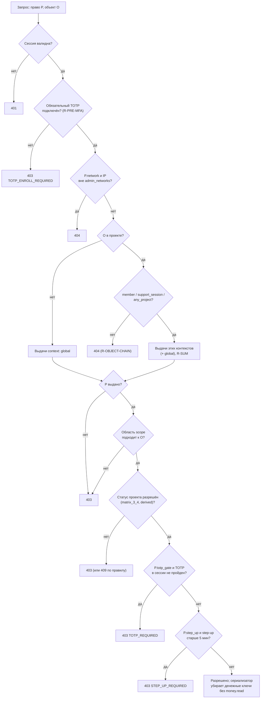

# Матрица прав как данные — пояснения к `permissions.yaml`

Контракт SEC-001 (трек SEC). Потребители: CORE, ADM, AUTH, RT, EXP, QA, FE.
Источник правды — SPEC v0.5: 3.1–3.4, 12.4 (SEC-AUTHZ-01…06), FR-2FA-05, FR-ADM-06, FR-PORT-01…03.
Статус: черновик `0.1.0`, после утверждения PM-001 (веха M0) — `1.0.0`; дальше изменения только через CR.

## Из чего состоит файл

| Раздел | Ключ | Что задаёт | Кто читает |
|---|---|---|---|
| 1 | `system_roles`, `project_roles`, `contexts`, `scopes` | Субъекты, контексты доступа (`member`, `support_session`, `any_project`) и области (`any`, `own_discipline`, `author`, …) | SEC (движок), QA |
| 2 | `permissions` | Каталог из 83 прав: название, ссылки на SPEC, эндпоинты 15.2, флаги `totp_gate`, `step_up`, `network`, `money_fields`, `read_only` | API (`x-permission`), SEC, FE |
| 3 | `grants` | Какой субъект какое право получает, в каком контексте и с какой областью | SEC (движок), QA |
| 4 | `rules`, `derived_status_gates` | Правила вычисления R-…: суммирование ролей, совместимость, TOTP-гейт, step-up, сети, режим поддержки, руководитель пресейла; ограничения по статусу, выведенные из 4.2 | SEC, CORE, QA |
| 5 | `authz_examples` | Все 23 строки таблицы SEC-AUTHZ-05 со ссылками на записи файла | QA (TC-SEC-02) |
| 6 | `matrix_3_3` | 45 строк 3.3 (`M3.3-01…45`) × 8 субъектов: текст ячейки дословно (`spec`) и его толкование | QA (TC-SEC-02) |
| 7 | `matrix_3_4` | 16 строк 3.4 (`M3.4-01…16`) × 5 статусов: текст дословно и толкование | QA (TC-SEC-06), SEC, NTF |

Тест `backend/tests/unit/sec/test_permissions_contract.py` сверяет разделы 6–7 с таблицами SPEC
дословно и проверяет, что выдачи (раздел 3) реализуют каждую ячейку: разрешающая ячейка
обеспечена правами, запрещающая — нет (кроме явного исключения, например «до отправки — свой вопрос»).

## Коды прав

Коды **не содержат области**. `PATCH /nodes/{id}` объявляет одно право `tree.write`, а модератору оно
выдано с `scope: any`, эксперту — с `scope: own_discipline`; область проверяется на объекте по цепочке
SEC-AUTHZ-03. Поэтому коды-примеры из PLAN.md `tree.write.any` и `tree.write.own_discipline` сведены к
`tree.write` (раздел 6 плана упоминал ещё `tree.write.branch` — это тот же код). Остальные коды из
текста задачи SEC-001 сохранены как есть.

Служебные псевдоправа `public`, `token.login_step`, `token.activation`, `session.pre_mfa`,
`authenticated` нужны, чтобы и эндпоинты без роли явно объявляли право (SEC-AUTHZ-02, TC-SEC-01).

Один эндпоинт может требовать разные права в зависимости от объекта:

| Эндпоинт | Право | Когда |
|---|---|---|
| `POST /threads/{id}/resolve`, `/reopen` | `thread.resolve` | обычный вопрос |
| | `cq.close`, `cq.reopen` | вопрос заказчику (`threads.is_customer`) |
| `POST /nodes/{id}/move` | `tree.write` | перенос внутри своей области |
| | `tree.write` + `tree.move.cross_branch` | цель — другая ветка |
| `PATCH /nodes/{id}` | `tree.write` | O/R/P, ×N, структура, название, тип |
| | `comment.write` | только `comment_lines` |
| `PUT /projects/{id}/branches/…/status` | `branch.status.draft_done` | «черновик» ↔ «готово» |
| | `branch.status.not_needed` | в «не нужно» и обратно |
| `POST /projects/{id}/exports` | `export.hours` или `export.money` | по виду выгрузки (`contracts/exports.yaml`) |
| `POST /nodes/{id}/copy-from` | `branch.copy_from` в цели и в источнике | источник проверяется по `M3.4-09` (`evaluated_on: source_project`) |

## Алгоритм проверки

Коды ошибок `TOTP_REQUIRED`, `TOTP_ENROLL_REQUIRED`, `STEP_UP_REQUIRED` и коды 409 правил R-…
(`LAST_MODERATOR`, `LAST_SUPERADMIN`, `ROLE_INCOMPATIBLE`, `PROJECT_ARCHIVED`, `INVALID_STATUS_TRANSITION`)
описываются в `contracts/errors.yaml` (API-001).

## Толкования, которых нет в SPEC дословно

Каждое толкование помечено в файле и требует внимания при ревью PM-001.

1. **Видимость проекта в «Подготовке»** (`M3.4-01`). Строка 3.4 говорит о «Моих оценках», а таблица 4.2 —
   «кто видит проект: только модераторы». Поэтому ограничение распространено на `project.read`,
   `tree.read`, `discussion.read` для проектных ролей. Режим поддержки и руководитель пресейла видят
   проект в любом статусе (`M3.4-12`, `M3.4-13`).
2. **Документы и закрытые заметки в «Завершена» и «Архиве»** (`D-01`). В 3.4 их нет; таблица 4.2
   говорит «только чтение для всех», исключения — вопросы заказчику и «Результат пресейла». Поэтому
   `docs.write`, `docs.restore`, `notes.write` в этих статусах запрещены.
3. **«Напомнить не начавшим»** (`D-02`) — только «Оценка» и «Сведение»: это письмо о событии оценки (3.4,
   строка 15).
4. **Пометка снимка «ошибочный»** (`D-03`) — по статусам как создание снимка.
5. **Аудитор ИБ не может быть участником проекта** (`R-COMPAT`): из 3.2 «не видит проекты».
6. **«Проверено» по статусам** — включено в строки 3.4 «Правка дерева» (`M3.4-02`, `M3.4-03`):
   в «Завершена» и «Архиве» только чтение.
7. **Режим поддержки**: кроме прямо названных в 3.3 дерева, настроек и статистики, администратору даны
   `discussion.read` (обсуждения — часть рабочего экрана), `journal.read` (вкладка настроек),
   `cq.read` и `snapshot.read` (вкладки статистики). Скачивание документов, сравнение снимков и
   выгрузки в режиме поддержки запрещены (в 3.3 там ❌).

## Как пользоваться в коде и тестах

- **SEC (SEC-003 и далее)** загружает файл при старте, строит индекс «субъект → права» и проверяет
  каждый запрос по алгоритму выше. Права в коде — только строки из каталога.
- **API (API-002)** ставит `x-permission: <код>` каждой операции; TC-SEC-01 падает, если код не из каталога.
- **QA (TC-SEC-02, TC-SEC-06)** генерирует случаи из `matrix_3_3` × `matrix_3_4` × принадлежность ветки;
  `authz_examples` — обязательный минимум.
- **FE** использует коды, чтобы прятать кнопки (удобство, не защита — SEC-AUTHZ-01).
