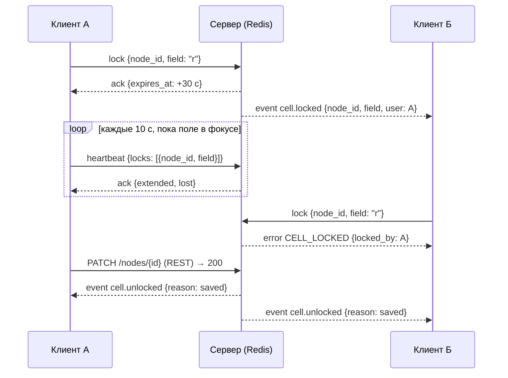

# WebSocket-события и команды — пояснения к `ws-events.schema.json`

Контракт RT-001 (трек RT). Потребители: FE, CORE, NTF, EXP, QA.
Источник правды — SPEC v0.5: 15.4, 13.3, ARCH-01/02, SEC-AUTHZ-01/04, FR-TREE-30…33, FR-SESS-02/05, FR-2FA-05.
Статус: `1.0.0`, утверждён PM-001 (веха M0, 05.11.2026); дальше изменения только через CR.

## Главное

- **WebSocket — только «сервер → клиент» и захват ячеек** (ARCH-01). Любые изменения данных идут через
  REST; событие рассылается после `COMMIT`.
- Подключение `wss://<host>/api/v1/ws` с cookie `__Host-session`. При рукопожатии сервер проверяет
  сессию (иначе HTTP 401), заголовок `Origin` (иначе закрытие 4403, SEC-WEB-04) и для сессий
  суперадминистратора — сеть из `security.admin_networks` (иначе HTTP 404, FR-SA-06).
- Личный канал `user:{id}` подписывается автоматически. На проект клиент подписывается командой
  `subscribe`.
- Формат JSON, UTF-8, одно сообщение ≤ 64 КБ (SEC-WEB-08). Числа O/R/P и деньги — строками (15.1).
  Деньги — целые строки без ограничения разрядности (`$defs.MoneyString`, как в OpenAPI; CR-002).

## Сообщения

| Направление | `type` / `op` | Схема (`$defs`) |
|---|---|---|
| сервер → клиент | `{"type": "event", "event": "<имя>", "channel", "ts", "project_version"?, "data"}` | `ServerEvent` — 25 событий |
| клиент → сервер | `{"op": "subscribe" \| "unsubscribe" \| "lock" \| "unlock" \| "heartbeat", "req_id"?, …}` | `ClientCommand` |
| сервер → клиент | `{"type": "ack", "op", "req_id", "result"}` и `{"type": "error", "op", "req_id", "code", …}` | `ServerReply` |

Коды в `error.code` — из `contracts/errors.yaml` (API-001): `FORBIDDEN`, `NOT_FOUND`, `CELL_LOCKED`
(с `locked_by`, `expires_at`), `PROJECT_STATUS_CONFLICT` (с `project_status`), `RATE_LIMITED`
(с `retry_after`), `VALIDATION_FAILED`.

## Каналы и права

| Канал | Кто получает | Право (`contracts/permissions.yaml`) |
|---|---|---|
| `project:{id}` | участники, администратор в режиме поддержки, руководитель пресейла | `tree.read` (с учётом статуса: в «Подготовке» — только модераторы, `M3.4-01`) |
| `project:{id}:money` | модератор и пресейл проекта, руководитель пресейла | `money.read` + пройденный в сессии TOTP |
| `project:{id}:notes` | модератор и пресейл проекта, руководитель пресейла | `notes.read` + пройденный в сессии TOTP |
| `user:{id}` | сам пользователь | `authenticated` |

**Правило денег (SEC-AUTHZ-04, TC-SEC-03).** События канала `project:{id}` и `user:{id}` не содержат
денежных ключей ни при каких правах: `rate`, `rates`, `cost`, `currency`, `exchange_rate`, `money`, `vat`,
`vat_percent`, `contract_amount`, `cost_rub`, `quote_rub`, `quote_cur`. Деньги — только событие
`money.updated` в канале `:money`. Заметки — только `note.*` в канале `:notes` (TC-SEC-07).

**Фильтр по подписчику (13.3).** Экземпляр API перед отправкой проверяет права каждого подписчика
по актуальным данным (не по состоянию на момент подписки):

- `node.deleted`, `node.restored` с узлами чужих веток получают все, кто видит дерево (дерево видно
  целиком, 3.3); содержимое корзины в события не входит.
- `document.scanned` о документе, удалённом в корзину, получают только модератор и пресейл (GAP-06).
- Права, которые пропали у подписчика (исключение из команды, снятие роли, истечение режима поддержки,
  проект в «Подготовке» для эксперта), дают `access.revoked` и отписку от всех каналов проекта
  не позже чем через 5 секунд (FR-SESS-05).
- Пропавший TOTP-гейт или `money.read` снимает подписку на `:money` и `:notes` без `access.revoked`;
  клиент узнаёт об этом из `member.updated` и перезапрашивает права.

## Версии и догрузка (ARCH-02, FR-TREE-33)

1. Каждое изменение проекта получает новый `projects.version`; событие несёт `project_version`, если
   в схеме у него есть это поле (`node.*`, `branch.status`, `message.*`, `thread.*`,
   `customer_question.updated`, `member.updated`, `project.updated`, `money.updated`, `note.*`).
   `cell.*`, `presence`, `document.scanned`, `notification.created`, `access.revoked`,
   `session.ended`, `resync.required` версию не несут.
2. **Пропуски номеров нормальны**: подписчик не получает событий, которые ему не положены (деньги,
   заметки). Клиент не делает выводов из разрыва номеров внутри живого соединения.
3. `subscribe` с `since` = последней применённой версии. Сервер отвечает `ack` с
   `{project_version, channels, resync}` и досылает события из `change_log` с версией > `since`,
   отфильтрованные по правам; если `since` старше 7 дней хранения `change_log` — `resync: true` и
   событие `resync.required`, клиент загружает дерево целиком (`GET /projects/{id}/tree`).
4. После разрыва соединения клиент показывает «Нет связи, правки не сохраняются», делает поля только
   для чтения, переподключается и подписывается заново с `since`.

## Захват ячеек (FR-TREE-31, TC-CONC-04)

- `lock` требует право `tree.write` с областью, покрывающей узел, и статус, разрешающий правку
  (`M3.4-02`, `M3.4-03`). `force: true` — только с `tree.lock.force` (модератор); прежний владелец
  получает `cell.unlocked {reason: forced}`, его несохранённый ввод остаётся на клиенте до
  конфликта по FR-TREE-32.
- Захват — ключ Redis `lock:{project_id}:{node_id}:{field}` с TTL 30 с. Снимается: `unlock`, успешный
  PATCH этого поля (`saved`), истечение TTL (`expired`), закрытие WebSocket владельца
  (`disconnected`), перехват (`forced`).
- PATCH поля, захваченного другим пользователем, отклоняется REST-ом: 423 `CELL_LOCKED`.
- `heartbeat` продлевает перечисленные захваты и **не продлевает сессию** (FR-SESS-02): сервер не
  обновляет время последней активности по сообщениям WebSocket.

## Сессия (FR-SESS-02, FR-SESS-05, TC-AUTH-05)

- При истечении или отзыве сессии сервер отправляет `session.ended` в `user:{id}` и закрывает
  соединение с кодом 4401 не позже чем через 5 секунд.
- При поочерёдном перезапуске API (18.3) соединение закрывается кодом 1012; клиент переподключается
  с `since` без потери данных.

## Толкования, которых нет в SPEC дословно

1. Набор захватываемых ячеек: `title`, `multiplier`, `comment`, `o`, `r`, `p` (столбцы FR-TREE-10, в
   которые вводят текст или число).
2. `heartbeat` несёт список продлеваемых захватов: SPEC говорит о продлении каждые 10 с, но не о форме.
3. Код закрытия 4429 и ответ `RATE_LIMITED` на поток команд — защита от злоупотребления каналом;
   конкретный лимит задаёт RT-реализация, в SPEC его нет.
4. `member.updated` несёт только идентификаторы затронутых пользователей и вид изменения: права клиент
   перезапрашивает по REST, чтобы в канал не попадали проектные роли других людей сверх команды.
