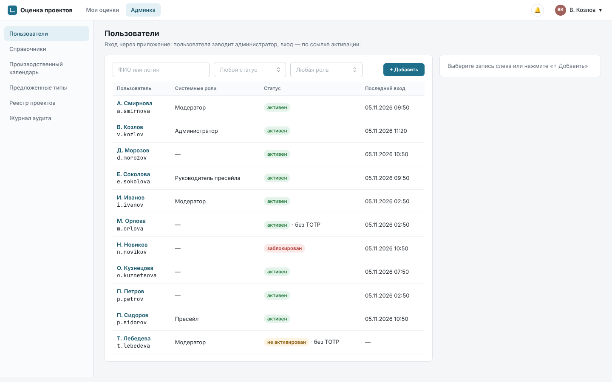
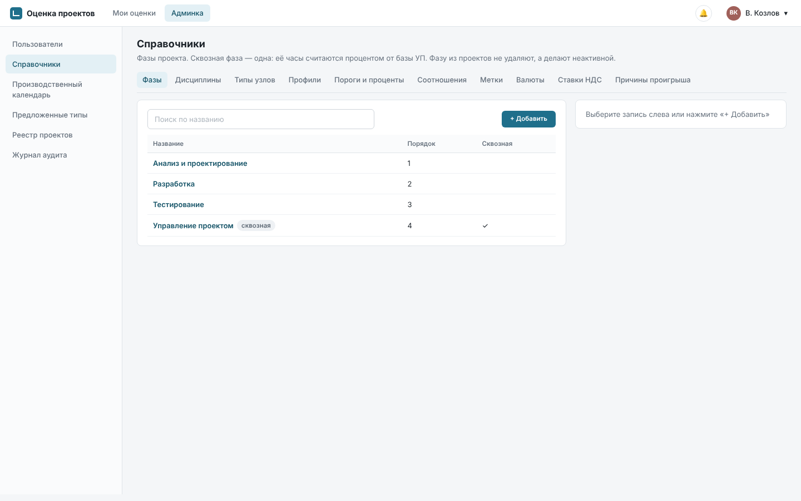
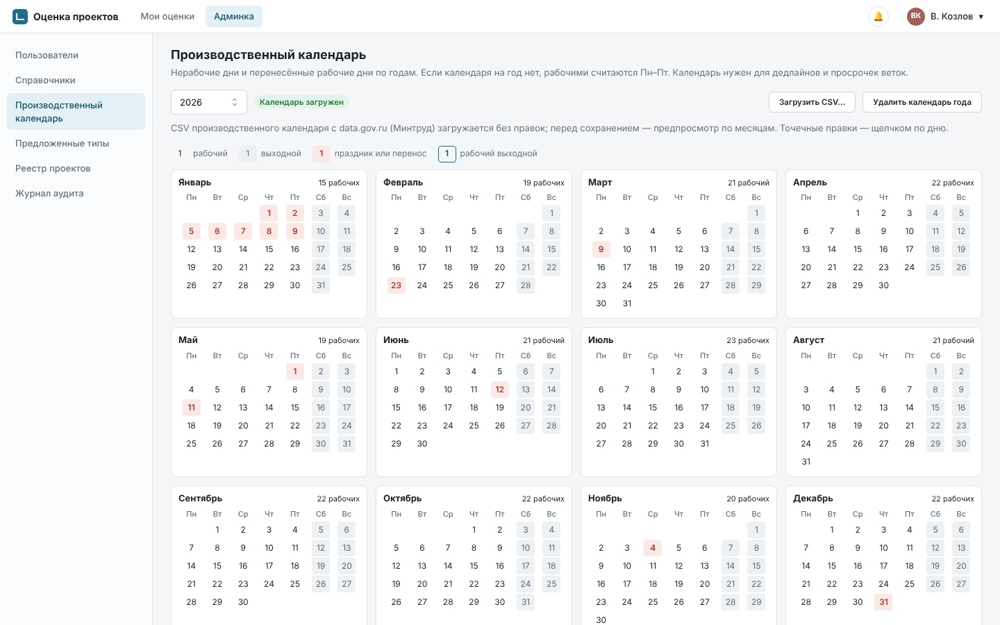
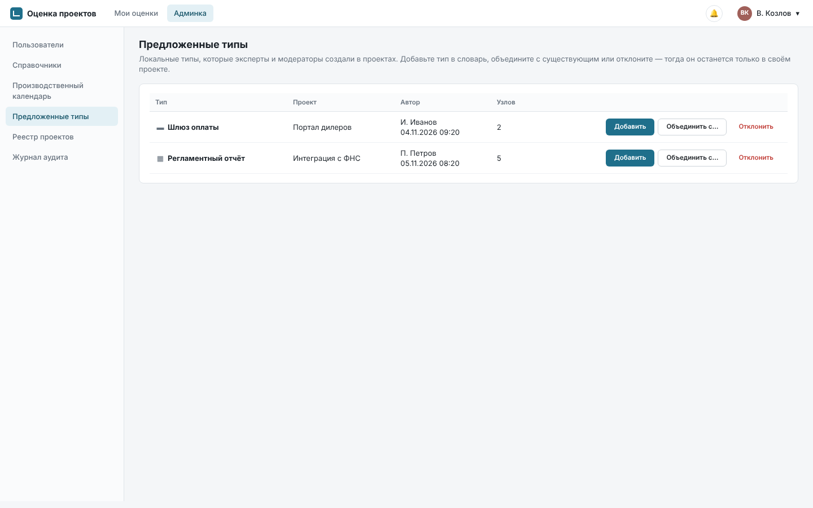
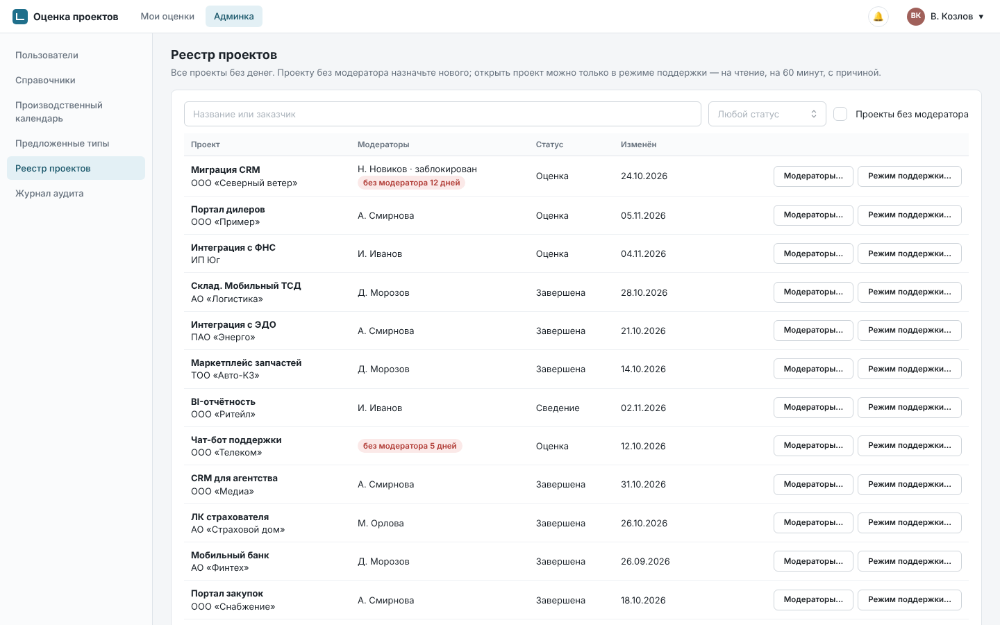

# Руководство администратора

Приложение оценки проектов. Основание: SPEC 7.5, FR-ADM-05, FR-ADM-06, FR-TREE-03, BR-PRJ-07.
Снимки экранов сделаны на демо-данных.

Администратор заводит пользователей и выдаёт им системные роли, ведёт справочники и
производственный календарь, разбирает предложенные типы узлов и следит, чтобы у каждого проекта был
модератор. **Ставок, стоимости и закрытых заметок проектов администратор не видит**, в том числе в
режиме поддержки (BR-ADM-03). Если администратор назначен в проект участником (в том числе сам
себя), он видит деньги как участник; такое назначение помечается в журнале аудита.

Способ входа, политики безопасности и почту настраивает суперадминистратор
([руководство суперадминистратора](superadmin.md)).

Вход в админку — пункт «Админка» в меню. Каждый раздел — список с поиском слева и форма справа.
Бездействие в админке — 15 минут, затем сессия закрывается. Второй фактор (TOTP) для
администратора обязателен.

## 1. Пользователи

Раздел «Пользователи»: ФИО и логин, источник входа («через приложение» или «через Active
Directory»), системные роли, статус, последний вход, TOTP. Фильтры — по статусу и роли, поиск — по
ФИО или логину.

### 1.1. Завести пользователя

**Вход через приложение.** «Добавить» → логин (3–64 символа: латиница, цифры, точка, дефис,
подчёркивание), ФИО, email, роли → «Создать». Пароль вы не задаёте: пользователь получит письмо со
ссылкой установки пароля, она действует 72 часа. Если у пользователя нет email или почта не
настроена, ссылка покажется на экране — передайте её лично.

**Вход через Active Directory.** «Найти в AD» → часть ФИО или логина (от 3 символов). Показываются до
50 учёток каталога с ФИО, логином, email и подразделением. «Выбрать» заводит пользователя сразу:
ему можно выдать роли и назначить в проекты до первого входа, войти он может паролем AD. Пометки в
результатах поиска:

- «уже заведён — открыть» — пользователь уже есть в приложении, откроется его карточка;
- «нет в группе доступа» — учётка есть в каталоге, но войти не сможет, пока ИТ не добавит её в
  группу доступа приложения.

Кроме того, в режиме AD пользователь из группы доступа заводится сам при первом входе, с ролью
«Пользователь».

### 1.2. Системные роли

| Роль | Что даёт |
|---|---|
| Пользователь | у всех; участвует в проектах, куда его назначили (эксперт, ревьюер) |
| Модератор | создаёт проекты и ведёт их; может быть модератором проекта |
| Пресейл | может быть пресейлом проекта: деньги, КП, вопросы заказчику |
| Руководитель пресейла | портфель всех проектов с деньгами, может стать модератором любого проекта |

Роль «Администратор» выдаёт суперадминистратор в разделе «Система», «Аудитор ИБ» — тоже он.
Если включено назначение ролей по группам AD, «Модератор» и «Пресейл» у пользователей AD выдаются
группами каталога и вручную не меняются (в карточке — пометка «из группы AD»). Свои роли менять и
себя блокировать нельзя.

Изменение ролей действует на открытые сессии пользователя в течение 5 секунд.

### 1.3. Блокировка, сброс пароля и TOTP

- **Заблокировать** — сессии завершаются, войти нельзя до разблокировки. Можно указать причину.
  Из проектов пользователь не исчезает: он остаётся в команде с пометкой «заблокирован» и перестаёт
  получать уведомления. Удалить пользователя нельзя, только заблокировать.
- В режиме AD блокировка бывает и автоматической — причина видна в карточке: «отключён в AD»,
  «вне группы доступа», «нет в AD», «не сопоставлен при переходе на AD».
- **Сбросить пароль** (только вход через приложение) — текущий пароль перестаёт действовать, уходит
  новая ссылка установки пароля.
- **Сбросить TOTP** — при следующем входе пользователь заново подключит приложение-аутентификатор.
  Применяйте, когда человек потерял телефон и резервные коды.

Все действия требуют подтверждения и пишутся в журнал аудита.

### 1.4. Заменить участника

Когда сотрудник уходит или переходит на другую работу, его можно заменить во всех проектах сразу
(FR-ADM-05). В карточке пользователя (обычно уже заблокированного) — «Заменить участника…»:

1. «Кем заменить» — активный пользователь.
2. Список активных проектов, где состоит участник, с его ролями и дисциплинами. Снимите отметки
   там, где замена не нужна.
3. Строка помечается и не применяется, если у замены нет нужной системной роли: для модератора
   проекта — «Модератор» или «Руководитель пресейла», для пресейла — «Пресейл». Сначала выдайте
   роль (раздел 1.2).
4. «Заменить…» → подтверждение.

Замена получает те же проектные роли (дисциплины, признак ревьюера, модератор, пресейл), прежний
участник уходит из отмеченных проектов. Авторство прежних правок не меняется. Открытые вопросы и
обсуждения, адресованные прежнему участнику, переходят к замене; закрытые не трогаются. Модераторы
проектов получают уведомление, действие пишется в аудит.

## 2. Справочники

Раздел «Справочники», вкладки:

| Вкладка | Что задаёт | Правила |
|---|---|---|
| Фазы | название, порядок, «сквозная (процент)», активна | сквозная фаза одна: её часы считаются процентом от базы УП; отметка переносит признак с прежней фазы |
| Дисциплины | название, короткое название (до 12 символов, для заголовков столбцов), цвет, профиль по умолчанию | ставок здесь нет — они задаются в проекте |
| Типы узлов | название, иконка, нормы (вариант и O/R/P в часах, O ≤ R ≤ P, до 20) | «Работа» — тип по умолчанию, его нельзя удалить или отключить |
| Профили | дисциплина, название, цепочка типов сверху вниз (1–8 уровней) | у каждой дисциплины один профиль по умолчанию; его получают новые ветки |
| Пороги и проценты | порог «крупного листа» для уровней «Средне» и «Детально», ожидаемое число единиц для «Средне», % УП по умолчанию (0–50), срок автоархивации после «Завершена» (по умолчанию 180 дней, 0 — выключено) | пороги и срок автоархивации действуют сразу на все проекты, % УП — только на новые |
| Соотношения | дисциплина A, дисциплины B, минимум и максимум % | нормы для статистики, например «QA к (Бэкенд + Фронтенд) — 25–35%» |
| Метки | название, короткое имя, цвет, куда идёт в статистике (Допущения, Риски, Технологии, Ограничения) | категория решает, в какой список статистики и выгрузок попадёт строка комментария |
| Валюты | код ISO 4217, символ, активна | RUB нельзя удалить или отключить |
| Ставки НДС | название, процент, по умолчанию | «Без НДС» нельзя удалить; ставка по умолчанию одна, её получает новый проект |
| Причины проигрыша | название, «Другое — нужен текст» | для «Результата пресейла» |

- Запись, которая уже используется в проектах, удалить нельзя — сделайте её неактивной: она
  перестанет предлагаться в новых проектах.
- Каждое изменение пишется в журнал аудита со значениями «было → стало».
- Снимки проектов изменения справочников не трогают: они хранят названия на момент снимка.

## 3. Производственный календарь

Раздел «Производственный календарь». По нему считаются дедлайны и просрочки в рабочих днях. Если
календаря на год нет, рабочими считаются понедельник–пятница без праздников.

1. Выберите год → «Загрузить CSV…». Подходит CSV производственного календаря с data.gov.ru
   (Минтруд) без правок.
2. Проверьте предпросмотр по месяцам: рабочие дни, нерабочие будни, рабочие выходные, итог за
   год. Календарь ещё не сохранён.
3. «Сохранить календарь».
4. Точечные правки — щелчком по дню (рабочий ↔ нерабочий), затем «Сохранить правки».

«Удалить календарь года» возвращает Пн–Пт без праздников; дедлайны пересчитаются. Загружайте
календарь на следующий год, как только Минтруд его опубликует (обычно осенью).

## 4. Предложенные типы

Эксперты и модераторы могут создать тип узла прямо в проекте (FR-TREE-03): он сразу работает, но
только в своём проекте, и появляется в разделе «Предложенные типы» с проектом, автором и числом
узлов.

- **Добавить** — тип попадает в словарь и становится доступен всем проектам.
- **Объединить с…** — выберите тип словаря: узлы проекта перепривяжутся к нему.
- **Отклонить** — тип останется локальным в своём проекте.

## 5. Реестр проектов

Раздел «Реестр проектов» — все проекты **без денег**: название и заказчик, модераторы, статус,
даты. Поиск — по названию или заказчику, фильтр — по статусу.

### 5.1. Проекты без модератора

Если все модераторы проекта заблокированы, проект помечается «без модератора N дней», а вы
получаете уведомление (BR-PRJ-07). Фильтр «Проекты без модератора» показывает только такие.

«Модераторы…» у проекта: снимите отметку, чтобы передать проект, или «Добавить модератора» —
активного пользователя с системной ролью «Модератор» или «Руководитель пресейла». Оставить проект
без модератора нельзя.

### 5.2. Режим поддержки

Когда пользователь жалуется на проект («итоги считаются странно», «не вижу ветку»), откройте его в
режиме поддержки (FR-ADM-06):

1. «Режим поддержки…» у проекта → причина, 10–500 символов → «Открыть проект».
2. Проект откроется только на чтение, без денег и закрытых заметок, с жёлтой полосой «Режим
   поддержки» и оставшимся временем. Сессия длится не больше 60 минут; потом откройте проект из
   реестра заново.
3. «В реестр» — выйти из режима.

Режим работает в любом статусе проекта. Открытие пишется в аудит с причиной, модераторы проекта
получают уведомление «Администратор открыл проект в режиме поддержки: <причина>». Поэтому пишите
причину так, чтобы модератору было понятно, зачем вы смотрите проект.

## 6. Журнал аудита

Раздел «Журнал аудита»: администратору видны события категорий «Пользователи и роли» и
«Справочники». Фильтры — период, пользователь, тип события, результат. Щелчок по строке открывает
запись целиком. «Выгрузить CSV…» — по текущим фильтрам, с паролем и кодом TOTP.

## 7. Частые ситуации

| Ситуация | Что делать |
|---|---|
| Новый сотрудник | завести (раздел 1.1), выдать роли; в проекты его добавит модератор |
| Ссылка активации не дошла или истекла | «Сбросить пароль» — уйдёт новая |
| Пользователь потерял телефон с TOTP | убедиться, что это он (лично или по телефону), затем «Сбросить TOTP» |
| Сотрудник уволен | заблокировать; «Заменить участника» в активных проектах; по запросу ИБ суперадминистратор анонимизирует учётку |
| Пользователь AD не может войти | проверить статус и причину блокировки в карточке; «нет в группе доступа» — обратиться в ИТ |
| Модератор в отпуске, проект стоит | «Модераторы…» в реестре: добавить второго модератора |
| В проектах завёлся дубль типа узла | «Предложенные типы» → «Объединить с…» |
