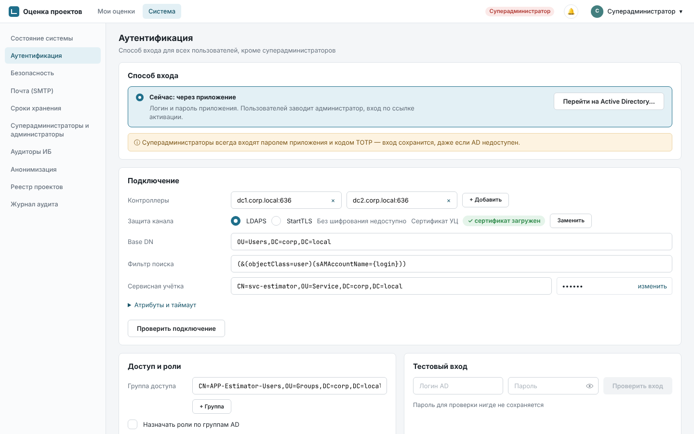
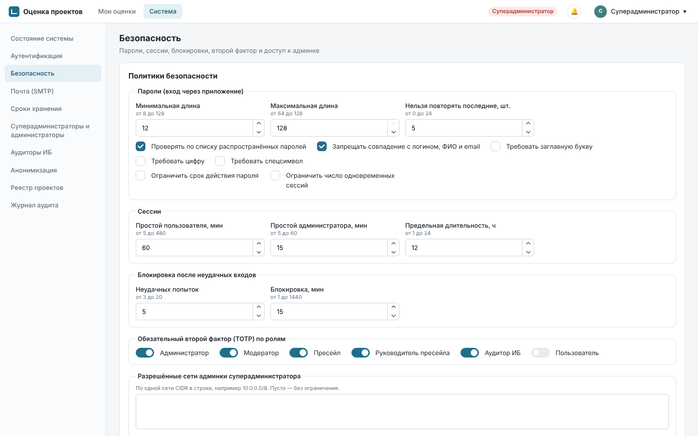
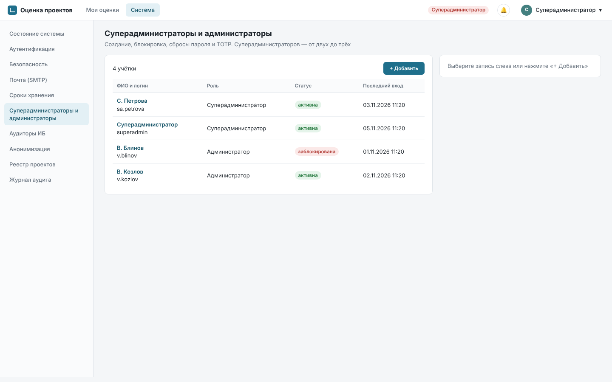
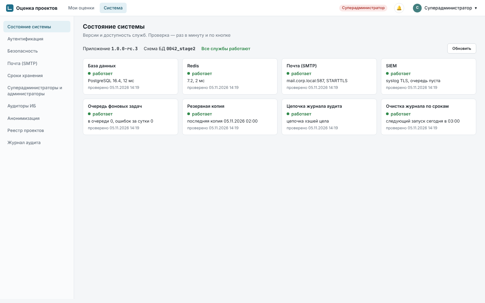
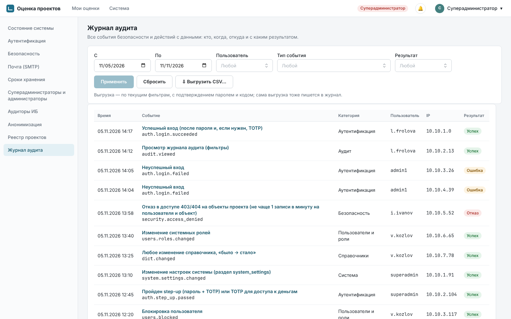

# Руководство суперадминистратора

Приложение оценки проектов. Основание: SPEC 7.1–7.4, 11.2, 12.3, 12.7, 18.2. Снимки экранов сделаны на
демо-данных.

Суперадминистратор настраивает приложение целиком: способ входа, политики безопасности, почту,
SIEM, сроки хранения, заводит администраторов и аудиторов ИБ. **Проектов, оценок и денег он не
видит** (раздел 3.2 SPEC): в его меню нет «Моих оценок», а реестр проектов показывает только
названия, статусы и модераторов.

Установку, резервные копии, ключи и консольные команды выполняет служба эксплуатации ИТ — см.
[инструкцию службы эксплуатации](operations.md). Работа администратора (пользователи,
справочники, календарь) — в [руководстве администратора](admin.md).

## 1. Вход и защита учётки

- Суперадминистратор **всегда** входит паролем приложения и кодом TOTP, даже когда остальные
  пользователи входят через Active Directory. Если AD недоступен или настроен с ошибкой, вход
  суперадминистратора сохраняется, и настройки можно исправить (FR-SA-03).
- Второй фактор для суперадминистратора обязателен и не отключается.
- Логины суперадминистраторов зарезервированы: пользователь AD с таким же логином войти не сможет.
- Логины суперадминистраторов не блокируются при подборе пароля. Вместо блокировки растёт
  задержка ответа (до 60 с), а после 5 неудач подряд ИБ и все суперадминистраторы получают
  оповещение (FR-LOCK-04).
- Бездействие в админке — 15 минут, затем сессия закрывается (меняется в «Безопасности»).
- Критичные действия (сохранение настроек, создание учёток, выгрузка журнала) требуют повторного
  ввода пароля и кода TOTP — окно «Подтвердите действие».

Суперадминистраторов должно быть **от двух до трёх**. Пока он один, вверху раздела «Система» висит
жёлтая полоса «Заведите второго суперадминистратора»: без второго потерянный пароль или телефон с
TOTP восстанавливает только служба эксплуатации консольной командой `reset-superadmin`.

## 2. Первый вход и мастер первичной настройки

1. Служба эксплуатации создаёт первого суперадминистратора командой `estimator create-superadmin`
   и передаёт вам ссылку. Ссылка действует 60 минут; если не успели, попросите новую
   (`issue-activation`).
2. По ссылке задайте пароль (не короче 12 символов) и подключите приложение-аутентификатор
   (Яндекс Ключ, Google Authenticator, FreeOTP, Microsoft Authenticator): отсканируйте QR-код и
   введите первый код. **Сохраните 10 резервных кодов** — они понадобятся, если телефон потерян.
3. Откроется мастер «Первичная настройка» из пяти шагов. Пока он не пройден, остальные
   пользователи видят «Приложение настраивается». Прерванную настройку можно продолжить с того же
   шага.

| Шаг | Что указать |
|---|---|
| 1. Адрес и часовой пояс | Адрес приложения `https://…` (по нему строятся ссылки в письмах) и часовой пояс компании: по нему считаются дедлайны, ежедневная сводка и ночные задачи |
| 2. Почта | Сервер SMTP и адрес отправителя; отправьте тестовое письмо (раздел 6). Через этот сервер уйдут письма со ссылками активации |
| 3. Способ входа | «Через приложение» — задайте политику паролей; «Через Active Directory» — параметры каталога и обе проверки (раздел 3) |
| 4. Политики безопасности | Сессии, блокировки, второй фактор по ролям, сети админки (раздел 4). Значения по умолчанию подходят для большинства компаний |
| 5. Первый администратор | В режиме «Приложение» — логин, ФИО, email: администратор получит ссылку активации. В режиме AD — найдите учётку в каталоге по ФИО или логину: она заводится сразу, без ожидания первого входа |

После «Завершить настройку» приложение открыто для всех. Дальше администратор заполняет
справочники ([руководство администратора](admin.md)). Все шаги мастера пишутся в журнал аудита.

## 3. Аутентификация и переход на Active Directory

Раздел «Система» → «Аутентификация». Режим один на всё приложение (кроме суперадминистраторов).

| | Через приложение | Через Active Directory |
|---|---|---|
| Пароль | хранится в приложении (Argon2id), действует политика паролей приложения | проверяет AD, действует политика паролей AD |
| Кто заводит пользователей | администратор; пользователь задаёт пароль по ссылке | администратор или модератор проекта находит человека в каталоге («Найти в AD»), либо учётка появляется при первом входе |
| Смена и сброс пароля | в приложении, одноразовой ссылкой | средствами AD |
| ФИО и email | вводит администратор | берутся из AD при каждом входе |
| Отключение | блокировка в приложении | отключение в AD или исключение из группы доступа: сессии закрываются в течение 15 минут |

### 3.1. Параметры подключения

Блок «Подключение»:

- **Контроллеры** — один или несколько `host:port`; при недоступности перебираются по порядку.
- **Защита канала** — LDAPS (636) или StartTLS (389). Без шифрования подключиться нельзя:
  пароли пользователей шли бы по сети открытым текстом.
- **Сертификат УЦ** — корневой сертификат компании в формате PEM (до 64 КБ). Проверка
  сертификата контроллера не отключается.
- **Base DN** и **фильтр поиска** — по умолчанию `(&(objectClass=user)(sAMAccountName={login}))`;
  в фильтре обязательно `{login}`.
- **Сервисная учётка** (DN) и её пароль. После сохранения пароль не показывается, видно только
  «Пароль задан, изменить». Если поменять сервер или учётку, пароль нужно ввести заново: прежний
  на новый сервер не отправится.
- «Атрибуты и таймаут» — атрибуты логина (`sAMAccountName` или `userPrincipalName`), ФИО, email,
  подразделения; таймаут 1–60 с.

Подключается один домен AD; несколько доменов и лесов не поддерживаются.

### 3.2. Доступ и роли

- **Группа доступа** обязательна (одна или несколько). Вложенные группы учитываются. Кто не
  состоит ни в одной, получает тот же отказ, что и при неверном пароле.
- **Назначать роли по группам AD** — необязательно. Через группы выдаются только «Модератор» и
  «Пресейл»; «Администратор», «Руководитель пресейла» и «Аудитор ИБ» — только вручную. При
  включении приложение показывает, у кого из пользователей AD роли снимутся и добавятся. После
  включения эти две роли в админке вручную не меняются.

### 3.3. Проверки и сохранение

1. «Проверить подключение» — вход сервисной учёткой и поиск; рядом пишется результат и время.
2. «Тестовый вход» — введите логин и пароль реального сотрудника: увидите ФИО, email, состояние
   учётки, группы и итоговую роль. Пароль нигде не сохраняется.
3. «Сохранить…» становится доступна, только когда обе проверки прошли с текущими параметрами.
   Сохранение требует пароль и код TOTP и оповещает всех администраторов и ИБ.

### 3.4. Переход «Приложение → AD»

Кнопка «Перейти на Active Directory…» видна в режиме «Приложение». Сначала настройте и проверьте
подключение (разделы 3.1–3.3), затем:

1. Экран предупреждения: после перехода все, кроме суперадминистраторов, входят логином и паролем
   AD, пароли приложения перестают действовать.
2. «Сформировать отчёт» — пользователи приложения сопоставляются с AD **по логину** (без учёта
   регистра) и делятся на три списка: «Сопоставлены», «Неоднозначные совпадения» и
   «Не найдены в AD».
3. Для каждого неоднозначного совпадения выберите учётку AD или «Не сопоставлять». Пока остались
   нерешённые, перейти нельзя.
4. «Перейти на AD» с паролем и кодом TOTP. Все сессии, кроме вашей, завершаются; роли, назначения
   в проекты и TOTP пользователей сохраняются. Не найденные и не сопоставленные пользователи
   блокируются («не сопоставлен при переходе на AD»), пока администратор не свяжет их с учёткой
   каталога.

После перехода в блоке «Способ входа» видны дата, автор и ссылка на отчёт. **Обратного
переключателя в интерфейсе нет.** Вернуться ко входу через приложение можно только консольной
командой `estimator auth-mode local` службы эксплуатации — по согласованному с ИБ решению, например
если AD надолго недоступен. Каждый пользователь тогда получит ссылку установки пароля на 72 часа.

Если AD недоступен, пользователи AD не могут войти («Сервис аутентификации временно недоступен»),
открытые сессии работают до истечения, суперадминистратор входит как обычно.

## 4. Политики безопасности

Раздел «Безопасность». Сохранение — с паролем и кодом TOTP, изменение оповещает ИБ.

| Блок | Значения по умолчанию | Примечание |
|---|---|---|
| Пароли (только вход через приложение) | 12–128 символов, проверка по списку распространённых паролей, запрет совпадения с логином, ФИО и email, нельзя повторять 5 последних, срок действия не ограничен | требования к заглавным, цифрам и спецсимволам по умолчанию выключены (рекомендация NIST) |
| Сессии | простой пользователя 60 мин, администратора 15 мин, предельная длительность 12 ч | число одновременных сессий по умолчанию не ограничено |
| Блокировка | 5 неудачных попыток для пары «логин + IP» → блокировка на 15 мин | суперадминистраторов не блокирует (раздел 1) |
| Второй фактор по ролям | обязателен для «Администратора», «Модератора», «Пресейла», «Руководителя пресейла», «Аудитора ИБ»; по желанию — для «Пользователя» | деньги и закрытые заметки отдаются только сессии, где пройден TOTP, независимо от политики |
| Сети админки | пусто — без ограничения | см. ниже |
| Адрес службы ИБ | — | сюда уходят оповещения о критичных изменениях |

Если отключить обязательный второй фактор для какой-либо роли, вверху раздела «Система» появится
жёлтая полоса с перечнем ролей: вход по одному паролю слабее.

**Разрешённые сети админки** — по одной сети CIDR в строке (`10.20.0.0/16`, `fd00::/8`). Если список
задан, раздел «Система», его API и вход суперадминистраторов доступны только из этих сетей; из
других сетей ответ 404, как будто раздела нет. Добавляя ограничение, **убедитесь, что ваша текущая
сеть в списке**, иначе потеряете доступ к админке; вернуть его сможет служба эксплуатации. Всё
приложение в любом случае доступно только из офисной сети и VPN.

## 5. Передача аудита в SIEM

Раздел «Безопасность» → «Передача аудита в SIEM». Каждое событие журнала уходит в syslog
(RFC 5424, TCP + TLS, JSON одной строкой).

- Сервер SIEM и порт; **сертификат УЦ** обязателен: сертификат SIEM проверяется по нему и по имени
  хоста.
- Клиентский сертификат и закрытый ключ (mTLS) — если этого требует SIEM. Ключ после сохранения не
  показывается.
- Если SIEM недоступен или сертификат не прошёл проверку, события копятся в очереди (до 100 000) и
  досылаются. Переполнение очереди — красный индикатор «SIEM» в «Состоянии системы».

## 6. Почта и ежедневная сводка

Раздел «Почта (SMTP)»: сервер, порт, защита (STARTTLS, TLS или без шифрования), логин, пароль,
таймаут, адрес и имя отправителя.

- «Отправить тестовое письмо» использует параметры формы, сохранять их для проверки не нужно.
- Без шифрования письма со ссылками активации и сброса пароля идут по сети открытым текстом —
  выбирайте STARTTLS или TLS.
- Сохранение — с паролем и кодом TOTP; администраторы и ИБ получают оповещение (на старый адрес,
  если почта менялась).
- «Ежедневная сводка» — время отправки сводки уведомлений в часовом поясе приложения.

## 7. Сроки хранения

Раздел «Сроки хранения» (NFR-REL-06).

| Что | По умолчанию | Ограничение |
|---|---|---|
| Журнал аудита | 12 мес. | не меньше 6 мес. |
| Логи приложения | 90 дней | |
| Корзина | 30 дней | |
| Файлы выгрузок | 24 ч | |
| Уведомления | 365 дней | |
| Журнал изменений дерева | 7 дней | |

Проекты хранятся бессрочно. Записи аудита старше срока удаляет служба эксплуатации ежемесячной
командой `estimator audit purge` ([регламенты](regulations.md#4-ежемесячная-очистка-журнала-аудита));
если очистка не запускалась больше двух месяцев, в «Состоянии системы» загорается
предупреждение. Резервные копии хранятся 30 дней, их срок задаёт служба эксплуатации.

## 8. Суперадминистраторы, администраторы и аудиторы ИБ

**«Суперадминистраторы и администраторы»** — список учёток раздела «Система» с ролью, статусом,
последним входом и состоянием TOTP.

- «Добавить» → логин, ФИО, email, роль. Пользователь получит письмо со ссылкой активации; если
  почта не настроена, ссылка показывается на экране — передайте её лично.
- Суперадминистраторов не больше трёх. Создание суперадминистратора требует пароль и код TOTP и
  оповещает всех администраторов и ИБ.
- Действия с учёткой: «Заблокировать» / «Разблокировать», «Сбросить пароль» (новая ссылка
  активации), «Сбросить TOTP» (при следующем входе подключить заново), «Разжаловать» (снять роль).
  Последнего активного суперадминистратора заблокировать или разжаловать нельзя.
- В режиме AD администратора можно найти в каталоге. Если у учётки в каталоге нет почты, укажите
  адрес для ссылки активации и оповещений.

Роль «Администратор» выдаёт только суперадминистратор. Остальные системные роли («Модератор»,
«Пресейл», «Руководитель пресейла») выдаёт администратор в разделе «Пользователи».

**«Аудиторы ИБ»** — учётки, которые читают журнал аудита. Другие роли аудитору не выдаются; проектов
и денег он не видит. Заводятся и блокируются так же, как администраторы.

## 9. Анонимизация

Раздел «Анонимизация» (SEC-PD-03) — обезличивание уволенных сотрудников по запросу.

- В списке все **заблокированные** учётки: и раздела «Система», и обычные пользователи. Активную
  учётку сначала заблокируйте.
- «Анонимизировать…» → подтверждение паролем и кодом TOTP. ФИО станет «Удалённый пользователь
  #N», логин и email — случайными значениями, сессии и TOTP удаляются. Авторство в проектах
  остаётся, но в обезличенном виде.
- **Действие необратимо.** Вкладка «Анонимизированные» показывает уже обезличенные учётки.

## 10. Состояние системы

Раздел «Состояние системы» — версии и доступность служб. Проверка раз в минуту и по кнопке
«Обновить».

| Индикатор | Что значит красный | Что делать |
|---|---|---|
| База данных, Redis | служба недоступна | сообщить службе эксплуатации |
| Почта (SMTP) | сервер не отвечает или отклоняет вход | проверить «Почту»; сообщить ИТ |
| Active Directory (LDAP) | ни один контроллер не отвечает | пользователи AD не могут войти; сообщить ИТ |
| SIEM | очередь событий переполнена | проверить «Передачу аудита в SIEM»; сообщить ИБ |
| Очередь фоновых задач | задачи не выполняются (уведомления, выгрузки, ночные задачи) | сообщить ИТ |
| Резервная копия | последней копии больше 26 часов | сообщить ИТ |
| Цепочка журнала аудита | ежедневная проверка (04:00) нашла разрыв или подмену | **сразу сообщить ИБ**; записи аудита до разбора не удаляются |
| Очистка журнала по срокам | очистка не запускалась больше двух месяцев | напомнить ИТ о регламенте |

Вверху — версия приложения и версия схемы БД; их называют при обращении в поддержку.

## 11. Реестр проектов

«Реестр проектов» — все проекты без денег, только чтение: название и заказчик, модераторы,
статус, даты, сколько дней проект без модератора. Передавать проекты и открывать их в режиме
поддержки может администратор ([руководство администратора](admin.md#5-реестр-проектов)).

## 12. Журнал аудита

Раздел «Журнал аудита» — все события безопасности и действий с данными: кто, когда, откуда и с
каким результатом. Суперадминистратор и аудитор ИБ видят всё, включая действия суперадминистраторов;
администратор — только категории «Пользователи и роли» и «Справочники».

- Фильтры: период, пользователь, тип события, результат («Успех», «Ошибка», «Отказ»). Нажмите
  «Применить».
- Щелчок по строке открывает запись целиком: IP, браузер, объект, подробности.
- Журнал хранит **факт** изменения без значений: денег, паролей и текста заметок в нём нет.
- «Выгрузить CSV…» — по текущим фильтрам, с паролем и кодом TOTP. Сама выгрузка тоже пишется в
  журнал.
- Записи нельзя изменить или удалить из интерфейса. Каждая связана хэшем с предыдущей; целостность
  цепочки проверяется каждую ночь (индикатор в «Состоянии системы»).

Что журналируется: входы и выходы (в том числе неудачные, с причиной), блокировки, step-up,
создание и изменение учёток и ролей, анонимизация, все настройки раздела «Система», запуск
консольных команд, изменения справочников («было → стало»), смена статусов и команды проектов,
режим поддержки, отказы в доступе, превышение лимитов, заражённые файлы, просмотр и выгрузка
самого журнала (SEC-AUD-01).

## 13. Частые ситуации

| Ситуация | Что делать |
|---|---|
| Потерян телефон с TOTP | войти резервным кодом и подключить TOTP заново в профиле; если кодов нет — другой суперадминистратор нажимает «Сбросить TOTP» в «Суперадминистраторах и администраторах» |
| Все суперадминистраторы потеряли доступ | служба эксплуатации выполняет `estimator reset-superadmin --login …` |
| Ссылка активации администратора истекла | «Сбросить пароль» у учётки — уйдёт новая ссылка |
| Пользователи AD не могут войти | проверить индикатор LDAP в «Состоянии системы» и «Проверить подключение» в «Аутентификации» |
| Нет доступа к админке после изменения сетей | войти из сети, которая есть в списке, и исправить список; если такой сети нет, обратиться в службу эксплуатации ИТ |
| Сотрудник уволен | администратор блокирует и при необходимости заменяет его в проектах; по запросу — анонимизация |
