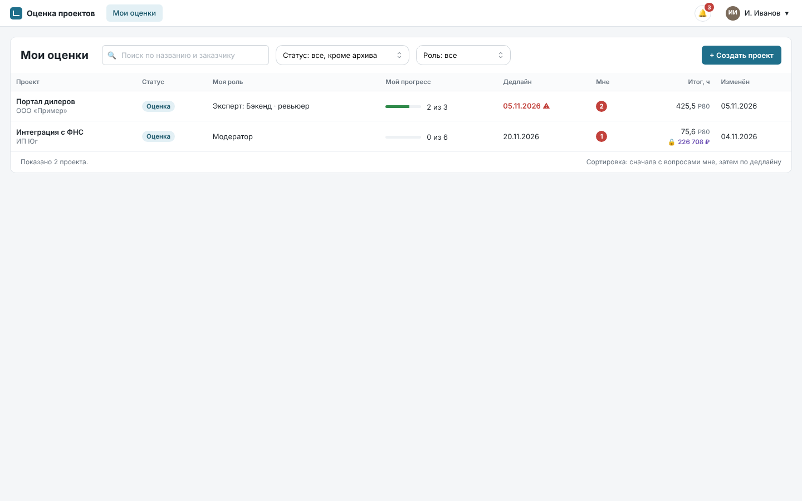
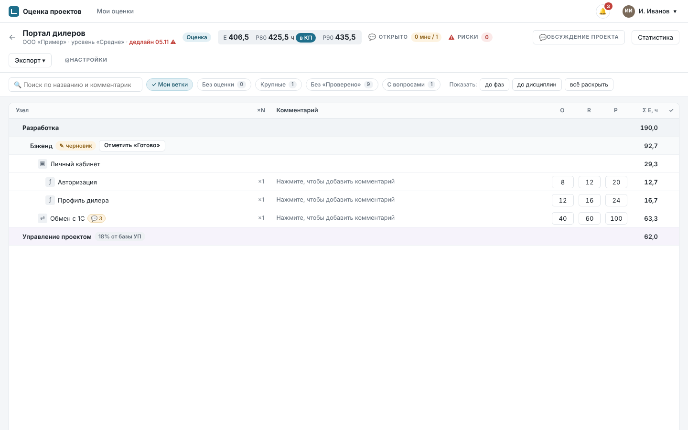
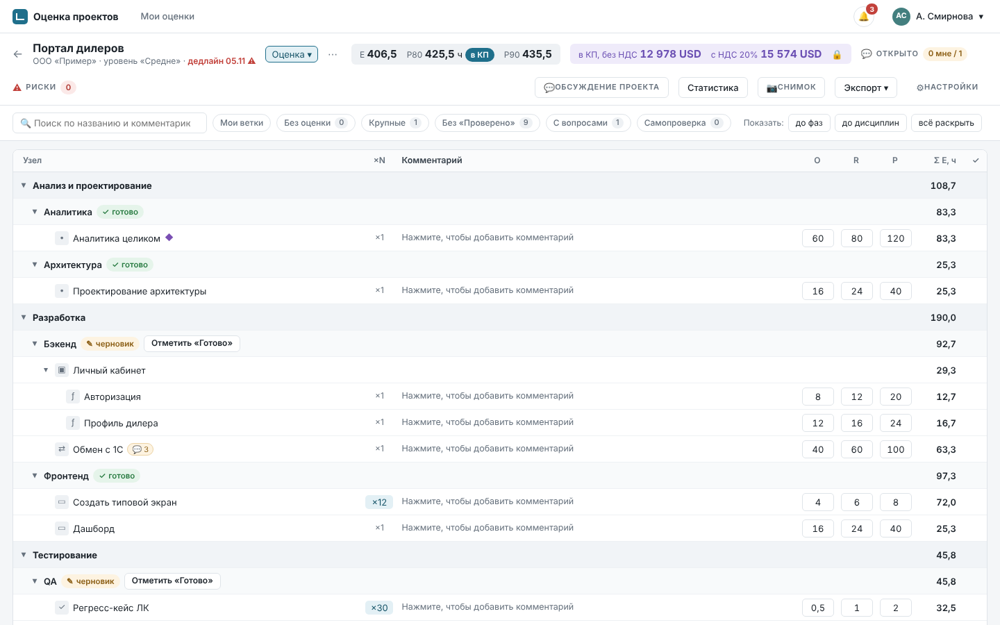
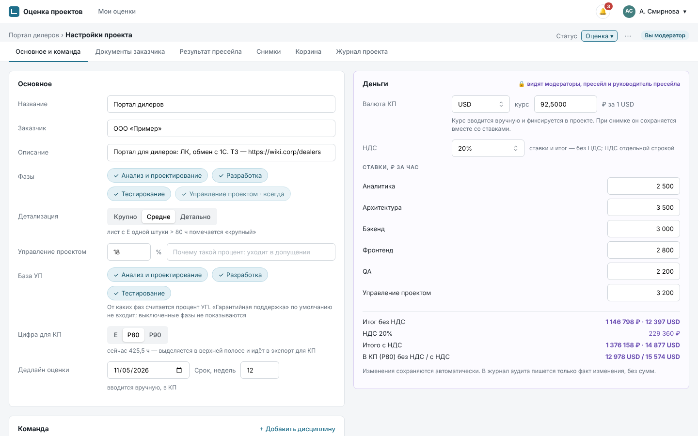
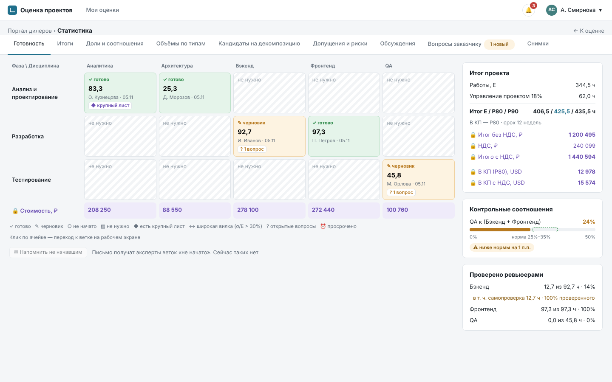
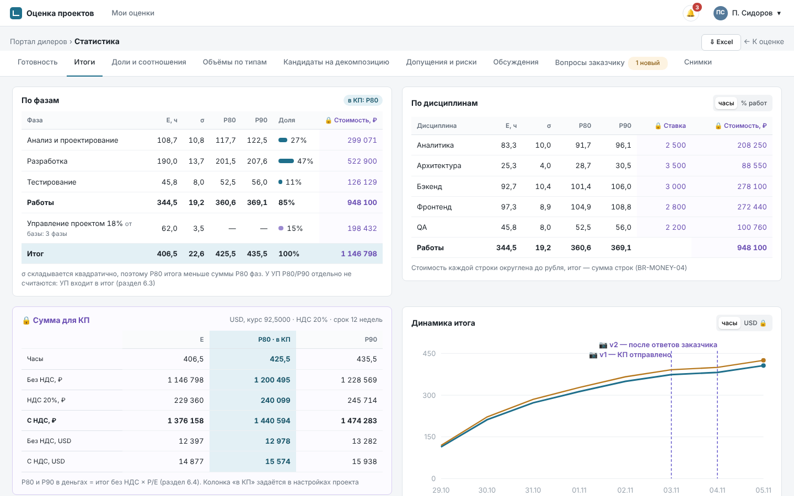
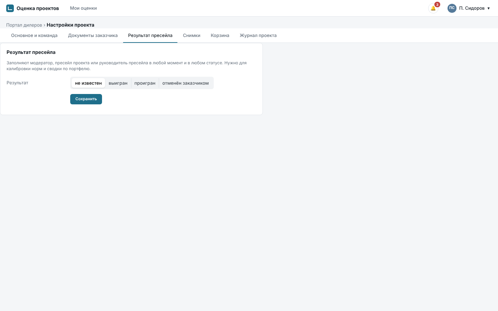
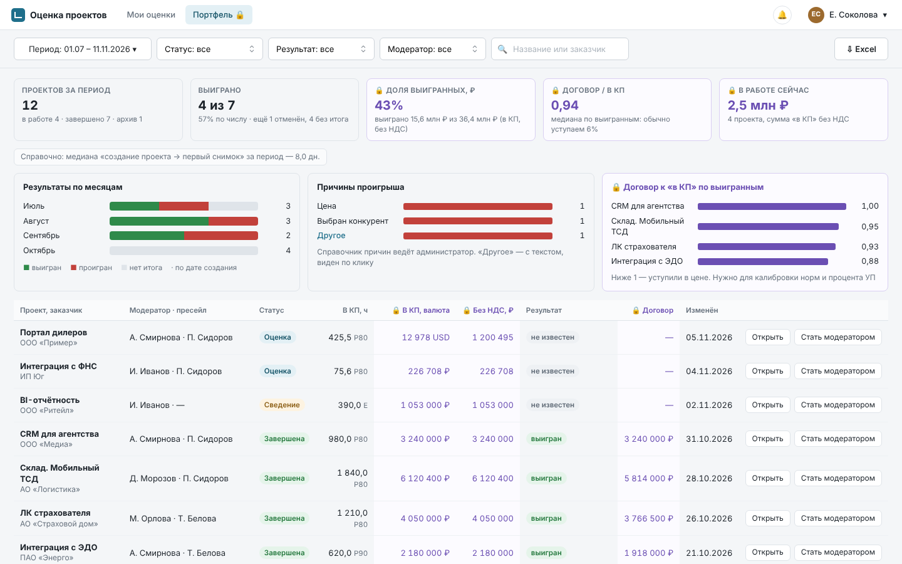
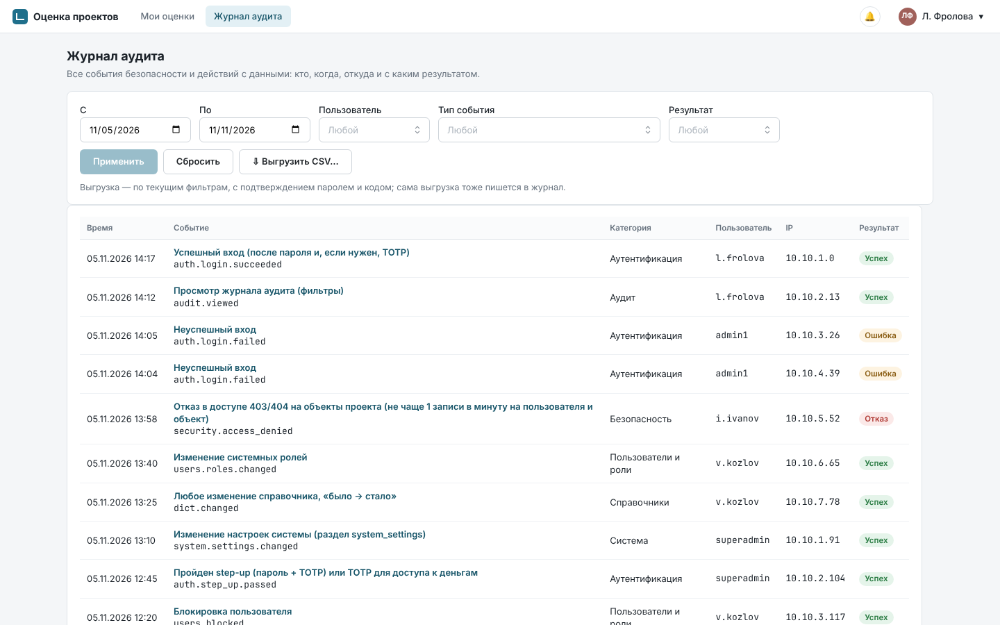
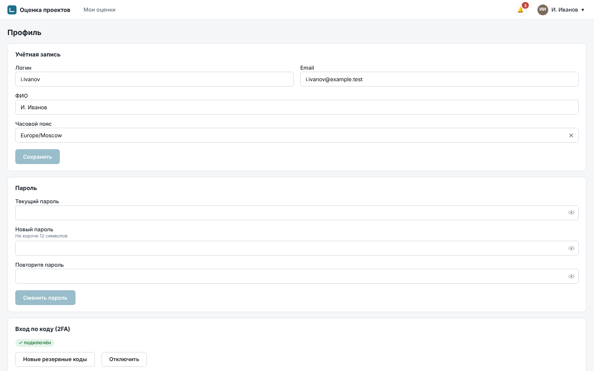

# Руководство пользователя

Приложение оценки проектов: эксперты оценивают свои дисциплины в одном общем дереве, модератор
сводит оценку, пресейл получает цифру для КП. Основание: SPEC 4.5, 8–10, 18.2. Снимки экранов
сделаны на демо-данных.

Разделы по ролям — читайте свой:

1. [Эксперт: первые 10 минут](#1-эксперт-первые-10-минут)
2. [Модератор](#2-модератор)
3. [Пресейл](#3-пресейл)
4. [Руководитель пресейла](#4-руководитель-пресейла)
5. [Аудитор ИБ](#5-аудитор-иб)
6. [Профиль и уведомления — для всех](#6-профиль-и-уведомления)

## 1. Эксперт: первые 10 минут

**Вход.** Письмо «Вас назначили в проект» ведёт в приложение. Войдите логином и паролем (рабочим
паролем AD или паролем приложения — как принято в компании). Если попросит, подключите второй
фактор: отсканируйте QR-код приложением-аутентификатором (Яндекс Ключ, Google Authenticator) и
сохраните резервные коды.

**«Мои оценки»** — проекты, где вы участвуете: ваша роль и дисциплины, прогресс ваших веток,
дедлайн (красный, если осталось 2 рабочих дня или меньше) и счётчик «Мне» — вопросы вам и ответы на
ваши вопросы. Откройте проект.

**Рабочий экран** — дерево оценки: фаза → дисциплина → узлы → листья. Фильтр «Мои ветки» включён:
видны только ветки ваших дисциплин. Чужие ветки можно смотреть, но не править.

**Построить ветку.** Наведите на строку своей дисциплины и нажмите «+»:

- «Дочерний узел» — модуль, функция, экран (тип подсказывается по профилю ветки);
- «Лист рядом» — ещё одна работа на том же уровне;
- у листа «Дочерний узел» означает «разбить» его на части.

Узлы с детьми суммируются сами, оценку ставят только листьям. Нужного типа нет — «+ Свой тип в
проекте…».

**Оценить лист — O, R, P в часах на одну штуку:**

| Поле | Что вписать |
|---|---|
| O | оптимистично: всё пошло гладко |
| R | реалистично: как обычно |
| P | пессимистично: всё, что может, пошло не так |
| ×N | сколько таких штук (например, 12 типовых экранов) |

- Tab переходит O → R → P → Комментарий → O следующего листа, Enter сохраняет, Esc отменяет.
- Быстро: впишите в O вилку `8-12-20` — она разложится по трём полям.
- Шаг 0,5 ч. Должно быть O ≤ R ≤ P: иначе строка красная и в сумму не входит.
- Пустой лист подсвечен и подписан «не учтён».
- Сохраняется сразу, кнопки «Сохранить» нет. Отменить правку можно через «История» листа.

**Комментарий** — что заложено в оценку: «Допущение: обмен через REST, формат согласуем». Строке
можно дать метку (Допущение, Риск, Технология, Ограничение): она попадёт в соответствующий список
статистики и выгрузок.

**Задать вопрос.** Значок 💬 у строки раскрывает обсуждение. Напишите вопрос, отметьте «нужен
ответ» и укажите адресата через @: `@Бэкенд` (эксперты дисциплины), `@Иван Петров` (участник проекта),
`@модератор` (все модераторы), `@заказчик` (вопрос уйдёт пресейлу для отправки заказчику). Не ждите ответа: поставьте
широкую вилку и запишите допущение в комментарий. Когда ответят, придёт уведомление, и ссылка
приведёт прямо к строке.

**«Готово».** Когда ветка оценена, нажмите «Отметить «Готово»» у строки дисциплины. Кнопка
неактивна, пока есть пустые или неверные листья (фильтр «Без оценки» их покажет). Открытые вопросы
«Готово» не блокируют. Если потом изменить цифры, ветка вернётся в «черновик», а модератор получит
уведомление.

**Вместе с коллегами.** Правки других видны сразу. Ячейка, которую сейчас правит коллега, обведена
его цветом — подождите несколько секунд. Если пропала связь, вверху жёлтая полоса «Нет связи»:
правки не сохраняются, пока она не исчезнет.

**Ревьюер** (если вы им назначены) ставит «Проверено» в последнем столбце: на лист или узел целиком.
Любая правка цифр снимает отметку. Отметка на собственной правке считается «самопроверкой».

**Нельзя и не нужно:** видеть ставки и деньги, править чужие ветки, удалять сообщения (можно
отозвать своё, пока на него не ответили).

## 2. Модератор

Модератор создаёт проект, собирает команду, следит за готовностью и сводит оценку. Видит деньги
(после ввода кода второго фактора) и правит любые ветки.

**Создать проект** — «+ Создать проект» на «Моих оценках»: название, заказчик, фазы, уровень
детализации (Крупно, Средне, Детально), процент управления проектом (УП), цифра для КП (E, P80 или
P90), дедлайн. Проект создаётся в статусе «Подготовка»: его видят только модераторы.

**Настройки проекта** (⚙ «Настройки»):

- «Основное и команда» — параметры, дисциплины, эксперты по дисциплинам, ревьюеры, пресейл
  (до 3), второй модератор; ставки дисциплин и УП, валюта и курс КП, ставка НДС.
- «Документы заказчика» — PDF, DOCX, XLSX; файлы проверяются антивирусом.
- «Снимки», «Корзина» (удалённые узлы, восстановление), «Журнал проекта» (все изменения).

**Статусы.** Кнопка статуса в верхней полосе:

| Статус | Что происходит | Как перейти дальше |
|---|---|---|
| Подготовка | настройка и команда; эксперты проект не видят | «Запустить оценку» — команда получит письма |
| Оценка | эксперты работают | когда все ветки «готово» или «не нужно», появится предложение перейти к сведению |
| Сведение | вы правите и проверяете; эксперты могут править, «готово» при этом снимается | «Завершить» или вернуть в оценку |
| Завершена | только чтение; вопросы заказчику и «Результат пресейла» ведутся дальше | переоткрыть или в архив (автоматически через 180 дней) |
| Архив | только чтение и копирование веток | восстановить в «Завершена» |

Отменить проект — «Отменить проект…» с причиной (уходит в архив). Удалить проект через интерфейс
нельзя.

**Сводить оценку.** «Статистика» → сетка готовности (фаза × дисциплина), итоги, доли дисциплин,
сравнение с нормами соотношений, списки допущений и рисков, вопросы заказчику. Клик по строке ведёт
в дерево. Ветку, которая проекту не нужна, отметьте «не нужно».

**Снимок** («📷 Снимок») — неизменная копия оценки, например «v1 — КП отправлено». Снимки можно
сравнивать между собой и с текущим деревом.

**Экспорт** — Excel «Часы» (для всех) и «С деньгами», вопросы заказчику в Word. На каждом файле
гриф «Коммерческая тайна» и ФИО выгрузившего.

**Закрытые заметки** (🔒) — внутренние соображения о цене и переговорах на проекте и у каждого узла.
Их видят только модераторы, пресейл и руководитель пресейла, эксперты — нет.

## 3. Пресейл

Пресейл видит экран модератора с деньгами, но правит только обсуждения, закрытые заметки,
документы заказчика, вопросы заказчику и «Результат пресейла». Дерево и цифры — только чтение.

**Вопросы заказчику.** Вопросы с адресатом `@заказчик` собираются в «Статистика» → «Вопросы
заказчику» с номерами В-001, В-002…

1. Выгрузите список в Word (в нём нет денег и внутренних обсуждений) и отправьте заказчику; или
   отметьте вопросы отправленными вручную. После отправки автор уже не может править свой вопрос —
   только вы и модератор.
2. Ответ заказчика внесите кнопкой «Внести ответ заказчика» в тот же вопрос. Автор получит
   уведомление и закроет вопрос.

**Цифра для КП.** «Статистика» → «Итоги»: часы и деньги по дисциплинам, сумма без НДС и с НДС в
валюте КП. Если ставка дисциплины не задана, вместо суммы — «не заданы ставки: …»: попросите
модератора.

**Результат пресейла** («Настройки» → «Результат пресейла»): выигран (с суммой договора), проигран
(с причиной), отменён заказчиком. Заполняйте, когда результат стал известен: по нему калибруются
нормы и строится сводка по портфелю.

## 4. Руководитель пресейла

Пункт «Портфель 🔒» в меню — все проекты компании с деньгами: статус, цифра для КП в часах и
деньгах, модераторы, пресейл, результат. Сводка за период — число проектов по статусам и
результатам, сумма оценок и договоров.

- Любой проект открывается на чтение с деньгами и закрытыми заметками. Первое за сессию открытие
  чужого проекта пишется в журнал аудита.
- «Стать модератором проекта» — добавляет в команду модератором только вас (кроме архивных
  проектов). Других модераторов назначает модератор проекта или администратор.
- «Результат пресейла» можно заполнить в любом проекте.

## 5. Аудитор ИБ

Аудитор ИБ видит только «Журнал аудита»: все события безопасности и действий с данными, включая
действия суперадминистраторов. Проектов и денег аудитор не видит.

- Фильтры: период, пользователь, тип события, результат («Успех», «Ошибка», «Отказ»).
- Щелчок по строке — запись целиком: IP, браузер, объект, подробности. Значений денег, паролей и
  текста заметок в журнале нет — только факт изменения.
- «Выгрузить CSV…» — с паролем и кодом второго фактора; выгрузка тоже попадает в журнал.
- Сбой ежедневной проверки цепочки журнала суперадминистратор передаёт в ИБ: это признак подмены
  записей.

## 6. Профиль и уведомления

Меню с вашим именем → «Профиль»:

- **Пароль** (вход через приложение) — нужен текущий; после смены остальные ваши сессии
  завершатся. Забыли пароль — «Забыли пароль?» на странице входа.
- **Второй фактор** — подключить, получить новые резервные коды. Потеряли телефон и коды —
  обратитесь к администратору.
- **Сессии** — где вы вошли; любую можно завершить.
- **Уведомления** — какие письма получать и получать ли ежедневную сводку.

Колокольчик 🔔 в верхней полосе — события для вас: вопросы вам, ответы на ваши вопросы, изменения
модератора в ваших листьях. Клик по пункту открывает строку с обсуждением. В письмах — только
название проекта и счётчики, без цифр и текста.

Сессия закрывается после 60 минут бездействия (за 2 минуты приложение предложит продлить) и не
позже чем через 12 часов после входа.
